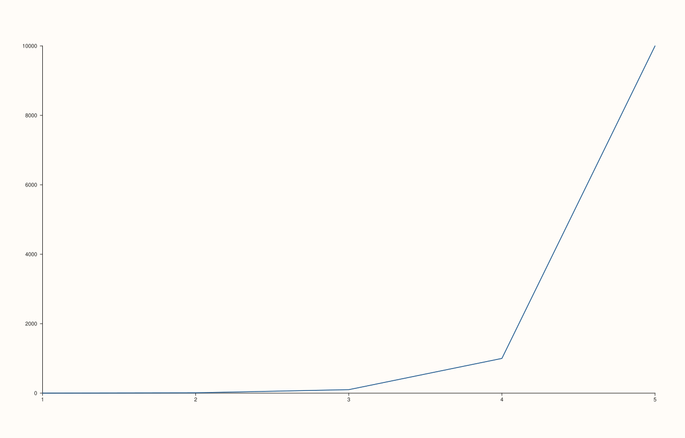
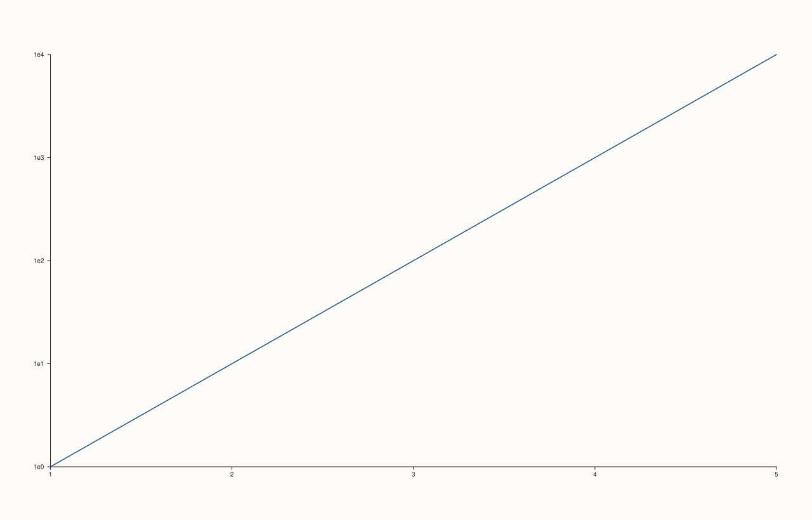
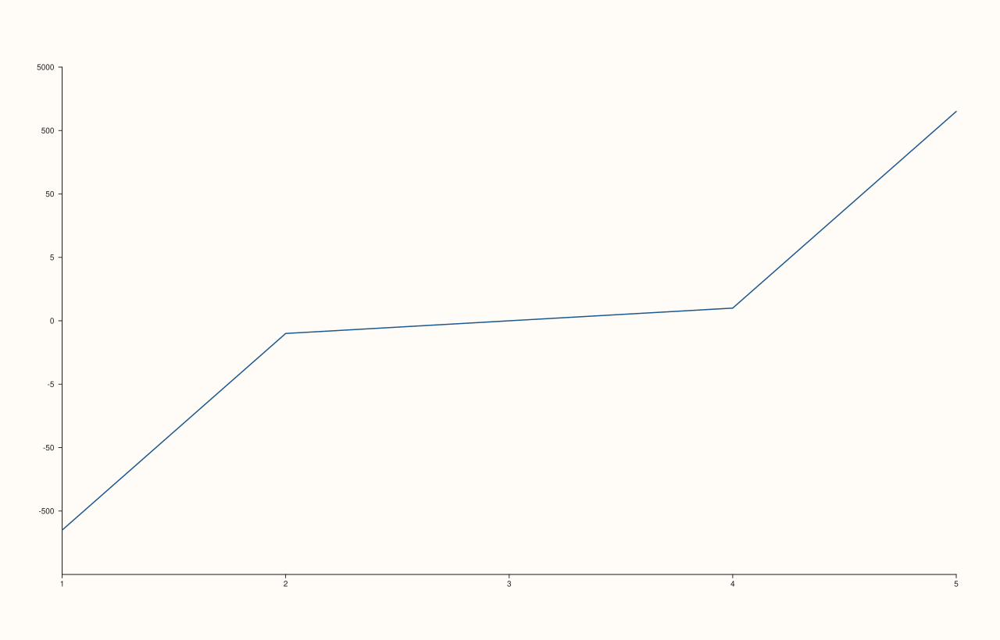

<!-- pluss-hand-authored -->

# Pane::scale_x

[Back to Pane API Reference](../../pane_api_reference)

## Signature

```cpp
Pane& Pane::scale_x(ScalePolicy scale)
```

## What It Does

Sets how the x-axis maps data values to screen positions — linear (the default), base-10
logarithmic, or symmetric-log (linear near zero, logarithmic further out, useful for data
that spans zero but also has a wide dynamic range on either side). This is purely a
**mapping** choice; it says nothing about which portion of the data range is shown — that's
[`x_limits()`](x_limits.md)'s job, and the two interact (see the important callout below).

`ScalePolicy` is a small struct with three fields (`kind`, `base`, `linear_threshold`) and
three static factories that are the normal way to build one:

- **`ScalePolicy::linear()`** — the default. `kind = ScaleKind::Linear`.
- **`ScalePolicy::log10()`** — `kind = ScaleKind::Log10`, `base = 10.0`. Requires all
  plotted x-values (and any explicit `x_limits()`) to be strictly positive.
- **`ScalePolicy::symlog(base = 10.0, threshold = 1.0)`** — `kind = ScaleKind::SymLog`.
  Linear within `[-threshold, threshold]`, logarithmic (in the given `base`) beyond it on
  both sides. The only variant with its own validated parameters — see the important
  callout below.

```{important} scale_x() and x_limits() validate against EACH OTHER, in whichever order they're called
Switching to `ScalePolicy::log10()` **after** [`x_limits()`](x_limits.md) has already set a
range that includes zero or negative values throws immediately — `scale_x()` checks the
*existing* limits for compatibility with the *new* scale. Conversely, calling
`x_limits()` with a non-positive range **after** `scale_x(ScalePolicy::log10())` is already
active throws too — `x_limits()` checks the new range against the *current* scale. Order
doesn't provide an escape hatch either way. See Example 5 and Example 6.
```

```{important} symlog validates its own two parameters
`ScalePolicy::symlog(base, threshold)` builds successfully with any values — validation
happens later, when the resulting `ScalePolicy` is actually passed to `scale_x()`/
`scale_y()`/`scale_z()`. At that point: `base` must be finite and greater than `1`, or
`scale_x()` throws `std::invalid_argument("scale_x: symlog base must be finite and
greater than 1")`; `linear_threshold` must be finite and positive, or it throws
`std::invalid_argument("scale_x: symlog linear threshold must be finite and positive")`.
See Example 4.
```

## Parameters

**scale** (`ScalePolicy`)
    The scale policy to apply — build one via `ScalePolicy::linear()`, `::log10()`, or
    `::symlog(base, threshold)`.

## Returns

`Pane&`
    A reference to the same pane, for chaining.

## Examples

Example 1. The default: `ScaleKind::Linear`, with no `scale_x()` call at all.

```cpp
using namespace pluss::pl;

auto fig = studio("scale_default_linear");
auto& pane = fig.pane2();
pane.trend(std::vector<double>{1.0, 2.0, 3.0, 4.0, 5.0}, std::vector<double>{1.0, 10.0, 100.0, 1000.0, 10000.0});
fig.show();

std::cout << static_cast<int>(pane.x_axis().scale.kind) << "\n";  // Linear == 0
```

### Output

```text
0
```



Example 2. `ScalePolicy::log10()` applied to the y-axis (via
[`scale_y()`](scale_y.md) — the same mechanics, mirrored) — the exponential growth in the
data becomes a straight line under a log scale.

```cpp
using namespace pluss::pl;

auto fig = studio("scale_log10");
auto& pane = fig.pane2();
pane.trend(std::vector<double>{1.0, 2.0, 3.0, 4.0, 5.0}, std::vector<double>{1.0, 10.0, 100.0, 1000.0, 10000.0});
pane.scale_y(ScalePolicy::log10());
fig.show();

std::cout << static_cast<int>(pane.y_axis().scale.kind) << "\n";  // Log10 == 1
```

### Output

```text
1
```



Example 3. `ScalePolicy::symlog(base, threshold)` — linear near zero, logarithmic beyond
`threshold`, suited to data that both crosses zero and spans a wide range.

```cpp
using namespace pluss::pl;

auto fig = studio("scale_symlog");
auto& pane = fig.pane2();
pane.trend(std::vector<double>{1.0, 2.0, 3.0, 4.0, 5.0}, std::vector<double>{-1000.0, -1.0, 0.0, 1.0, 1000.0});
pane.scale_y(ScalePolicy::symlog(10.0, 5.0));
fig.show();

std::cout << pane.y_axis().scale.base << " " << pane.y_axis().scale.linear_threshold << "\n";
```

### Output

```text
10 5
```



Example 4. Both `symlog` parameter validation failures.

```cpp
using namespace pluss::pl;

auto fig = studio("scale_bad_symlog");
auto& pane = fig.pane2();
pane.trend(std::vector<double>{1.0, 2.0}, std::vector<double>{1.0, 2.0});

try {
  pane.scale_y(ScalePolicy::symlog(0.5, 1.0));  // base must be > 1
} catch (const std::invalid_argument& e) {
  std::cout << e.what() << "\n";
}

try {
  pane.scale_y(ScalePolicy::symlog(10.0, -2.0));  // threshold must be positive
} catch (const std::invalid_argument& e) {
  std::cout << e.what() << "\n";
}
```

### Output

```text
scale_y: symlog base must be finite and greater than 1
scale_y: symlog linear threshold must be finite and positive
```

Example 5. Switching to `log10` **after** incompatible `y_limits()` are already set — the
existing limits are checked against the new scale.

```cpp
using namespace pluss::pl;

auto fig = studio("scale_log10_after_bad_limits");
auto& pane = fig.pane2();
pane.trend(std::vector<double>{1.0, 2.0}, std::vector<double>{1.0, 2.0});
pane.y_limits(Range1d{-5.0, 5.0});

try {
  pane.scale_y(ScalePolicy::log10());
} catch (const std::invalid_argument& e) {
  std::cout << e.what() << "\n";
}
```

### Output

```text
scale_y: log10 limits must be strictly positive
```

Example 6. The reverse ordering — `log10` is already active, then incompatible
`y_limits()` are attempted. Same underlying rule, checked from the other side. See
[`y_limits()`](y_limits.md) for the full details of this half of the check.

```cpp
using namespace pluss::pl;

auto fig = studio("scale_bad_limits_after_log10");
auto& pane = fig.pane2();
pane.trend(std::vector<double>{1.0, 2.0}, std::vector<double>{1.0, 2.0});
pane.scale_y(ScalePolicy::log10());

try {
  pane.y_limits(Range1d{-5.0, 5.0});
} catch (const std::invalid_argument& e) {
  std::cout << e.what() << "\n";
}
```

### Output

```text
y_limits: log10 limits must be strictly positive
```

## Notes

- Not `noexcept` — validates `symlog`'s two parameters, and cross-checks against any
  existing `x_limits()`.
- `ScaleKind::Linear` is `0`, `Log10` is `1`, `SymLog` is `2`.
- The `log10`/`x_limits()` compatibility check only fires when **both** a non-`Linear`
  scale (specifically `Log10`) and explicit limits are present — a `Linear` scale never
  rejects any range, including ones that cross zero.
- Purely a mapping choice — has no bearing on [`x_limit_method`](x_limit_method.md), which
  only governs how *auto-fit* padding is computed, independent of scale.

## See Also

- [`Pane::scale_y`](scale_y.md) / [`Pane::scale_z`](scale_z.md): the y- and z-axis
  equivalents (there is no `scale_color()` — [`color_limits`](color_limits.md) has no
  associated scale concept).
- [`Pane::x_limits`](x_limits.md): the range this scale maps, and the other half of the
  cross-validation described above.
- [`Pane::x_axis`](axis_accessors.md): reads back the full `AxisState`, including
  `scale`, in one place.

<div class="pluss-inline-prev-next">
  <a class="prev-link" href="lights.html">
    <span class="label">Previous</span>
    <span class="title">lights</span>
  </a>
  <a class="next-link" href="scale_y.html">
    <span class="label">Next</span>
    <span class="title">scale_y</span>
  </a>
</div>
