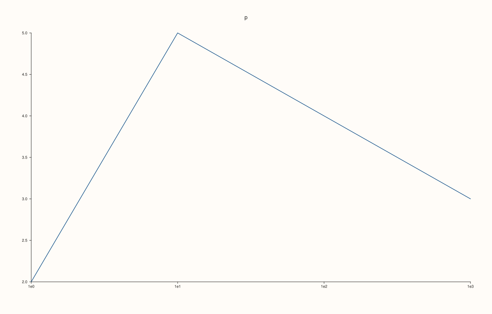
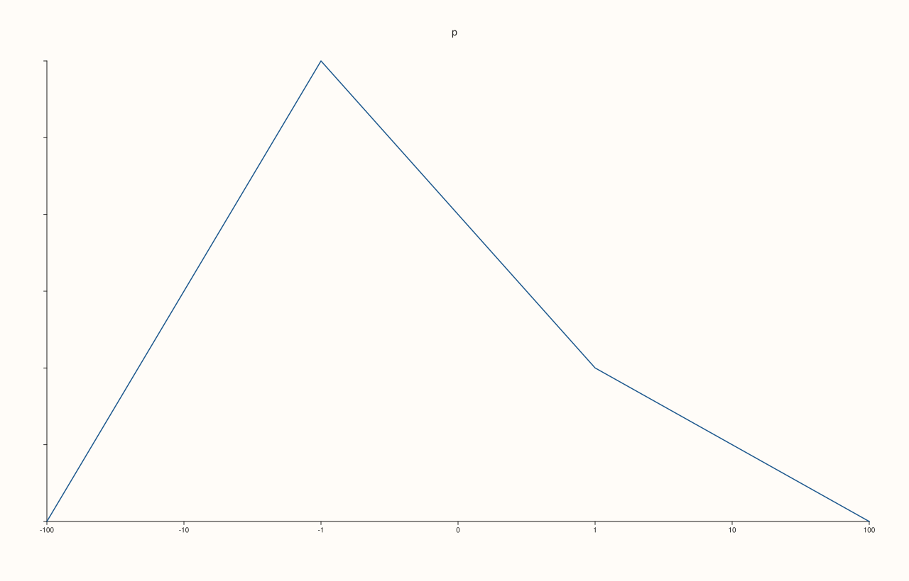
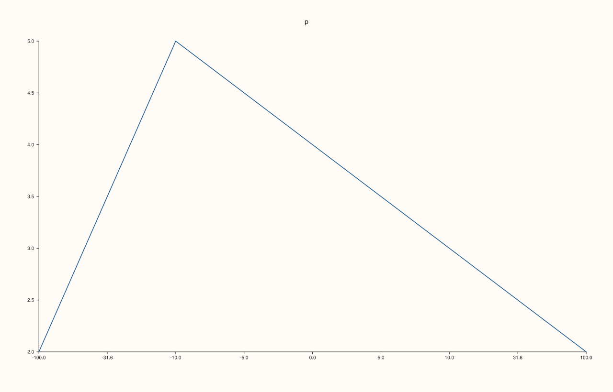
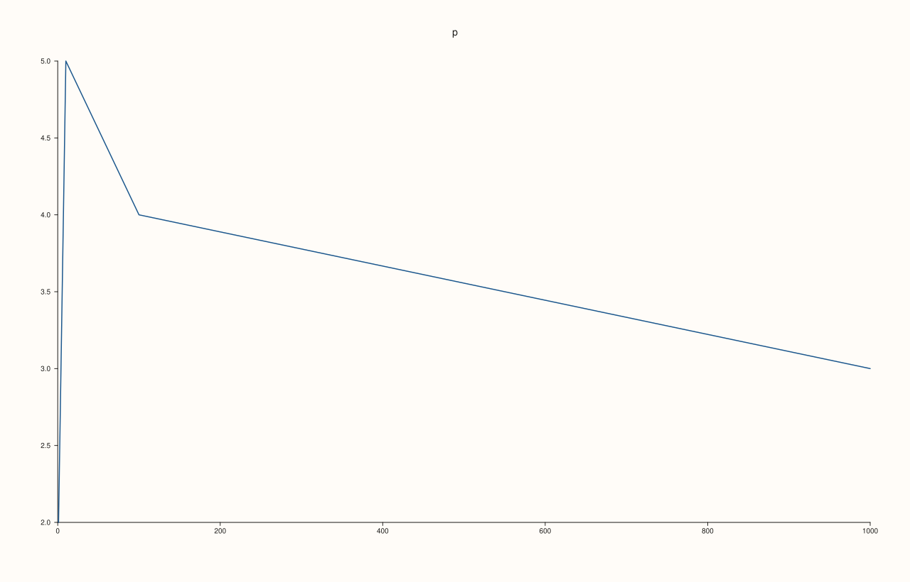
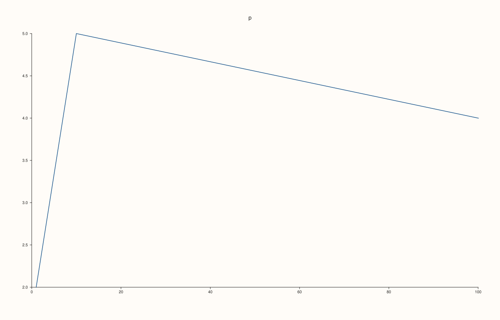

<!-- pluss-hand-authored -->

# Pane::scale_x

[Back to Pane API Reference](../../pane_api_reference)

## Signature

```cpp
Pane& Pane::scale_x(ScalePolicy scale)
```

## What It Does

Sets how values are spread along the x axis. `ScalePolicy::linear()` (the default) spaces values evenly; `ScalePolicy::log10()` spaces them by their base-10 logarithm, so equal ratios take equal distances and the ticks are powers of ten, which suits data across several orders of magnitude; `ScalePolicy::symlog(base, threshold)` is logarithmic beyond `threshold` and linear inside it, symmetric about zero, so it can show negative values, zero and large values on one axis. The policy is stored in `x_axis().scale` and is read when the figure is rendered.

A policy is refused with `pluss::Error`, leaving the previous scale in place, when it cannot be drawn: a symmetric-log `base` must be finite and greater than 1, its `linear_threshold` finite and positive, and `log10` cannot be combined with a manual range ([`x_limits`](x_limits.md)) that includes zero or negative values. The reverse order is refused too: with `log10` active, a range that is not strictly positive is rejected by `x_limits`.

## Parameters

**scale** (`ScalePolicy`)
    `ScalePolicy::linear()`, `ScalePolicy::log10()` or `ScalePolicy::symlog(base = 10, linear_threshold = 1)`.

## Returns

`Pane&`
    The same pane, for chaining.

## Examples

Example 1. Linear by default. A new axis reports `Linear` (0); `log10` is 1 and `symlog` is 2; each call is read back and the last wins.

```cpp
auto fig = studio("scale_x_readback");
auto& pane = fig.pane2("p");
pane.trend(std::vector<double>{1, 2, 3, 4}, std::vector<double>{2, 5, 4, 3});
std::cout << "new axis: " << static_cast<int>(pane.x_axis().scale.kind) << " (Linear = 0)\n";
pane.scale_x(ScalePolicy::log10());
std::cout << "log10: " << static_cast<int>(pane.x_axis().scale.kind) << "\n";
pane.scale_x(ScalePolicy::symlog(10.0, 1.0));
std::cout << "symlog: " << static_cast<int>(pane.x_axis().scale.kind) << ", base " << pane.x_axis().scale.base << ", threshold " << pane.x_axis().scale.linear_threshold << "\n";
pane.scale_x(ScalePolicy::linear());
std::cout << "linear again: " << static_cast<int>(pane.x_axis().scale.kind) << "\n";
fig.save_svg("figure.svg");
```

### Output

```text
new axis: 0 (Linear = 0)
log10: 1
symlog: 2, base 10, threshold 1
linear again: 0
```


Example 2. A logarithmic axis. Data spanning three decades is spread evenly on a log10 axis and the ticks are written as powers of ten; the same data on the default linear axis crowds the small values together.

```cpp
auto texts = [](const std::string& svg) {
  std::string out;
  for (std::size_t at = svg.find("<text"); at != std::string::npos; at = svg.find("<text", at + 1)) {
    const auto gt = svg.find('>', at);
    out += svg.substr(gt + 1, svg.find("</text>", gt) - gt - 1) + " ";
  }
  return out;
};
auto build = [&](bool log) {
  auto fig = studio("scale_x_log");
  auto& pane = fig.pane2("p");
  pane.trend(std::vector<double>{1, 10, 100, 1000}, std::vector<double>{2, 5, 4, 3});
  pane.y_tick_labels(false);
  pane.z_tick_labels(false);
  if (log) pane.scale_x(ScalePolicy::log10());
  return fig.to_svg();
};
std::cout << "linear ticks: " << texts(build(false)) << "\n";
std::cout << "log10 ticks:  " << texts(build(true)) << "\n";
auto fig = studio("scale_x_log_out");
auto& pane = fig.pane2("p");
pane.trend(std::vector<double>{1, 10, 100, 1000}, std::vector<double>{2, 5, 4, 3});
pane.scale_x(ScalePolicy::log10());
fig.save_svg("figure.svg");
```

### Output

```text
linear ticks: p 0 200 400 600 800 1000 
log10 ticks:  p 1e0 1e1 1e2 1e3 
```



Example 3. A symmetric-log axis. Values on both sides of zero, from -100 to 100, are shown logarithmically beyond the linear threshold and linearly inside it, so negative values, zero and large values share one axis.

```cpp
auto texts = [](const std::string& svg) {
  std::string out;
  for (std::size_t at = svg.find("<text"); at != std::string::npos; at = svg.find("<text", at + 1)) {
    const auto gt = svg.find('>', at);
    out += svg.substr(gt + 1, svg.find("</text>", gt) - gt - 1) + " ";
  }
  return out;
};
auto fig = studio("scale_x_symlog");
auto& pane = fig.pane2("p");
pane.trend(std::vector<double>{-100, -1, 0, 1, 100}, std::vector<double>{2, 5, 4, 3, 2});
pane.y_tick_labels(false);
pane.z_tick_labels(false);
pane.scale_x(ScalePolicy::symlog());
std::cout << texts(fig.to_svg()) << "\n";
fig.save_svg("figure.svg");
```

### Output

```text
p -100 -10 -1 0 1 10 100 
```



Example 4. The symmetric-log parameters. The base and the linear threshold shape the curve; changing either changes the figure, and the stored policy reads back what was given.

```cpp
auto build = [&](double base, double threshold) {
  auto fig = studio("scale_x_symlog_params");
  auto& pane = fig.pane2("p");
  pane.trend(std::vector<double>{-100, -10, 0, 10, 100}, std::vector<double>{2, 5, 4, 3, 2});
  pane.scale_x(ScalePolicy::symlog(base, threshold));
  return fig.to_svg();
};
std::cout << "base 10 vs 2: " << (build(10.0, 1.0) != build(2.0, 1.0)) << ", threshold 1 vs 10: " << (build(10.0, 1.0) != build(10.0, 10.0)) << "\n";
auto fig = studio("scale_x_symlog_params_out");
auto& pane = fig.pane2("p");
pane.trend(std::vector<double>{-100, -10, 0, 10, 100}, std::vector<double>{2, 5, 4, 3, 2});
pane.scale_x(ScalePolicy::symlog(10.0, 10.0));
std::cout << "stored: base " << pane.x_axis().scale.base << ", threshold " << pane.x_axis().scale.linear_threshold << "\n";
fig.save_svg("figure.svg");
```

### Output

```text
base 10 vs 2: 1, threshold 1 vs 10: 1
stored: base 10, threshold 10
```



Example 5. Linear is the default. Setting `ScalePolicy::linear()` gives exactly the figure of an axis that never set a scale, and switching back from log restores it.

```cpp
auto build = [&](int mode) {
  auto fig = studio("scale_x_default");
  auto& pane = fig.pane2("p");
  pane.trend(std::vector<double>{1, 10, 100, 1000}, std::vector<double>{2, 5, 4, 3});
  if (mode == 1) pane.scale_x(ScalePolicy::linear());
  if (mode == 2) pane.scale_x(ScalePolicy::log10()).scale_x(ScalePolicy::linear());
  return fig.to_svg();
};
std::cout << "linear() == default: " << (build(1) == build(0)) << ", log then linear == default: " << (build(2) == build(0)) << "\n";
auto fig = studio("scale_x_default_out");
auto& pane = fig.pane2("p");
pane.trend(std::vector<double>{1, 10, 100, 1000}, std::vector<double>{2, 5, 4, 3});
fig.save_svg("figure.svg");
```

### Output

```text
linear() == default: 1, log then linear == default: 1
```



Example 6. Invalid policies are refused and the previous scale is kept. A symmetric-log base that is not greater than 1 (or not finite) and a threshold that is not positive throw `pluss::Error`; so does switching to log10 while a manual range that includes zero is set.

```cpp
auto fig = studio("scale_x_invalid");
auto& pane = fig.pane2("p");
pane.trend(std::vector<double>{1, 10, 100, 1000}, std::vector<double>{2, 5, 4, 3});
auto attempt = [&](const char* label, auto call) {
  try {
    call();
  } catch (const pluss::Error& e) {
    std::cout << label << ": " << e.message() << "\n";
  }
};
attempt("base 1", [&] { pane.scale_x(ScalePolicy::symlog(1.0, 1.0)); });
attempt("base 0.5", [&] { pane.scale_x(ScalePolicy::symlog(0.5, 1.0)); });
attempt("threshold 0", [&] { pane.scale_x(ScalePolicy::symlog(10.0, 0.0)); });
attempt("threshold -1", [&] { pane.scale_x(ScalePolicy::symlog(10.0, -1.0)); });
attempt("base nan", [&] { pane.scale_x(ScalePolicy::symlog(std::numeric_limits<double>::quiet_NaN(), 1.0)); });
pane.x_limits(Range1d{0.0, 100.0});
attempt("log10 over a range that includes zero", [&] { pane.scale_x(ScalePolicy::log10()); });
std::cout << "scale kept: " << static_cast<int>(pane.x_axis().scale.kind) << " (Linear = 0)\n";
fig.save_svg("figure.svg");
```

### Output

```text
base 1: scale_x: symlog base must be finite and greater than 1
base 0.5: scale_x: symlog base must be finite and greater than 1
threshold 0: scale_x: symlog linear threshold must be finite and positive
threshold -1: scale_x: symlog linear threshold must be finite and positive
base nan: scale_x: symlog base must be finite and greater than 1
log10 over a range that includes zero: scale_x: log10 limits must be strictly positive
scale kept: 0 (Linear = 0)
```



## Notes

- Not `noexcept`: it throws for invalid policies.
- Data that cannot be placed on the scale (zero or negative values on a log axis) does not stretch the range; use `symlog` for data that crosses zero.

## See Also

- [`Pane::x_limits`](x_limits.md): a manual range, which must be positive on a log axis.
- [`Pane::x_tick_format`](x_tick_format.md): how tick numbers are written.
- [`ScalePolicy`](../types/ScalePolicy.md): the policies and their parameters.
- [`Pane::scale_y`](scale_y.md): the same setting for the y axis.
- [`Pane::scale_z`](scale_z.md): the same setting for the z axis.

<div class="pluss-inline-prev-next">
  <a class="prev-link" href="scale_guide.html">
    <span class="label">Previous</span>
    <span class="title">scale_guide</span>
  </a>
  <a class="next-link" href="scale_y.html">
    <span class="label">Next</span>
    <span class="title">scale_y</span>
  </a>
</div>
