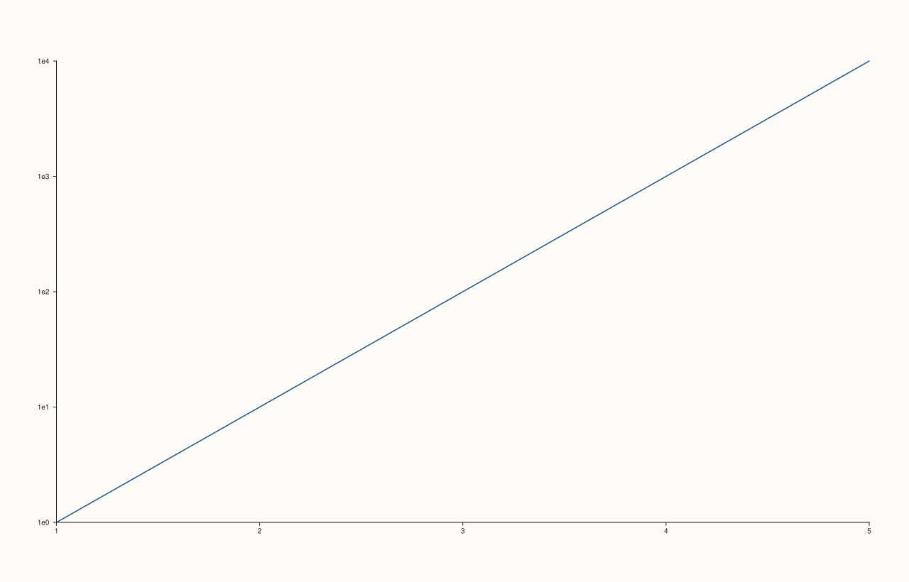
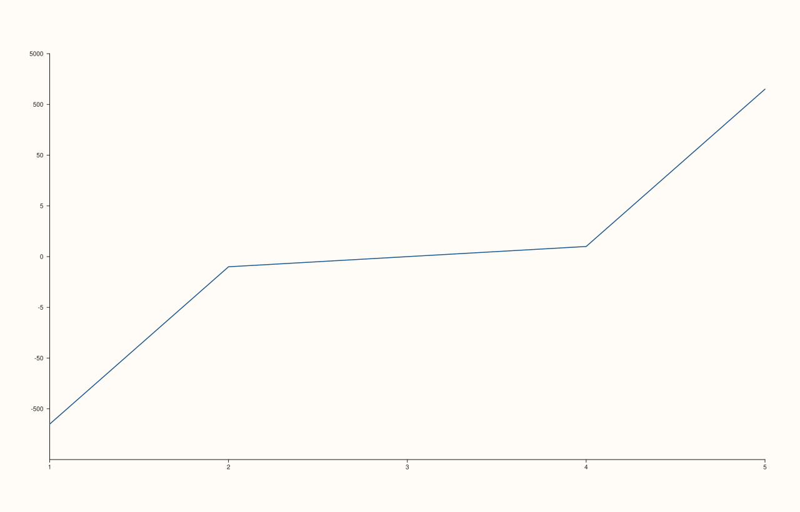

<!-- pluss-hand-authored -->

# Pane::scale_y

[Back to Pane API Reference](../../pane_api_reference)

## Signature

```cpp
Pane& Pane::scale_y(ScalePolicy scale)
```

## What It Does

The y-axis counterpart of [`scale_x()`](scale_x.md): sets how the y-axis maps data values
to screen positions (`ScalePolicy::linear()`/`::log10()`/`::symlog(base, threshold)`).
Every behavioral detail from `scale_x()` carries over unchanged, with `"scale_y"` in place
of `"scale_x"` in every throw message:

- `symlog`'s `base` must be finite and `> 1`; `linear_threshold` must be finite and
  positive — checked when the `ScalePolicy` is passed in, not when it's built.
- Switching to `log10` after incompatible [`y_limits()`](y_limits.md) are already set
  throws; so does setting incompatible `y_limits()` after `log10` is already active —
  cross-validated in both directions, regardless of call order.

All of `scale_x()`'s examples in this documentation set are in fact written against
`scale_y()` already (the mechanics are identical regardless of which axis is used) — see
that page for the full set of worked examples, including both symlog validation failures
and both directions of the scale/limits cross-check.

## Parameters

**scale** (`ScalePolicy`)
    The scale policy to apply.

## Returns

`Pane&`
    A reference to the same pane, for chaining.

## Examples

Example 1. `ScalePolicy::log10()` on the y-axis — exponential growth becomes a straight
line.

```cpp
using namespace pluss::pl;

auto fig = studio("scale_log10");
auto& pane = fig.pane2();
pane.trend(std::vector<double>{1.0, 2.0, 3.0, 4.0, 5.0}, std::vector<double>{1.0, 10.0, 100.0, 1000.0, 10000.0});
pane.scale_y(ScalePolicy::log10());
fig.show();

std::cout << static_cast<int>(pane.y_axis().scale.kind) << "\n";
```

### Output

```text
1
```



Example 2. `ScalePolicy::symlog(base, threshold)` — linear near zero, logarithmic beyond
the threshold, on data that crosses zero.

```cpp
using namespace pluss::pl;

auto fig = studio("scale_symlog");
auto& pane = fig.pane2();
pane.trend(std::vector<double>{1.0, 2.0, 3.0, 4.0, 5.0}, std::vector<double>{-1000.0, -1.0, 0.0, 1.0, 1000.0});
pane.scale_y(ScalePolicy::symlog(10.0, 5.0));
fig.show();

std::cout << pane.y_axis().scale.base << " " << pane.y_axis().scale.linear_threshold << "\n";
```

### Output

```text
10 5
```



## Notes

See [`scale_x()`](scale_x.md)'s Notes — every detail (enum values, when the cross-check
fires, independence from `y_limit_method`) applies identically here.

## See Also

- [`Pane::scale_x`](scale_x.md): the x-axis equivalent, with the full worked-example set
  for both validation failure modes.
- [`Pane::scale_z`](scale_z.md): the z-axis equivalent.
- [`Pane::y_limits`](y_limits.md): the range this scale maps.

<div class="pluss-inline-prev-next">
  <a class="prev-link" href="scale_x.html">
    <span class="label">Previous</span>
    <span class="title">scale_x</span>
  </a>
  <a class="next-link" href="scale_z.html">
    <span class="label">Next</span>
    <span class="title">scale_z</span>
  </a>
</div>
