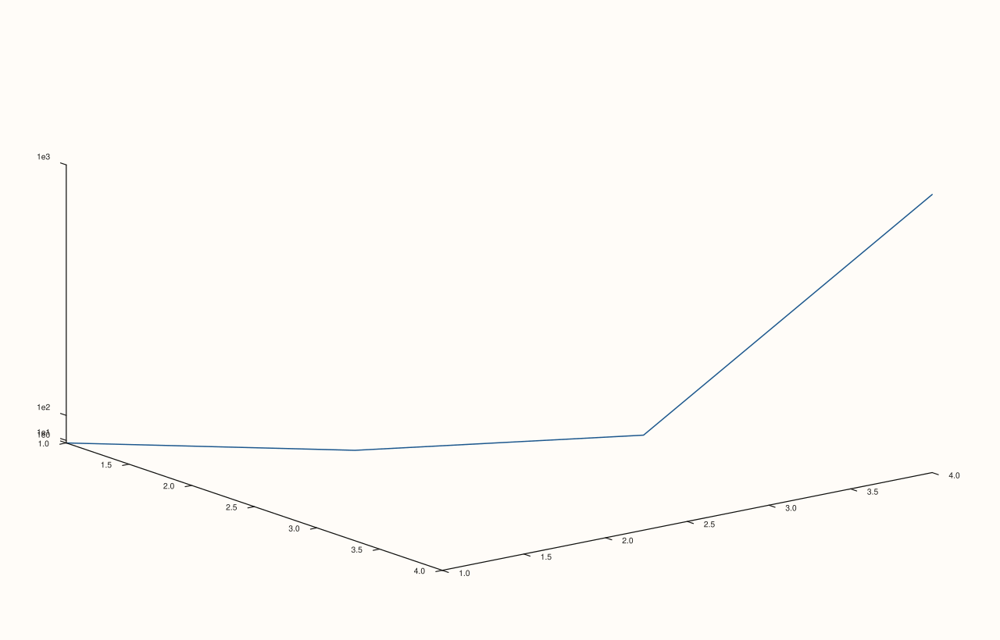

<!-- pluss-hand-authored -->

# Pane::scale_z

[Back to Pane API Reference](../../pane_api_reference)

## Signature

```cpp
Pane& Pane::scale_z(ScalePolicy scale)
```

## What It Does

The z-axis counterpart of [`scale_x()`](scale_x.md)/[`scale_y()`](scale_y.md): sets how the
z-axis maps data values to screen positions. Meaningful on 3D (`Volumetric`) panes; a 2D
(`Planar`) pane does carry a `z_axis()` state internally, but it plays no role in ordinary
2D rendering. Every validation detail from `scale_x()` carries over unchanged, with
`"scale_z"` in place of `"scale_x"` in throw messages — see that page for the full set of
worked examples covering both `symlog` validation failures and both directions of the
scale/[`z_limits()`](z_limits.md) cross-check.

## Parameters

**scale** (`ScalePolicy`)
    The scale policy to apply.

## Returns

`Pane&`
    A reference to the same pane, for chaining.

## Examples

Example 1. `ScalePolicy::log10()` on the z-axis of a 3D `path3` trace whose z-values span
three orders of magnitude.

```cpp
using namespace pluss::pl;

auto fig = studio("scale_z_log10");
auto& pane = fig.pane3();
pane.path3(std::vector<double>{1.0, 2.0, 3.0, 4.0}, std::vector<double>{1.0, 2.0, 3.0, 4.0}, std::vector<double>{1.0, 10.0, 100.0, 1000.0});
pane.scale_z(ScalePolicy::log10());
fig.show();

std::cout << static_cast<int>(pane.z_axis().scale.kind) << "\n";
```

### Output

```text
1
```



## Notes

See [`scale_x()`](scale_x.md)'s Notes — every detail applies identically here. Most useful
on 3D panes; on 2D panes the z-axis state exists but is inert.

## See Also

- [`Pane::scale_x`](scale_x.md): the x-axis equivalent, with the full worked-example set.
- [`Pane::scale_y`](scale_y.md): the y-axis equivalent.
- [`Pane::z_limits`](z_limits.md): the range this scale maps.

<div class="pluss-inline-prev-next">
  <a class="prev-link" href="scale_y.html">
    <span class="label">Previous</span>
    <span class="title">scale_y</span>
  </a>
  <a class="next-link" href="x_limits.html">
    <span class="label">Next</span>
    <span class="title">x_limits</span>
  </a>
</div>
