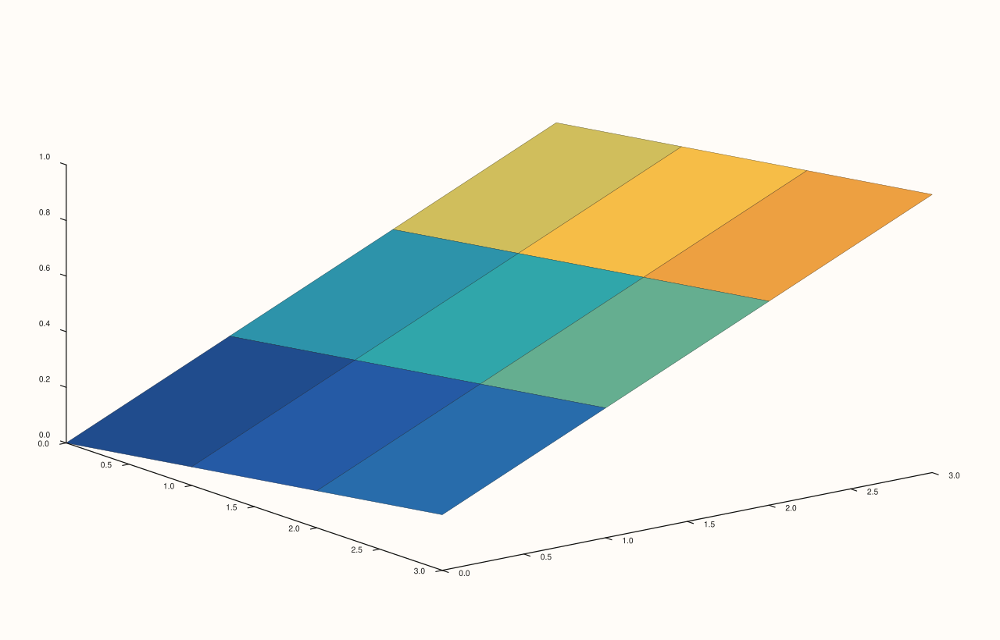
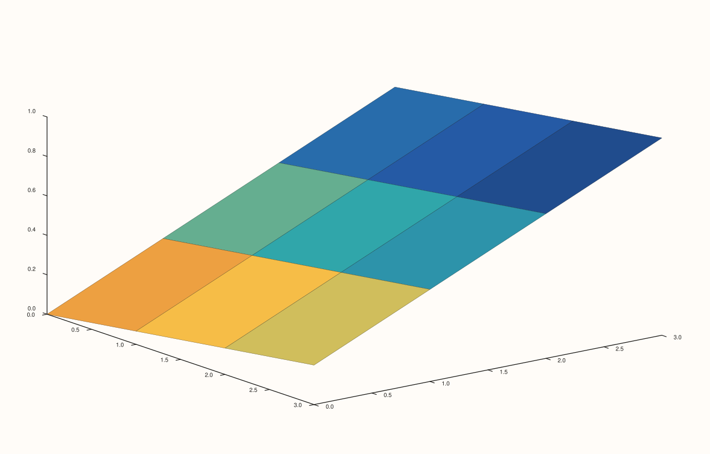

<!-- pluss-hand-authored -->

# Pane::sheet

[Back to Pane API Reference](../../pane_api_reference)

## Signatures

```cpp
template <class X, class Y, class Z>
Trace& Pane::sheet(X&& x, Y&& y, Z&& z)

template <class X, class Y, class Z, class C>
Trace& Pane::sheet(X&& x, Y&& y, Z&& z, C&& c)
```

## What It Does

Adds a continuous, filled 3D surface trace over a scalar field `z(x, y)` — a solid mesh
lofted through the grid of `(x[i], y[j], z(i,j))` points. Two overloads:

- **`sheet(x, y, z)`** — surface shape and fill color both come from `z`.
- **`sheet(x, y, z, c)`** — surface shape still comes from `z`; fill color comes from a
  separate matrix `c` instead, matching `z`'s shape.

```{important} Requires a Volumetric pane
Calling `sheet()` on a `Planar` pane throws
`std::logic_error("sheet requires a volumetric pane")`.
```

## Parameters

**x**, **y** (series-convertible)
    The grid's coordinate axes.

**z** (series-convertible, must be rank-2)
    The surface height at each `(x, y)` grid point.

**c** (series-convertible, must be rank-2 matching `z`'s shape, four-argument overload
only)
    A separate fill-color value per grid point, decoupled from `z`'s own height values.

## Returns

`Trace&`
    A reference to the newly created trace, for chaining.

## Examples

Example 1. A filled surface, colored directly from `z`.

```cpp
using namespace pluss::pl;

auto fig = studio("sheet_xyz");
auto& pane = fig.pane3();
auto z = pluss::series::linspace(0.0, 1.0, 16, pluss::ScalarType::Float64).reshape({4, 4});
pane.sheet(std::vector<double>{0.0, 1.0, 2.0, 3.0}, std::vector<double>{0.0, 1.0, 2.0, 3.0}, z);
fig.show();
```



Example 2. The same surface shape, colored from a separate reverse-gradient matrix `c`
instead. Verified via direct SVG diff to render genuinely different fill coloring from
Example 1, with the surface's shape unchanged.

```cpp
using namespace pluss::pl;

auto fig = studio("sheet_xyzc");
auto& pane = fig.pane3();
auto z = pluss::series::linspace(0.0, 1.0, 16, pluss::ScalarType::Float64).reshape({4, 4});
auto c = pluss::series::linspace(1.0, 0.0, 16, pluss::ScalarType::Float64).reshape({4, 4});
pane.sheet(std::vector<double>{0.0, 1.0, 2.0, 3.0}, std::vector<double>{0.0, 1.0, 2.0, 3.0}, z, c);
fig.show();
```



## Notes

- Not `noexcept`.
- `sheet()` shares its exact payload type (`SurfaceData`) and overload shape with
  [`lattice()`](lattice.md) — the two differ only in `TraceKind` (`Sheet` vs. `Lattice`),
  rendering as a filled solid surface versus a wireframe mesh respectively. See
  [`lattice()`](lattice.md)'s Notes for a verified, important divergence between the two:
  the separate-color-matrix `c` argument has an observed rendering effect on `sheet()`
  (confirmed above) but **no observed effect at all** on `lattice()`, even at an extreme
  color contrast — consistent with a pure wireframe having no filled area for a per-cell
  color to paint.
- `flash::surface3d` (if present) is a convenience wrapper around this exact method.

## See Also

- [`Pane::lattice`](lattice.md): the identical-payload wireframe-mesh sibling of this
  method.
- [`Pane::fieldmap`](fieldmap.md): the 2D `Planar` filled-color analogue.
- [`Pane::ridge3`](ridge3.md): a discrete-level-line alternative to a continuous filled
  surface, on the same `Volumetric` pane kind.

<div class="pluss-inline-prev-next">
  <a class="prev-link" href="isoshell.html">
    <span class="label">Previous</span>
    <span class="title">isoshell</span>
  </a>
  <a class="next-link" href="lattice.html">
    <span class="label">Next</span>
    <span class="title">lattice</span>
  </a>
</div>
