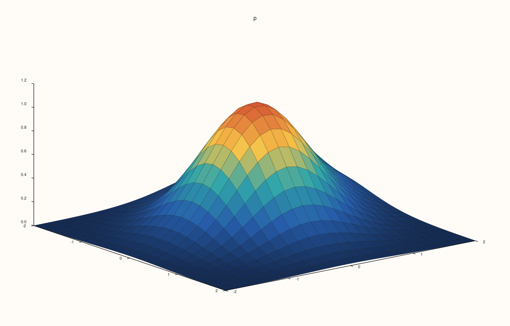
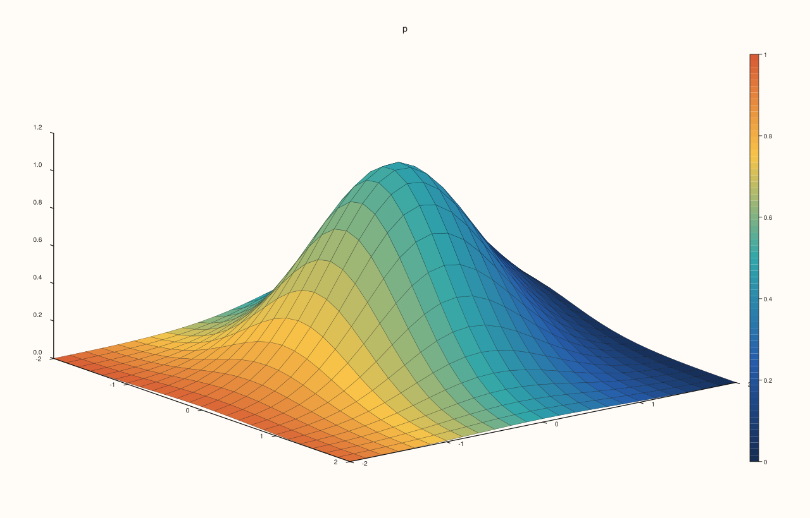
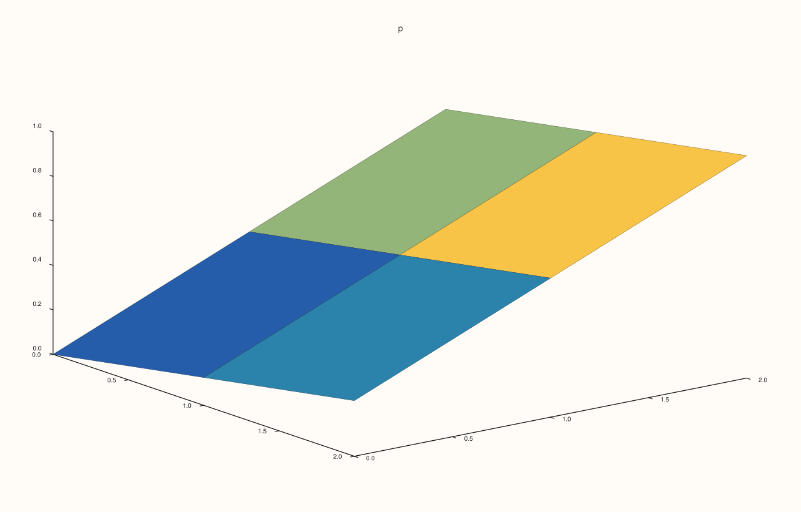
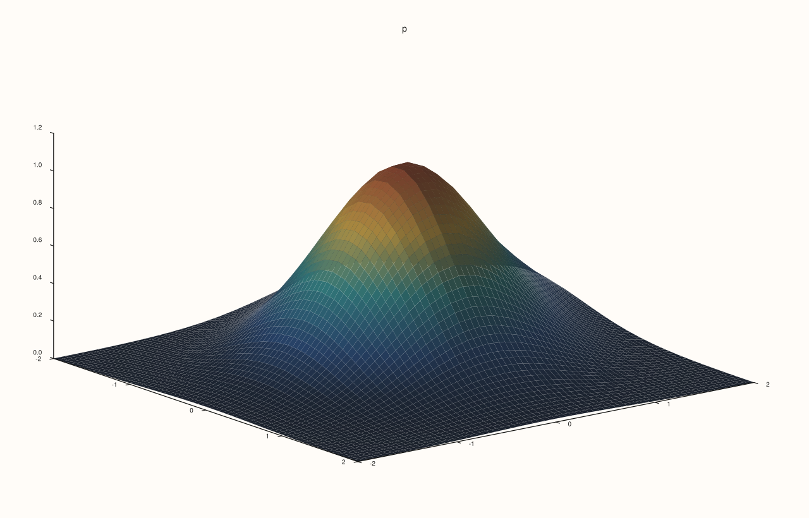
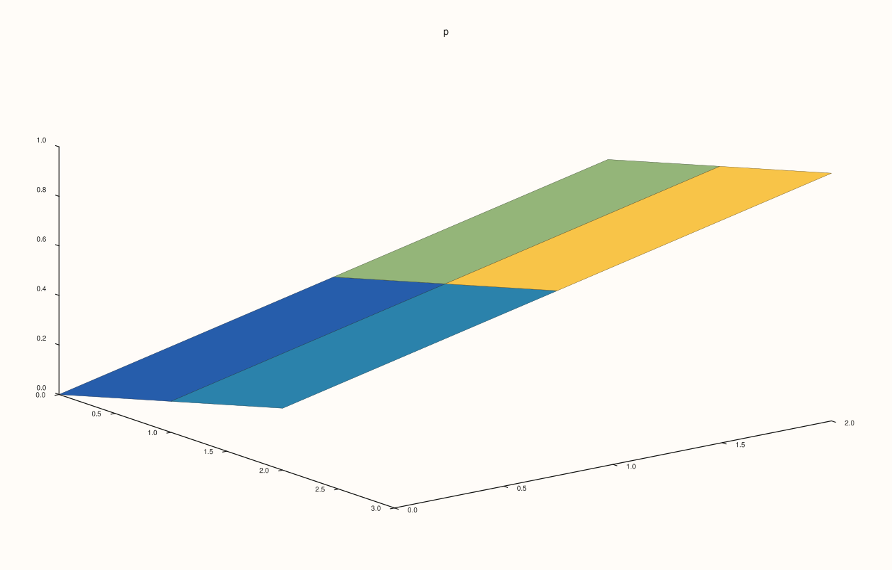
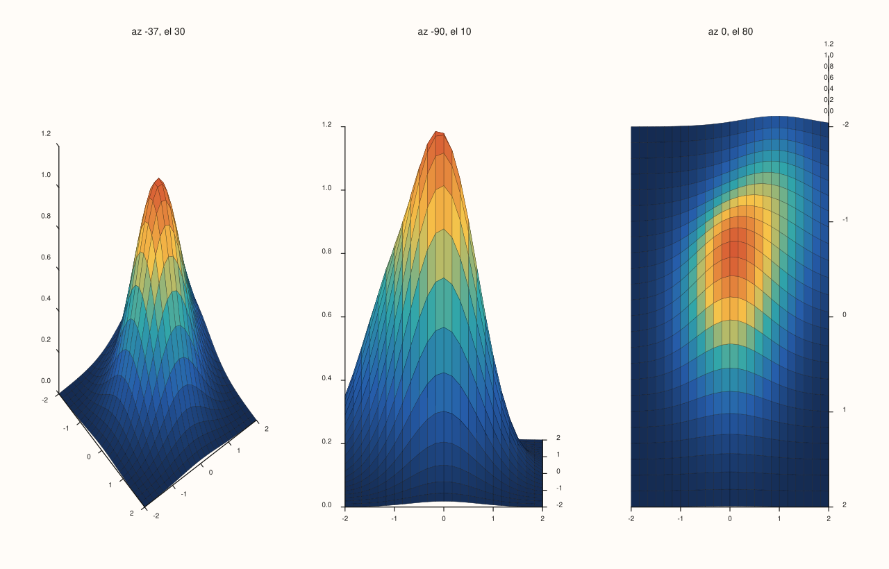

<!-- pluss-hand-authored -->

# Pane::sheet

[Back to Pane API Reference](../../pane_api_reference)

## Signature

```cpp
Trace& Pane::sheet(Series x, Series y, Series z)
Trace& Pane::sheet(Series x, Series y, Series z, Series c)
```

## What It Does

Adds a **surface**: a continuous sheet through the points `(x[j], y[i], z(i, j))` of a field `z(x, y)`, each cell filled and shaded. It shows a quantity that depends on two others as a surface.

`z` is a rank-2 matrix with a row for each `y` and a column for each `x`; `x` and `y` give the coordinates of the columns and rows, or are full matrices with a value for each point (for a grid that is not rectangular).

| Call | Colours from |
|---|---|
| `sheet(x, y, z)` | The height `z`, through the palette. |
| `sheet(x, y, z, c)` | `c`, a matrix of the shape of `z`. |

The range of the colours is the data's, or the pane's [`color_limits`](color_limits.md); [`scale_guide`](scale_guide.md) shows it. Shading and lighting are set on the trace ([`shade`](../trace/shade.md), [`lighting`](../trace/lighting.md), [`material`](../trace/material.md)).

## Parameters

**x**, **y** (`Series`-convertible)
    The coordinates of the columns and the rows, or full matrices.

**z** (`Series`-convertible, rank 2)
    The field.

**c** (`Series`-convertible, optional)
    The values that colour the surface, with as many elements as `z`.

## Returns

`Trace&`
    The new trace.

## Examples

Example 1. A field `z(x, y)` over a grid of 25 by 25 points, drawn as a surface. `x` and `y` give the coordinates of the columns and rows.

```cpp
auto fig = studio("sheet_bump");
auto& pane = fig.pane3("p");
const std::int64_t n = 25;
std::vector<double> axis(static_cast<std::size_t>(n)), field(static_cast<std::size_t>(n * n));
for (std::int64_t i = 0; i < n; ++i) axis[static_cast<std::size_t>(i)] = -2.0 + 4.0 * i / (n - 1);
for (std::int64_t i = 0; i < n; ++i) {
  for (std::int64_t j = 0; j < n; ++j) {
    const double x = axis[static_cast<std::size_t>(i)], y = axis[static_cast<std::size_t>(j)];
    field[static_cast<std::size_t>(i * n + j)] = std::exp(-(x * x + y * y)) + 0.5 * std::exp(-((x - 1.0) * (x - 1.0) + (y + 1.0) * (y + 1.0)));
  }
}
auto z = pluss::make_series(field, {n, n});
pane.sheet(axis, axis, z);
fig.save_svg("figure.svg");
```



Example 2. A fourth argument colours the surface by another quantity: here the field is drawn as it is and coloured by a matrix that runs the other way, so high ground is shown in low colours. The colours of the two figures differ.

```cpp
auto build = [&](bool with_color) {
  auto fig = studio("sheet_color");
  auto& pane = fig.pane3("p");
  const std::int64_t n = 25;
std::vector<double> axis(static_cast<std::size_t>(n)), field(static_cast<std::size_t>(n * n));
for (std::int64_t i = 0; i < n; ++i) axis[static_cast<std::size_t>(i)] = -2.0 + 4.0 * i / (n - 1);
for (std::int64_t i = 0; i < n; ++i) {
  for (std::int64_t j = 0; j < n; ++j) {
    const double x = axis[static_cast<std::size_t>(i)], y = axis[static_cast<std::size_t>(j)];
    field[static_cast<std::size_t>(i * n + j)] = std::exp(-(x * x + y * y)) + 0.5 * std::exp(-((x - 1.0) * (x - 1.0) + (y + 1.0) * (y + 1.0)));
  }
}
auto z = pluss::make_series(field, {n, n});
  auto c = pluss::series::linspace(1.0, 0.0, n * n, pluss::ScalarType::Float64).reshape({n, n});
  if (with_color) pane.sheet(axis, axis, z, c);
  else pane.sheet(axis, axis, z);
  return fig.to_svg();
};
std::cout << "colour series changes the figure: " << (build(true) != build(false)) << "\n";
auto fig = studio("sheet_color_out");
auto& pane = fig.pane3("p");
const std::int64_t n = 25;
std::vector<double> axis(static_cast<std::size_t>(n)), field(static_cast<std::size_t>(n * n));
for (std::int64_t i = 0; i < n; ++i) axis[static_cast<std::size_t>(i)] = -2.0 + 4.0 * i / (n - 1);
for (std::int64_t i = 0; i < n; ++i) {
  for (std::int64_t j = 0; j < n; ++j) {
    const double x = axis[static_cast<std::size_t>(i)], y = axis[static_cast<std::size_t>(j)];
    field[static_cast<std::size_t>(i * n + j)] = std::exp(-(x * x + y * y)) + 0.5 * std::exp(-((x - 1.0) * (x - 1.0) + (y + 1.0) * (y + 1.0)));
  }
}
auto z = pluss::make_series(field, {n, n});
auto c = pluss::series::linspace(1.0, 0.0, n * n, pluss::ScalarType::Float64).reshape({n, n});
pane.sheet(axis, axis, z, c);
pane.scale_guide(true);
fig.save_svg("figure.svg");
```

### Output

```text
colour series changes the figure: 1
```



Example 3. A small grid shows the structure: a 3 by 3 field is four cells of a mesh.

```cpp
auto fig = studio("sheet_coarse");
auto& pane = fig.pane3("p");
auto z = pluss::series::linspace(0.0, 1.0, 9, pluss::ScalarType::Float64).reshape({3, 3});
pane.sheet(std::vector<double>{0, 1, 2}, std::vector<double>{0, 1, 2}, z);
fig.save_svg("figure.svg");
```



Example 4. How the surface is shaded is a property of the trace: `ShadeMode::Smooth` blends the colour across each cell, and a [light](lights.md) with `lighting` gives it relief.

```cpp
auto fig = studio("sheet_shade");
auto& pane = fig.pane3("p");
const std::int64_t n = 25;
std::vector<double> axis(static_cast<std::size_t>(n)), field(static_cast<std::size_t>(n * n));
for (std::int64_t i = 0; i < n; ++i) axis[static_cast<std::size_t>(i)] = -2.0 + 4.0 * i / (n - 1);
for (std::int64_t i = 0; i < n; ++i) {
  for (std::int64_t j = 0; j < n; ++j) {
    const double x = axis[static_cast<std::size_t>(i)], y = axis[static_cast<std::size_t>(j)];
    field[static_cast<std::size_t>(i * n + j)] = std::exp(-(x * x + y * y)) + 0.5 * std::exp(-((x - 1.0) * (x - 1.0) + (y + 1.0) * (y + 1.0)));
  }
}
auto z = pluss::make_series(field, {n, n});
pane.sheet(axis, axis, z).shade(ShadeMode::Smooth).lighting(LightingMode::Flat);
pane.lights().lamp_right();
fig.save_svg("figure.svg");
```



Example 5. Coordinates can be full matrices, one value for each grid point, for grids that are not rectangular. Here the grid is sheared: each row is shifted along x.

```cpp
auto fig = studio("sheet_matrices");
auto& pane = fig.pane3("p");
auto z = pluss::series::linspace(0.0, 1.0, 9, pluss::ScalarType::Float64).reshape({3, 3});
auto x = pluss::make_series(std::vector<double>{0, 1, 2, 0.5, 1.5, 2.5, 1, 2, 3}, {3, 3});
auto y = pluss::make_series(std::vector<double>{0, 0, 0, 1, 1, 1, 2, 2, 2}, {3, 3});
pane.sheet(x, y, z);
fig.save_svg("figure.svg");
```



Example 6. Seen from other sides: the lens turns the picture and nothing else.

```cpp
auto fig = studio("sheet_view");
fig.mosaic(1, 3);
const std::int64_t n = 25;
std::vector<double> axis(static_cast<std::size_t>(n)), field(static_cast<std::size_t>(n * n));
for (std::int64_t i = 0; i < n; ++i) axis[static_cast<std::size_t>(i)] = -2.0 + 4.0 * i / (n - 1);
for (std::int64_t i = 0; i < n; ++i) {
  for (std::int64_t j = 0; j < n; ++j) {
    const double x = axis[static_cast<std::size_t>(i)], y = axis[static_cast<std::size_t>(j)];
    field[static_cast<std::size_t>(i * n + j)] = std::exp(-(x * x + y * y)) + 0.5 * std::exp(-((x - 1.0) * (x - 1.0) + (y + 1.0) * (y + 1.0)));
  }
}
auto z = pluss::make_series(field, {n, n});
const double views[3][2] = {{-37.5, 30.0}, {-90.0, 10.0}, {0.0, 80.0}};
for (int i = 0; i < 3; ++i) {
  auto& pane = fig.pane3("az " + std::to_string(static_cast<int>(views[i][0])) + ", el " + std::to_string(static_cast<int>(views[i][1])));
  pane.sheet(axis, axis, z);
  pane.lens().look(views[i][0], views[i][1]);
}
fig.save_svg("figure.svg");
```



Example 7. Inputs that cannot be drawn are refused when the trace is added, and the message names the method and the problem. The pane keeps the traces it had.

```cpp
auto report = [](const char* what, auto&& call) {
  auto fig = studio("sheet_errors");
  auto& pane = fig.pane3("p");
  try {
    call(pane);
    std::cout << what << ": accepted\n";
  } catch (const pluss::Error& e) {
    std::cout << what << ": " << e.message() << "\n";
  }
};
report("coordinates do not match z", [](Pane& pane) { auto z = pluss::series::linspace(0.0, 1.0, 9, pluss::ScalarType::Float64).reshape({3, 3}); pane.sheet(std::vector<double>{1, 2}, std::vector<double>{1, 2, 3}, z); });
report("colour has another shape", [](Pane& pane) { auto z = pluss::series::linspace(0.0, 1.0, 9, pluss::ScalarType::Float64).reshape({3, 3}); auto c = pluss::series::linspace(0.0, 1.0, 4, pluss::ScalarType::Float64).reshape({2, 2}); pane.sheet(std::vector<double>{1, 2, 3}, std::vector<double>{1, 2, 3}, z, c); });
auto fig = studio("sheet_errors_out");
auto& pane = fig.pane3("p");
pane.path3(std::vector<double>{0, 1}, std::vector<double>{0, 1}, std::vector<double>{0, 1});
fig.save_svg("figure.svg");
```

### Output

```text
coordinates do not match z: sheet: x/y must both be vectors with extents matching z columns/rows or full matrices matching z
colour has another shape: sheet: color data must match z element count
```


Example 8. `sheet` needs a volumetric pane. On a planar pane it throws at once, naming the kind it needs, and nothing is added.

```cpp
auto fig = studio("sheet_wrong_pane");
auto& pane = fig.pane2("p");
try {
  pane.sheet(std::vector<double>{0, 1}, std::vector<double>{0, 1}, pluss::series::linspace(0.0, 1.0, 4, pluss::ScalarType::Float64).reshape({2, 2}));
} catch (const pluss::Error& e) {
  std::cout << e.message() << "\n";
}
std::cout << "traces: " << pane.trace_count() << "\n";
fig.save_svg("figure.svg");
```

### Output

```text
sheet requires a volumetric pane
traces: 0
```


## Notes

- Returns the new [`Trace&`](../trace/label.md); the reference stays valid for the life of the pane, and the style calls of the trace ([`label`](../trace/label.md), [`stroke`](../trace/stroke.md), [`width`](../trace/width.md), ...) chain off it.
- The data is copied into the trace when it is added, so changing the vector afterwards does not change the figure.

## See Also

- [`Pane::lattice`](lattice.md): the wire grid.
- [`Pane::spire3`](spire3.md): bars on the grid.
- [`Pane::ridge3`](ridge3.md): contour lines on the surface.
- [`Pane::lens`](lens.md): the view.

<div class="pluss-inline-prev-next">
  <a class="prev-link" href="scale_z.html">
    <span class="label">Previous</span>
    <span class="title">scale_z</span>
  </a>
  <a class="next-link" href="spike.html">
    <span class="label">Next</span>
    <span class="title">spike</span>
  </a>
</div>
