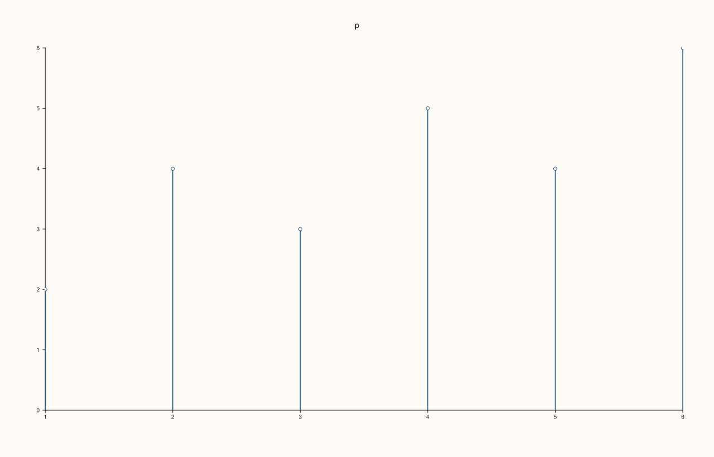
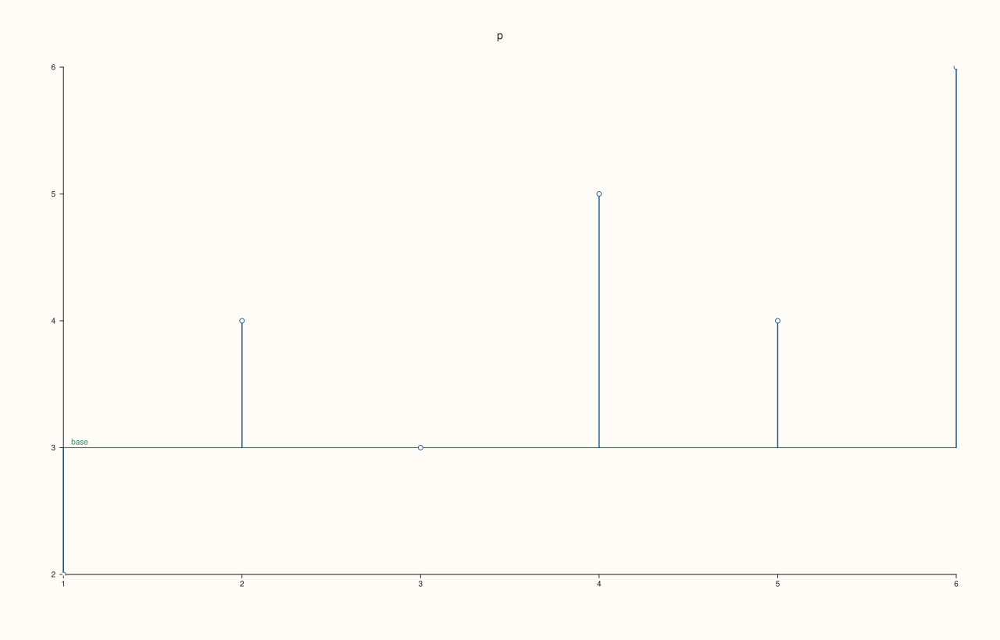
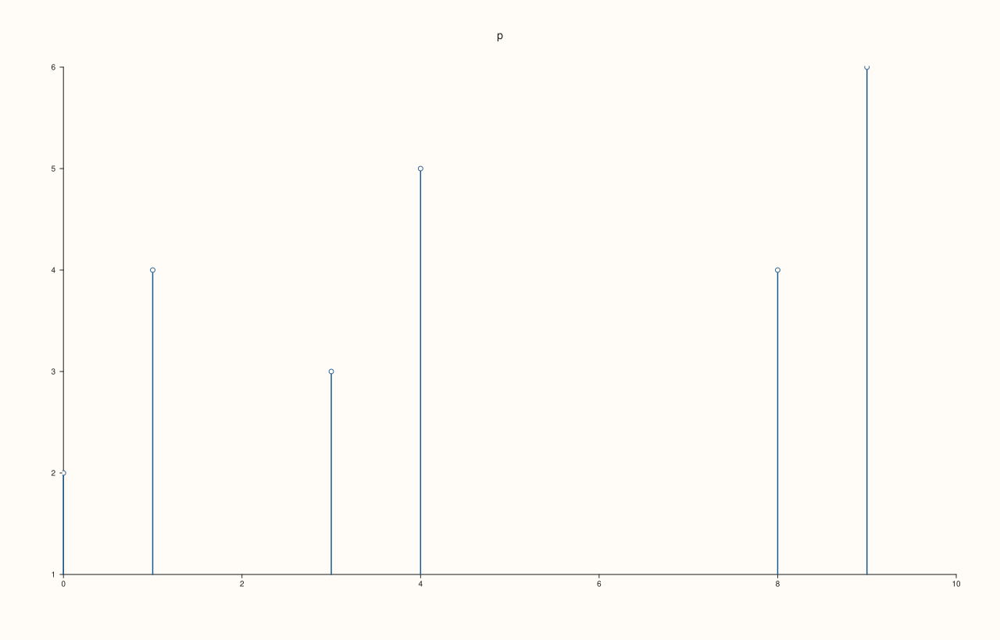
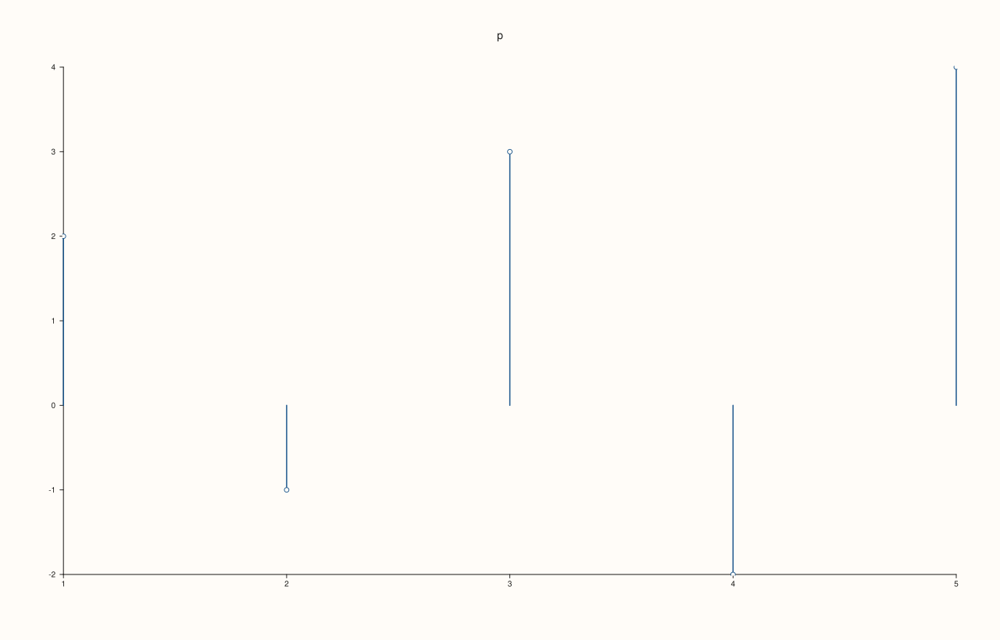

<!-- pluss-hand-authored -->

# Pane::spike

[Back to Pane API Reference](../../pane_api_reference)

## Signature

```cpp
Trace& Pane::spike(Series y, double base = 0.0)
Trace& Pane::spike(Series x, Series y, double base = 0.0)
```

## What It Does

Adds **stems**: one vertical line for each value, from a baseline to the value, with nothing joining them. It is the trace of a discrete signal, a stem plot or a lollipop chart. The baseline is `base`, 0 by default.

| Call | Meaning |
|---|---|
| `spike(y, base = 0)` | Values at the positions 1, 2, 3, ... |
| `spike(x, y, base = 0)` | Values at the positions `x`. |

`x` and `y` have the same length, or one has length 1. For the same data as a filled region use [`ribbon`](ribbon.md).

## Parameters

**x** (`Series`-convertible, second call)
    The positions.

**y** (`Series`-convertible)
    The values.

**base** (`double`, default 0)
    The baseline the stems starts from.

## Returns

`Trace&`
    The new trace.

## Examples

Example 1. Values only: the positions are the indices 1, 2, 3, ... A stem rises from the base (0) to each value.

```cpp
auto fig = studio("spike_y");
auto& pane = fig.pane2("p");
pane.spike(std::vector<double>{2, 4, 3, 5, 4, 6});
fig.save_svg("figure.svg");
```



Example 2. Positions and values. The positions need not be evenly spaced.

```cpp
auto fig = studio("spike_xy");
auto& pane = fig.pane2("p");
pane.spike(std::vector<double>{0, 1, 3, 4, 8, 9}, std::vector<double>{2, 4, 3, 5, 4, 6});
fig.save_svg("figure.svg");
```


Example 3. The base moves the baseline. With base 3 the stems are drawn between 3 and each value, so values below 3 give stems that hang down.

```cpp
auto fig = studio("spike_base");
auto& pane = fig.pane2("p");
pane.spike(std::vector<double>{2, 4, 3, 5, 4, 6}, 3.0);
pane.rule_y(3.0, "base");
fig.save_svg("figure.svg");
```



Example 4. The base with positions: the second overload takes it after the data.

```cpp
auto fig = studio("spike_base_xy");
auto& pane = fig.pane2("p");
pane.spike(std::vector<double>{0, 1, 3, 4, 8, 9}, std::vector<double>{2, 4, 3, 5, 4, 6}, 1.0);
fig.save_svg("figure.svg");
```



Example 5. Negative values lie below the base, which is zero by default.

```cpp
auto fig = studio("spike_negative");
auto& pane = fig.pane2("p");
pane.spike(std::vector<double>{2, -1, 3, -2, 4});
fig.save_svg("figure.svg");
```



Example 6. Inputs that cannot be drawn are refused when the trace is added, and the message names the method and the problem. The pane keeps the traces it had.

```cpp
auto report = [](const char* what, auto&& call) {
  auto fig = studio("spike_errors");
  auto& pane = fig.pane2("p");
  try {
    call(pane);
    std::cout << what << ": accepted\n";
  } catch (const pluss::Error& e) {
    std::cout << what << ": " << e.message() << "\n";
  }
};
report("x and y differ", [](Pane& pane) { pane.spike(std::vector<double>{1, 2, 3}, std::vector<double>{1, 2}); });
auto fig = studio("spike_errors_out");
auto& pane = fig.pane2("p");
pane.trend(std::vector<double>{0, 1}, std::vector<double>{0, 1});
fig.save_svg("figure.svg");
```

### Output

```text
x and y differ: spike: series lengths must match or broadcast from scalar
```


Example 7. `spike` needs a planar pane. On a volumetric pane it throws at once, naming the kind it needs, and nothing is added.

```cpp
auto fig = studio("spike_wrong_pane");
auto& pane = fig.pane3("p");
try {
  pane.spike(std::vector<double>{1, 2});
} catch (const pluss::Error& e) {
  std::cout << e.message() << "\n";
}
std::cout << "traces: " << pane.trace_count() << "\n";
fig.save_svg("figure.svg");
```

### Output

```text
spike requires a planar pane
traces: 0
```


## Notes

- Returns the new [`Trace&`](../trace/label.md); the reference stays valid for the life of the pane, and the style calls of the trace ([`label`](../trace/label.md), [`stroke`](../trace/stroke.md), [`width`](../trace/width.md), ...) chain off it.
- The data is copied into the trace when it is added, so changing the vector afterwards does not change the figure.

## See Also

- [`Pane::ribbon`](ribbon.md): the filled band.
- [`Pane::trend`](trend.md): the line.
- [`Pane::columns`](columns.md): bars.

<div class="pluss-inline-prev-next">
  <a class="prev-link" href="sheet.html">
    <span class="label">Previous</span>
    <span class="title">sheet</span>
  </a>
  <a class="next-link" href="spire3.html">
    <span class="label">Next</span>
    <span class="title">spire3</span>
  </a>
</div>
