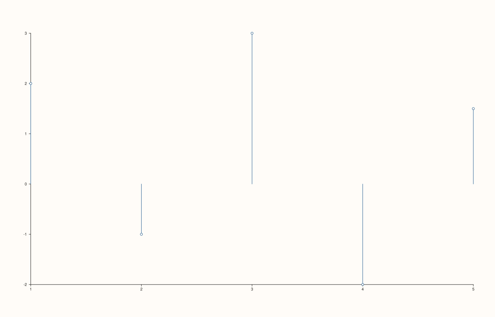
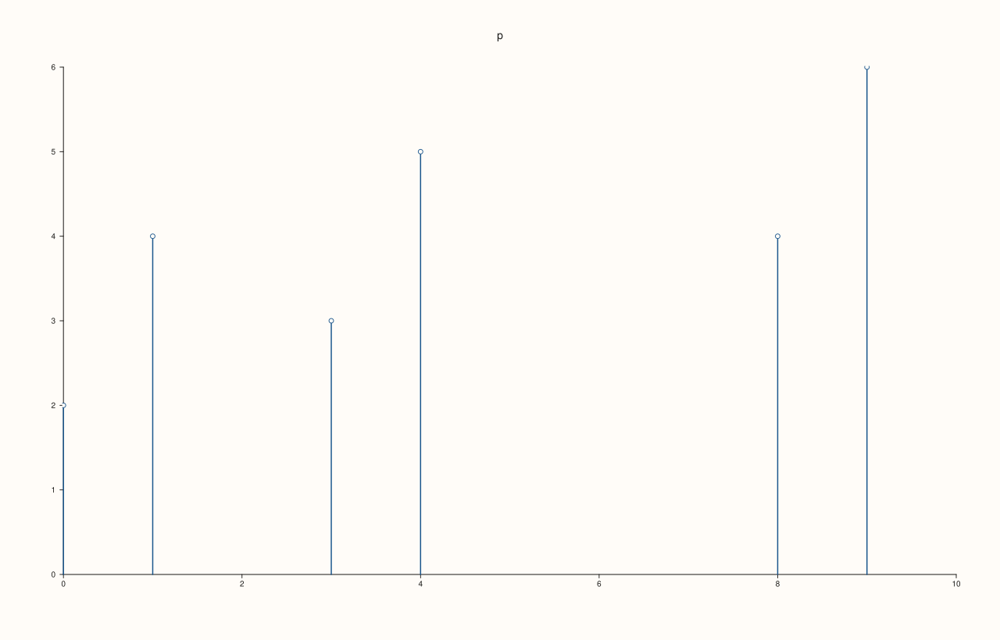

<!-- pluss-hand-authored -->

# Pane::spike

[Back to Pane API Reference](../../pane_api_reference)

## Signatures

```cpp
template <class Y>
Trace& Pane::spike(Y&& y, double base = 0.0)

template <class X, class Y>
Trace& Pane::spike(X&& x, Y&& y, double base = 0.0)
```

## What It Does

Adds a discrete stem/spike trace — one vertical line per point, running from `base` up (or
down) to `y[i]` at position `x[i]`. Structurally identical to [`ribbon()`](ribbon.md) —
same two overloads, same `base` default of `0.0` — but rendered as individual disconnected
stems instead of one continuous filled band:

- **`spike(y, base = 0.0)`** — `x` is auto-assigned as `0, 1, 2, …`.
- **`spike(x, y, base = 0.0)`** — `x` is supplied explicitly.

## Parameters

**y** (series-convertible)
    The tip value of each stem.

**x** (series-convertible, two-argument overload only)
    The explicit horizontal position of each stem. When omitted (one-argument overload),
    positions are auto-assigned as `0, 1, 2, …`.

**base** (`double`, default `0.0`)
    The value each stem starts from. `0.0` starts every stem at the y-axis origin,
    correctly showing negative `y` values as downward-pointing stems (see Example 1).

## Returns

`Trace&`
    A reference to the newly created trace, for chaining.

## Examples

Example 1. Mixed positive/negative values, `base = 0.0` (default) — positive values spike
upward from zero, negative values spike downward, `x` auto-assigned.

```cpp
using namespace pluss::pl;

auto fig = studio("spike_y_only");
auto& pane = fig.pane2();
pane.spike(std::vector<double>{2.0, -1.0, 3.0, -2.0, 1.5});
fig.show();
```



Example 2. The same values, `x` given explicitly instead of auto-assigned. Verified via
direct SVG diff to render genuinely different from Example 1.

```cpp
using namespace pluss::pl;

auto fig = studio("spike_xy");
auto& pane = fig.pane2();
pane.spike(std::vector<double>{10.0, 20.0, 30.0, 40.0, 50.0}, std::vector<double>{2.0, -1.0, 3.0, -2.0, 1.5});
fig.show();
```



## Notes

- Not `noexcept`.
- Sharing its exact two-overload, `(x?, y, base=0.0)` shape with [`ribbon()`](ribbon.md),
  `spike()` is best understood as `ribbon()`'s discrete-stem rendering sibling rather than
  a fully independent trace kind — everything documented above about `ribbon()`'s `base`
  parameter (shifts the *starting* end of each element, not the tip) applies identically
  here.
- `flash::stemplot` (if present) is a convenience wrapper around this exact method.

## See Also

- [`Pane::ribbon`](ribbon.md): the continuous filled-band sibling of this method.
- [`Pane::columns`](columns.md): a related discrete-per-category trace kind, rendered as
  wider bars rather than thin stems.

<div class="pluss-inline-prev-next">
  <a class="prev-link" href="ribbon.html">
    <span class="label">Previous</span>
    <span class="title">ribbon</span>
  </a>
  <a class="next-link" href="contour.html">
    <span class="label">Next</span>
    <span class="title">contour</span>
  </a>
</div>
