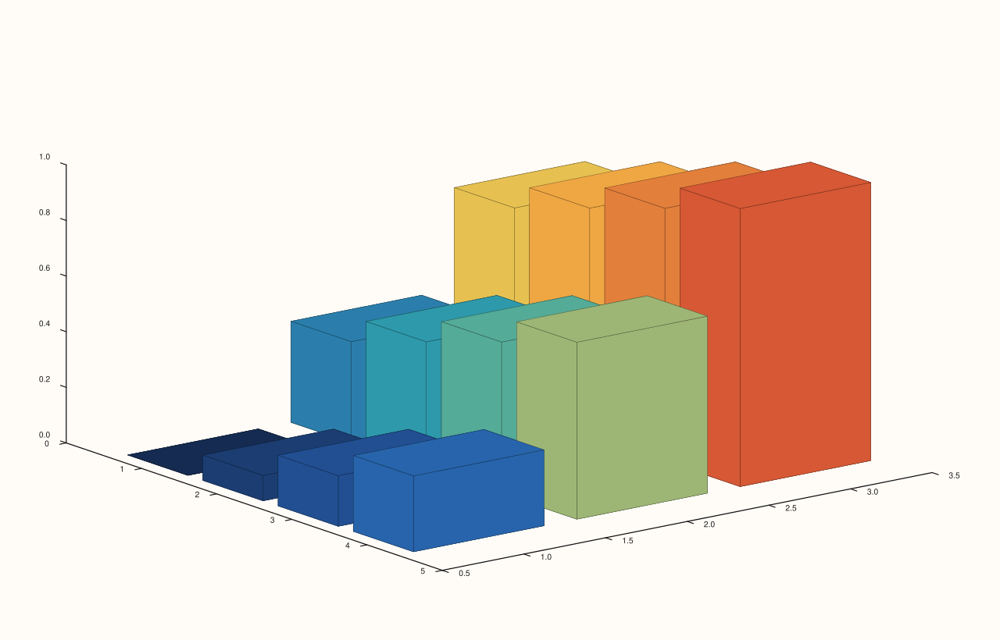
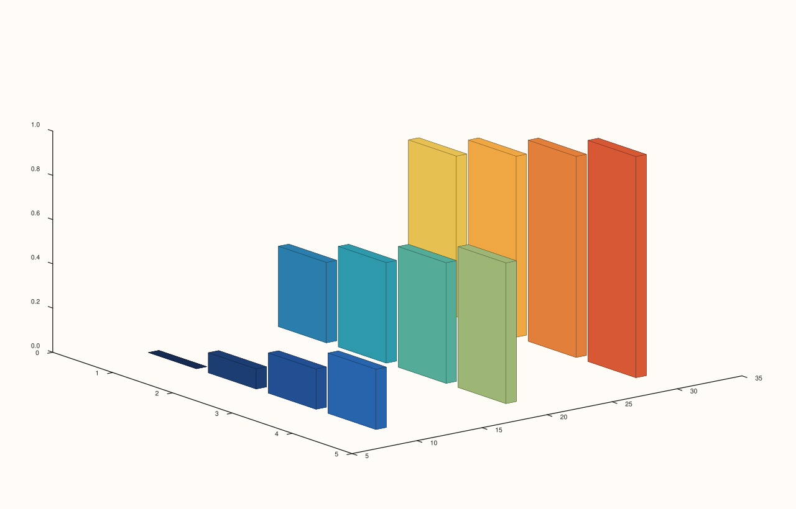
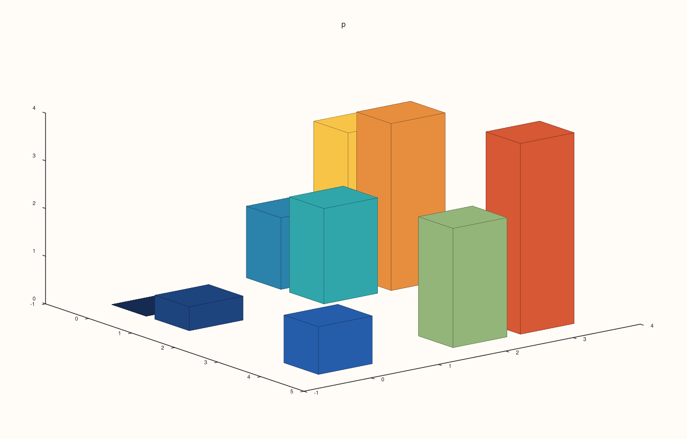
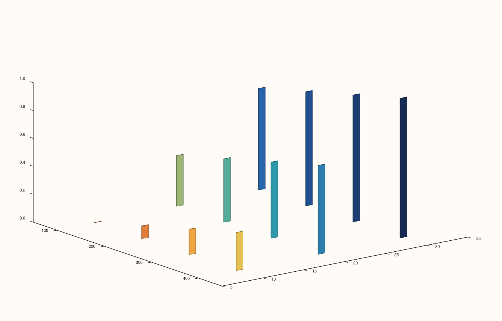

<!-- pluss-hand-authored -->

# Pane::spire3

[Back to Pane API Reference](../../pane_api_reference)

## Signatures

```cpp
template <class Z>
Trace& Pane::spire3(Z&& z)

template <class Y, class Z>
Trace& Pane::spire3(Y&& y, Z&& z)

template <class X, class Y, class Z>
Trace& Pane::spire3(X&& x, Y&& y, Z&& z)

template <class X, class Y, class Z, class C>
Trace& Pane::spire3(X&& x, Y&& y, Z&& z, C&& c)
```

## What It Does

Adds a 3D "spire"/bar-forest trace — one vertical bar per grid cell in `z`, at height
`z(row, col)`. `z` is always a rank-2 grid (rows × columns); the four overloads differ only
in how much of the `(x, y)` coordinate grid you supply explicitly versus let default to
`0, 1, 2, …` index positions:

- **`spire3(z)`** — both `x` and `y` are auto-assigned as `0, 1, 2, …` (`x` indexes `z`'s
  columns, `y` indexes its rows).
- **`spire3(y, z)`** — `y` supplied explicitly (must match `z`'s row count), `x` still
  auto-indexed from `z`'s column count.
- **`spire3(x, y, z)`** — both `x` and `y` supplied explicitly, matching `z`'s column and
  row counts respectively.
- **`spire3(x, y, z, c)`** — as above, plus a separate rank-2 color matrix `c`, matching
  `z`'s shape, decoupled from `z`'s own bar-height values (the identical
  shape-vs-color-decoupling pattern as [`Pane::fieldmap`](fieldmap.md)).

```{important} z must be rank-2 in EVERY overload — and every overload validates eagerly
All four overloads require `z` to be a genuine rank-2 matrix, and all four throw
immediately at the `spire3()` call site (not deferred to render time) when it isn't, with
the message `std::invalid_argument: spire3: z must be a rank-2 matrix`.

Only the one- and two-argument overloads carry a *visible*, inline
`if (z.dim() != 2) throw ...` check in their own source — they need `z`'s own shape to
auto-derive the missing `x` and/or `y` axis. The three- and four-argument (fully explicit
`x, y, z[, c]`) overloads carry no such inline check in their own body, yet were verified
to throw the identical message at the identical eager (call-site, not render-time) point —
the requirement is enforced uniformly by the trace-payload validation shared across all
four overloads, just not visibly re-stated in the two overloads that don't need it for
their own axis-inference logic. Passing a flat, one-dimensional `z` to *any* overload
fails immediately, before any rendering is attempted.
```

```{important} Requires a Volumetric pane
Calling `spire3()` on a `Planar` pane throws
`std::logic_error("spire3 requires a volumetric pane")`.
```

## Parameters

**z** (series-convertible, must be rank-2)
    The bar-height grid — one value per `(row, col)` cell.

**y** (series-convertible, two-, three-, and four-argument overloads)
    Row coordinates, matching `z`'s row count. Auto-indexed as `0, 1, 2, …` in the
    one-argument overload.

**x** (series-convertible, three- and four-argument overloads)
    Column coordinates, matching `z`'s column count. Auto-indexed as `0, 1, 2, …` in the
    one- and two-argument overloads.

**c** (series-convertible, must be rank-2 matching `z`'s shape, four-argument overload
only)
    A separate color value per cell, decoupled from `z`'s own bar-height values.

## Returns

`Trace&`
    A reference to the newly created trace, for chaining.

## Examples

Example 1. `z` alone, both axes auto-indexed — a `3×4` bar grid.

```cpp
using namespace pluss::pl;

auto fig = studio("spire3_z_only");
auto& pane = fig.pane3();
auto z = pluss::series::linspace(0.0, 1.0, 12, pluss::ScalarType::Float64).reshape({3, 4});
pane.spire3(z);
fig.show();
```



Example 2. `y` supplied explicitly, `x` still auto-indexed. Verified via direct SVG diff
to render genuinely different from Example 1.

```cpp
using namespace pluss::pl;

auto fig = studio("spire3_y_z");
auto& pane = fig.pane3();
auto z = pluss::series::linspace(0.0, 1.0, 12, pluss::ScalarType::Float64).reshape({3, 4});
pane.spire3(std::vector<double>{10.0, 20.0, 30.0}, z);
fig.show();
```



Example 3. Both `x` and `y` supplied explicitly — `z` is still the same `3×4` rank-2
grid, only the coordinate labeling changes.

```cpp
using namespace pluss::pl;

auto fig = studio("spire3_xyz");
auto& pane = fig.pane3();
auto z = pluss::series::linspace(0.0, 1.0, 12, pluss::ScalarType::Float64).reshape({3, 4});
pane.spire3(std::vector<double>{100.0, 200.0, 300.0, 400.0}, std::vector<double>{10.0, 20.0, 30.0}, z);
fig.show();
```



Example 4. Explicit `x`, `y`, and a separate color matrix `c` (the reverse gradient of
`z`) — bar heights still come from `z`, but fill color comes from `c`. Verified via direct
SVG diff to render genuinely different from Example 3.

```cpp
using namespace pluss::pl;

auto fig = studio("spire3_xyzc");
auto& pane = fig.pane3();
auto z = pluss::series::linspace(0.0, 1.0, 12, pluss::ScalarType::Float64).reshape({3, 4});
auto c = pluss::series::linspace(1.0, 0.0, 12, pluss::ScalarType::Float64).reshape({3, 4});
pane.spire3(std::vector<double>{100.0, 200.0, 300.0, 400.0}, std::vector<double>{10.0, 20.0, 30.0}, z, c);
fig.show();
```



Example 5 (failure). A flat, one-dimensional `z` fails identically on the one-argument
overload and the fully-explicit three-argument overload — both eagerly, at the call site.

```cpp
using namespace pluss::pl;

auto fig1 = studio("spire3_flat_z_1arg");
auto& pane1 = fig1.pane3();
try {
  pane1.spire3(std::vector<double>{1.0, 2.0, 3.0});
} catch (const std::invalid_argument& e) {
  std::cout << e.what() << "\n";
}

auto fig2 = studio("spire3_flat_z_3arg");
auto& pane2 = fig2.pane3();
try {
  pane2.spire3(std::vector<double>{1.0, 2.0, 3.0}, std::vector<double>{4.0, 5.0, 6.0}, std::vector<double>{0.1, 0.2, 0.3});
} catch (const std::invalid_argument& e) {
  std::cout << e.what() << "\n";
}
```

Output:

```text
spire3: z must be a rank-2 matrix
spire3: z must be a rank-2 matrix
```

## Notes

- Not `noexcept`.
- `Spire3Data` (the underlying payload struct) also carries `width` (default `0.8`),
  `depth` (default `0.8`), and `base` (default `0.0`) fields — none of the four `spire3()`
  overloads above exposes a parameter for any of them; every call constructs the payload
  with these three fields fixed at their struct defaults. No entry point for customizing
  bar width/depth/base was found on `Pane` for this trace kind.
- `flash::bar3d` (if present) is a convenience wrapper around one of these overloads.

## See Also

- [`Pane::fieldmap`](fieldmap.md): shares the identical `z`-shape/`c`-color decoupling
  pattern and the identical `"... z must be a rank-2 matrix"` error message, on a 2D
  `Planar` pane instead.
- [`Pane::cloud3`](cloud3.md): a discrete, non-grid-constrained 3D point trace, for data
  that isn't naturally laid out on a regular `(x, y)` grid.

<div class="pluss-inline-prev-next">
  <a class="prev-link" href="path3.html">
    <span class="label">Previous</span>
    <span class="title">path3</span>
  </a>
  <a class="next-link" href="isoband.html">
    <span class="label">Next</span>
    <span class="title">isoband</span>
  </a>
</div>
