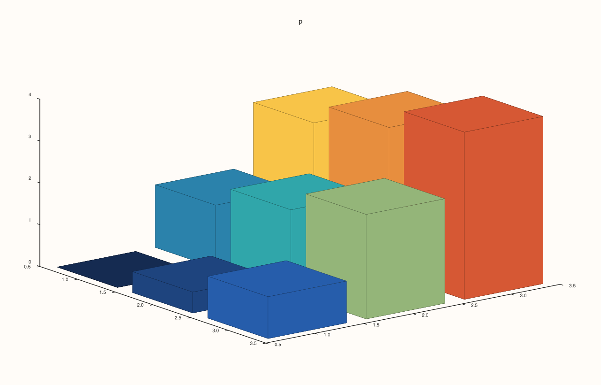
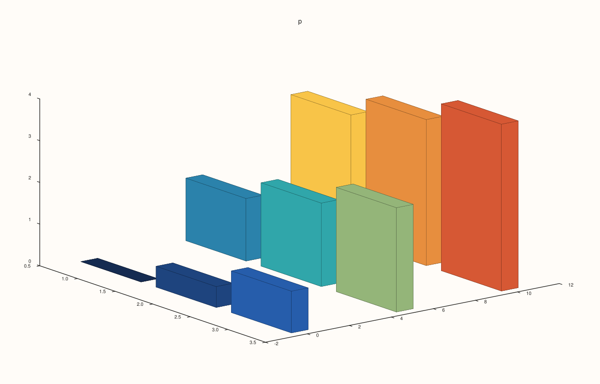
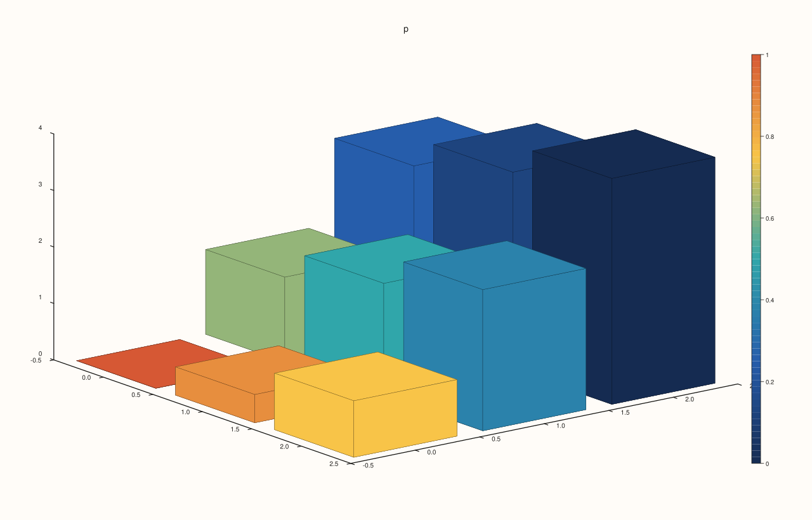
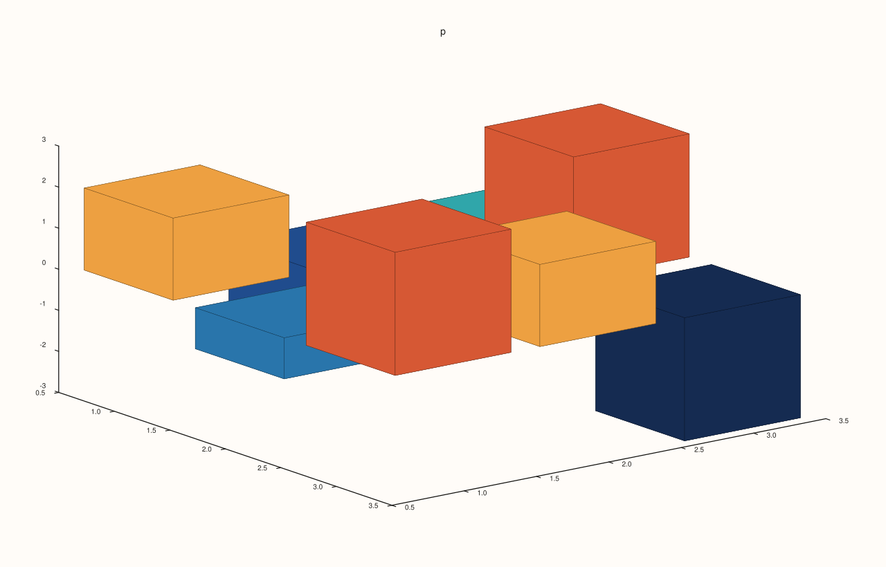
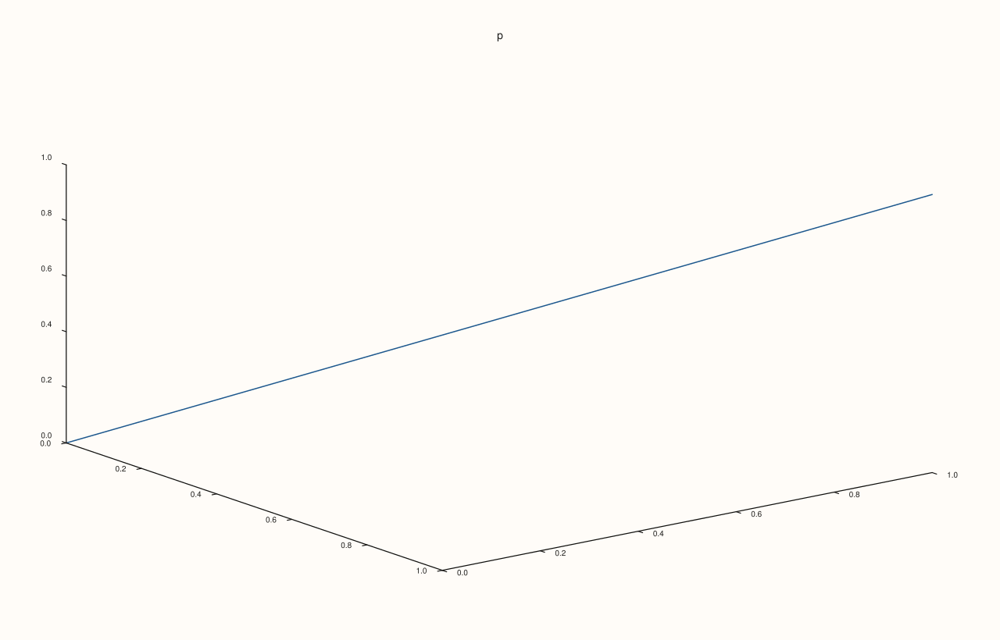

<!-- pluss-hand-authored -->

# Pane::spire3

[Back to Pane API Reference](../../pane_api_reference)

## Signature

```cpp
Trace& Pane::spire3(Series z)
Trace& Pane::spire3(Series y, Series z)
Trace& Pane::spire3(Series x, Series y, Series z)
Trace& Pane::spire3(Series x, Series y, Series z, Series c)
```

## What It Does

Adds a **bar chart in three dimensions**: a vertical bar for each cell of a matrix `z`, standing on the grid of the coordinates with the height of the cell. It is the trace for a table of values over two categories, a histogram of two variables, or a surface shown as bars.

`z` is a rank-2 matrix: its columns run along x and its rows along y. The calls differ in how much of the grid you give:

| Call | Coordinates |
|---|---|
| `spire3(z)` | x and y are the indices 1, 2, 3, ... |
| `spire3(y, z)` | y given, x the indices. |
| `spire3(x, y, z)` | Both given. |
| `spire3(x, y, z, c)` | Both given, and the bars are coloured by `c`, a matrix of the shape of `z`, instead of by their height. |

`x` has as many entries as `z` has columns and `y` as many as it has rows, or both are full matrices of the shape of `z`. `z` must be rank 2 in every call: a rank-1 series throws.

## Parameters

**x**, **y** (`Series`-convertible, optional)
    The coordinates of the columns and the rows.

**z** (`Series`-convertible, rank 2)
    The heights.

**c** (`Series`-convertible, optional)
    The values that colour the bars.

## Returns

`Trace&`
    The new trace.

## Examples

Example 1. Only the heights: one bar for each cell of a 3 by 3 matrix, standing at the positions 1, 2, 3 along x (the columns) and 1, 2, 3 along y (the rows).

```cpp
auto fig = studio("spire3_z");
auto& pane = fig.pane3("p");
auto z = pluss::series::linspace(0.0, 4.0, 9, pluss::ScalarType::Float64).reshape({3, 3});
pane.spire3(z);
fig.save_svg("figure.svg");
```



Example 2. With `y` given, the rows stand at those positions; the columns keep the positions 1, 2, 3.

```cpp
auto fig = studio("spire3_yz");
auto& pane = fig.pane3("p");
auto z = pluss::series::linspace(0.0, 4.0, 9, pluss::ScalarType::Float64).reshape({3, 3});
pane.spire3(std::vector<double>{0, 5, 10}, z);
fig.save_svg("figure.svg");
```



Example 3. Both coordinates given: bars on a grid of your own spacing.

```cpp
auto fig = studio("spire3_xyz");
auto& pane = fig.pane3("p");
auto z = pluss::series::linspace(0.0, 4.0, 9, pluss::ScalarType::Float64).reshape({3, 3});
pane.spire3(std::vector<double>{0, 1, 4}, std::vector<double>{0, 2, 3}, z);
fig.save_svg("figure.svg");
```


Example 4. A fourth argument colours the bars by another quantity, a matrix of the same shape as `z`. Here the bars are coloured by a matrix running the other way from their heights.

```cpp
auto fig = studio("spire3_color");
auto& pane = fig.pane3("p");
auto z = pluss::series::linspace(0.0, 4.0, 9, pluss::ScalarType::Float64).reshape({3, 3});
auto c = pluss::series::linspace(1.0, 0.0, 9, pluss::ScalarType::Float64).reshape({3, 3});
pane.spire3(std::vector<double>{0, 1, 2}, std::vector<double>{0, 1, 2}, z, c);
pane.scale_guide(true);
fig.save_svg("figure.svg");
```



Example 5. Bars go down from zero for negative values.

```cpp
auto fig = studio("spire3_negative");
auto& pane = fig.pane3("p");
auto z = pluss::make_series(std::vector<double>{2, -1, 3, -2, 1, 2, 0, 3, -3}, {3, 3});
pane.spire3(z);
fig.save_svg("figure.svg");
```



Example 6. Inputs that cannot be drawn are refused when the trace is added, and the message names the method and the problem. The pane keeps the traces it had.

```cpp
auto report = [](const char* what, auto&& call) {
  auto fig = studio("spire3_errors");
  auto& pane = fig.pane3("p");
  try {
    call(pane);
    std::cout << what << ": accepted\n";
  } catch (const pluss::Error& e) {
    std::cout << what << ": " << e.message() << "\n";
  }
};
report("z is not a matrix", [](Pane& pane) { pane.spire3(std::vector<double>{1, 2, 3}); });
report("coordinates do not match z", [](Pane& pane) { auto z = pluss::series::linspace(0.0, 4.0, 9, pluss::ScalarType::Float64).reshape({3, 3}); pane.spire3(std::vector<double>{1, 2}, std::vector<double>{1, 2, 3}, z); });
auto fig = studio("spire3_errors_out");
auto& pane = fig.pane3("p");
pane.path3(std::vector<double>{0, 1}, std::vector<double>{0, 1}, std::vector<double>{0, 1});
fig.save_svg("figure.svg");
```

### Output

```text
z is not a matrix: spire3: z must be a rank-2 matrix
coordinates do not match z: spire3: x/y must both be vectors with extents matching z columns/rows or full matrices matching z
```



Example 7. `spire3` needs a volumetric pane. On a planar pane it throws at once, naming the kind it needs, and nothing is added.

```cpp
auto fig = studio("spire3_wrong_pane");
auto& pane = fig.pane2("p");
try {
  pane.spire3(pluss::series::linspace(0.0, 1.0, 4, pluss::ScalarType::Float64).reshape({2, 2}));
} catch (const pluss::Error& e) {
  std::cout << e.message() << "\n";
}
std::cout << "traces: " << pane.trace_count() << "\n";
fig.save_svg("figure.svg");
```

### Output

```text
spire3 requires a volumetric pane
traces: 0
```


## Notes

- Returns the new [`Trace&`](../trace/label.md); the reference stays valid for the life of the pane, and the style calls of the trace ([`label`](../trace/label.md), [`stroke`](../trace/stroke.md), [`width`](../trace/width.md), ...) chain off it.
- The data is copied into the trace when it is added, so changing the vector afterwards does not change the figure.

## See Also

- [`Pane::sheet`](sheet.md): the same data as a surface.
- [`Pane::lattice`](lattice.md): as a wire grid.
- [`Pane::columns`](columns.md): bars in the plane.

<div class="pluss-inline-prev-next">
  <a class="prev-link" href="spike.html">
    <span class="label">Previous</span>
    <span class="title">spike</span>
  </a>
  <a class="next-link" href="theme_tokens.html">
    <span class="label">Next</span>
    <span class="title">theme_tokens</span>
  </a>
</div>
