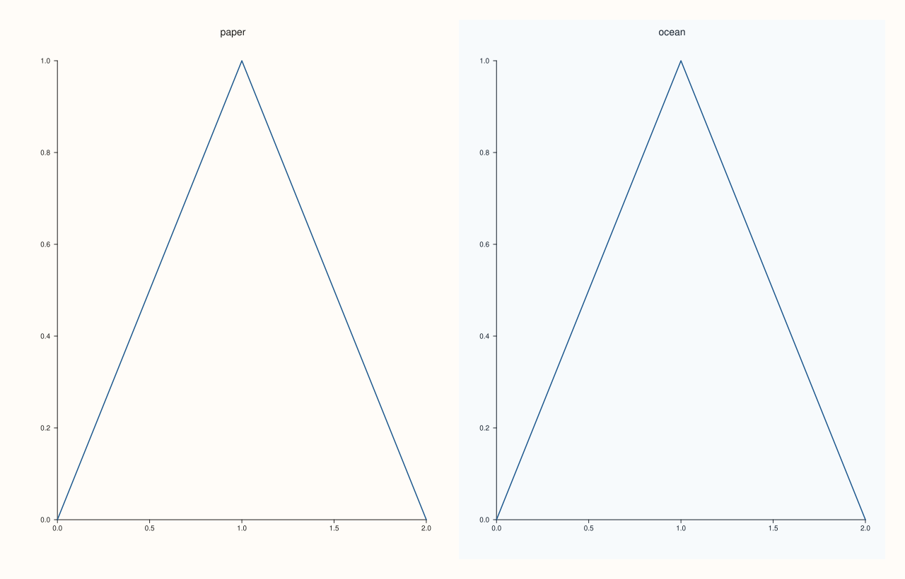
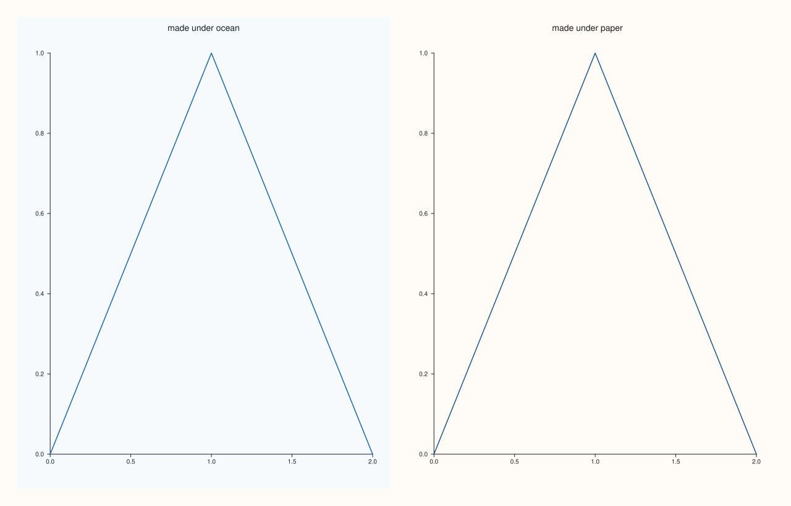
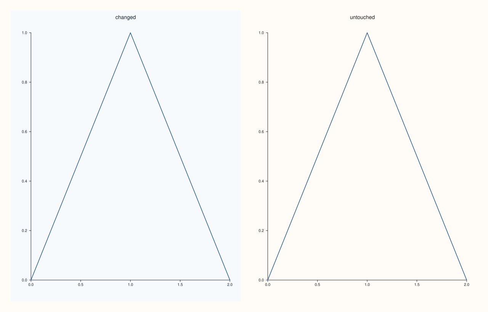
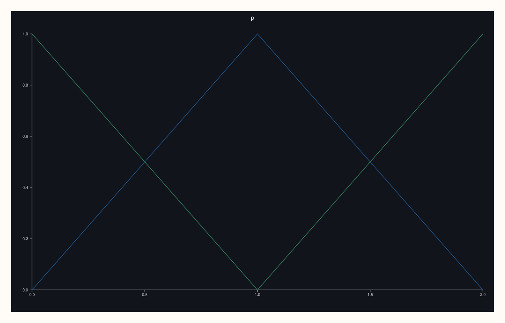

<!-- pluss-hand-authored -->

# Pane::theme_tokens

[Back to Pane API Reference](../../pane_api_reference)

## Signature

```cpp
const Theme& Pane::theme_tokens() const noexcept
Theme& Pane::theme_tokens() noexcept
```

## What It Does

Returns the pane's own [`Theme`](../types/Theme.md): the accent colours its traces cycle through, the background and foreground colours, and the palette of its surfaces. The non-const call returns a reference, and the theme is changed by assigning a whole `Theme` to it; a `Theme` has no setters for single fields.

A pane takes a **copy** of the figure's theme at the moment it is made ([`Studio::theme`](../studio/theme.md) before [`pane2`](../studio/pane2.md)). After that the two are independent: changing the pane's theme does not touch the figure or the other panes, and changing the figure's theme later does not reach panes that already exist. To restyle a whole figure, set the figure's theme first and then make the panes; to restyle one pane, assign to its `theme_tokens()`.

## Parameters

*(none)*

## Returns

`const Theme&` / `Theme&`
    The pane's own theme. The reference follows later calls; copy it to keep a theme.

## Examples

Example 1. A pane starts with the theme of its figure.

```cpp
auto fig = studio("theme_default");
auto& pane = fig.pane2("p");
pane.trend(std::vector<double>{0, 1, 2}, std::vector<double>{0, 1, 0});
std::cout << "figure: " << fig.theme_tokens().name() << ", pane: " << pane.theme_tokens().name() << "\n";
fig.save_svg("figure.svg");
```

### Output

```text
figure: paper, pane: paper
```


Example 2. Assigning a theme restyles the pane: the same data in the two built-in themes, `Theme::paper()` and `Theme::ocean()`.

```cpp
auto fig = studio("theme_assign");
fig.mosaic(1, 2);
auto& a = fig.pane2("paper");
a.trend(std::vector<double>{0, 1, 2}, std::vector<double>{0, 1, 0});
a.theme_tokens() = Theme::paper();
auto& b = fig.pane2("ocean");
b.trend(std::vector<double>{0, 1, 2}, std::vector<double>{0, 1, 0});
b.theme_tokens() = Theme::ocean();
std::cout << a.theme_tokens().name() << " and " << b.theme_tokens().name() << "\n";
fig.save_svg("figure.svg");
```

### Output

```text
paper and ocean
```



Example 3. The copy is taken when the pane is made. The first pane is made under the ocean theme; the figure's theme is then changed to paper, and the second pane is made. Each keeps the theme of its moment.

```cpp
auto fig = studio("theme_snapshot");
fig.mosaic(1, 2);
fig.theme(Theme::ocean());
auto& first = fig.pane2("made under ocean");
first.trend(std::vector<double>{0, 1, 2}, std::vector<double>{0, 1, 0});
fig.theme(Theme::paper());
auto& second = fig.pane2("made under paper");
second.trend(std::vector<double>{0, 1, 2}, std::vector<double>{0, 1, 0});
std::cout << "first: " << first.theme_tokens().name() << ", second: " << second.theme_tokens().name() << ", figure: " << fig.theme_tokens().name() << "\n";
fig.save_svg("figure.svg");
```

### Output

```text
first: ocean, second: paper, figure: paper
```



Example 4. Independent afterwards. Assigning a theme to one pane leaves the figure's theme and the other pane as they were.

```cpp
auto fig = studio("theme_independent");
fig.mosaic(1, 2);
auto& changed = fig.pane2("changed");
changed.trend(std::vector<double>{0, 1, 2}, std::vector<double>{0, 1, 0});
auto& untouched = fig.pane2("untouched");
untouched.trend(std::vector<double>{0, 1, 2}, std::vector<double>{0, 1, 0});
const std::string before = fig.theme_tokens().name();
changed.theme_tokens() = before == "paper" ? Theme::ocean() : Theme::paper();
std::cout << "changed: " << changed.theme_tokens().name() << ", untouched: " << untouched.theme_tokens().name() << ", figure still " << fig.theme_tokens().name() << "\n";
fig.save_svg("figure.svg");
```

### Output

```text
changed: ocean, untouched: paper, figure still paper
```



Example 5. Reading the tokens. The accents are the colours the traces take in turn, and the background and foreground are the colours of the page and of text and axes.

```cpp
auto fig = studio("theme_read");
auto& pane = fig.pane2("p");
pane.trend(std::vector<double>{0, 1, 2}, std::vector<double>{0, 1, 0});
const Theme& theme = pane.theme_tokens();
std::cout << theme.name() << ": " << theme.accents().size() << " accents; accent(0) red " << theme.accent(0).red << "\n";
std::cout << "background alpha " << theme.background().alpha << ", foreground alpha " << theme.foreground().alpha << "\n";
fig.save_svg("figure.svg");
```

### Output

```text
paper: 5 accents; accent(0) red 0.109804
background alpha 1, foreground alpha 1
```


Example 6. A theme of your own. The constructor takes a name, the accents, the background and foreground, and the palette of surfaces; this one is a dark page with two accents.

```cpp
auto fig = studio("theme_custom");
auto& pane = fig.pane2("p");
pane.trend(std::vector<double>{0, 1, 2}, std::vector<double>{0, 1, 0});
pane.trend(std::vector<double>{0, 1, 2}, std::vector<double>{1, 0, 1});
pane.theme_tokens() = Theme("night", {Rgba::from_u8(255, 170, 60), Rgba::from_u8(90, 200, 255)}, Rgba::from_u8(18, 20, 28), Rgba::from_u8(230, 230, 235), PaletteRamp::thermal());
std::cout << pane.theme_tokens().name() << " with " << pane.theme_tokens().accents().size() << " accents\n";
fig.save_svg("figure.svg");
```

### Output

```text
night with 2 accents
```



## Notes

- Both forms are `noexcept`.
- The figure's page background is the figure's theme; a pane's own background colour is drawn inside its area.

## See Also

- [`Theme`](../types/Theme.md): the type and its built-in themes.
- [`Studio::theme`](../studio/theme.md): the figure's theme, which new panes copy.
- [`Studio::theme_tokens`](../studio/theme_tokens.md): the figure's theme, read back.

<div class="pluss-inline-prev-next">
  <a class="prev-link" href="spire3.html">
    <span class="label">Previous</span>
    <span class="title">spire3</span>
  </a>
  <a class="next-link" href="tick_font_scale.html">
    <span class="label">Next</span>
    <span class="title">tick_font_scale</span>
  </a>
</div>
