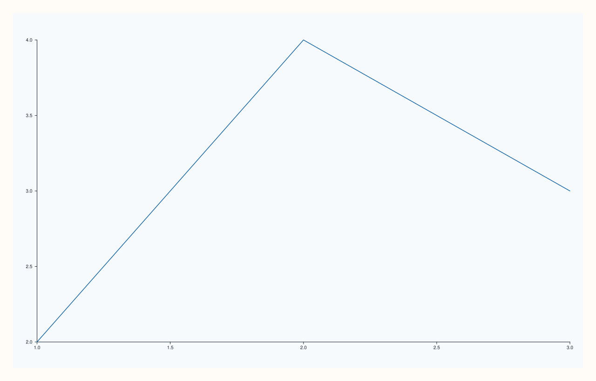
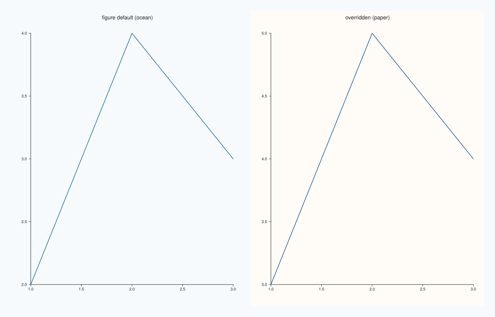

<!-- pluss-hand-authored -->

# Pane::theme_tokens

[Back to Pane API Reference](../../pane_api_reference)

## Signatures

```cpp
const Theme& Pane::theme_tokens() const noexcept
Theme& Pane::theme_tokens() noexcept
```

## What It Does

Returns this pane's own `Theme` — colors, name, and palette used when rendering this
specific pane. The `const` overload is a read-only accessor; the non-`const` overload
returns a **mutable reference**, letting the pane's theme be replaced in place by
assigning a whole new `Theme` value through it (`Theme` itself has no field-level setters
— so whole-value assignment is the only way to change it; `Theme` does not yet have its
own dedicated reference page).

Every new pane starts out with a **copy** of whatever `Theme` its figure's
[`Studio::theme_tokens()`](../studio/theme_tokens.md)/[`theme()`](../studio/theme.md) held
at the moment [`pane2()`](../studio/pane2.md)/[`pane3()`](../studio/pane3.md) created it —
the same creation-time-snapshot rule documented on `Studio::theme()`. After that moment,
though, the two are **completely independent**: mutating a pane's own `theme_tokens()`
never affects the figure's theme (or any other pane's), and mutating the figure's theme
afterward never reaches back into panes already created. See Example 3.

## Parameters

*(none)*

## Returns

`const Theme&` (const overload) / `Theme&` (non-const overload)
    A reference to this pane's current theme.

## Examples

Example 1. A freshly created pane's theme matches whatever the figure's default theme
was — `Theme::paper()`, `Studio`'s own constructor default, in this case.

```cpp
using namespace pluss::pl;

auto fig = studio("pane_theme_default");
auto& pane = fig.pane2();
pane.trend(std::vector<double>{1.0, 2.0, 3.0}, std::vector<double>{2.0, 4.0, 3.0});
fig.show();

std::cout << pane.theme_tokens().name() << "\n";
```

### Output

```text
paper
```


Example 2. Overriding a single pane's theme in place, independent of the figure's own
theme, via the non-`const` overload.

```cpp
using namespace pluss::pl;

auto fig = studio("pane_theme_mutated");
auto& pane = fig.pane2();
pane.theme_tokens() = Theme::ocean();
pane.trend(std::vector<double>{1.0, 2.0, 3.0}, std::vector<double>{2.0, 4.0, 3.0});
fig.show();

std::cout << pane.theme_tokens().name() << "\n";
```

### Output

```text
ocean
```



Example 3. Two panes on the same `Studio` themed `ocean` at the figure level, then one
pane overridden back to `paper` individually — the override doesn't leak to its sibling
pane, and reading each pane's theme happens immediately after that pane's own creation
(before the next `pane2()` call), per [`pane2()`](../studio/pane2.md)'s reference-safety
rule.

```cpp
using namespace pluss::pl;

auto fig = studio("pane_theme_independent");
fig.theme(Theme::ocean());

auto& first = fig.pane2("figure default (ocean)");
first.trend(std::vector<double>{1.0, 2.0, 3.0}, std::vector<double>{2.0, 4.0, 3.0});
std::string first_theme = first.theme_tokens().name();

auto& second = fig.pane2("overridden (paper)");
second.theme_tokens() = Theme::paper();
second.trend(std::vector<double>{1.0, 2.0, 3.0}, std::vector<double>{3.0, 5.0, 4.0});
std::string second_theme = second.theme_tokens().name();

fig.mosaic(1, 2);
fig.show();

std::cout << first_theme << " " << second_theme << "\n";
```

### Output

```text
ocean paper
```



## Notes

- Both overloads are `noexcept`.
- `Theme` has no field-level setters (only accessors and the two static factories
  `Theme::paper()`/`Theme::ocean()`), so the non-`const` overload is used for whole-value
  reassignment, e.g. `pane.theme_tokens() = Theme::ocean();` — the exact same idiom as
  [`Studio::theme_tokens()`](../studio/theme_tokens.md).
- Copied from the figure's theme at pane-creation time, then fully independent — mutating
  one side never affects the other afterward. See Example 3, and see
  [`pane_style_defaults()`](../studio/pane_style_defaults.md) for the figure-wide mechanism
  that captures a *template* pane's theme (among other fields) for future panes to inherit.

## See Also

- [`Studio::theme`](../studio/theme.md) / [`Studio::theme_tokens`](../studio/theme_tokens.md):
  the figure-wide theme every new pane starts from.
- [`Studio::pane_style_defaults`](../studio/pane_style_defaults.md): captures a template
  pane's theme (and other style fields) for future `pane2()`/`pane3()` calls to inherit.

<div class="pluss-inline-prev-next">
  <a class="prev-link" href="title.html">
    <span class="label">Previous</span>
    <span class="title">title</span>
  </a>
  <a class="next-link" href="lens.html">
    <span class="label">Next</span>
    <span class="title">lens</span>
  </a>
</div>
