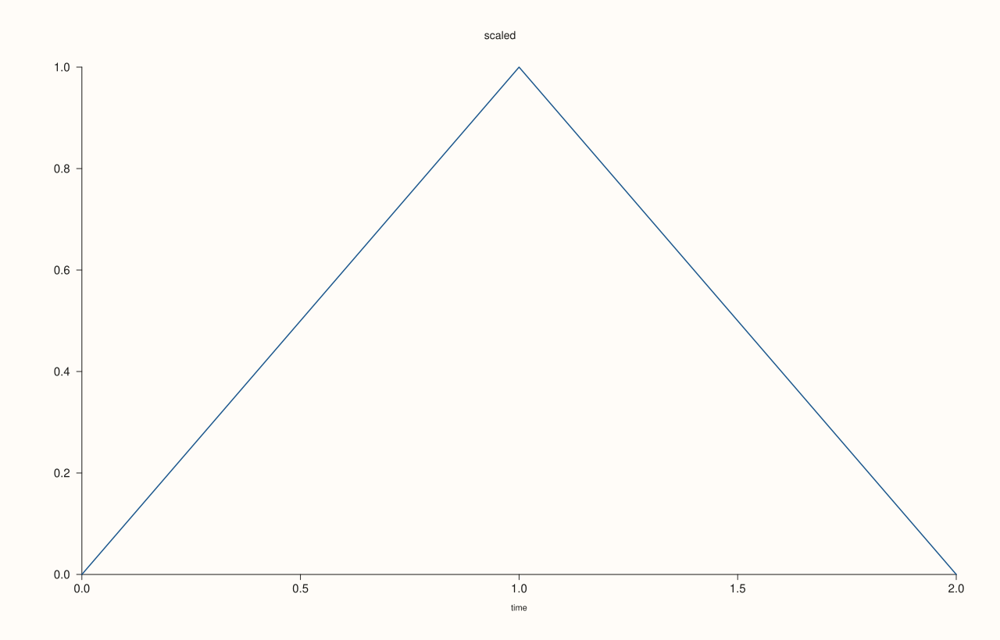
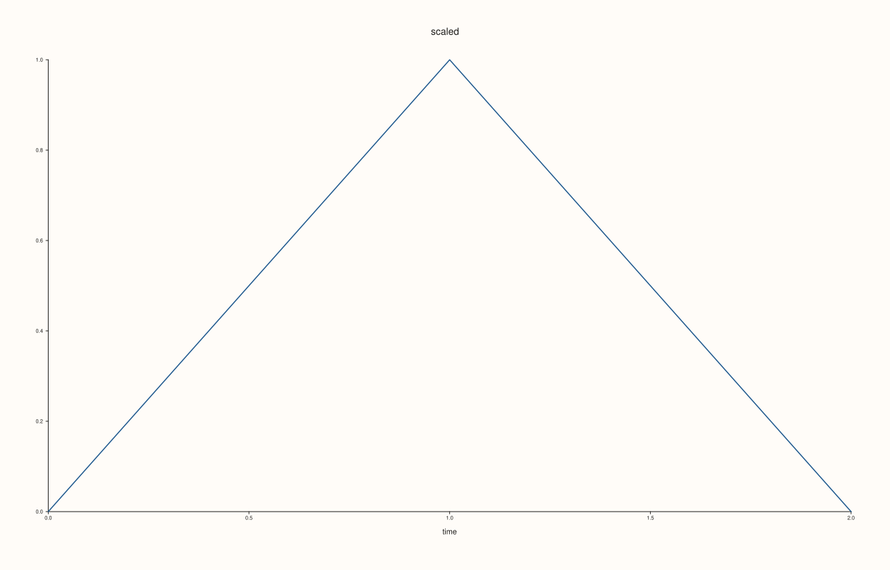
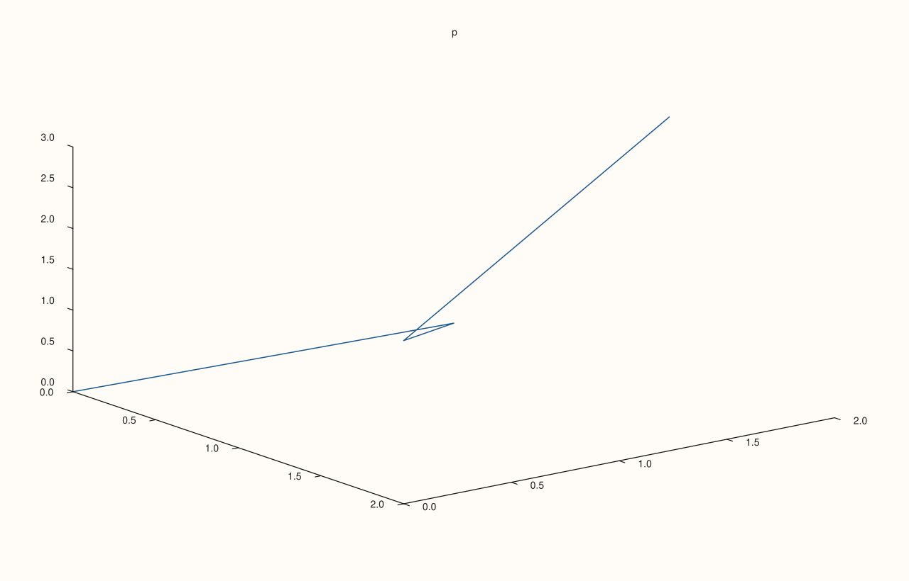
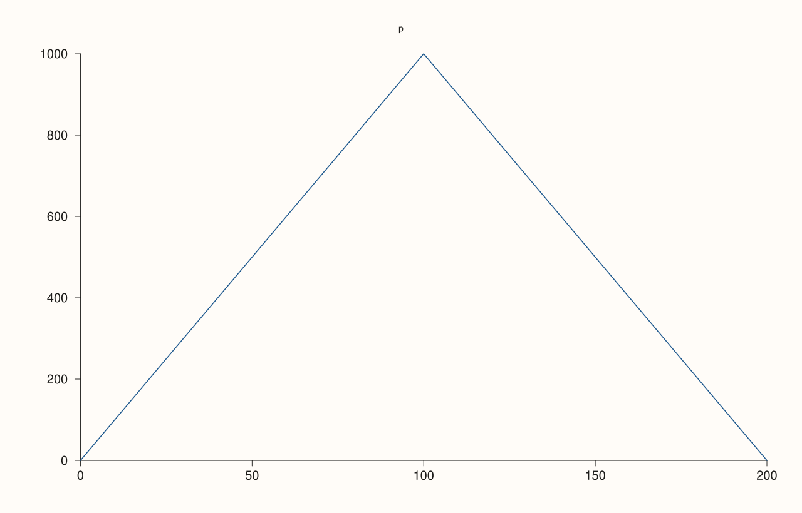

<!-- pluss-hand-authored -->

# Pane::tick_font_scale

[Back to Pane API Reference](../../pane_api_reference)

## Signature

```cpp
Pane& Pane::tick_font_scale(double scale)
double Pane::tick_font_scale() const noexcept
```

## What It Does

Scales the font of the tick labels of the pane, on all its axes at once. The scale is a factor on the default tick size: 1 is the default, 1.5 makes the labels half as large again, 0.75 three quarters. The layout follows: the margins grow with the labels, so larger labels are not cut off and the plot area gives way to them.

The scale must be finite and positive; anything else throws. It applies to the tick labels only: the axis labels have their own scale ([`axis_label_font_scale`](axis_label_font_scale.md)), the title and the legend are unaffected. The getter takes no argument.

## Parameters

**scale** (`double`, setter only)
    The factor on the default tick label size. Finite and strictly positive.

## Returns

**Setter:** `Pane&`, the same pane.
**Getter:** `double`, the scale in force; `1.0` for a new pane.

## Examples

Example 1. The default scale is 1. The tick labels are drawn at the default size.

```cpp
auto fig = studio("tickfont_default");
auto& pane = fig.pane2("p");
pane.trend(std::vector<double>{0, 1, 2}, std::vector<double>{0, 1, 0});
pane.x_label("time").title("scaled");
auto size_of = [](const std::string& svg, const std::string& text) {
  const auto hit = svg.find(">" + text + "<");
  if (hit == std::string::npos) return std::string("absent");
  const auto open = svg.rfind("<text", hit);
  const auto k = svg.find("font-size=\"", open) + 11;
  return svg.substr(k, svg.find('"', k) - k);
};
std::cout << "scale: " << pane.tick_font_scale() << ", tick label size: " << size_of(fig.to_svg(), "1.0") << "\n";
fig.save_svg("figure.svg");
```

### Output

```text
scale: 1, tick label size: 10.0000
```


Example 2. A scale of 1.5 makes the tick labels half as large again, and leaves the axis label and the title as they were.

```cpp
auto fig = studio("tickfont_larger");
auto& pane = fig.pane2("p");
pane.trend(std::vector<double>{0, 1, 2}, std::vector<double>{0, 1, 0});
pane.x_label("time").title("scaled");
auto size_of = [](const std::string& svg, const std::string& text) {
  const auto hit = svg.find(">" + text + "<");
  if (hit == std::string::npos) return std::string("absent");
  const auto open = svg.rfind("<text", hit);
  const auto k = svg.find("font-size=\"", open) + 11;
  return svg.substr(k, svg.find('"', k) - k);
};
pane.tick_font_scale(1.5);
const std::string svg = fig.to_svg();
std::cout << "tick: " << size_of(svg, "1.0") << ", axis label: " << size_of(svg, "time") << ", title: " << size_of(svg, "scaled") << "\n";
fig.save_svg("figure.svg");
```

### Output

```text
tick: 15.0000, axis label: 11.0000, title: 14.0000
```



Example 3. A scale below 1 shrinks them, which leaves more of the figure to the data.

```cpp
auto fig = studio("tickfont_smaller");
auto& pane = fig.pane2("p");
pane.trend(std::vector<double>{0, 1, 2}, std::vector<double>{0, 1, 0});
pane.x_label("time").title("scaled");
auto size_of = [](const std::string& svg, const std::string& text) {
  const auto hit = svg.find(">" + text + "<");
  if (hit == std::string::npos) return std::string("absent");
  const auto open = svg.rfind("<text", hit);
  const auto k = svg.find("font-size=\"", open) + 11;
  return svg.substr(k, svg.find('"', k) - k);
};
pane.tick_font_scale(0.75);
std::cout << "tick: " << size_of(fig.to_svg(), "1.0") << "\n";
fig.save_svg("figure.svg");
```

### Output

```text
tick: 7.5000
```



Example 4. Every axis takes the scale. On a volumetric pane the labels of all three axes grow together.

```cpp
auto fig = studio("tickfont_3d");
auto& pane = fig.pane3("p");
pane.path3(std::vector<double>{0, 1, 2, 1}, std::vector<double>{0, 1, 0, 2}, std::vector<double>{0, 1, 2, 3});
pane.tick_font_scale(1.4);
fig.save_svg("figure.svg");
```



Example 5. The room follows the text. With larger tick labels the plot area starts further from the left edge: the y tick labels, right-aligned against the axis, end further to the right.

```cpp
auto build = [&](double scale) {
  auto fig = studio("tickfont_layout");
  auto& pane = fig.pane2("p");
  pane.trend(std::vector<double>{0, 100, 200}, std::vector<double>{0, 1000, 0});
  pane.tick_font_scale(scale);
  return fig.to_svg();
};
auto at = [](const std::string& svg, const std::string& text) {
  const auto hit = svg.find(">" + text + "<");
  if (hit == std::string::npos) return std::string("absent");
  const auto open = svg.rfind("<text", hit);
  auto number = [&](const char* key) {
    const auto k = svg.find(std::string(key) + "=\"", open) + std::string(key).size() + 2;
    return std::stod(svg.substr(k, svg.find('"', k) - k));
  };
  return "(" + std::to_string(static_cast<int>(number("x"))) + ", " + std::to_string(static_cast<int>(number("y"))) + ")";
};
std::cout << "tick '1000' ends at " << at(build(1.0), "1000") << " at scale 1, " << at(build(2.0), "1000") << " at scale 2\n";
auto fig = studio("tickfont_layout_out");
auto& pane = fig.pane2("p");
pane.trend(std::vector<double>{0, 100, 200}, std::vector<double>{0, 1000, 0});
pane.tick_font_scale(2.0);
fig.save_svg("figure.svg");
```

### Output

```text
tick '1000' ends at (71, 89) at scale 1, (108, 93) at scale 2
```



Example 6. Zero, negative and non-finite scales throw, and the scale is left as it was.

```cpp
auto fig = studio("tickfont_errors");
auto& pane = fig.pane2("p");
pane.trend(std::vector<double>{0, 1}, std::vector<double>{0, 1});
for (double bad : {0.0, -1.0, std::numeric_limits<double>::quiet_NaN(), std::numeric_limits<double>::infinity()}) {
  try {
    pane.tick_font_scale(bad);
  } catch (const pluss::Error& e) {
    std::cout << e.message() << "\n";
  }
}
std::cout << "still " << pane.tick_font_scale() << "\n";
fig.save_svg("figure.svg");
```

### Output

```text
tick_font_scale: scale must be finite and positive
tick_font_scale: scale must be finite and positive
tick_font_scale: scale must be finite and positive
tick_font_scale: scale must be finite and positive
still 1
```


## Notes

- The setter throws `pluss::Error` for a scale that is not finite and positive; the getter is `noexcept`.
- The scale multiplies the base size, so it is a ratio and not a size in points.

## See Also

- [`Pane::axis_label_font_scale`](axis_label_font_scale.md): the same for the axis labels.
- [`Pane::x_tick_rotation`](x_tick_rotation.md): turn the labels.
- [`Pane::x_tick_labels`](x_tick_labels.md): switch the labels off.

<div class="pluss-inline-prev-next">
  <a class="prev-link" href="theme_tokens.html">
    <span class="label">Previous</span>
    <span class="title">theme_tokens</span>
  </a>
  <a class="next-link" href="title.html">
    <span class="label">Next</span>
    <span class="title">title</span>
  </a>
</div>
