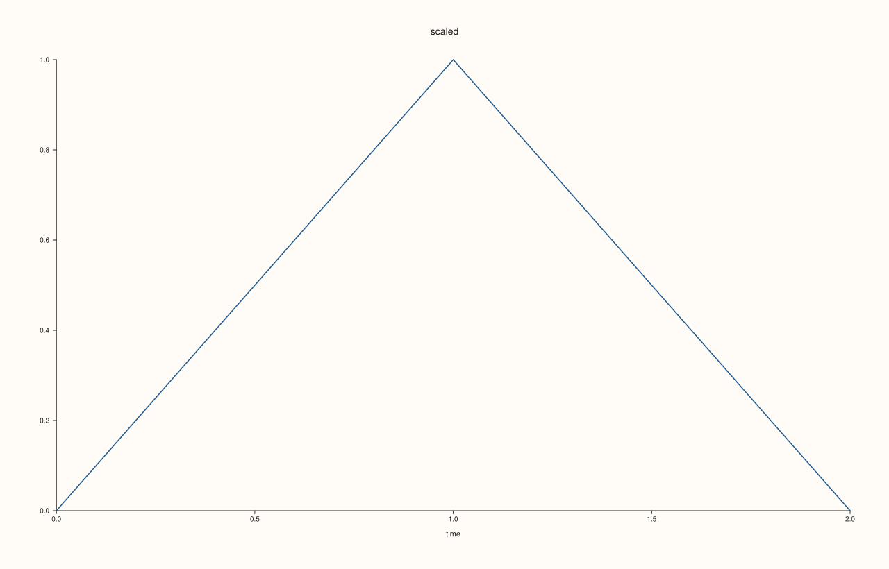
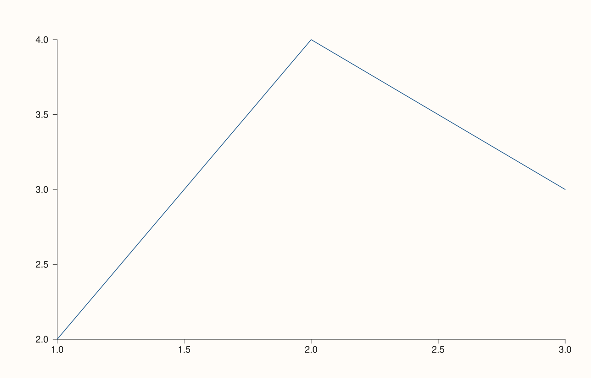

<!-- pluss-hand-authored -->

# Pane::tick_font_scale

[Back to Pane API Reference](../../pane_api_reference)

## Signatures

```cpp
Pane& Pane::tick_font_scale(double scale)          // setter
double Pane::tick_font_scale() const noexcept        // getter
```

## What It Does

Scales the font size used for tick labels on this pane, multiplicatively (`1.0` is normal
size, `2.0` doubles it). Every new pane starts with whatever
[`Studio::context_scales()`](../studio/context_scales.md) most recently set as the
figure's default `tick_font_scale`, at the moment the pane was created —
[`pane2()`](../studio/pane2.md)/[`pane3()`](../studio/pane3.md) apply that default automatically — and this
method then lets it be overridden per-pane afterward.

```{note} No overload-resolution ambiguity here, unlike visible()/axes_visible()/parallel_xy_labels()
`tick_font_scale(double scale)`'s setter has **no default argument** — it requires an
explicit `scale`, so calling `pane.tick_font_scale()` with zero arguments can only ever
match the `const` getter. There is no zero-argument collision to worry about, unlike
[`visible()`](visible.md)/[`axes_visible()`](axes_visible.md)/
[`parallel_xy_labels()`](parallel_xy_labels.md), whose bool setters default `enable` to
`true`.
```

## Parameters

**scale** (`double`, setter only)
    The multiplicative scale factor. Must be finite and positive.

## Returns

**Setter:** `Pane&` — a reference to the same pane, for chaining.

**Getter:** `double` — the current scale factor.

## Examples

Example 1. The default: `1.0`.

```cpp
using namespace pluss::pl;

auto fig = studio("tick_font_scale_default");
auto& pane = fig.pane2();
pane.trend(std::vector<double>{1.0, 2.0, 3.0}, std::vector<double>{2.0, 4.0, 3.0});
fig.show();

std::cout << pane.tick_font_scale() << "\n";
```

### Output

```text
1
```



Example 2. A larger scale — visibly bigger tick labels.

```cpp
using namespace pluss::pl;

auto fig = studio("tick_font_scale_large");
auto& pane = fig.pane2();
pane.trend(std::vector<double>{1.0, 2.0, 3.0}, std::vector<double>{2.0, 4.0, 3.0});
pane.tick_font_scale(2.0);
fig.show();

std::cout << pane.tick_font_scale() << "\n";
```

### Output

```text
2
```



Example 3. Both validation failures: zero and negative.

```cpp
using namespace pluss::pl;

auto fig = studio("tick_font_scale_failure");
auto& pane = fig.pane2();
pane.trend(std::vector<double>{1.0, 2.0}, std::vector<double>{1.0, 2.0});

try {
  pane.tick_font_scale(0.0);
} catch (const std::invalid_argument& e) {
  std::cout << e.what() << "\n";
}

try {
  pane.tick_font_scale(-1.0);
} catch (const std::invalid_argument& e) {
  std::cout << e.what() << "\n";
}
```

### Output

```text
tick_font_scale: scale must be finite and positive
tick_font_scale: scale must be finite and positive
```

## Notes

- The setter is not `noexcept` (validates finiteness and positivity); the getter **is**
  `noexcept`.
- Snapshotted from [`Studio::context_scales()`](../studio/context_scales.md) at
  pane-creation time — see [`pane2()`](../studio/pane2.md)'s Notes for the same "creation-time
  snapshot, not a live link" timing rule.
- Zero and negative values are both rejected, along with non-finite ones.

## See Also

- [`Pane::axis_label_font_scale`](axis_label_font_scale.md): the equivalent for axis
  *labels* rather than tick labels.
- [`Studio::context_scales`](../studio/context_scales.md): the figure-wide default this
  is initialized from.

<div class="pluss-inline-prev-next">
  <a class="prev-link" href="place.html">
    <span class="label">Previous</span>
    <span class="title">place</span>
  </a>
  <a class="next-link" href="axis_label_font_scale.html">
    <span class="label">Next</span>
    <span class="title">axis_label_font_scale</span>
  </a>
</div>
