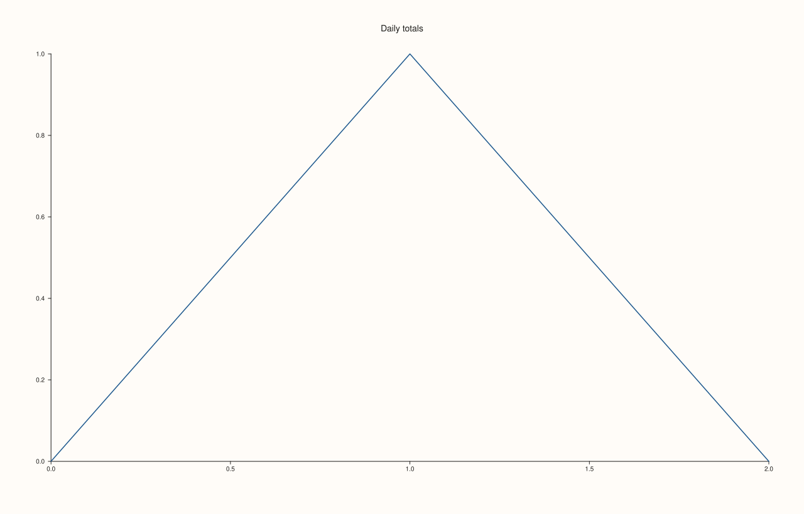
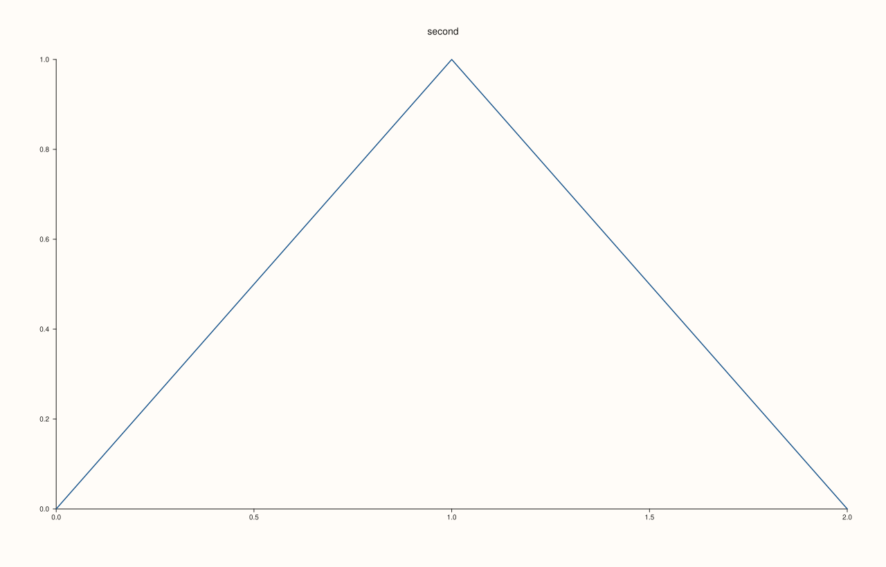
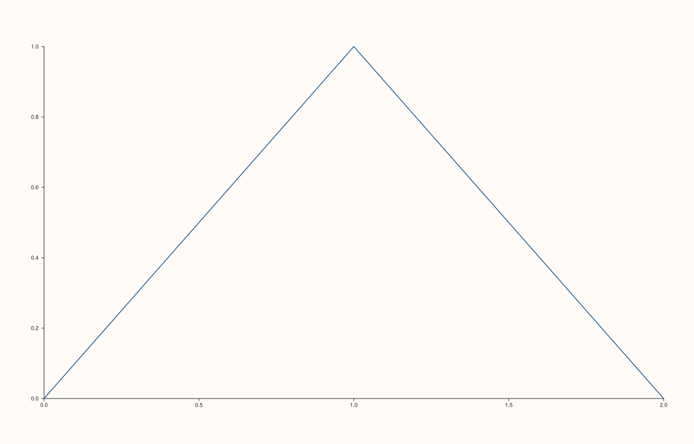
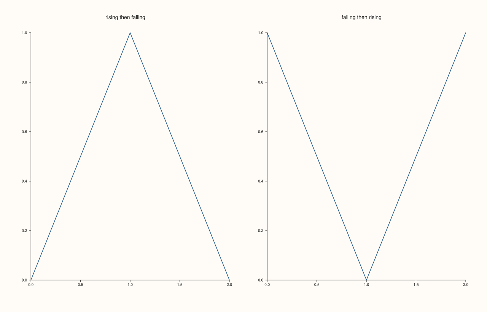
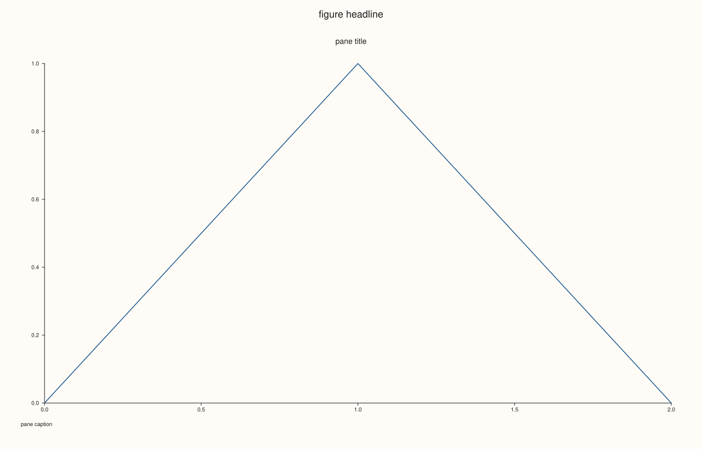

<!-- pluss-hand-authored -->

# Pane::title

[Back to Pane API Reference](../../pane_api_reference)

## Signature

```cpp
Pane& Pane::title(std::string title)
```

## What It Does

Sets the title of the pane, drawn above its plot area, centred over it. It replaces the title the pane was made with ([`Studio::pane2`](../studio/pane2.md)'s argument) and may be called at any time. An empty string removes the title, and a pane without one takes back the room the title would have used.

The title belongs to this pane. The figure's own heading is [`Studio::headline`](../studio/headline.md); a pane's [`caption`](caption.md) is a note below the plot; and an axis has its label. Text between dollar signs is typeset as mathematics.

## Parameters

**title** (`std::string`)
    The title. Empty for none.

## Returns

`Pane&`
    The same pane, for chaining.

## Examples

Example 1. Setting a title after the pane is made. The text is written above the plot and read back with `title_text()`.

```cpp
auto fig = studio("title_set");
auto& pane = fig.pane2("");
pane.trend(std::vector<double>{0, 1, 2}, std::vector<double>{0, 1, 0});
pane.title("Daily totals");
std::cout << "title_text: " << pane.title_text() << "\n";
std::cout << "drawn: " << (fig.to_svg().find(">Daily totals<") != std::string::npos) << "\n";
fig.save_svg("figure.svg");
```

### Output

```text
title_text: Daily totals
drawn: 1
```



Example 2. A second call replaces the first, and the title the pane was made with is replaced the same way.

```cpp
auto fig = studio("title_replace");
auto& pane = fig.pane2("first");
pane.trend(std::vector<double>{0, 1, 2}, std::vector<double>{0, 1, 0});
std::cout << "made with: " << pane.title_text() << "\n";
pane.title("second");
std::cout << "after title(): " << pane.title_text() << "\n";
const std::string svg = fig.to_svg();
std::cout << "first drawn: " << (svg.find(">first<") != std::string::npos) << ", second drawn: " << (svg.find(">second<") != std::string::npos) << "\n";
fig.save_svg("figure.svg");
```

### Output

```text
made with: first
after title(): second
first drawn: 0, second drawn: 1
```



Example 3. An empty string removes the title. The figure is then exactly the figure of a pane that never had one, the room included.

```cpp
auto build = [&](bool titled_then_cleared) {
  auto fig = studio("title_clear");
  auto& pane = fig.pane2();
  pane.trend(std::vector<double>{0, 1, 2}, std::vector<double>{0, 1, 0});
  if (titled_then_cleared) pane.title("temporary").title("");
  return fig.to_svg();
};
std::cout << "cleared == never titled: " << (build(true) == build(false)) << "\n";
auto fig = studio("title_clear_out");
auto& pane = fig.pane2();
pane.trend(std::vector<double>{0, 1, 2}, std::vector<double>{0, 1, 0});
fig.save_svg("figure.svg");
```

### Output

```text
cleared == never titled: 1
```



Example 4. Each pane has its own. In a mosaic every pane is titled for what it shows.

```cpp
auto fig = studio("title_mosaic");
fig.mosaic(1, 2);
auto& a = fig.pane2();
a.trend(std::vector<double>{0, 1, 2}, std::vector<double>{0, 1, 0});
a.title("rising then falling");
auto& b = fig.pane2();
b.trend(std::vector<double>{0, 1, 2}, std::vector<double>{1, 0, 1});
b.title("falling then rising");
fig.save_svg("figure.svg");
```



Example 5. Mathematics between dollar signs is typeset.

```cpp
auto fig = studio("title_math");
auto& pane = fig.pane2("");
pane.trend(std::vector<double>{0, 1, 2}, std::vector<double>{0, 1, 0});
pane.title("Decay $e^{-t}$");
fig.save_svg("figure.svg");
```


Example 6. A title is not the headline and not a caption: the three are set by three calls and drawn in three places.

```cpp
auto fig = studio("title_distinct");
auto& pane = fig.pane2("");
pane.trend(std::vector<double>{0, 1, 2}, std::vector<double>{0, 1, 0});
pane.title("pane title").caption("pane caption");
fig.headline("figure headline");
const std::string svg = fig.to_svg();
std::cout << "all three drawn: " << (svg.find(">pane title<") != std::string::npos && svg.find(">pane caption<") != std::string::npos && svg.find(">figure headline<") != std::string::npos) << "\n";
fig.save_svg("figure.svg");
```

### Output

```text
all three drawn: 1
```



## Notes

- Any string is accepted; the empty string clears the title.
- Read the title back with [`title_text`](title_text.md).

## See Also

- [`Pane::title_text`](title_text.md): read the title.
- [`Pane::caption`](caption.md): a note below the plot.
- [`Studio::headline`](../studio/headline.md): the heading of the figure.

<div class="pluss-inline-prev-next">
  <a class="prev-link" href="tick_font_scale.html">
    <span class="label">Previous</span>
    <span class="title">tick_font_scale</span>
  </a>
  <a class="next-link" href="title_text.html">
    <span class="label">Next</span>
    <span class="title">title_text</span>
  </a>
</div>
