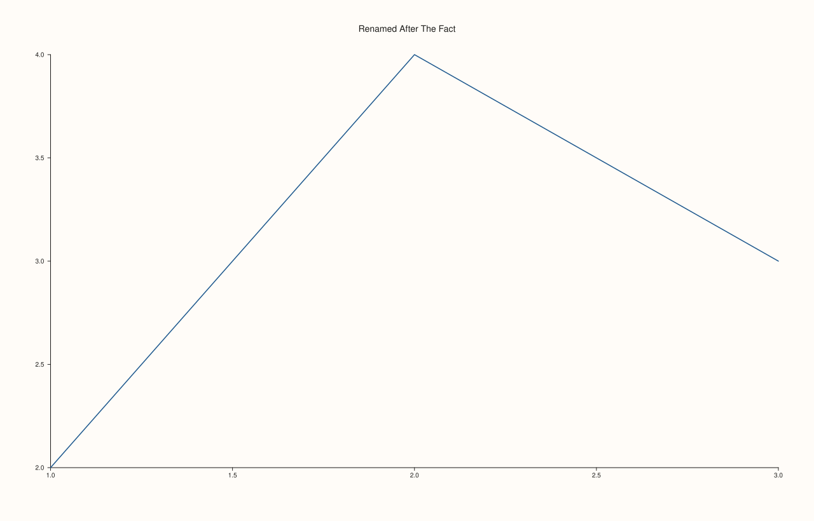
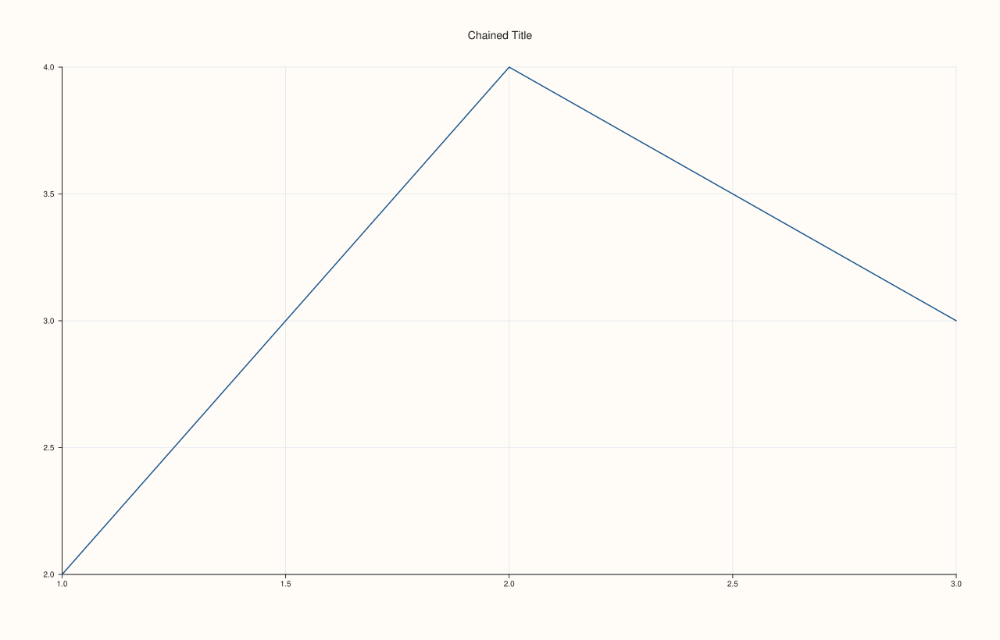

<!-- pluss-hand-authored -->

# Pane::title

[Back to Pane API Reference](../../pane_api_reference)

## Signature

```cpp
Pane& Pane::title(std::string title)
```

## What It Does

Sets (or replaces, or clears) the pane's own title text after construction — the same
field [`Studio::pane2()`](../studio/pane2.md)/[`Studio::pane3()`](../studio/pane3.md)'s
`title` constructor parameter initializes, just reachable at any later point in the
pane's lifetime rather than only at creation time. Passing an empty string clears the
title back to drawing nothing, exactly matching the constructor's default.

```{note} No validation, no throw
Unlike many string-taking setters elsewhere in `PlussPl`, `title()` performs no validation
at all — any `std::string`, including an empty one, is accepted unconditionally.
```

## Parameters

**title** (`std::string`)
    The new title text. An empty string clears any existing title.

## Returns

`Pane&`
    A reference to the same pane, for chaining.

## Examples

Example 1. Overwriting a title given at construction time.

```cpp
using namespace pluss::pl;

auto fig = studio("title_setter");
auto& pane = fig.pane2("Original");
pane.trend(std::vector<double>{1.0, 2.0, 3.0}, std::vector<double>{2.0, 4.0, 3.0});
pane.title("Renamed After The Fact");
fig.show();

std::cout << pane.title_text() << "\n";
```

### Output

```text
Renamed After The Fact
```



Example 2. Clearing a title back to empty with `title("")`.

```cpp
using namespace pluss::pl;

auto fig = studio("title_cleared");
auto& pane = fig.pane2("Will Be Cleared");
pane.trend(std::vector<double>{1.0, 2.0, 3.0}, std::vector<double>{2.0, 4.0, 3.0});
pane.title("");
fig.show();

std::cout << pane.title_text().empty() << "\n";
```

### Output

```text
1
```


Example 3. Chaining `title()` with other setters, since it returns `Pane&`.

```cpp
using namespace pluss::pl;

auto fig = studio("title_chained");
auto& pane = fig.pane2();
pane.title("Chained Title").grid(GridStyle::Major);
pane.trend(std::vector<double>{1.0, 2.0, 3.0}, std::vector<double>{2.0, 4.0, 3.0});
fig.show();

std::cout << pane.title_text() << " " << static_cast<int>(pane.grid_style()) << "\n";
```

### Output

```text
Chained Title 1
```



## Notes

- Not marked `noexcept`, though in practice only fails via `std::string`'s own allocation
  failure — no argument validation of its own.
- An empty string is a legitimate way to clear the title, not an error.
- Chains naturally with every other `Pane&`-returning setter.

## See Also

- [`Pane::title_text`](title_text.md): reads back the current value.
- [`Studio::pane2`](../studio/pane2.md) / [`Studio::pane3`](../studio/pane3.md): where a
  title is normally supplied up front, as an alternative to calling `title()` afterward.

<div class="pluss-inline-prev-next">
  <a class="prev-link" href="title_text.html">
    <span class="label">Previous</span>
    <span class="title">title_text</span>
  </a>
  <a class="next-link" href="theme_tokens.html">
    <span class="label">Next</span>
    <span class="title">theme_tokens</span>
  </a>
</div>
