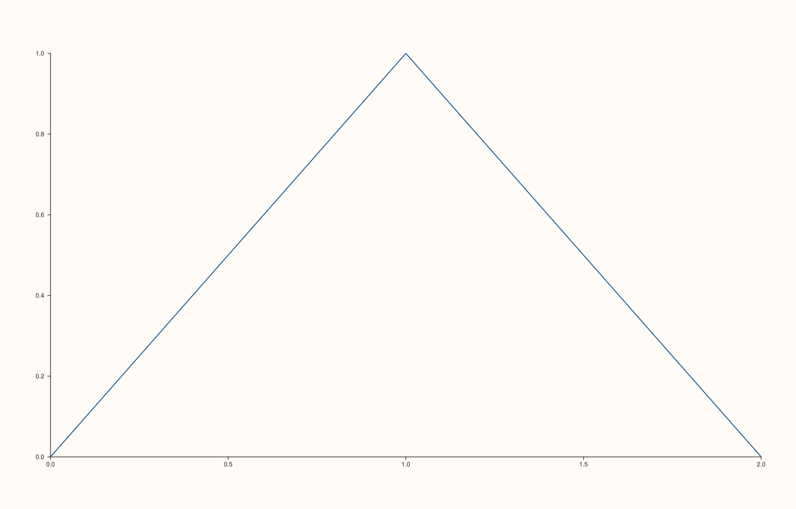
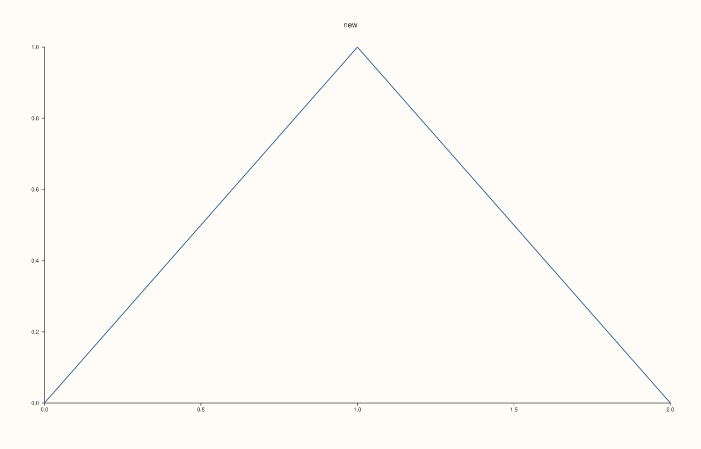
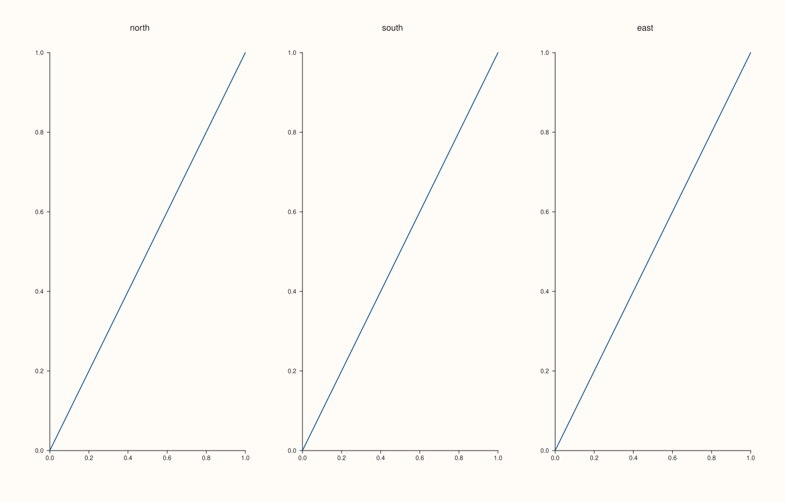

<!-- pluss-hand-authored -->

# Pane::title_text

[Back to Pane API Reference](../../pane_api_reference)

## Signature

```cpp
const std::string& Pane::title_text() const noexcept
```

## What It Does

Returns the pane's title: the text it was made with ([`Studio::pane2`](../studio/pane2.md), [`pane3`](../studio/pane3.md)) or the last one given to [`title`](title.md). An empty string means no title.

Use it to find a pane among those of a figure ([`Studio::panes`](../studio/panes.md) lists them), to build a legend or a report from the titles, or to restore a title after changing it. The reference is to the pane's own string and follows later calls; copy it to keep the value.

## Parameters

*(none)*

## Returns

`const std::string&`
    The title, empty for none.

## Examples

Example 1. The title given when the pane is made.

```cpp
auto fig = studio("title_text_made");
auto& pane = fig.pane2("Revenue");
pane.trend(std::vector<double>{0, 1, 2}, std::vector<double>{0, 1, 0});
std::cout << "'" << pane.title_text() << "'\n";
fig.save_svg("figure.svg");
```

### Output

```text
'Revenue'
```


Example 2. A pane made without a title has an empty one.

```cpp
auto fig = studio("title_text_untitled");
auto& pane = fig.pane2();
pane.trend(std::vector<double>{0, 1, 2}, std::vector<double>{0, 1, 0});
std::cout << "empty: " << pane.title_text().empty() << "\n";
fig.save_svg("figure.svg");
```

### Output

```text
empty: 1
```



Example 3. After `title()` it returns the new text.

```cpp
auto fig = studio("title_text_after");
auto& pane = fig.pane2("old");
pane.trend(std::vector<double>{0, 1, 2}, std::vector<double>{0, 1, 0});
pane.title("new");
std::cout << pane.title_text() << "\n";
fig.save_svg("figure.svg");
```

### Output

```text
new
```



Example 4. Listing the panes of a figure by title.

```cpp
auto fig = studio("title_text_listing");
fig.mosaic(1, 3);
for (const char* name : {"north", "south", "east"}) {
  fig.pane2(name).trend(std::vector<double>{0, 1}, std::vector<double>{0, 1});
}
for (const auto& pane : fig.panes()) std::cout << pane.title_text() << " ";
std::cout << "\n";
fig.save_svg("figure.svg");
```

### Output

```text
north south east 
```



## Notes

- `noexcept`; reads only.

## See Also

- [`Pane::title`](title.md): set the title.
- [`Studio::panes`](../studio/panes.md): the panes of a figure.

<div class="pluss-inline-prev-next">
  <a class="prev-link" href="title.html">
    <span class="label">Previous</span>
    <span class="title">title</span>
  </a>
  <a class="next-link" href="trend.html">
    <span class="label">Next</span>
    <span class="title">trend</span>
  </a>
</div>
