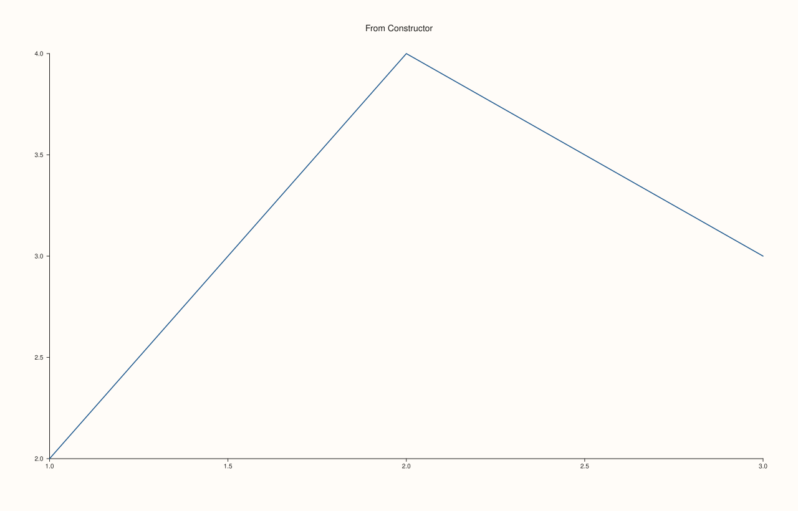
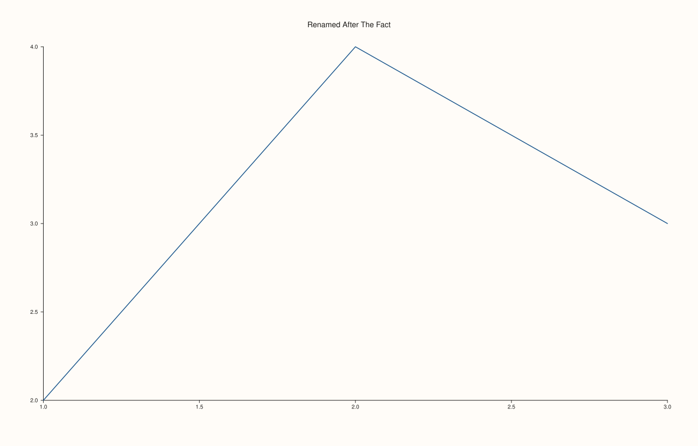

<!-- pluss-hand-authored -->

# Pane::title_text

[Back to Pane API Reference](../../pane_api_reference)

## Signature

```cpp
const std::string& Pane::title_text() const noexcept
```

## What It Does

Returns the pane's current title — the text drawn above the pane's own plot area,
independent of the figure-wide [`Studio::headline`](../studio/headline.md). Empty by
default, whether left unset at construction (both
[`Studio::pane2()`](../studio/pane2.md)/[`Studio::pane3()`](../studio/pane3.md) default
their `title` parameter to `{}`) or explicitly cleared later via
[`title("")`](title.md).

## Parameters

*(none)*

## Returns

`const std::string&`
    The pane's current title text.

## Examples

Example 1. No title given at creation — empty by default.

```cpp
using namespace pluss::pl;

auto fig = studio("title_default");
auto& pane = fig.pane2();
pane.trend(std::vector<double>{1.0, 2.0, 3.0}, std::vector<double>{2.0, 4.0, 3.0});
fig.show();

std::cout << pane.title_text().empty() << "\n";
```

### Output

```text
1
```


Example 2. A title supplied through `pane2()`'s constructor-forwarded `title` parameter.

```cpp
using namespace pluss::pl;

auto fig = studio("title_ctor");
auto& pane = fig.pane2("From Constructor");
pane.trend(std::vector<double>{1.0, 2.0, 3.0}, std::vector<double>{2.0, 4.0, 3.0});
fig.show();

std::cout << pane.title_text() << "\n";
```

### Output

```text
From Constructor
```



Example 3. A title changed afterward through [`title()`](title.md) — see that page for the
setter itself; `title_text()` reads back whatever it was most recently set to, from either
source.

```cpp
using namespace pluss::pl;

auto fig = studio("title_setter");
auto& pane = fig.pane2("Original");
pane.trend(std::vector<double>{1.0, 2.0, 3.0}, std::vector<double>{2.0, 4.0, 3.0});
pane.title("Renamed After The Fact");
fig.show();

std::cout << pane.title_text() << "\n";
```

### Output

```text
Renamed After The Fact
```



## Notes

- `noexcept`, `const`.
- Empty is a well-defined, valid state — an empty title simply draws no title text above
  the pane, it isn't an error state.
- Reflects whichever source (constructor parameter or [`title()`](title.md) setter) most
  recently wrote to it.

## See Also

- [`Pane::title`](title.md): the only way to change this after construction.
- [`Studio::pane2`](../studio/pane2.md) / [`Studio::pane3`](../studio/pane3.md): where the
  initial title is normally supplied.
- [`Studio::headline`](../studio/headline.md): the figure-wide equivalent, as opposed to
  this per-pane title.

<div class="pluss-inline-prev-next">
  <a class="prev-link" href="kind.html">
    <span class="label">Previous</span>
    <span class="title">kind</span>
  </a>
  <a class="next-link" href="title.html">
    <span class="label">Next</span>
    <span class="title">title</span>
  </a>
</div>
