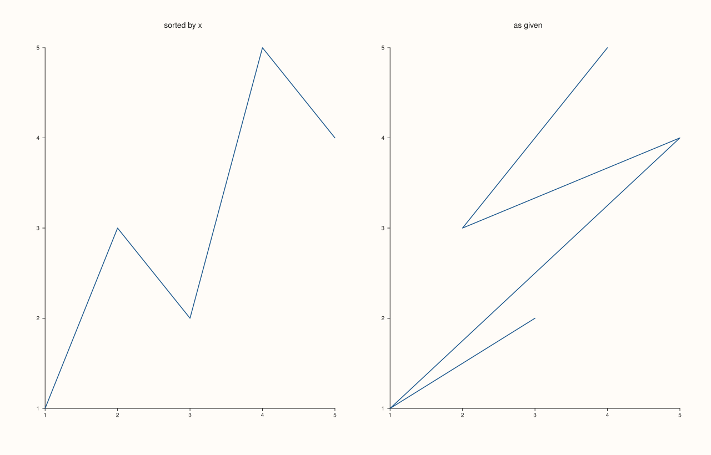
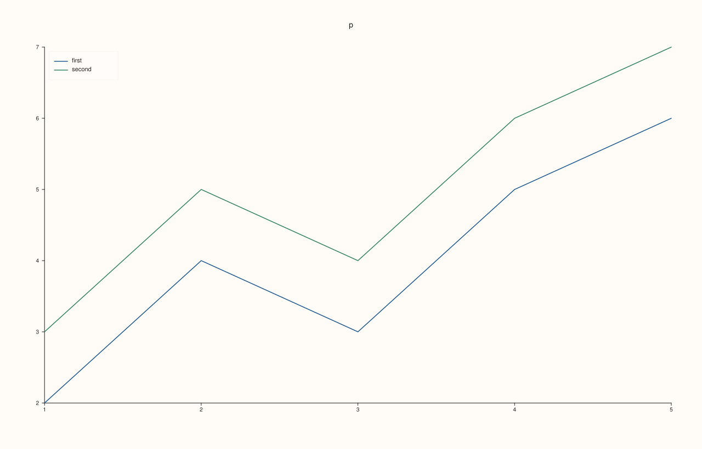
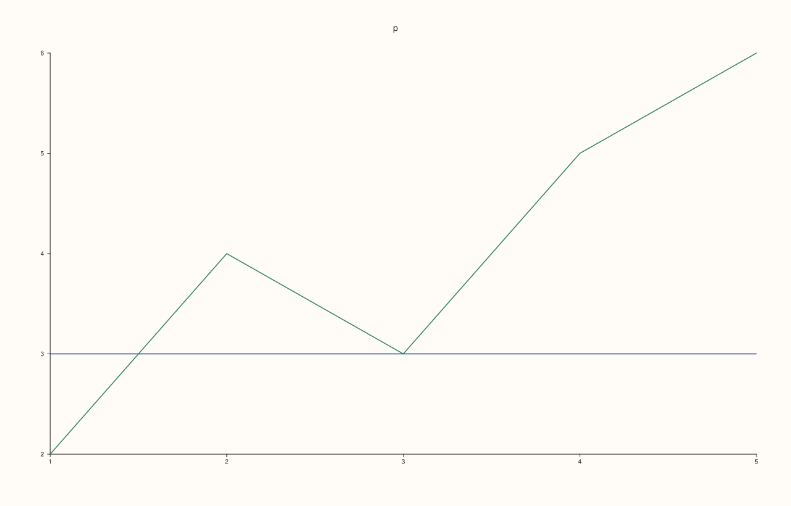
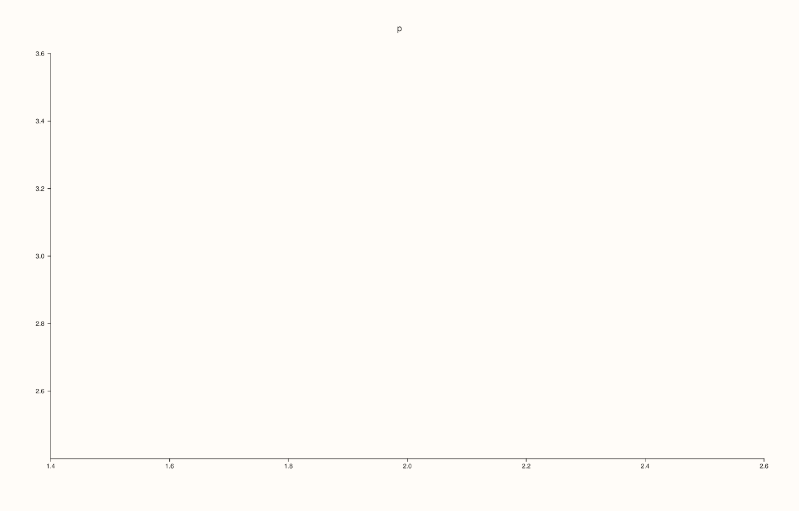

<!-- pluss-hand-authored -->

# Pane::trend

[Back to Pane API Reference](../../pane_api_reference)

## Signature

```cpp
Trace& Pane::trend(Series x, Series y)
```

## What It Does

Adds a **line**: the points `(x[i], y[i])` joined in the order given. It is the basic trace of a plot of one quantity against another and the one every line chart of [`flash`](../../flash_api_reference) is built on.

`x` and `y` are anything that converts to a `Series`. They must have the same length, or one of them a single value, which is repeated. Empty series are refused. The line is not sorted: put the points in the order they should be joined. Series with `NaN` are accepted and drawn as far as the other values go.

The pane needs to be planar ([`pane2`](../studio/pane2.md)); a volumetric pane takes [`path3`](path3.md) instead.

## Parameters

**x**, **y** (`Series`-convertible)
    The coordinates of the points. Equal lengths, or one of length 1.

## Returns

`Trace&`
    The new trace, for styling.

## Examples

Example 1. A line through five points. Points are joined in the order they are given.

```cpp
auto fig = studio("trend_basic");
auto& pane = fig.pane2("p");
Trace& line = pane.trend(std::vector<double>{1, 2, 3, 4, 5}, std::vector<double>{2, 4, 3, 5, 6});
std::cout << "traces: " << pane.trace_count() << "\n";
fig.save_svg("figure.svg");
```

### Output

```text
traces: 1
```


Example 2. The order is the order of the data: `trend` does not sort by x. The same five points in a different order make a different path.

```cpp
auto fig = studio("trend_order");
fig.mosaic(1, 2);
auto& sorted = fig.pane2("sorted by x");
sorted.trend(std::vector<double>{1, 2, 3, 4, 5}, std::vector<double>{1, 3, 2, 5, 4});
auto& shuffled = fig.pane2("as given");
shuffled.trend(std::vector<double>{3, 1, 5, 2, 4}, std::vector<double>{2, 1, 4, 3, 5});
fig.save_svg("figure.svg");
```



Example 3. Several traces on one pane, each added by its own call, take the accent colours of the theme in turn.

```cpp
auto fig = studio("trend_two");
auto& pane = fig.pane2("p");
pane.trend(std::vector<double>{1, 2, 3, 4, 5}, std::vector<double>{2, 4, 3, 5, 6}).label("first");
pane.trend(std::vector<double>{1, 2, 3, 4, 5}, std::vector<double>{3, 5, 4, 6, 7}).label("second");
pane.legend(KeyPlace::NorthWest);
std::cout << "traces: " << pane.trace_count() << "\n";
fig.save_svg("figure.svg");
```

### Output

```text
traces: 2
```



Example 4. A single value is repeated to the length of the other series, so a flat line is `trend(x, 3.0)` written as a one-element series.

```cpp
auto fig = studio("trend_broadcast");
auto& pane = fig.pane2("p");
pane.trend(std::vector<double>{1, 2, 3, 4, 5}, pluss::series::linspace(3.0, 3.0, 1, pluss::ScalarType::Float64));
pane.trend(std::vector<double>{1, 2, 3, 4, 5}, std::vector<double>{2, 4, 3, 5, 6});
fig.save_svg("figure.svg");
```



Example 5. Anything that converts to a `Series` is accepted: `std::vector` of any arithmetic type, an initializer list, or a `Series`. The three calls draw the same line.

```cpp
auto build = [&](int how) {
  auto fig = studio("trend_types");
  auto& pane = fig.pane2("p");
  if (how == 0) pane.trend(std::vector<double>{1, 2, 3}, std::vector<double>{2, 4, 3});
  if (how == 1) pane.trend(std::vector<int>{1, 2, 3}, std::vector<float>{2, 4, 3});
  if (how == 2) pane.trend(pluss::series::linspace(1.0, 3.0, 3, pluss::ScalarType::Float64), std::vector<double>{2, 4, 3});
  return fig.to_svg();
};
std::cout << "vector<int>/<float> == vector<double>: " << (build(1) == build(0)) << ", linspace Series == vector: " << (build(2) == build(0)) << "\n";
auto fig = studio("trend_types_out");
auto& pane = fig.pane2("p");
pane.trend(std::vector<double>{1, 2, 3}, std::vector<double>{2, 4, 3});
fig.save_svg("figure.svg");
```

### Output

```text
vector<int>/<float> == vector<double>: 1, linspace Series == vector: 1
```


Example 6. One point is a valid trace, with nothing to join: it adds a trace that draws no line, and the pane's range still comes from it.

```cpp
auto fig = studio("trend_single");
auto& pane = fig.pane2("p");
pane.trend(std::vector<double>{2.0}, std::vector<double>{3.0});
std::cout << "traces: " << pane.trace_count() << "\n";
fig.save_svg("figure.svg");
```

### Output

```text
traces: 1
```



Example 7. Inputs that cannot be drawn are refused when the trace is added, and the message names the method and the problem. The pane keeps the traces it had.

```cpp
auto report = [](const char* what, auto&& call) {
  auto fig = studio("trend_errors");
  auto& pane = fig.pane2("p");
  try {
    call(pane);
    std::cout << what << ": accepted\n";
  } catch (const pluss::Error& e) {
    std::cout << what << ": " << e.message() << "\n";
  }
};
report("lengths differ", [](Pane& pane) { pane.trend(std::vector<double>{1, 2, 3}, std::vector<double>{1, 2}); });
report("empty", [](Pane& pane) { pane.trend(std::vector<double>{}, std::vector<double>{}); });
auto fig = studio("trend_errors_out");
auto& pane = fig.pane2("p");
pane.trend(std::vector<double>{0, 1}, std::vector<double>{0, 1});
fig.save_svg("figure.svg");
```

### Output

```text
lengths differ: trend: series lengths must match or broadcast from scalar
empty: trend: empty series inputs are not supported
```


Example 8. `trend` needs a planar pane. On a volumetric pane it throws at once, naming the kind it needs, and nothing is added.

```cpp
auto fig = studio("trend_wrong_pane");
auto& pane = fig.pane3("p");
try {
  pane.trend(std::vector<double>{0, 1}, std::vector<double>{0, 1});
} catch (const pluss::Error& e) {
  std::cout << e.message() << "\n";
}
std::cout << "traces: " << pane.trace_count() << "\n";
fig.save_svg("figure.svg");
```

### Output

```text
trend requires a planar pane
traces: 0
```


## Notes

- Returns the new [`Trace&`](../trace/label.md); the reference stays valid for the life of the pane, and the style calls of the trace ([`label`](../trace/label.md), [`stroke`](../trace/stroke.md), [`width`](../trace/width.md), ...) chain off it.
- The data is copied into the trace when it is added, so changing the vector afterwards does not change the figure.

## See Also

- [`Pane::path3`](path3.md): the line in three dimensions.
- [`Pane::cloud`](cloud.md): the points without the line.
- [`Pane::ribbon`](ribbon.md): the region under a line.

<div class="pluss-inline-prev-next">
  <a class="prev-link" href="title_text.html">
    <span class="label">Previous</span>
    <span class="title">title_text</span>
  </a>
  <a class="next-link" href="violin.html">
    <span class="label">Next</span>
    <span class="title">violin</span>
  </a>
</div>
