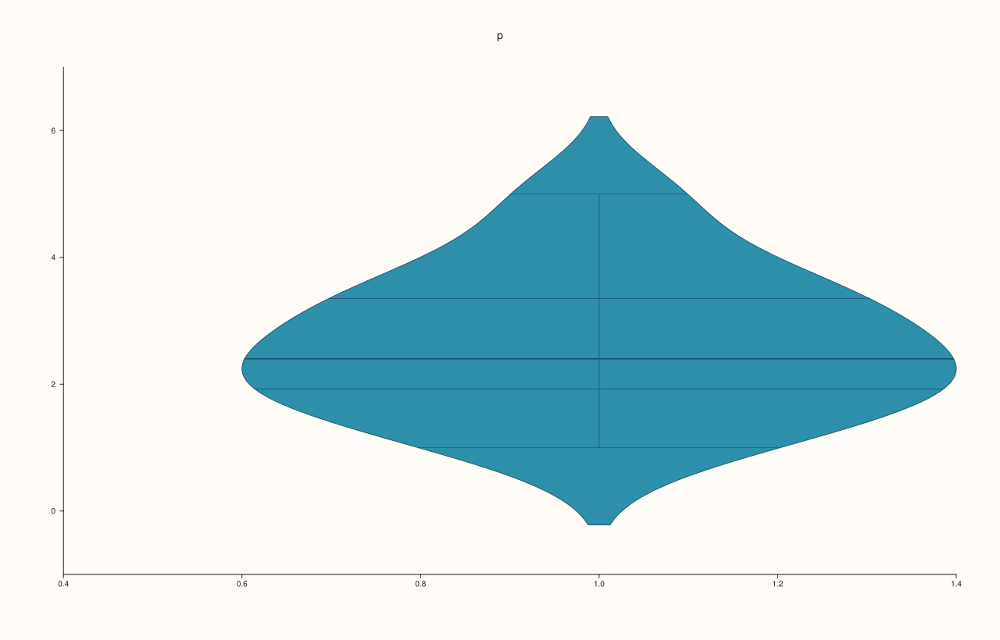
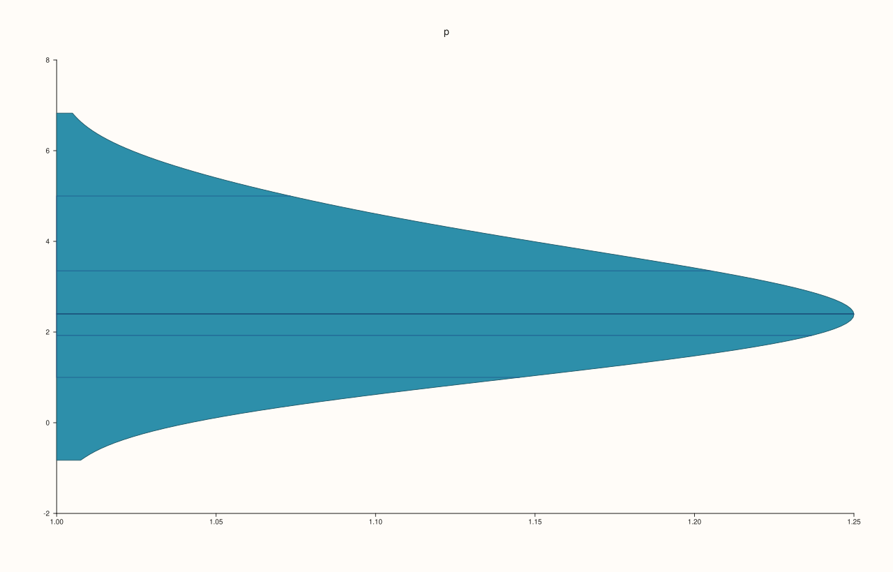
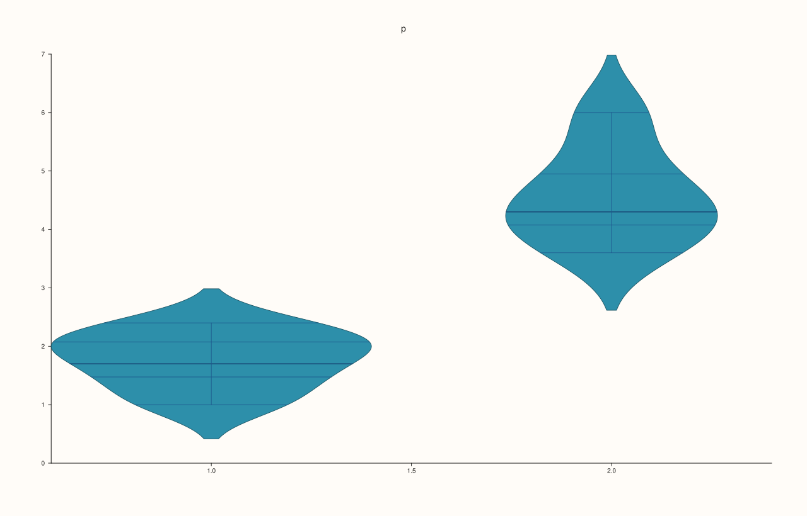
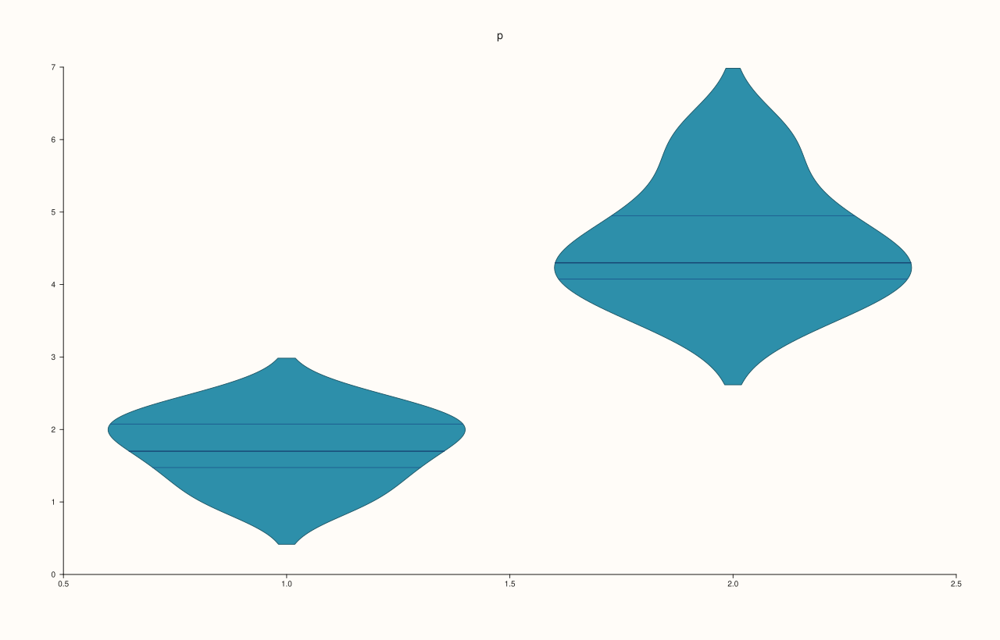
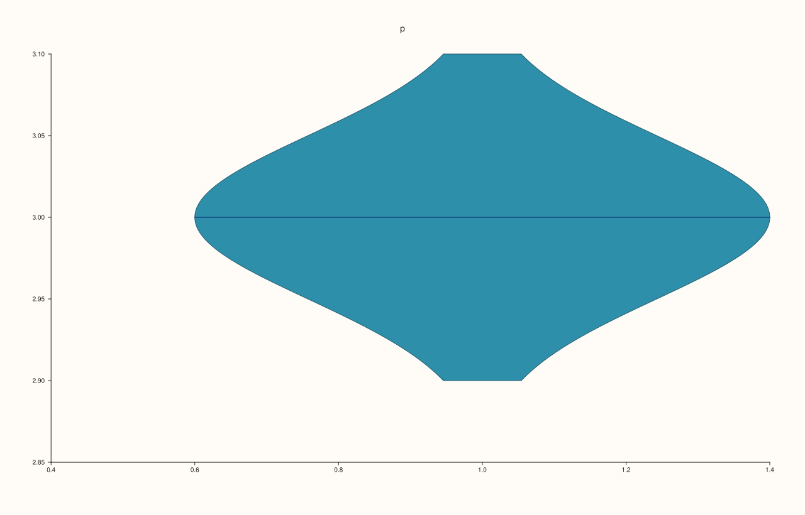

<!-- pluss-hand-authored -->

# Pane::violin

[Back to Pane API Reference](../../pane_api_reference)

## Signature

```cpp
Trace& Pane::violin(Series values)
Trace& Pane::violin(Series values, const ViolinOptions& options)
Trace& Pane::violin(Series group, Series values)
Trace& Pane::violin(Series group, Series values, const ViolinOptions& options)
```

## What It Does

Adds a **violin plot**: a smoothed estimate of the distribution of a sample, drawn as a mirrored outline that is wide where the values are dense. Unlike a [box](quartet.md) it shows bumps and gaps in the distribution, and unlike a [histogram](bucket.md) it has no bins to choose.

The four calls are the two choices, grouped or not and with options or not:

| Call | Draws |
|---|---|
| `violin(values)` | One violin, default options. |
| `violin(values, options)` | One violin, shaped by `options`. |
| `violin(group, values)` | One violin per distinct group, default options. |
| `violin(group, values, options)` | One per group, shaped by `options`. |

[`ViolinOptions`](../types/ViolinOptions.md) holds the width of the violins, how much the estimate is smoothed, how far the outline extends past the data, whether the groups are scaled by area, by count or to a common width, what is drawn inside, and which side is drawn. The options are checked when the trace is added: `width` and `bw_adjust` must be positive and finite, `cut` non-negative and finite.

## Parameters

**values** (`Series`-convertible)
    The sample.

**group** (`Series`-convertible, optional)
    The group of each value; same length as `values`.

**options** (`ViolinOptions`, optional)
    The shape of the violins.

## Returns

`Trace&`
    The new trace.

## Examples

Example 1. One violin for all the values: the outline is a smoothed estimate of how the values are distributed, wide where they are dense.

```cpp
auto fig = studio("violin_one");
auto& pane = fig.pane2("p");
pane.violin(std::vector<double>{1.0, 1.4, 1.7, 2.0, 2.1, 2.4, 2.6, 3.0, 3.3, 3.5, 4.1, 5.0});
fig.save_svg("figure.svg");
```



Example 2. With a `ViolinOptions` the shape is chosen: here the violin is narrower, smoothed more, and drawn as one half only. Each field is described on the [`ViolinOptions`](../types/ViolinOptions.md) page.

```cpp
auto fig = studio("violin_options");
auto& pane = fig.pane2("p");
ViolinOptions options;
options.width = 0.5;
options.bw_adjust = 1.5;
options.side = ViolinSide::Right;
pane.violin(std::vector<double>{1.0, 1.4, 1.7, 2.0, 2.1, 2.4, 2.6, 3.0, 3.3, 3.5, 4.1, 5.0}, options);
fig.save_svg("figure.svg");
```



Example 3. A group series gives one violin for each distinct group value.

```cpp
auto fig = studio("violin_groups");
auto& pane = fig.pane2("p");
pane.violin(std::vector<double>{1, 1, 1, 1, 1, 1, 2, 2, 2, 2, 2, 2}, std::vector<double>{1.0, 1.4, 1.7, 2.0, 2.1, 2.4, 3.6, 4.0, 4.3, 4.5, 5.1, 6.0});
fig.save_svg("figure.svg");
```



Example 4. Groups and options together.

```cpp
auto fig = studio("violin_groups_options");
auto& pane = fig.pane2("p");
ViolinOptions options;
options.inner = ViolinInner::Quartile;
options.scale = ViolinScale::Width;
pane.violin(std::vector<double>{1, 1, 1, 1, 1, 1, 2, 2, 2, 2, 2, 2}, std::vector<double>{1.0, 1.4, 1.7, 2.0, 2.1, 2.4, 3.6, 4.0, 4.3, 4.5, 5.1, 6.0}, options);
fig.save_svg("figure.svg");
```



Example 5. The calls without options use `ViolinOptions{}`: the two figures are the same.

```cpp
auto build = [&](bool explicit_options) {
  auto fig = studio("violin_defaults");
  auto& pane = fig.pane2("p");
  if (explicit_options) pane.violin(std::vector<double>{1.0, 1.4, 1.7, 2.0, 2.1, 2.4, 2.6, 3.0, 3.3, 3.5, 4.1, 5.0}, ViolinOptions{});
  else pane.violin(std::vector<double>{1.0, 1.4, 1.7, 2.0, 2.1, 2.4, 2.6, 3.0, 3.3, 3.5, 4.1, 5.0});
  return fig.to_svg();
};
std::cout << "same figure: " << (build(true) == build(false)) << "\n";
auto fig = studio("violin_defaults_out");
auto& pane = fig.pane2("p");
pane.violin(std::vector<double>{1.0, 1.4, 1.7, 2.0, 2.1, 2.4, 2.6, 3.0, 3.3, 3.5, 4.1, 5.0});
fig.save_svg("figure.svg");
```

### Output

```text
same figure: 1
```


Example 6. A single value has no distribution to estimate. It is accepted and drawn as a thin violin at that value.

```cpp
auto fig = studio("violin_one_value");
auto& pane = fig.pane2("p");
pane.violin(std::vector<double>{3.0});
std::cout << "traces: " << pane.trace_count() << "\n";
fig.save_svg("figure.svg");
```

### Output

```text
traces: 1
```



Example 7. Inputs that cannot be drawn are refused when the trace is added, and the message names the method and the problem. The pane keeps the traces it had.

```cpp
auto report = [](const char* what, auto&& call) {
  auto fig = studio("violin_errors");
  auto& pane = fig.pane2("p");
  try {
    call(pane);
    std::cout << what << ": accepted\n";
  } catch (const pluss::Error& e) {
    std::cout << what << ": " << e.message() << "\n";
  }
};
report("width zero", [](Pane& pane) { ViolinOptions o; o.width = 0.0; pane.violin(std::vector<double>{1, 2, 3, 4}, o); });
report("smoothing negative", [](Pane& pane) { ViolinOptions o; o.bw_adjust = -1.0; pane.violin(std::vector<double>{1, 2, 3, 4}, o); });
report("cut negative", [](Pane& pane) { ViolinOptions o; o.cut = -1.0; pane.violin(std::vector<double>{1, 2, 3, 4}, o); });
report("group and values differ", [](Pane& pane) { pane.violin(std::vector<double>{1, 2}, std::vector<double>{1, 2, 3}); });
auto fig = studio("violin_errors_out");
auto& pane = fig.pane2("p");
pane.trend(std::vector<double>{0, 1}, std::vector<double>{0, 1});
fig.save_svg("figure.svg");
```

### Output

```text
width zero: violin: width must be positive and finite
smoothing negative: violin: bw_adjust must be positive and finite
cut negative: violin: cut must be non-negative and finite
group and values differ: violin: series lengths must match or broadcast from scalar
```


Example 8. `violin` needs a planar pane. On a volumetric pane it throws at once, naming the kind it needs, and nothing is added.

```cpp
auto fig = studio("violin_wrong_pane");
auto& pane = fig.pane3("p");
try {
  pane.violin(std::vector<double>{1, 2, 3});
} catch (const pluss::Error& e) {
  std::cout << e.message() << "\n";
}
std::cout << "traces: " << pane.trace_count() << "\n";
fig.save_svg("figure.svg");
```

### Output

```text
violin requires a planar pane
traces: 0
```


## Notes

- Returns the new [`Trace&`](../trace/label.md); the reference stays valid for the life of the pane, and the style calls of the trace ([`label`](../trace/label.md), [`stroke`](../trace/stroke.md), [`width`](../trace/width.md), ...) chain off it.
- The data is copied into the trace when it is added, so changing the vector afterwards does not change the figure.

## See Also

- [`ViolinOptions`](../types/ViolinOptions.md): every field, with a figure for each.
- [`Pane::quartet`](quartet.md), [`Pane::bucket`](bucket.md): other summaries of a sample.

<div class="pluss-inline-prev-next">
  <a class="prev-link" href="trend.html">
    <span class="label">Previous</span>
    <span class="title">trend</span>
  </a>
  <a class="next-link" href="visible.html">
    <span class="label">Next</span>
    <span class="title">visible</span>
  </a>
</div>
