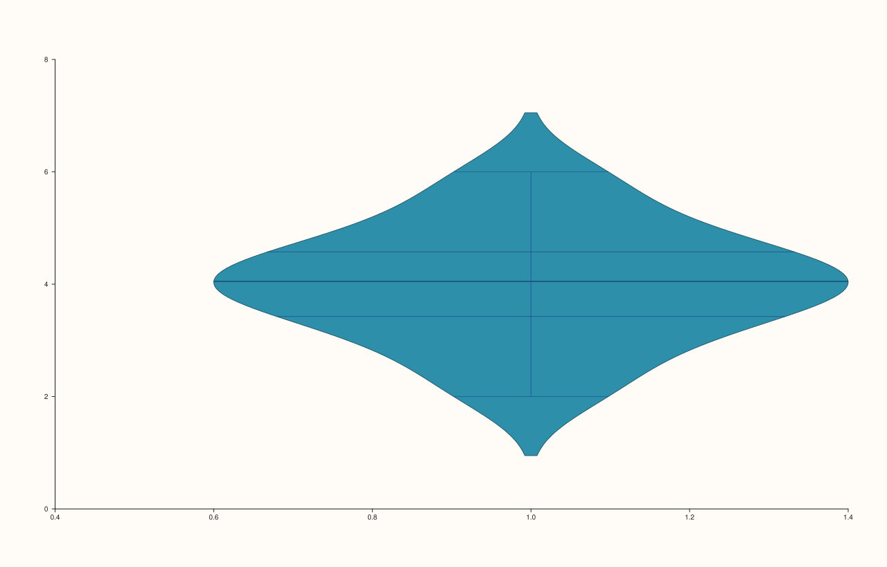
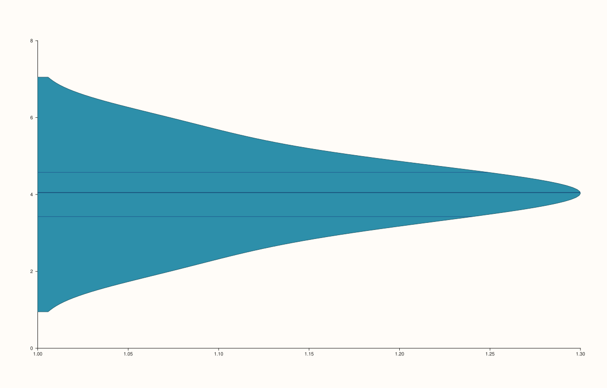
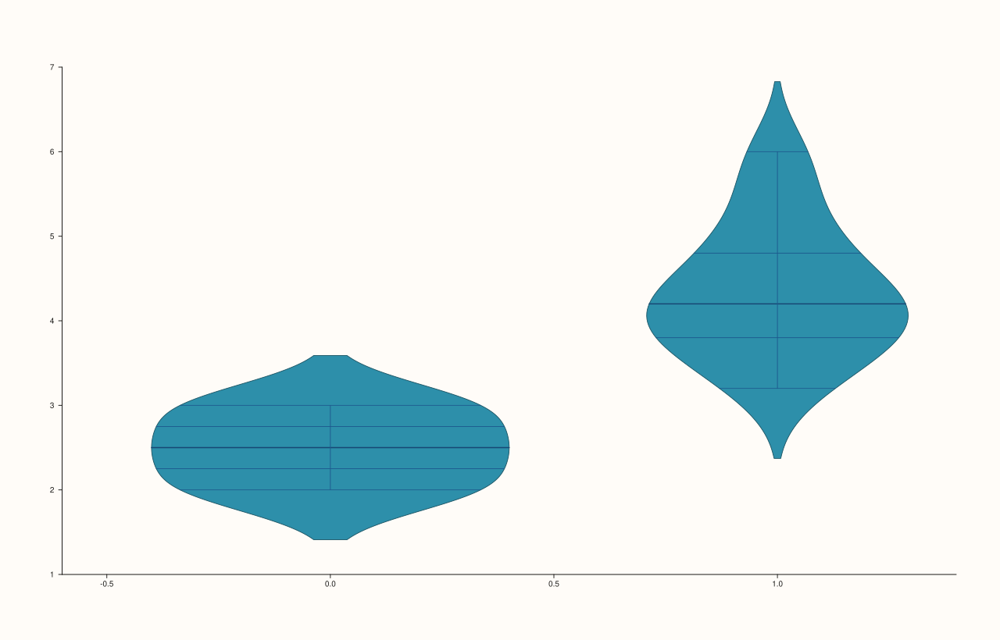
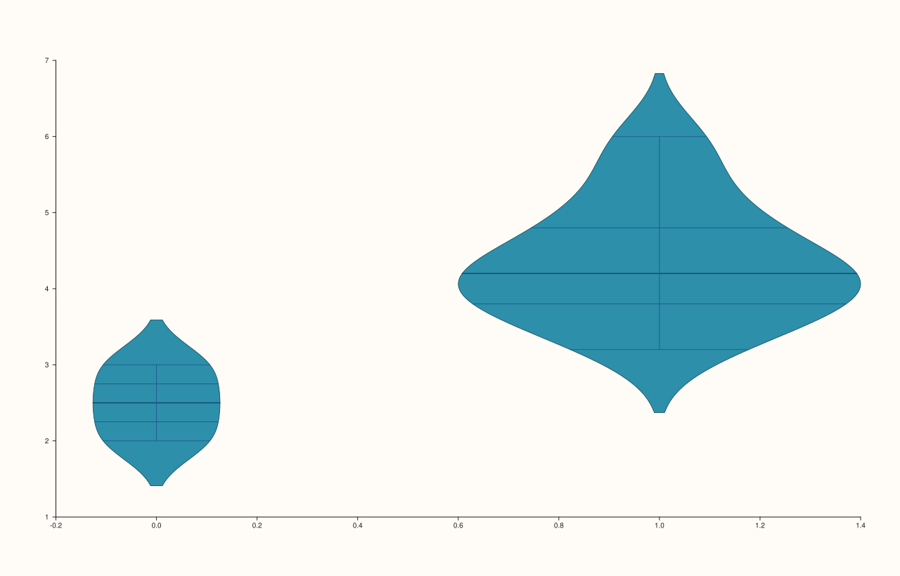

<!-- pluss-hand-authored -->

# Pane::violin

[Back to Pane API Reference](../../pane_api_reference)

## Signatures

```cpp
template <class Values>
Trace& Pane::violin(Values&& values)

template <class Values>
Trace& Pane::violin(Values&& values, const ViolinOptions& options)

template <class Group, class Values>
Trace& Pane::violin(Group&& group, Values&& values)

template <class Group, class Values>
Trace& Pane::violin(Group&& group, Values&& values, const ViolinOptions& options)
```

## What It Does

Adds a violin-plot trace — a smoothed kernel-density estimate of `values`'s distribution,
drawn as a mirrored, filled silhouette (the "violin" shape). Four overloads split along two
independent axes: **grouped vs. ungrouped**, and **default options vs. explicit
`ViolinOptions`**:

- **`violin(values)`** — one violin over the whole `values` series, default options.
- **`violin(values, options)`** — one violin, with explicit shape/scaling controls.
- **`violin(group, values)`** — `values` split by `group`, one violin per distinct group
  value, default options. Delegates internally to the four-argument overload with a
  default-constructed `ViolinOptions{}`.
- **`violin(group, values, options)`** — grouped, with explicit options.

```{important} Disambiguation via a requires clause
The two-argument grouped overload `violin(group, values)` is constrained with a
`requires` clause that explicitly excludes `ViolinOptions` from the `Values` template
slot. Without that constraint, `violin(someGroup, someValues)` would be ambiguous with
`violin(values, options)` whenever the compiler tried to match `group` against the
`values` parameter of the two-argument ungrouped-with-options overload. In practice this
is invisible to callers — the right overload is always selected — but it explains why the
grouped overload cannot also accept a trailing `ViolinOptions` without the explicit
three-argument form below.
```

```{important} Requires a Planar pane
Calling `violin()` on a `Volumetric` pane throws
`std::logic_error("violin requires a planar pane")`.
```

## Parameters

**values** (series-convertible)
    The raw observations whose distribution is estimated.

**group** (series-convertible, grouped overloads only)
    A per-observation grouping key, paired with `values` by index — one violin is drawn
    per distinct group value.

**options** (`ViolinOptions`, options-taking overloads only; default `ViolinOptions{}`
when omitted)
    Bundles every shape/scaling toggle in one struct:

    - **`width`** (`double`, default `0.8`) — the violin's maximum half-width, in
      category-slot units.
    - **`bw_adjust`** (`double`, default `1.0`) — a multiplier on the kernel-density
      estimate's bandwidth; values above `1.0` smooth the silhouette further (fewer,
      broader bumps), values below `1.0` track the raw data more tightly (more, sharper
      bumps).
    - **`cut`** (`double`, default `2.0`) — how far the density estimate extends past the
      observed data's min/max, in bandwidth units. `0.0` clips the violin exactly to the
      observed range.
    - **`scale`** (`ViolinScale`, default `ViolinScale::Area`) — how multiple violins in
      the same grouped plot are normalized against each other: `Area` (every violin
      encloses the same area regardless of group size), `Count` (violin area scales with
      the group's observation count, so a bigger group draws a visibly wider violin), or
      `Width` (every violin uses the same maximum width, ignoring both area and count).
    - **`inner`** (`ViolinInner`, default `ViolinInner::Box`) — what summary marker is
      drawn inside the violin body: `None`, `Box` (a mini box-and-whisker), `Quartile`
      (quartile reference lines), `Stick` (individual observation ticks), or `Point`
      (individual observation dots).
    - **`side`** (`ViolinSide`, default `ViolinSide::Full`) — which half of the mirrored
      silhouette is drawn: `Full` (both halves), `Left`, or `Right`. `Left`/`Right` are
      most useful for split/comparison violins sharing a single category slot.

## Returns

`Trace&`
    A reference to the newly created trace, for chaining.

## Examples

Example 1. A single ungrouped violin, all-default options.

```cpp
using namespace pluss::pl;

auto fig = studio("violin_values_only");
auto& pane = fig.pane2();
std::vector<double> values{2.0, 2.5, 3.0, 3.2, 3.5, 3.7, 4.0, 4.1, 4.3, 4.5, 4.8, 5.0, 5.5, 6.0, 3.8, 4.2};
pane.violin(values);
fig.show();
```



Example 2. The same values, with explicit `ViolinOptions` — a narrower `width`, quartile
reference lines instead of the default mini box, and only the right half drawn. Verified
via direct SVG diff to render genuinely different from Example 1.

```cpp
using namespace pluss::pl;

auto fig = studio("violin_with_options");
auto& pane = fig.pane2();
std::vector<double> values{2.0, 2.5, 3.0, 3.2, 3.5, 3.7, 4.0, 4.1, 4.3, 4.5, 4.8, 5.0, 5.5, 6.0, 3.8, 4.2};
ViolinOptions opts;
opts.width = 0.6;
opts.inner = ViolinInner::Quartile;
opts.side = ViolinSide::Right;
pane.violin(values, opts);
fig.show();
```



Example 3. The same values split into two **unequal-sized** groups (3 observations vs.
13), default options (`ViolinScale::Area`) — each violin encloses the same area despite
the group-size imbalance.

```cpp
using namespace pluss::pl;

auto fig = studio("violin_grouped");
auto& pane = fig.pane2();
std::vector<double> values{2.0, 2.5, 3.0, 3.2, 3.5, 3.7, 4.0, 4.1, 4.3, 4.5, 4.8, 5.0, 5.5, 6.0, 3.8, 4.2};
std::vector<double> group{0.0, 0.0, 0.0, 1.0, 1.0, 1.0, 1.0, 1.0, 1.0, 1.0, 1.0, 1.0, 1.0, 1.0, 1.0, 1.0};
pane.violin(group, values);
fig.show();
```



Example 4. The identical grouped data, with `scale = ViolinScale::Count` — now the
smaller (3-observation) group draws visibly narrower than the larger (13-observation)
group. Verified via direct SVG diff to render genuinely different from Example 3; with
**equal**-sized groups, `Area` and `Count` scaling were separately verified to produce
byte-identical output, since equal counts make the two normalizations coincide.

```cpp
using namespace pluss::pl;

auto fig = studio("violin_grouped_options");
auto& pane = fig.pane2();
std::vector<double> values{2.0, 2.5, 3.0, 3.2, 3.5, 3.7, 4.0, 4.1, 4.3, 4.5, 4.8, 5.0, 5.5, 6.0, 3.8, 4.2};
std::vector<double> group{0.0, 0.0, 0.0, 1.0, 1.0, 1.0, 1.0, 1.0, 1.0, 1.0, 1.0, 1.0, 1.0, 1.0, 1.0, 1.0};
ViolinOptions opts;
opts.scale = ViolinScale::Count;
pane.violin(group, values, opts);
fig.show();
```



## Notes

- Not `noexcept`.
- `ViolinScale::Area` vs. `ViolinScale::Count` only produce visibly different output when
  group sizes actually differ — with equal-sized groups they coincide exactly (verified via
  direct SVG diff during this documentation pass).
- `inner = ViolinInner::None` removes the inner summary marker entirely, leaving just the
  silhouette.
- `side = ViolinSide::Left` / `ViolinSide::Right` are designed to be paired — two calls to
  `violin()` on the same category slot, one `Left` and one `Right`, to build a
  back-to-back split-violin comparison. That pairing wasn't separately exercised here;
  treat it as the documented intent rather than independently verified.
- `flash::violinplot` (if present) is a convenience wrapper around this exact method.

## See Also

- [`Pane::quartet`](quartet.md): a simpler box-and-whisker summary of the same kind of raw
  observations, without the kernel-density silhouette.
- [`Pane::bucket`](bucket.md): a binned-count histogram view of the same kind of raw
  observations.

<div class="pluss-inline-prev-next">
  <a class="prev-link" href="wedge.html">
    <span class="label">Previous</span>
    <span class="title">wedge</span>
  </a>
  <a class="next-link" href="radial.html">
    <span class="label">Next</span>
    <span class="title">radial</span>
  </a>
</div>
