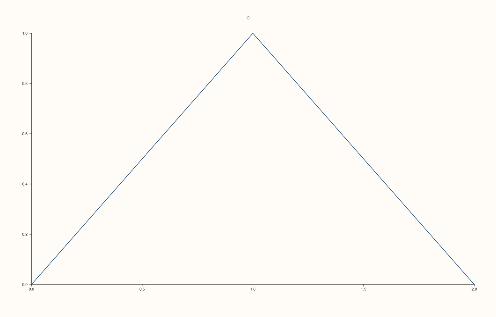
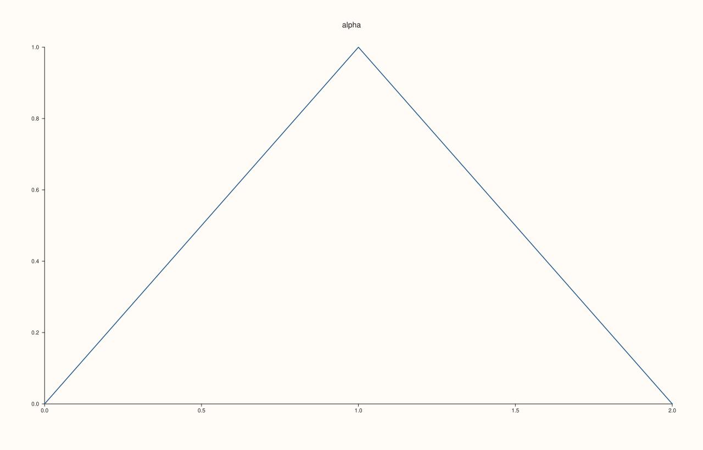
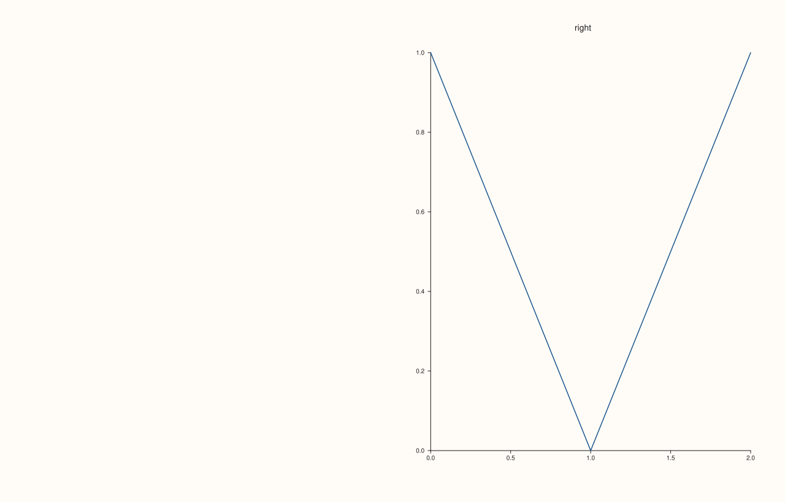
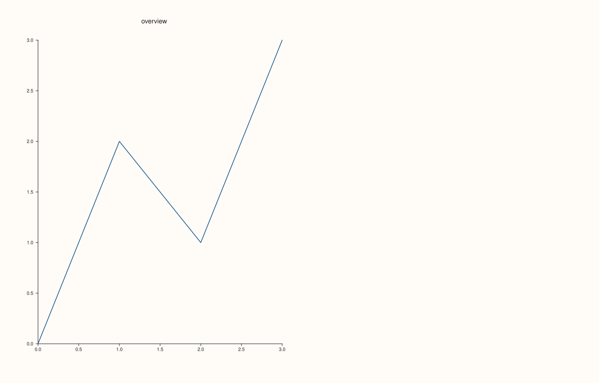

<!-- pluss-hand-authored -->

# Pane::visible

[Back to Pane API Reference](../../pane_api_reference)

## Signature

```cpp
Pane& Pane::visible(bool enable) noexcept
bool Pane::visible() const noexcept
Pane& Pane::hide() noexcept
Pane& Pane::show() noexcept
```

## What It Does

Controls whether the pane is drawn at all. A hidden pane draws nothing: no title, no axes, no traces, no legend entries. It keeps its cell in a [`mosaic`](../studio/mosaic.md), so the other panes stay where they are and the cell is left empty. Its data and settings are kept, and showing it again restores it exactly.

`hide()` is `visible(false)` and `show()` is `visible(true)`. The getter takes no argument. The setter requires one, so `pane.visible()` always reads and never changes anything.

Use it to compare figures with and without a pane, or to switch panes by a condition without rebuilding the figure. To keep a pane but remove only its axes, use [`axes_visible`](axes_visible.md); to remove one trace, use [`Trace::visible`](../trace/visible.md).

## Parameters

**enable** (`bool`, setter only)
    `true` to draw the pane, `false` to hide it.

## Returns

**Setters:** `Pane&`, the same pane.
**Getter:** `bool`, whether the pane is drawn. A new pane is visible.

## Examples

Example 1. A new pane is visible, and reading the state with no argument changes nothing.

```cpp
auto fig = studio("visible_default");
auto& pane = fig.pane2("p");
pane.trend(std::vector<double>{0, 1, 2}, std::vector<double>{0, 1, 0});
pane.hide();
std::cout << "after hide: " << pane.visible() << "\n";
std::cout << "reading again: " << pane.visible() << "\n";
pane.show();
std::cout << "after show: " << pane.visible() << "\n";
fig.save_svg("figure.svg");
```

### Output

```text
after hide: 0
reading again: 0
after show: 1
```



Example 2. `hide()` and `visible(false)` are the same, and so are `show()` and `visible(true)`.

```cpp
auto build = [&](int how) {
  auto fig = studio("visible_spellings");
  auto& pane = fig.pane2("p");
  pane.trend(std::vector<double>{0, 1, 2}, std::vector<double>{0, 1, 0});
  if (how == 0) pane.hide();
  if (how == 1) pane.visible(false);
  return fig.to_svg();
};
std::cout << "hide() == visible(false): " << (build(0) == build(1)) << "\n";
auto fig = studio("visible_spellings_out");
auto& pane = fig.pane2("p");
pane.trend(std::vector<double>{0, 1, 2}, std::vector<double>{0, 1, 0});
pane.visible(false).visible(true);
fig.save_svg("figure.svg");
```

### Output

```text
hide() == visible(false): 1
```


Example 3. A hidden pane draws nothing. Its title is in the figure while it is shown and gone while it is hidden, and showing it again gives back the original figure.

```cpp
auto fig = studio("visible_draws");
auto& pane = fig.pane2("alpha");
pane.trend(std::vector<double>{0, 1, 2}, std::vector<double>{0, 1, 0});
const std::string shown = fig.to_svg();
pane.hide();
const std::string hidden = fig.to_svg();
pane.show();
std::cout << "title while shown: " << (shown.find(">alpha<") != std::string::npos) << ", while hidden: " << (hidden.find(">alpha<") != std::string::npos) << "\n";
std::cout << "shown again == shown before: " << (fig.to_svg() == shown) << "\n";
fig.save_svg("figure.svg");
```

### Output

```text
title while shown: 1, while hidden: 0
shown again == shown before: 1
```



Example 4. The cell stays. Of two panes side by side, the left is hidden: the right one is still in the right half of the figure and the left half is empty.

```cpp
auto fig = studio("visible_mosaic");
fig.mosaic(1, 2);
auto& left = fig.pane2("left");
left.trend(std::vector<double>{0, 1, 2}, std::vector<double>{0, 1, 0});
auto& right = fig.pane2("right");
right.trend(std::vector<double>{0, 1, 2}, std::vector<double>{1, 0, 1});
auto at = [](const std::string& svg, const std::string& text) {
  const auto hit = svg.find(">" + text + "<");
  if (hit == std::string::npos) return std::string("absent");
  const auto open = svg.rfind("<text", hit);
  auto number = [&](const char* key) {
    const auto k = svg.find(std::string(key) + "=\"", open) + std::string(key).size() + 2;
    return std::stod(svg.substr(k, svg.find('"', k) - k));
  };
  return "(" + std::to_string(static_cast<int>(number("x"))) + ", " + std::to_string(static_cast<int>(number("y"))) + ")";
};
const std::string before = fig.to_svg();
left.hide();
const std::string after = fig.to_svg();
std::cout << "right title before " << at(before, "right") << ", after " << at(after, "right") << "\n";
fig.save_svg("figure.svg");
```

### Output

```text
right title before (950, 50), after (950, 50)
```



Example 5. Switching by a condition. The same figure is built for two modes; the second pane is shown only in the detailed one.

```cpp
auto build = [&](bool detailed) {
  auto fig = studio("visible_condition");
  fig.mosaic(1, 2);
  auto& overview = fig.pane2("overview");
  overview.trend(std::vector<double>{0, 1, 2, 3}, std::vector<double>{0, 2, 1, 3});
  auto& detail = fig.pane2("detail");
  detail.trend(std::vector<double>{0, 1, 2, 3}, std::vector<double>{1, 3, 2, 4});
  detail.visible(detailed);
  return fig.to_svg();
};
std::cout << "detail drawn: " << (build(true).find(">detail<") != std::string::npos) << ", " << (build(false).find(">detail<") != std::string::npos) << "\n";
auto fig = studio("visible_condition_out");
fig.mosaic(1, 2);
auto& overview = fig.pane2("overview");
overview.trend(std::vector<double>{0, 1, 2, 3}, std::vector<double>{0, 2, 1, 3});
auto& detail = fig.pane2("detail");
detail.trend(std::vector<double>{0, 1, 2, 3}, std::vector<double>{1, 3, 2, 4});
detail.hide();
fig.save_svg("figure.svg");
```

### Output

```text
detail drawn: 1, 0
```



## Notes

- All four are `noexcept`.
- Hiding a pane does not remove its data or settings, and does not remove it from [`Studio::panes`](../studio/panes.md).
- A hidden pane gets no share of a group caption (see [`align_x`](align_x.md)).

## See Also

- [`Pane::axes_visible`](axes_visible.md): hide only the axes.
- [`Trace::visible`](../trace/visible.md): hide one trace.
- [`Studio::mosaic`](../studio/mosaic.md): the cells a hidden pane keeps.

<div class="pluss-inline-prev-next">
  <a class="prev-link" href="violin.html">
    <span class="label">Previous</span>
    <span class="title">violin</span>
  </a>
  <a class="next-link" href="wedge.html">
    <span class="label">Next</span>
    <span class="title">wedge</span>
  </a>
</div>
