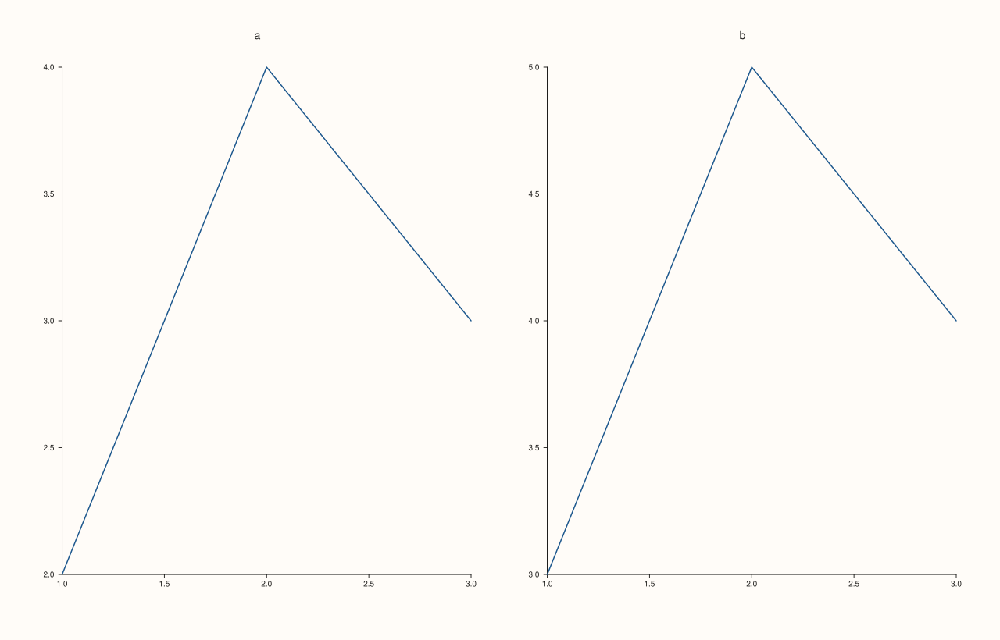
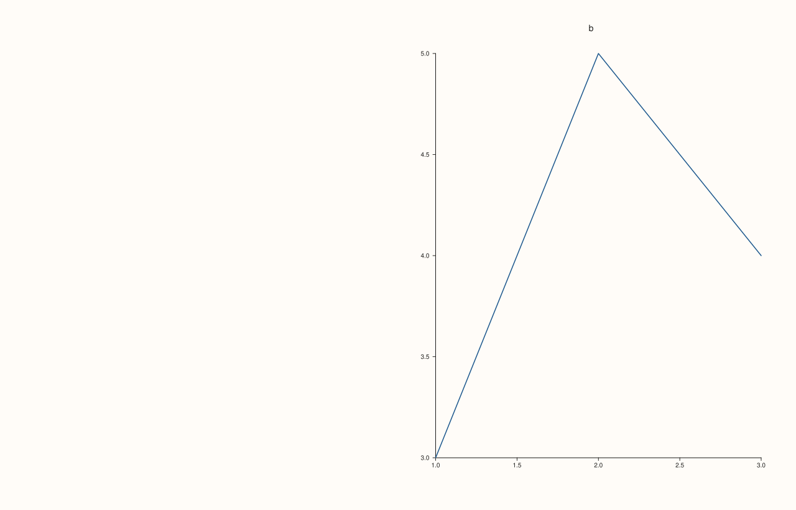

<!-- pluss-hand-authored -->

# Pane::visible / hide / show

[Back to Pane API Reference](../../pane_api_reference)

## Signatures

```cpp
Pane& Pane::visible(bool enable) noexcept   // setter -- enable is now required
bool Pane::visible() const noexcept          // getter -- always safe to call bare
Pane& Pane::hide() noexcept                   // shorthand for visible(false)
Pane& Pane::show() noexcept                   // shorthand for visible(true)
```

## What It Does

Controls whether this pane renders at all — `false` skips it entirely at render time
(useful for temporarily disabling a pane in a multi-pane mosaic without removing it from
the figure). `hide()` and `show()` are pure shorthands: `hide()` is exactly
`visible(false)`, `show()` is exactly `visible(true)`.

```{important} Fixed: enable is now required, not defaulted
Earlier revisions declared the setter as visible(bool enable = true), sharing its
name with a separate const getter overload. On a non-const Pane&, C++ overload
resolution prefers a non-const member function over a const one for a
non-const object, so the bare, argument-less call pane.visible() -- exactly the
form that looks like "just reading the current value" -- silently resolved to
the SETTER, called with its default enable = true. This was directly verified
during this documentation effort: after explicitly hiding a pane with
visible(false), calling the bare pane.visible() on that same mutable pane
silently flipped it back to visible.

It has since been fixed at the source: enable no longer has a default, so
pane.visible() (zero arguments) now only matches the const getter and always
safely reads the current value, on both const and non-const Pane objects. To
set the value, pass the argument explicitly -- visible(true)/visible(false) --
or use the unambiguous hide()/show() shorthands, which never had this problem in
the first place (they take no arguments and have no same-named const
counterpart). See Example 4 below for the fixed behavior, reproduced and
verified.

The identical fix was applied to axes_visible and parallel_xy_labels, which carried
the same setter-with-default-argument-plus-same-named-getter shape, and to
Trace::transparent/Trace::annotate_levels on the sibling Trace class. It never
applied to methods like tick_font_scale, whose setter requires an explicit
argument with no default, leaving no zero-argument ambiguity to fall into in
the first place.
```

## Parameters

**enable** (`bool`, required, setter only)
    `true` to render the pane, `false` to skip it.

## Returns

**Setters (`visible(bool)`, `hide()`, `show()`):** `Pane&` — a reference to the same pane,
for chaining.

**Getter (`Pane::visible() const`):** `bool` — whether the pane currently renders. Now
always reachable with a bare call, on both `const` and non-`const` panes.

## Examples

Example 1. The default: visible.

```cpp
using namespace pluss::pl;

auto fig = studio("visible_default");
fig.mosaic(1, 2);
auto& pane_a = fig.pane2("a");
pane_a.trend(std::vector<double>{1.0, 2.0, 3.0}, std::vector<double>{2.0, 4.0, 3.0});
bool a_visible = pane_a.visible();

auto& pane_b = fig.pane2("b");
pane_b.trend(std::vector<double>{1.0, 2.0, 3.0}, std::vector<double>{3.0, 5.0, 4.0});

fig.show();
std::cout << a_visible << "\n";
```

### Output

```text
1
```



Example 2. `hide()` — the pane's mosaic slot is skipped entirely.

```cpp
using namespace pluss::pl;

auto fig = studio("visible_hide_method");
fig.mosaic(1, 2);
auto& pane_a = fig.pane2("a");
pane_a.trend(std::vector<double>{1.0, 2.0, 3.0}, std::vector<double>{2.0, 4.0, 3.0});
pane_a.hide();
bool a_hidden = pane_a.visible();

auto& pane_b = fig.pane2("b");
pane_b.trend(std::vector<double>{1.0, 2.0, 3.0}, std::vector<double>{3.0, 5.0, 4.0});

fig.show();
std::cout << a_hidden << "\n";
```

### Output

```text
0
```


Example 3. `visible(false)` directly — identical effect to `hide()`.

```cpp
using namespace pluss::pl;

auto fig = studio("visible_false_direct");
fig.mosaic(1, 2);
auto& pane_a = fig.pane2("a");
pane_a.trend(std::vector<double>{1.0, 2.0, 3.0}, std::vector<double>{2.0, 4.0, 3.0});
pane_a.visible(false);
bool a_visible = pane_a.visible();

auto& pane_b = fig.pane2("b");
pane_b.trend(std::vector<double>{1.0, 2.0, 3.0}, std::vector<double>{3.0, 5.0, 4.0});

fig.show();
std::cout << a_visible << "\n";
```

### Output

```text
0
```



Example 4 (edge case). Since `enable` is now required, a bare `pane.visible()` call
compiles as a *read* — it can no longer accidentally reset visibility.

```cpp
using namespace pluss::pl;

auto fig = studio("visible_safe_bare_call");
auto& pane = fig.pane2();
pane.trend(std::vector<double>{1.0, 2.0, 3.0}, std::vector<double>{2.0, 4.0, 3.0});

pane.visible(false);
std::cout << pane.visible() << "\n";

std::cout << pane.visible() << "\n";  // bare call: now unconditionally a read

fig.show();
```

### Output

```text
0
0
```

## Notes

- `visible(bool)`, `hide()`, and `show()` are all `noexcept`. The `const` getter overload
  is also `noexcept`.
- `enable`'s default argument was removed specifically to eliminate the getter/setter
  overload-resolution hazard — see the important callout above. `std::as_const(pane)` is
  no longer necessary to reach the getter safely, though it still works.
- `hide()` and `show()` remain the more explicit, self-documenting spelling for setting
  visibility, and were never affected by the hazard in the first place (no arguments, no
  same-named `const` counterpart).
- Hiding a pane does not remove it from [`Studio::panes()`](../studio/panes.md) or affect
  [`Studio::pane_count()`](../studio/pane_count.md) — it only affects whether that pane's
  slot renders content.

## See Also

- [`Pane::axes_visible`](axes_visible.md): the same visibility concept, scoped to just the
  axes rather than the whole pane, which received the identical fix.
- [`Pane::parallel_xy_labels`](parallel_xy_labels.md): another setter/getter pair that
  received the same fix.
- [`Pane::tick_font_scale`](tick_font_scale.md): a setter/getter pair with **no** such
  hazard, since its setter has no default argument.
- [`Trace::transparent`](../trace/transparent.md), [`Trace::annotate_levels`](../trace/annotate_levels.md):
  the same fix applied to the sibling `Trace` class.
- [`Trace::visible`](../trace/visible.md): never had this problem — `Trace` was built with
  `hide()`/`show()` as its only setters from the start, with `visible()` getter-only.

<div class="pluss-inline-prev-next">
  <a class="prev-link" href="align_group_accessors.html">
    <span class="label">Previous</span>
    <span class="title">align_group_accessors</span>
  </a>
  <a class="next-link" href="axes_visible.html">
    <span class="label">Next</span>
    <span class="title">axes_visible</span>
  </a>
</div>
