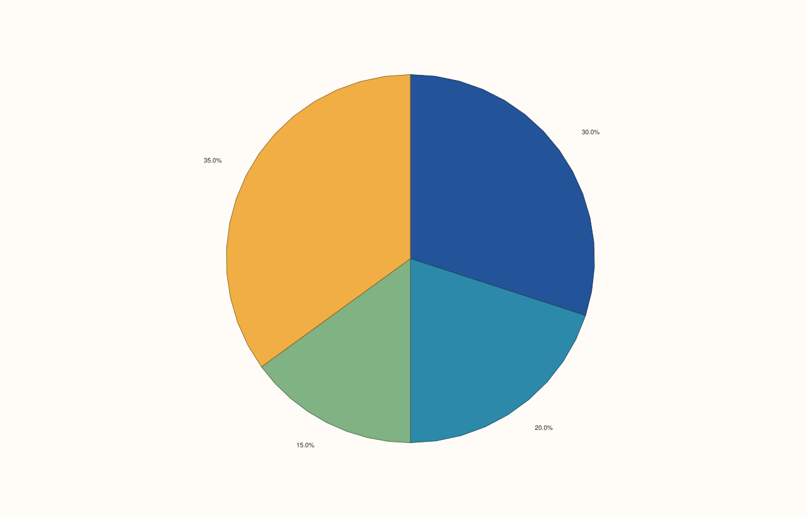
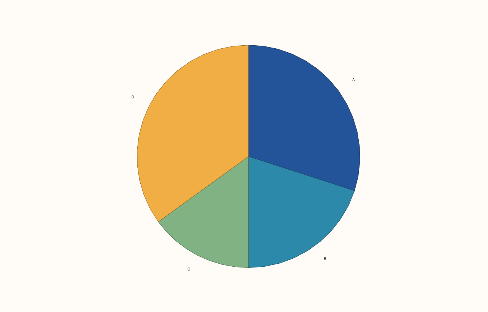
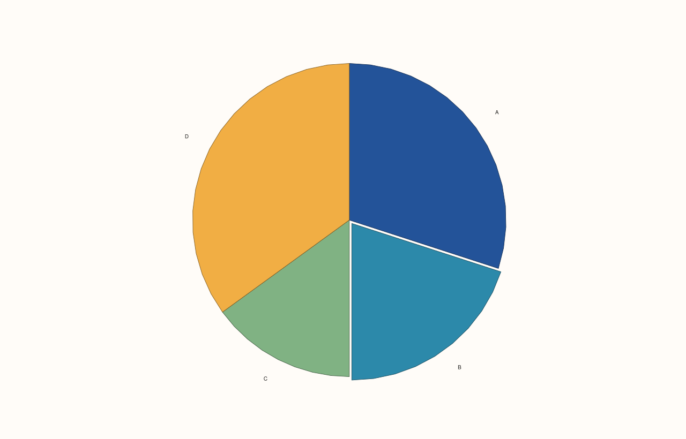

<!-- pluss-hand-authored -->

# Pane::wedge

[Back to Pane API Reference](../../pane_api_reference)

## Signatures

```cpp
template <class Values>
Trace& Pane::wedge(Values&& values)

template <class Values>
Trace& Pane::wedge(Values&& values, pluss::msharp::RangeView::Of<std::string_view> labels)

template <class Values>
Trace& Pane::wedge(Values&& values, std::initializer_list<std::string_view> labels)

template <class Values, class Explode>
Trace& Pane::wedge(Values&& values, Explode&& explode, pluss::msharp::RangeView::Of<std::string_view> labels)

template <class Values, class Explode>
Trace& Pane::wedge(Values&& values, Explode&& explode, std::initializer_list<std::string_view> labels)
```

## What It Does

Adds a pie-chart trace — one wedge per value in `values`, each sized proportionally to
its share of the total. Despite five declared overloads, there are really only **three
practical call shapes** — the `initializer_list<std::string_view>` overloads are pure
convenience forwarders to the `RangeView`-taking ones, so `{"a", "b", "c"}` braces at the
call site work transparently without the caller needing to construct a `RangeView`
directly:

- **`wedge(values)`** — plain wedges, no labels, no per-wedge pull-out offset.
- **`wedge(values, labels)`** — one label per wedge, in the same order as `values`.
- **`wedge(values, explode, labels)`** — additionally, `explode` supplies a per-wedge
  pull-out distance (`0.0` keeps a wedge flush with the pie; larger values visually
  separate it, the "exploded pie slice" effect), paired with `values` by index.

```{important} Requires a Planar pane
Calling `wedge()` on a `Volumetric` pane throws
`std::logic_error("wedge requires a planar pane")`.
```

## Parameters

**values** (series-convertible)
    The wedge sizes (proportional to total).

**labels** (`RangeView::Of<std::string_view>` or `std::initializer_list<std::string_view>`)
    One label per wedge, matching `values`'s order and count.

**explode** (series-convertible, three-parameter overloads only)
    Per-wedge pull-out distance, matching `values`'s order and count.

## Returns

`Trace&`
    A reference to the newly created trace, for chaining.

## Examples

Example 1. Plain wedges, no labels.

```cpp
using namespace pluss::pl;

auto fig = studio("wedge_values_only");
auto& pane = fig.pane2();
pane.wedge(std::vector<double>{30.0, 20.0, 15.0, 35.0});
fig.show();
```



Example 2. Labeled wedges, using a braced `initializer_list` for `labels` — resolves to
the convenience overload, which forwards to the `RangeView`-taking one.

```cpp
using namespace pluss::pl;

auto fig = studio("wedge_values_labels");
auto& pane = fig.pane2();
pane.wedge(std::vector<double>{30.0, 20.0, 15.0, 35.0}, std::initializer_list<std::string_view>{"A", "B", "C", "D"});
fig.show();
```



Example 3. Labeled wedges with one wedge pulled out (`explode = 0.15` on the second
wedge) — verified via direct SVG diff to render genuinely different from Example 2.

```cpp
using namespace pluss::pl;

auto fig = studio("wedge_values_explode_labels");
auto& pane = fig.pane2();
pane.wedge(std::vector<double>{30.0, 20.0, 15.0, 35.0}, std::vector<double>{0.0, 0.15, 0.0, 0.0},
           std::initializer_list<std::string_view>{"A", "B", "C", "D"});
fig.show();
```



## Notes

- Not `noexcept`.
- Five declared overloads collapse to three practical call shapes — see "What It Does".
- `explode` cannot be supplied without `labels` — there's no
  `wedge(values, explode)` overload lacking labels; every `explode`-taking overload
  requires labels alongside it.
- `flash::`'s pie-chart-family function (if present) is a convenience wrapper around this
  exact method.

## See Also

- [`Pane::columns`](columns.md): a proportional-value trace kind with a very different
  visual form (bars rather than pie wedges).

<div class="pluss-inline-prev-next">
  <a class="prev-link" href="quartet.html">
    <span class="label">Previous</span>
    <span class="title">quartet</span>
  </a>
  <a class="next-link" href="violin.html">
    <span class="label">Next</span>
    <span class="title">violin</span>
  </a>
</div>
