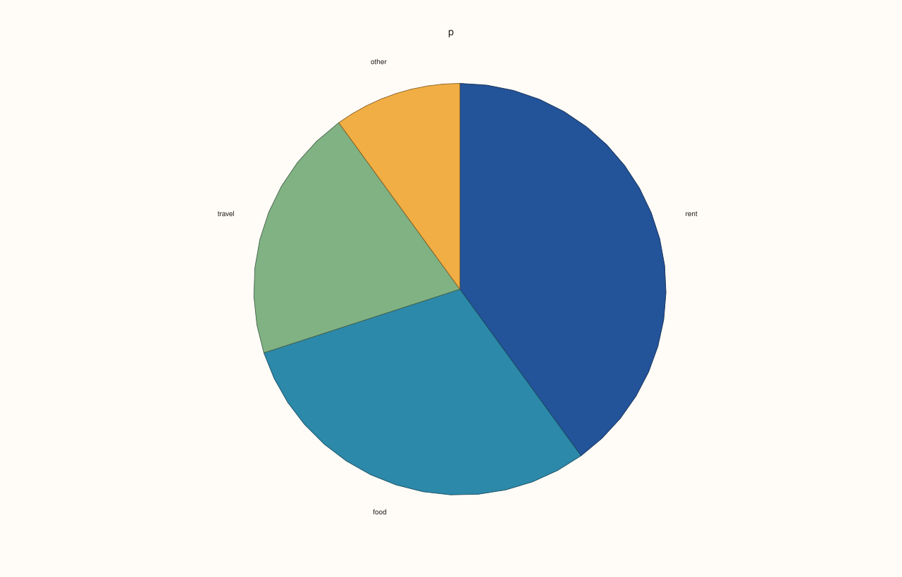
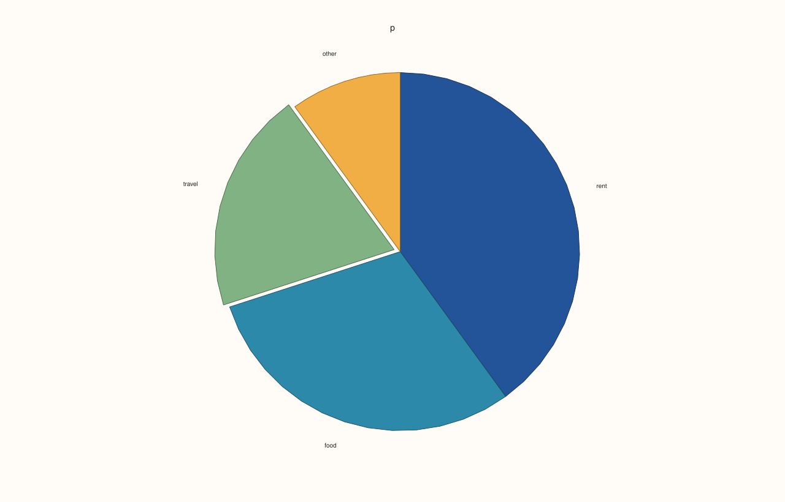
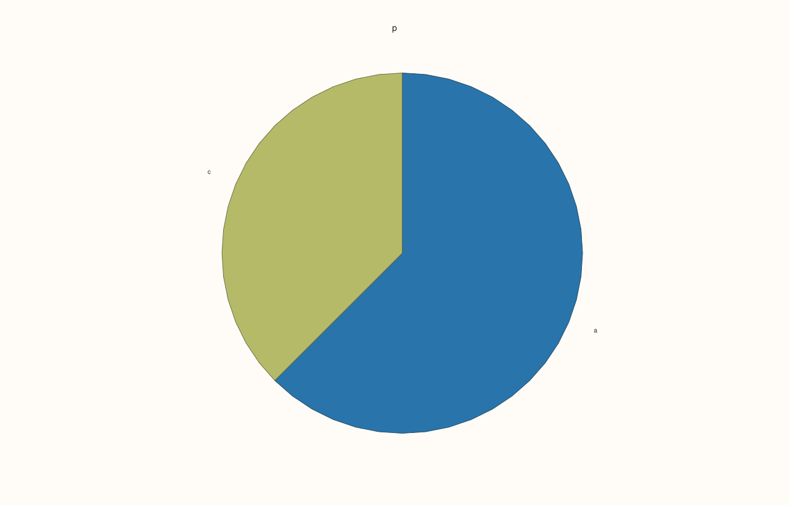
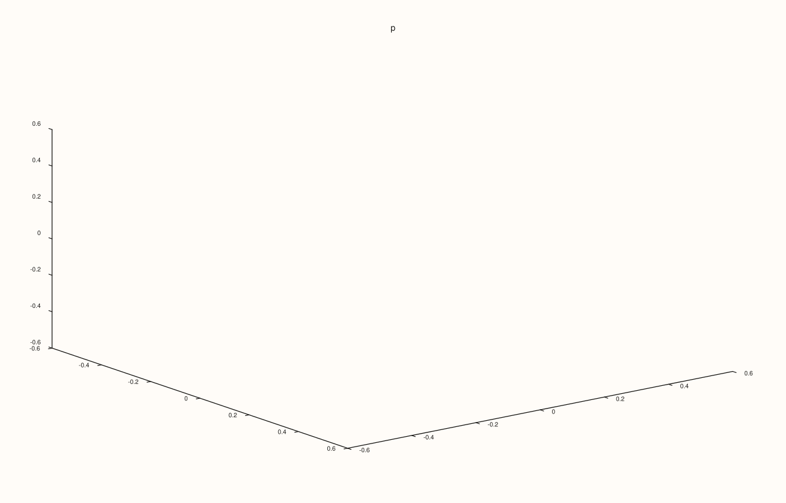

<!-- pluss-hand-authored -->

# Pane::wedge

[Back to Pane API Reference](../../pane_api_reference)

## Signature

```cpp
Trace& Pane::wedge(Series values)
Trace& Pane::wedge(Series values, std::initializer_list<std::string_view> labels)
Trace& Pane::wedge(Series values, std::vector<double> explode, std::initializer_list<std::string_view> labels)
```

## What It Does

Adds a **pie chart**: one wedge for each value, its angle proportional to the value's share of the total. A pane that holds a pie is drawn without axes.

| Call | Adds |
|---|---|
| `wedge(values)` | Wedges, unlabelled. |
| `wedge(values, labels)` | Wedges with a label each, in order. A range of strings can be given in place of the braces. |
| `wedge(values, explode, labels)` | And a pull-out distance for each wedge: 0 leaves it in place. |

Values must be finite and not negative, with at least one positive, and `labels` and `explode` have one entry for each value. The wedges go clockwise from the top; they take the accent colours of the theme in turn.

## Parameters

**values** (`Series`-convertible)
    The sizes of the wedges; only their shares matter.

**explode** (`Series`-convertible, optional)
    How far each wedge is pulled out.

**labels** (strings, optional)
    One label for each wedge.

## Returns

`Trace&`
    The new trace.

## Examples

Example 1. Values only: each wedge's angle is its share of the total, starting from the top and going clockwise. Each wedge is annotated with its share as a percentage.

```cpp
auto fig = studio("wedge_values");
auto& pane = fig.pane2("p");
pane.wedge(std::vector<double>{4, 3, 2, 1});
fig.save_svg("figure.svg");
```


Example 2. Labels name the wedges, in the order of the values.

```cpp
auto fig = studio("wedge_labels");
auto& pane = fig.pane2("p");
pane.wedge(std::vector<double>{4, 3, 2, 1}, {"rent", "food", "travel", "other"});
fig.save_svg("figure.svg");
```



Example 3. A third series pulls wedges out of the pie: 0 keeps a wedge in place, larger values move it further away.

```cpp
auto fig = studio("wedge_explode");
auto& pane = fig.pane2("p");
pane.wedge(std::vector<double>{4, 3, 2, 1}, std::vector<double>{0, 0, 0.2, 0}, {"rent", "food", "travel", "other"});
fig.save_svg("figure.svg");
```



Example 4. Only the shares matter: values 4, 3, 2, 1 and 40, 30, 20, 10 draw the same pie.

```cpp
auto build = [&](double scale) {
  auto fig = studio("wedge_shares");
  auto& pane = fig.pane2("p");
  pane.wedge(std::vector<double>{4 * scale, 3 * scale, 2 * scale, 1 * scale});
  return fig.to_svg();
};
std::cout << "same pie: " << (build(1.0) == build(10.0)) << "\n";
auto fig = studio("wedge_shares_out");
auto& pane = fig.pane2("p");
pane.wedge(std::vector<double>{40, 30, 20, 10});
fig.save_svg("figure.svg");
```

### Output

```text
same pie: 1
```


Example 5. A zero value has no wedge, and a pie of one value is a full circle.

```cpp
auto fig = studio("wedge_zero");
auto& pane = fig.pane2("p");
pane.wedge(std::vector<double>{5, 0, 3}, {"a", "none", "c"});
fig.save_svg("figure.svg");
```



Example 6. Inputs that cannot be drawn are refused when the trace is added, and the message names the method and the problem. The pane keeps the traces it had.

```cpp
auto report = [](const char* what, auto&& call) {
  auto fig = studio("wedge_errors");
  auto& pane = fig.pane2("p");
  try {
    call(pane);
    std::cout << what << ": accepted\n";
  } catch (const pluss::Error& e) {
    std::cout << what << ": " << e.message() << "\n";
  }
};
report("negative value", [](Pane& pane) { pane.wedge(std::vector<double>{1, -2, 3}); });
report("all zero", [](Pane& pane) { pane.wedge(std::vector<double>{0, 0}); });
report("labels differ", [](Pane& pane) { pane.wedge(std::vector<double>{1, 2, 3}, {"a", "b"}); });
report("explode differs", [](Pane& pane) { pane.wedge(std::vector<double>{1, 2, 3}, std::vector<double>{0, 0.1}, {"a", "b", "c"}); });
auto fig = studio("wedge_errors_out");
auto& pane = fig.pane2("p");
pane.trend(std::vector<double>{0, 1}, std::vector<double>{0, 1});
fig.save_svg("figure.svg");
```

### Output

```text
negative value: wedge: values must be non-negative
all zero: wedge: at least one value must be positive
labels differ: wedge: labels must match the wedge count
explode differs: wedge: series lengths must match or broadcast from scalar
```


Example 7. `wedge` needs a planar pane. On a volumetric pane it throws at once, naming the kind it needs, and nothing is added.

```cpp
auto fig = studio("wedge_wrong_pane");
auto& pane = fig.pane3("p");
try {
  pane.wedge(std::vector<double>{1, 2, 3});
} catch (const pluss::Error& e) {
  std::cout << e.message() << "\n";
}
std::cout << "traces: " << pane.trace_count() << "\n";
fig.save_svg("figure.svg");
```

### Output

```text
wedge requires a planar pane
traces: 0
```



## Notes

- Returns the new [`Trace&`](../trace/label.md); the reference stays valid for the life of the pane, and the style calls of the trace ([`label`](../trace/label.md), [`stroke`](../trace/stroke.md), [`width`](../trace/width.md), ...) chain off it.
- The data is copied into the trace when it is added, so changing the vector afterwards does not change the figure.

## See Also

- [`Pane::columns`](columns.md): the same data as bars.
- [`Pane::radial`](radial.md): polar traces.

<div class="pluss-inline-prev-next">
  <a class="prev-link" href="visible.html">
    <span class="label">Previous</span>
    <span class="title">visible</span>
  </a>
  <a class="next-link" href="whisk.html">
    <span class="label">Next</span>
    <span class="title">whisk</span>
  </a>
</div>
