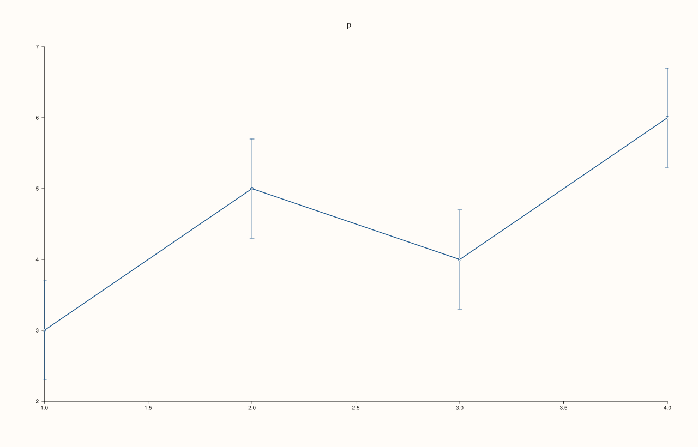
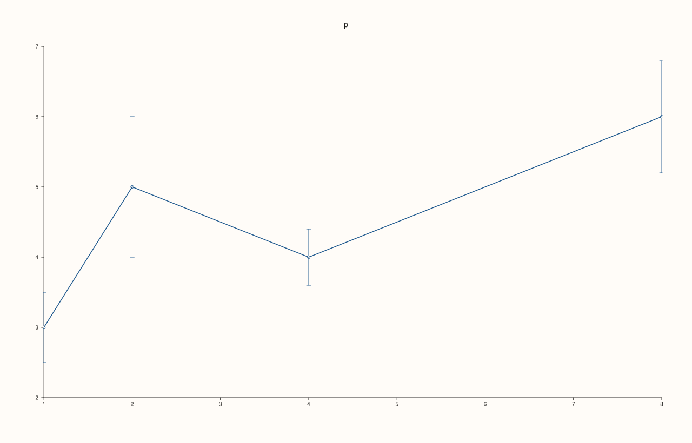
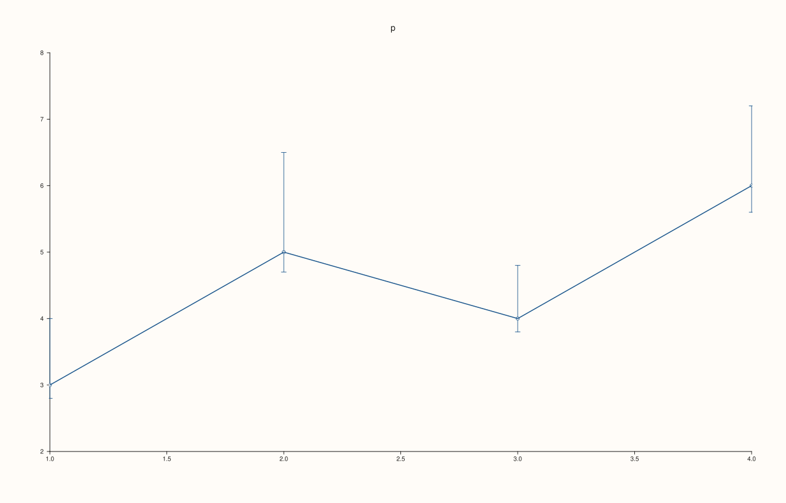
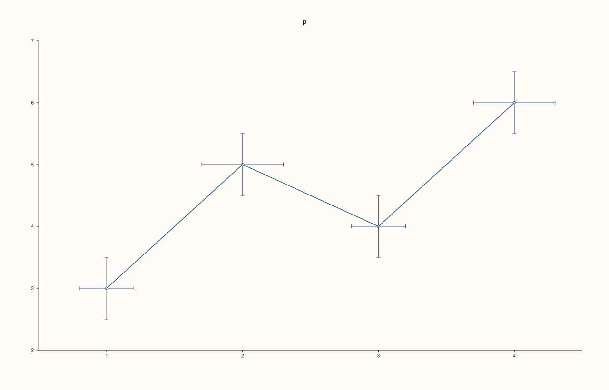
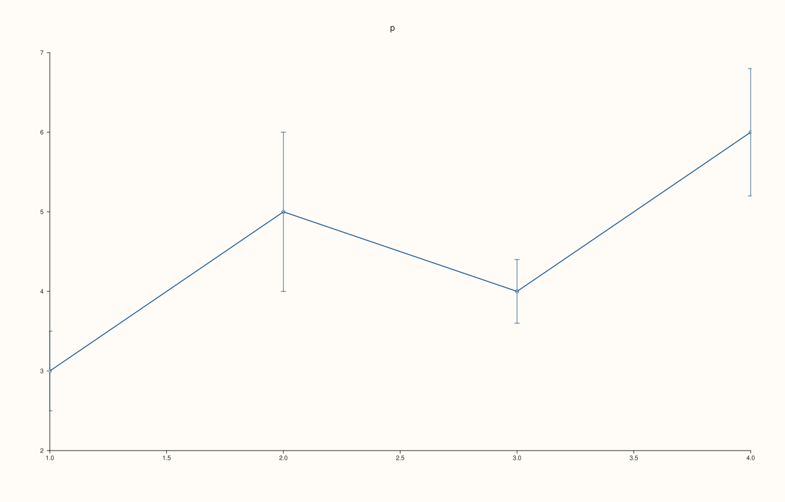

<!-- pluss-hand-authored -->

# Pane::whisk

[Back to Pane API Reference](../../pane_api_reference)

## Signature

```cpp
Trace& Pane::whisk(Series y, Series err)
Trace& Pane::whisk(Series x, Series y, Series err)
Trace& Pane::whisk(Series x, Series y, Series neg, Series pos)
Trace& Pane::whisk(Series x, Series y, Series yneg, Series ypos, Series xneg, Series xpos)
```

## What It Does

Adds **error bars**: a whisker through each point `(x[i], y[i])` showing the uncertainty of the value. It draws only the whiskers; add the points themselves with [`cloud`](cloud.md) or [`trend`](trend.md).

| Call | Whiskers |
|---|---|
| `whisk(y, err)` | Vertical, `err` above and below, at the positions 1, 2, 3, ... |
| `whisk(x, y, err)` | The same, at the positions `x`. |
| `whisk(x, y, neg, pos)` | Vertical, `neg` below and `pos` above. |
| `whisk(x, y, yneg, ypos, xneg, xpos)` | Vertical and horizontal, each with its own two lengths. The y lengths come first. |

The lengths are distances, not positions: finite and not negative. Each is a series with a length for each point (or one length for all). A rank-2 `y` is read as one series per column.

## Parameters

**x**, **y** (`Series`-convertible)
    The points.

**err**, **neg**, **pos**, **yneg**, **ypos**, **xneg**, **xpos** (`Series`-convertible)
    Whisker lengths: finite, not negative, one per point or one for all.

## Returns

`Trace&`
    The new trace.

## Examples

Example 1. Values and one error: the same distance above and below each point. The positions are the indices 1, 2, 3, ...

```cpp
auto fig = studio("whisk_symmetric");
auto& pane = fig.pane2("p");
pane.whisk(std::vector<double>{3, 5, 4, 6}, std::vector<double>{0.5, 1.0, 0.4, 0.8});
fig.save_svg("figure.svg");
```


Example 2. A single error is used for every point.

```cpp
auto fig = studio("whisk_scalar");
auto& pane = fig.pane2("p");
pane.whisk(std::vector<double>{3, 5, 4, 6}, std::vector<double>{0.7});
fig.save_svg("figure.svg");
```



Example 3. With positions: `whisk(x, y, error)`.

```cpp
auto fig = studio("whisk_xy");
auto& pane = fig.pane2("p");
pane.whisk(std::vector<double>{1, 2, 4, 8}, std::vector<double>{3, 5, 4, 6}, std::vector<double>{0.5, 1.0, 0.4, 0.8});
fig.save_svg("figure.svg");
```



Example 4. Different errors below and above: `whisk(x, y, below, above)`. Here the lower whiskers are short and the upper ones long.

```cpp
auto fig = studio("whisk_asymmetric");
auto& pane = fig.pane2("p");
pane.whisk(std::vector<double>{1, 2, 3, 4}, std::vector<double>{3, 5, 4, 6}, std::vector<double>{0.2, 0.3, 0.2, 0.4}, std::vector<double>{1.0, 1.5, 0.8, 1.2});
fig.save_svg("figure.svg");
```



Example 5. Errors in both directions: `whisk(x, y, y_below, y_above, x_below, x_above)`. Note the order: the y errors come first.

```cpp
auto fig = studio("whisk_both");
auto& pane = fig.pane2("p");
pane.whisk(std::vector<double>{1, 2, 3, 4}, std::vector<double>{3, 5, 4, 6},
           std::vector<double>{0.5, 0.5, 0.5, 0.5}, std::vector<double>{0.5, 0.5, 0.5, 0.5},
           std::vector<double>{0.2, 0.3, 0.2, 0.3}, std::vector<double>{0.2, 0.3, 0.2, 0.3});
fig.save_svg("figure.svg");
```



Example 6. Whiskers are usually drawn with the points they belong to: a cloud and a whisk of the same data on one pane.

```cpp
auto fig = studio("whisk_with_points");
auto& pane = fig.pane2("p");
const std::vector<double> x{1, 2, 3, 4}, y{3, 5, 4, 6};
pane.whisk(x, y, std::vector<double>{0.5, 1.0, 0.4, 0.8});
pane.cloud(x, y);
fig.save_svg("figure.svg");
```



Example 7. Inputs that cannot be drawn are refused when the trace is added, and the message names the method and the problem. The pane keeps the traces it had.

```cpp
auto report = [](const char* what, auto&& call) {
  auto fig = studio("whisk_errors");
  auto& pane = fig.pane2("p");
  try {
    call(pane);
    std::cout << what << ": accepted\n";
  } catch (const pluss::Error& e) {
    std::cout << what << ": " << e.message() << "\n";
  }
};
report("x and y differ", [](Pane& pane) { pane.whisk(std::vector<double>{1, 2, 3}, std::vector<double>{1, 2}, std::vector<double>{0.1}); });
report("error length differs", [](Pane& pane) { pane.whisk(std::vector<double>{1, 2, 3}, std::vector<double>{1, 2, 3}, std::vector<double>{0.1, 0.1}); });
report("negative error", [](Pane& pane) { pane.whisk(std::vector<double>{1, 2, 3}, std::vector<double>{1, 2, 3}, std::vector<double>{-0.1, 0.1, 0.1}); });
auto fig = studio("whisk_errors_out");
auto& pane = fig.pane2("p");
pane.trend(std::vector<double>{0, 1}, std::vector<double>{0, 1});
fig.save_svg("figure.svg");
```

### Output

```text
x and y differ: whisk: x must match the whisk rows or the full y matrix shape
error length differs: whisk: yneg must be scalar, match y rows, or match y element count
negative error: whisk: yneg must be finite and non-negative
```


Example 8. `whisk` needs a planar pane. On a volumetric pane it throws at once, naming the kind it needs, and nothing is added.

```cpp
auto fig = studio("whisk_wrong_pane");
auto& pane = fig.pane3("p");
try {
  pane.whisk(std::vector<double>{1, 2}, std::vector<double>{0.1});
} catch (const pluss::Error& e) {
  std::cout << e.message() << "\n";
}
std::cout << "traces: " << pane.trace_count() << "\n";
fig.save_svg("figure.svg");
```

### Output

```text
whisk requires a planar pane
traces: 0
```


## Notes

- Returns the new [`Trace&`](../trace/label.md); the reference stays valid for the life of the pane, and the style calls of the trace ([`label`](../trace/label.md), [`stroke`](../trace/stroke.md), [`width`](../trace/width.md), ...) chain off it.
- The data is copied into the trace when it is added, so changing the vector afterwards does not change the figure.
- The six-argument call takes the y lengths before the x lengths; passing them the other way compiles and draws the wrong whiskers, so check the figure.

## See Also

- [`Pane::cloud`](cloud.md), [`Pane::trend`](trend.md): the points the whiskers belong to.
- [`Pane::band_y`](band_y.md): a shaded interval across the pane.

<div class="pluss-inline-prev-next">
  <a class="prev-link" href="wedge.html">
    <span class="label">Previous</span>
    <span class="title">wedge</span>
  </a>
  <a class="next-link" href="x_auto_tick_decimals.html">
    <span class="label">Next</span>
    <span class="title">x_auto_tick_decimals</span>
  </a>
</div>
