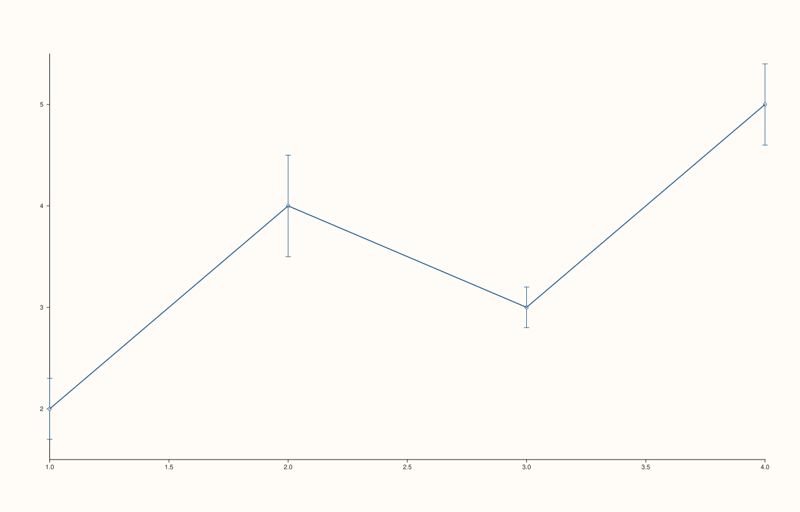
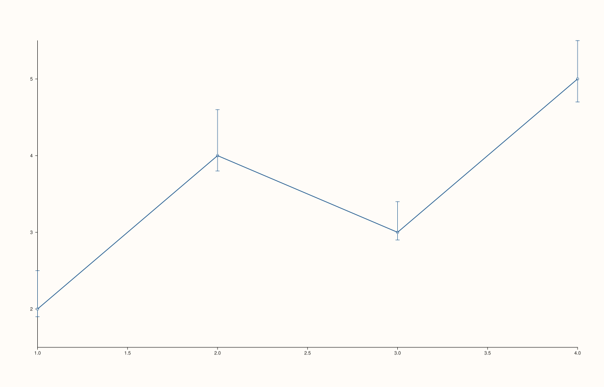
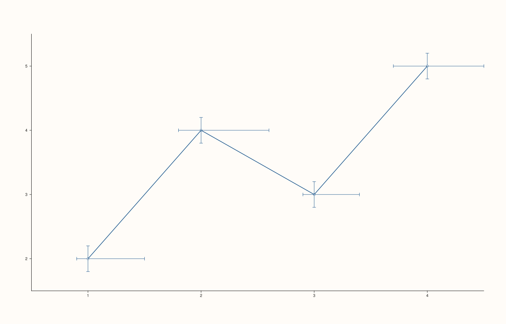

<!-- pluss-hand-authored -->

# Pane::whisk

[Back to Pane API Reference](../../pane_api_reference)

## Signatures

```cpp
template <class Y, class E>
Trace& Pane::whisk(Y&& y, E&& err)

template <class X, class Y, class E>
Trace& Pane::whisk(X&& x, Y&& y, E&& err)

template <class X, class Y, class Neg, class Pos>
Trace& Pane::whisk(X&& x, Y&& y, Neg&& neg, Pos&& pos)

template <class X, class Y, class YNeg, class YPos, class XNeg, class XPos>
Trace& Pane::whisk(X&& x, Y&& y, YNeg&& yneg, YPos&& ypos, XNeg&& xneg, XPos&& xpos)
```

## What It Does

Adds an error-bar trace — one vertical (and, in the six-argument overload, horizontal)
whisker per point, drawn at `(x[i], y[i])`. Four overloads cover every combination of
**auto vs. explicit x**, and **symmetric vs. asymmetric, y-only vs. fully independent x/y**
error magnitudes:

- **`whisk(y, err)`** — `x` is auto-assigned as `0, 1, 2, …`; `err` is a single series
  applied symmetrically both above and below each `y[i]`.
- **`whisk(x, y, err)`** — same symmetric-y-error behavior, but `x` is supplied explicitly
  instead of auto-indexed.
- **`whisk(x, y, neg, pos)`** — asymmetric y-error: `neg` below each point, `pos` above,
  independently. Still no x-error whiskers.
- **`whisk(x, y, yneg, ypos, xneg, xpos)`** — the fully general form: independent
  asymmetric error in **both** dimensions. Both y-direction and x-direction whiskers are
  drawn.

```{important} Parameter order does not match WhiskData's field order
The six-argument overload's parameter list is
`(x, y, yneg, ypos, xneg, xpos)` — the **y**-error arguments come *before* the
**x**-error arguments positionally, even though the underlying `WhiskData` struct stores
its fields in `x, y, xneg, xpos, yneg, ypos` order internally. Getting the call-site order
wrong (e.g. writing `xneg, xpos, yneg, ypos`) will silently compile — every parameter is a
template deduced from a series-convertible argument — but will apply the y-magnitudes as
x-error and vice versa. Read the signature above carefully rather than guessing from the
struct's field order.
```

```{important} Requires a Planar pane
Calling `whisk()` on a `Volumetric` pane throws
`std::logic_error("whisk requires a planar pane")`.
```

## Parameters

**y** (series-convertible)
    The center value at each point.

**x** (series-convertible, three- and four- and six-argument overloads)
    The explicit horizontal position of each point. When omitted (two-argument overload),
    positions are auto-assigned as `0, 1, 2, …`.

**err** (series-convertible, two- and three-argument overloads)
    A single symmetric error magnitude applied both above and below each `y[i]`.

**neg**, **pos** (series-convertible, four-argument overload)
    Independent below/above y-error magnitudes, replacing the single symmetric `err`.

**yneg**, **ypos**, **xneg**, **xpos** (series-convertible, six-argument overload)
    Independent below/above magnitudes in *both* dimensions — `yneg`/`ypos` for the
    vertical whisker, `xneg`/`xpos` for the horizontal whisker.

## Returns

`Trace&`
    A reference to the newly created trace, for chaining.

## Examples

Example 1. Symmetric y-error only, `x` auto-assigned as `0, 1, 2, 3`.

```cpp
using namespace pluss::pl;

auto fig = studio("whisk_y_err");
auto& pane = fig.pane2();
pane.whisk(std::vector<double>{2.0, 4.0, 3.0, 5.0}, std::vector<double>{0.3, 0.5, 0.2, 0.4});
fig.show();
```



Example 2. The same symmetric y-error, with `x` given explicitly as `10, 20, 30, 40`
instead of auto-assigned. Verified via direct SVG diff to render genuinely different from
Example 1 (a distinct choice of `x` was needed for this — `x` values that happened to
coincide with the auto-assigned `0, 1, 2, 3` positions would render identically).

```cpp
using namespace pluss::pl;

auto fig = studio("whisk_xy_err");
auto& pane = fig.pane2();
pane.whisk(std::vector<double>{10.0, 20.0, 30.0, 40.0}, std::vector<double>{2.0, 4.0, 3.0, 5.0}, std::vector<double>{0.3, 0.5, 0.2, 0.4});
fig.show();
```


Example 3. Asymmetric y-error — a small downward whisker, a larger upward one — with no
x-error at all.

```cpp
using namespace pluss::pl;

auto fig = studio("whisk_xy_asym_yerr");
auto& pane = fig.pane2();
pane.whisk(std::vector<double>{1.0, 2.0, 3.0, 4.0}, std::vector<double>{2.0, 4.0, 3.0, 5.0},
           std::vector<double>{0.1, 0.2, 0.1, 0.3}, std::vector<double>{0.5, 0.6, 0.4, 0.5});
fig.show();
```



Example 4. Fully independent asymmetric error in both dimensions — note the parameter
order `(x, y, yneg, ypos, xneg, xpos)`, y-error magnitudes before x-error magnitudes.
Verified via direct SVG diff to render genuinely different from Example 3 (horizontal
whiskers are now present in addition to the vertical ones).

```cpp
using namespace pluss::pl;

auto fig = studio("whisk_full_xy_err");
auto& pane = fig.pane2();
pane.whisk(std::vector<double>{1.0, 2.0, 3.0, 4.0}, std::vector<double>{2.0, 4.0, 3.0, 5.0},
           std::vector<double>{0.2, 0.2, 0.2, 0.2}, std::vector<double>{0.2, 0.2, 0.2, 0.2},
           std::vector<double>{0.1, 0.2, 0.1, 0.3}, std::vector<double>{0.5, 0.6, 0.4, 0.5});
fig.show();
```



## Notes

- Not `noexcept`.
- The two-argument overload computes its point count from `y`: if `y` happens to be a
  rank-2 series, the point count is taken from its first dimension (`sizes()[0]`);
  otherwise (the ordinary case) it's `y`'s total element count (`numel()`). Passing an
  ordinary 1D series for `y` is the expected, well-tested path.
- There is no three-error-argument overload lacking `x` — asymmetric error always requires
  explicit `x` (three or more total arguments); only the fully-symmetric case has an
  auto-indexed-`x` shorthand.
- `flash::errorbar` (if present) is a convenience wrapper around one of these overloads —
  check which shape it forwards to before assuming a particular error style is available
  through the `flash::` layer.

## See Also

- [`Pane::ribbon`](ribbon.md): a filled-band alternative for showing a range around a
  center line, better suited to a continuous band than discrete per-point whiskers.
- [`Pane::quartet`](quartet.md): a statistics-summarizing trace kind computing its own
  quartile spread from raw observations, rather than taking pre-computed error magnitudes.

<div class="pluss-inline-prev-next">
  <a class="prev-link" href="radial.html">
    <span class="label">Previous</span>
    <span class="title">radial</span>
  </a>
  <a class="next-link" href="ribbon.html">
    <span class="label">Next</span>
    <span class="title">ribbon</span>
  </a>
</div>
