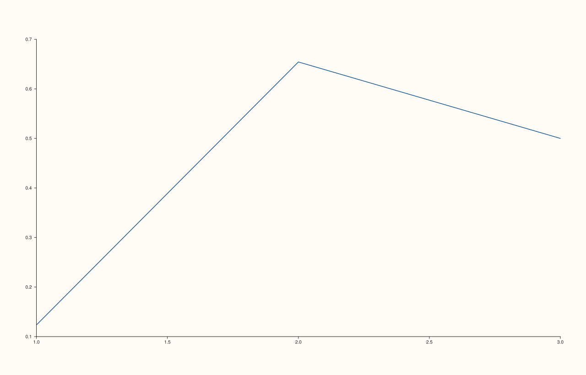

<!-- pluss-hand-authored -->

# Pane::x_auto_tick_decimals

[Back to Pane API Reference](../../pane_api_reference)

## Signatures

```cpp
Pane& Pane::x_auto_tick_decimals(int decimals)         // sets an explicit decimal count
Pane& Pane::clear_x_auto_tick_decimals() noexcept       // clears back to automatic
```

## What It Does

Overrides how many digits after the decimal point [`TickFormat::Auto`](x_tick_format.md)
uses when rendering x-axis tick labels — a fine-tuning knob for `Auto`'s own formatting
choice, distinct from switching to a different `TickFormat` entirely (like
[`Fixed3`](x_tick_format.md)/[`Fixed6`](x_tick_format.md), which hard-code their own
decimal count regardless of this setting). `clear_x_auto_tick_decimals()` removes the
override, letting `Auto` choose its own decimal count again.

```{important} decimals must be in the inclusive range [0, 8]
Any other value throws `std::invalid_argument("x_auto_tick_decimals: decimals must be in
[0, 8]")` — both `0` and `8` themselves are valid (inclusive on both ends); `-1` and `9`
are the first invalid values on either side. See Example 3.
```

## Parameters

**decimals** (`int`, setter only)
    The number of digits after the decimal point. Must be in `[0, 8]`.

## Returns

`Pane&`
    A reference to the same pane, for chaining (both the setter and `clear_x_auto_tick_decimals()`).

## Examples

Example 1. The default: unset, `Auto` chooses its own decimal count.

```cpp
using namespace pluss::pl;

auto fig = studio("auto_tick_decimals_default");
auto& pane = fig.pane2();
pane.trend(std::vector<double>{1.0, 2.0, 3.0}, std::vector<double>{0.123456, 0.654321, 0.5});
fig.show();

std::cout << pane.y_axis().auto_tick_decimals.has_value() << "\n";
```

### Output

```text
0
```



Example 2. An explicit override on the x-axis.

```cpp
using namespace pluss::pl;

auto fig = studio("x_auto_tick_decimals_3");
auto& pane = fig.pane2();
pane.trend(std::vector<double>{1.0, 2.0, 3.0}, std::vector<double>{0.123456, 0.654321, 0.5});
pane.x_auto_tick_decimals(3);
fig.show();

std::cout << *pane.x_axis().auto_tick_decimals << "\n";
```

### Output

```text
3
```


Example 3. Both out-of-range failures, and the two inclusive boundary values (`0` and
`8`) both succeeding.

```cpp
using namespace pluss::pl;

auto fig = studio("auto_tick_decimals_failures");
auto& pane = fig.pane2();
pane.trend(std::vector<double>{1.0, 2.0}, std::vector<double>{1.0, 2.0});

try {
  pane.x_auto_tick_decimals(-1);
} catch (const std::invalid_argument& e) {
  std::cout << e.what() << "\n";
}

try {
  pane.x_auto_tick_decimals(9);
} catch (const std::invalid_argument& e) {
  std::cout << e.what() << "\n";
}

pane.x_auto_tick_decimals(0);
std::cout << *pane.x_axis().auto_tick_decimals << "\n";

pane.x_auto_tick_decimals(8);
std::cout << *pane.x_axis().auto_tick_decimals << "\n";
```

### Output

```text
x_auto_tick_decimals: decimals must be in [0, 8]
x_auto_tick_decimals: decimals must be in [0, 8]
0
8
```

Example 4. `clear_x_auto_tick_decimals()` removes the override.

```cpp
using namespace pluss::pl;

auto fig = studio("auto_tick_decimals_cleared");
auto& pane = fig.pane2();
pane.trend(std::vector<double>{1.0, 2.0, 3.0}, std::vector<double>{0.123456, 0.654321, 0.5});
pane.x_auto_tick_decimals(3);
pane.clear_x_auto_tick_decimals();

std::cout << pane.x_axis().auto_tick_decimals.has_value() << "\n";
```

### Output

```text
0
```

## Notes

- The setter is not `noexcept` (validates the range); `clear_x_auto_tick_decimals()` is
  `noexcept`.
- Only affects rendering while [`TickFormat::Auto`](x_tick_format.md) is the active tick
  format — under `Fixed3`/`Fixed6`/etc., each format's own hard-coded decimal count is
  used instead, and this setting has no visible effect.
- `decimals` is validated as an inclusive range `[0, 8]`, both ends valid.

## See Also

- [`Pane::x_tick_format`](x_tick_format.md): the overall style choice this setting
  fine-tunes, only relevant under `Auto`.
- [`Pane::y_auto_tick_decimals`](y_auto_tick_decimals.md) /
  [`Pane::z_auto_tick_decimals`](z_auto_tick_decimals.md): the y- and z-axis equivalents.

<div class="pluss-inline-prev-next">
  <a class="prev-link" href="z_tick_format.html">
    <span class="label">Previous</span>
    <span class="title">z_tick_format</span>
  </a>
  <a class="next-link" href="y_auto_tick_decimals.html">
    <span class="label">Next</span>
    <span class="title">y_auto_tick_decimals</span>
  </a>
</div>
