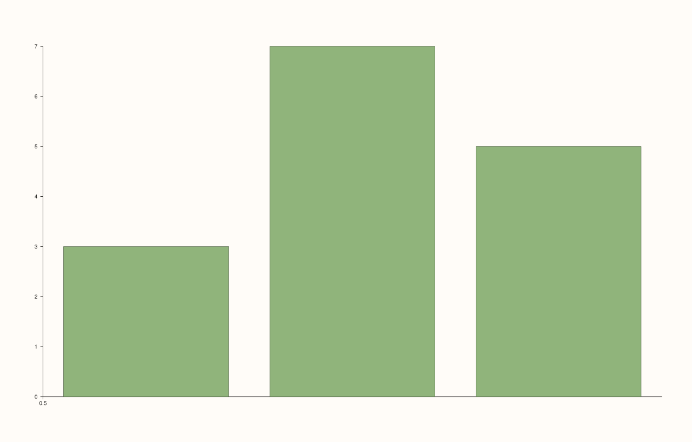

<!-- pluss-hand-authored -->

# Pane::x_categories

[Back to Pane API Reference](../../pane_api_reference)

## Signature

```cpp
Pane& Pane::x_categories(
    pluss::msharp::RangeView::Of<std::string_view> labels,
    double first = 1.0,
    double step = 1.0)
```

## What It Does

A convenience layer on top of [`x_ticks()`](x_ticks.md), purpose-built for the common
case of plotting categorical labels at evenly (or arithmetically) spaced positions,
without hand-computing each position: `x_categories(labels, first, step)` is exactly
`x_ticks(positions, labels)` where `positions` is generated as `first`,
`first + step`, `first + 2*step`, ... for as many entries as `labels` has. There is no
separate `clear_x_categories()` — since this method delegates straight to `x_ticks()`
internally, [`clear_x_ticks()`](x_ticks.md) clears whatever `x_categories()` set, exactly
as if `x_ticks()` had been called directly.

```{important} Negative step is legal -- descending category positions
`step` only needs to be finite and non-zero; a negative `step` produces descending
positions (`first`, `first - |step|`, `first - 2|step|`, ...) rather than throwing. Verified
directly: `x_categories(labels, 0.0, -1.0)` renders genuinely different (reversed-order)
tick placement compared to the default ascending arrangement. See Example 3.
```

## Parameters

**labels** (`RangeView::Of<std::string_view>`, accepts a braced `initializer_list` too)
    The category labels, in position order. Must be non-empty.

**first** (`double`, default `1.0`)
    The position of the first category. Must be finite.

**step** (`double`, default `1.0`)
    The spacing between consecutive category positions. Must be finite and non-zero;
    negative values produce descending positions.

## Returns

`Pane&`
    A reference to the same pane, for chaining.

## Examples

Example 1. The default `first`/`step` — categories placed at `1.0`, `2.0`, `3.0`.

```cpp
using namespace pluss::pl;

auto fig = studio("categories_default");
auto& pane = fig.pane2();
pane.columns(std::vector<double>{3.0, 7.0, 5.0});
pane.x_categories(std::initializer_list<std::string_view>{"Q1", "Q2", "Q3"});
fig.show();

std::cout << pane.x_axis().ticks->labels[0] << " " << pane.x_axis().ticks->labels[1] << " " << pane.x_axis().ticks->labels[2] << "\n";
std::cout << pane.x_axis().ticks->positions.numel() << "\n";
```

### Output

```text
Q1 Q2 Q3
3
```


Example 2. A custom `first`/`step` — categories placed at `10.0`, `15.0`, `20.0`.

```cpp
using namespace pluss::pl;

auto fig = studio("categories_custom_start_step");
auto& pane = fig.pane2();
pane.columns(std::vector<double>{3.0, 7.0, 5.0});
pane.x_categories(std::initializer_list<std::string_view>{"Q1", "Q2", "Q3"}, 10.0, 5.0);
fig.show();
```



Example 3. A negative `step` — descending positions, verified via direct SVG diff to
render genuinely different tick placement compared to Example 1's ascending default.

```cpp
using namespace pluss::pl;

auto fig1 = studio("categories_default");
auto& pane1 = fig1.pane2();
pane1.columns(std::vector<double>{3.0, 7.0, 5.0});
pane1.x_categories(std::initializer_list<std::string_view>{"Q1", "Q2", "Q3"});

auto fig2 = studio("categories_negative_step");
auto& pane2 = fig2.pane2();
pane2.columns(std::vector<double>{3.0, 7.0, 5.0});
pane2.x_categories(std::initializer_list<std::string_view>{"Q1", "Q2", "Q3"}, 0.0, -1.0);
fig2.show();

std::cout << (fig1.to_svg() != fig2.to_svg()) << "\n";
```

### Output

```text
1
```


Example 4. Both validation failures: empty `labels`, and a zero `step`.

```cpp
using namespace pluss::pl;

auto fig = studio("categories_failures");
auto& pane = fig.pane2();
pane.columns(std::vector<double>{3.0, 7.0});

try {
  pane.x_categories(std::initializer_list<std::string_view>{});
} catch (const std::invalid_argument& e) {
  std::cout << e.what() << "\n";
}

try {
  pane.x_categories(std::initializer_list<std::string_view>{"a", "b"}, 0.0, 0.0);
} catch (const std::invalid_argument& e) {
  std::cout << e.what() << "\n";
}
```

### Output

```text
x_categories: labels cannot be empty
x_categories: first/step must be finite and step cannot be zero
```

## Notes

- Not `noexcept` (validates `labels`, `first`, and `step`).
- Built directly on [`x_ticks()`](x_ticks.md) — anything true of `x_ticks()`'s resulting
  state is true here too, including that [`clear_x_ticks()`](x_ticks.md) is the way to
  remove it.
- `step` may be negative (descending positions); it just can't be zero.
- Both `first` and `step` must independently be finite — `NaN`/`±infinity` in either one
  throws the same combined message.

## See Also

- [`Pane::x_ticks`](x_ticks.md): the underlying mechanism this method builds on, and the
  way to clear its result.
- [`Pane::y_categories`](y_categories.md) / [`Pane::z_categories`](z_categories.md): the
  y- and z-axis equivalents.

<div class="pluss-inline-prev-next">
  <a class="prev-link" href="z_ticks.html">
    <span class="label">Previous</span>
    <span class="title">z_ticks</span>
  </a>
  <a class="next-link" href="y_categories.html">
    <span class="label">Next</span>
    <span class="title">y_categories</span>
  </a>
</div>
