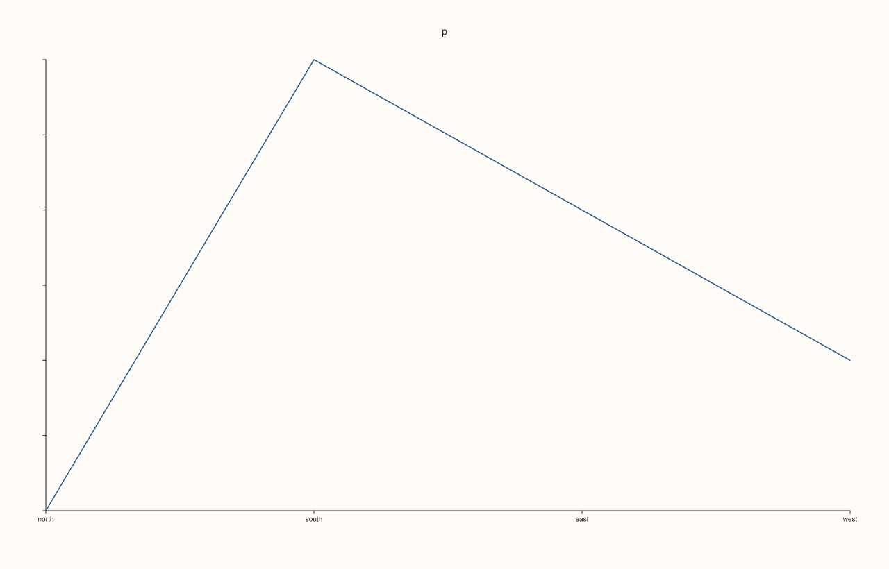
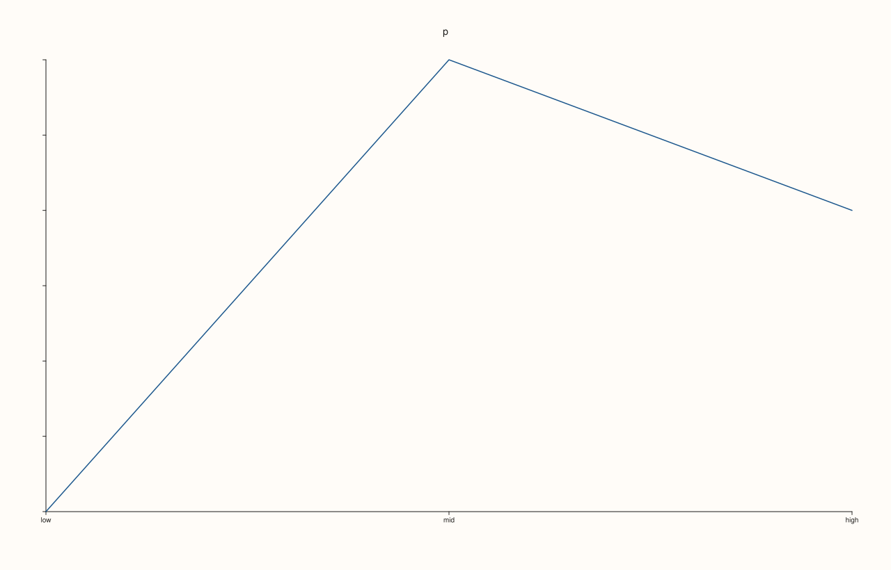
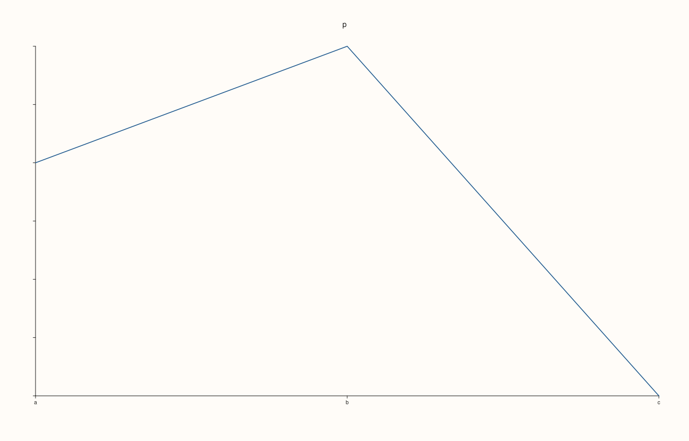
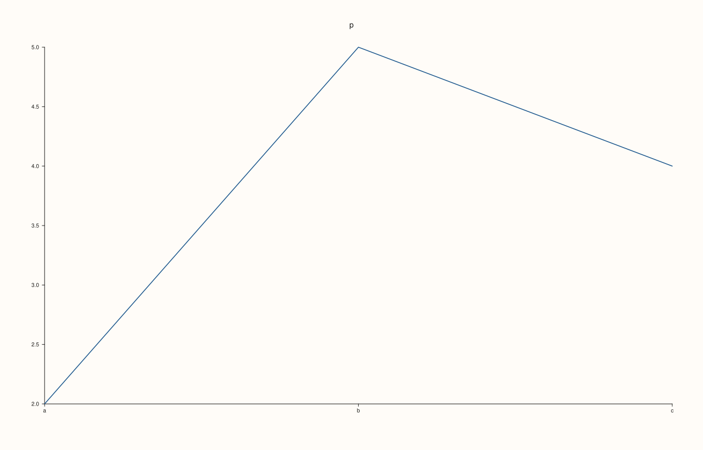
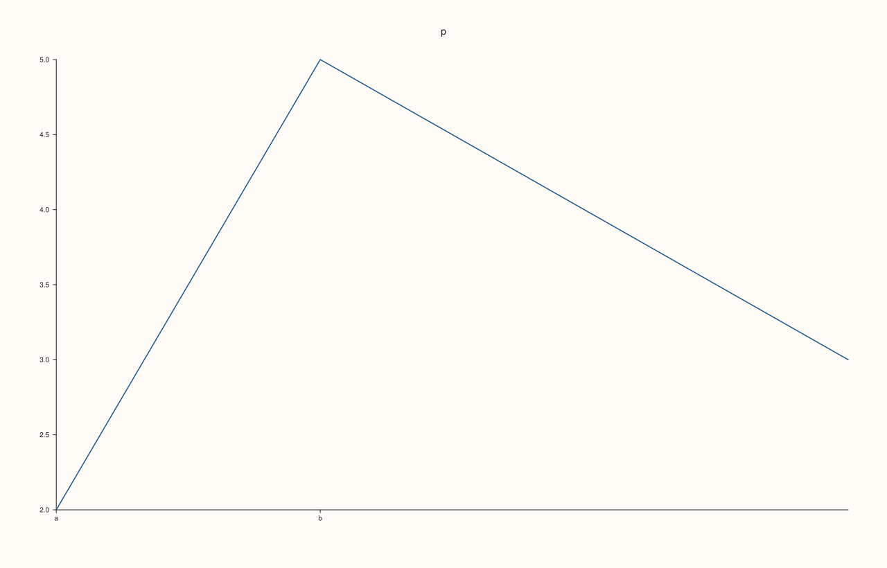

<!-- pluss-hand-authored -->

# Pane::x_categories

[Back to Pane API Reference](../../pane_api_reference)

## Signature

```cpp
Pane& Pane::x_categories(RangeView::Of<std::string_view> labels, double first = 1.0, double step = 1.0)
Pane& Pane::x_categories(std::initializer_list<std::string_view> labels, double first = 1.0, double step = 1.0)
```

## What It Does

Labels the x axis with names instead of numbers: the first label goes at position `first`, the next at `first + step`, and so on. It is the form of [`x_ticks`](x_ticks.md) for categorical data (bars of a bar chart, groups of a box plot) where the positions are evenly spaced, and it produces exactly the ticks that `x_ticks` would with those positions, replacing the automatic ones; [`clear_x_ticks`](x_ticks.md) removes them.

The defaults put the labels at 1, 2, 3, ..., which is where the bar and box traces draw their categories. A negative `step` runs the labels downwards. Labels cannot be empty, and `first` and `step` must be finite with a non-zero `step`; otherwise the call throws `pluss::Error` and the previous ticks are kept. Ticks that fall outside the displayed range are not drawn.

## Parameters

**labels** (`RangeView::Of<std::string_view>` or braced list)
    The category names, at least one.

**first** (`double`, default 1)
    The position of the first label. Finite.

**step** (`double`, default 1)
    The distance between labels. Finite and not zero.

## Returns

`Pane&`
    The same pane, for chaining.

## Examples

Example 1. Category names on the integers. Four labels with the defaults (`first = 1`, `step = 1`) sit at 1, 2, 3 and 4.

```cpp
auto texts = [](const std::string& svg) {
  std::string out;
  for (std::size_t at = svg.find("<text"); at != std::string::npos; at = svg.find("<text", at + 1)) {
    const auto gt = svg.find('>', at);
    out += svg.substr(gt + 1, svg.find("</text>", gt) - gt - 1) + " ";
  }
  return out;
};
auto fig = studio("x_categories_basic");
auto& pane = fig.pane2("p");
pane.trend(std::vector<double>{1, 2, 3, 4}, std::vector<double>{2, 5, 4, 3});
pane.y_tick_labels(false);
pane.z_tick_labels(false);
pane.x_categories({"north", "south", "east", "west"});
std::cout << texts(fig.to_svg()) << "\n";
fig.save_svg("figure.svg");
```

### Output

```text
p north south east west 
```



Example 2. Another origin and spacing. `first = 10` and `step = 5` put three labels at 10, 15 and 20, which is where the data is.

```cpp
auto texts = [](const std::string& svg) {
  std::string out;
  for (std::size_t at = svg.find("<text"); at != std::string::npos; at = svg.find("<text", at + 1)) {
    const auto gt = svg.find('>', at);
    out += svg.substr(gt + 1, svg.find("</text>", gt) - gt - 1) + " ";
  }
  return out;
};
auto fig = studio("x_categories_step");
auto& pane = fig.pane2("p");
pane.trend(std::vector<double>{10, 15, 20}, std::vector<double>{2, 5, 4});
pane.y_tick_labels(false);
pane.z_tick_labels(false);
pane.x_categories({"low", "mid", "high"}, 10.0, 5.0);
std::cout << texts(fig.to_svg()) << "\n";
fig.save_svg("figure.svg");
```

### Output

```text
p low mid high 
```



Example 3. A negative step runs the other way. The labels are placed at 3, 2 and 1, so the first name is at the highest position.

```cpp
auto texts = [](const std::string& svg) {
  std::string out;
  for (std::size_t at = svg.find("<text"); at != std::string::npos; at = svg.find("<text", at + 1)) {
    const auto gt = svg.find('>', at);
    out += svg.substr(gt + 1, svg.find("</text>", gt) - gt - 1) + " ";
  }
  return out;
};
auto fig = studio("x_categories_desc");
auto& pane = fig.pane2("p");
pane.trend(std::vector<double>{3, 2, 1}, std::vector<double>{2, 5, 4});
pane.y_tick_labels(false);
pane.z_tick_labels(false);
pane.x_categories({"c", "b", "a"}, 3.0, -1.0);
std::cout << texts(fig.to_svg()) << "\n";
fig.save_svg("figure.svg");
```

### Output

```text
p a b c 
```



Example 4. The same as `x_ticks`. `x_categories` computes the positions and calls `x_ticks`, so the two give the same figure.

```cpp
auto build = [&](bool through_ticks) {
  auto fig = studio("x_categories_same");
  auto& pane = fig.pane2("p");
  pane.trend(std::vector<double>{1, 2, 3}, std::vector<double>{2, 5, 4});
  if (through_ticks) pane.x_ticks(std::vector<double>{1.0, 2.0, 3.0}, {"a", "b", "c"});
  else pane.x_categories({"a", "b", "c"});
  return fig.to_svg();
};
std::cout << "equal: " << (build(true) == build(false)) << "\n";
auto fig = studio("x_categories_same_out");
auto& pane = fig.pane2("p");
pane.trend(std::vector<double>{1, 2, 3}, std::vector<double>{2, 5, 4});
pane.x_categories({"a", "b", "c"});
fig.save_svg("figure.svg");
```

### Output

```text
equal: 1
```



Example 5. Invalid specifications are refused. No labels, a step of zero, and a non-finite first or step each throw `pluss::Error`, and the previous ticks are kept.

```cpp
auto fig = studio("x_categories_invalid");
auto& pane = fig.pane2("p");
pane.trend(std::vector<double>{1, 2, 3, 4}, std::vector<double>{2, 5, 4, 3});
pane.x_categories({"a", "b"});
auto attempt = [&](const char* label, auto call) {
  try {
    call();
  } catch (const pluss::Error& e) {
    std::cout << label << ": " << e.message() << "\n";
  }
};
attempt("no labels", [&] { pane.x_categories({}); });
attempt("step zero", [&] { pane.x_categories({"a"}, 1.0, 0.0); });
attempt("first not finite", [&] { pane.x_categories({"a"}, std::numeric_limits<double>::quiet_NaN(), 1.0); });
attempt("step infinite", [&] { pane.x_categories({"a"}, 1.0, std::numeric_limits<double>::infinity()); });
std::cout << "kept: " << pane.x_axis().ticks->labels.size() << " labels\n";
fig.save_svg("figure.svg");
```

### Output

```text
no labels: x_categories: labels cannot be empty
step zero: x_categories: first/step must be finite and step cannot be zero
first not finite: x_categories: first/step must be finite and step cannot be zero
step infinite: x_categories: first/step must be finite and step cannot be zero
kept: 2 labels
```



## Notes

- Not `noexcept`: it throws for invalid arguments.
- There is no `clear_x_categories`; categories are ticks, so use `clear_x_ticks`.

## See Also

- [`Pane::x_ticks`](x_ticks.md): labels at arbitrary positions.
- [`Pane::x_tick_labels`](x_tick_labels.md): hide the tick labels.
- [`Pane::y_categories`](y_categories.md): the same setting for the y axis.
- [`Pane::z_categories`](z_categories.md): the same setting for the z axis.

<div class="pluss-inline-prev-next">
  <a class="prev-link" href="x_auto_tick_decimals.html">
    <span class="label">Previous</span>
    <span class="title">x_auto_tick_decimals</span>
  </a>
  <a class="next-link" href="x_label.html">
    <span class="label">Next</span>
    <span class="title">x_label</span>
  </a>
</div>
