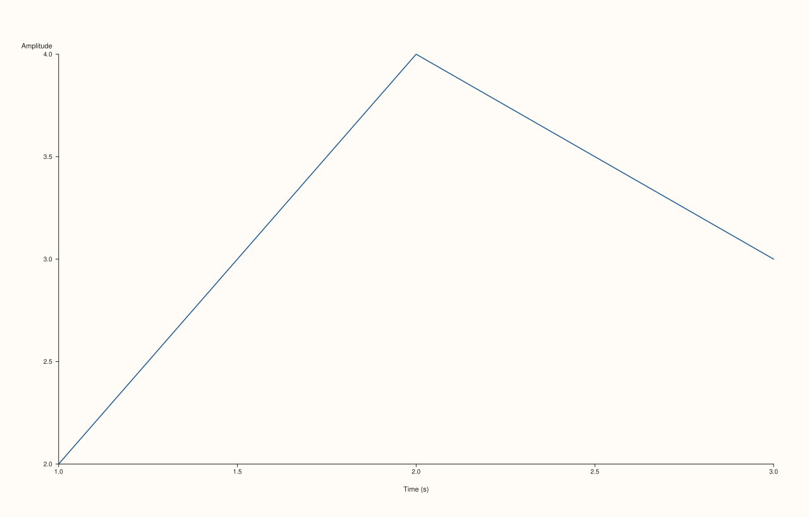

<!-- pluss-hand-authored -->

# Pane::x_label

[Back to Pane API Reference](../../pane_api_reference)

## Signature

```cpp
Pane& Pane::x_label(std::string label)
```

## What It Does

Sets the x-axis label — the caption text drawn alongside the axis itself, distinct from
the pane's own [`title()`](title.md) (drawn above the whole plot area) and from
[`Studio`'s figure-wide captions](../studio/x_caption.md) (drawn once across multiple
aligned panes). A plain, unconditional setter: no validation, and an empty string is a
legitimate way to clear the label back to nothing (the constructor default).

The current value is always readable back through [`x_axis().label`](axis_accessors.md) —
there's no separate `x_label_text()` accessor, since `x_axis()`'s `AxisState` already
carries the `label` field directly.

## Parameters

**label** (`std::string`)
    The x-axis label text. An empty string clears any existing label.

## Returns

`Pane&`
    A reference to the same pane, for chaining.

## Examples

Example 1. No label set — empty by default.

```cpp
using namespace pluss::pl;

auto fig = studio("labels_default");
auto& pane = fig.pane2();
pane.trend(std::vector<double>{1.0, 2.0, 3.0}, std::vector<double>{2.0, 4.0, 3.0});
fig.show();

std::cout << pane.x_axis().label.empty() << "\n";
```

### Output

```text
1
```


Example 2. `x_label()` chained with [`y_label()`](y_label.md) on a 2D pane.

```cpp
using namespace pluss::pl;

auto fig = studio("labels_2d");
auto& pane = fig.pane2();
pane.trend(std::vector<double>{1.0, 2.0, 3.0}, std::vector<double>{2.0, 4.0, 3.0});
pane.x_label("Time (s)").y_label("Amplitude");
fig.show();

std::cout << pane.x_axis().label << ", " << pane.y_axis().label << "\n";
```

### Output

```text
Time (s), Amplitude
```



## Notes

- Not marked `noexcept`, though it only fails via `std::string`'s own allocation failure —
  no argument validation of its own.
- An empty string is a legitimate way to clear the label, not an error.
- Read back through [`x_axis().label`](axis_accessors.md), not a dedicated accessor.

## See Also

- [`Pane::y_label`](y_label.md) / [`Pane::z_label`](z_label.md): the y- and z-axis
  equivalents.
- [`Pane::title`](title.md): the pane's own title, drawn above the plot area rather than
  alongside an axis.
- [`Studio::x_caption`](../studio/x_caption.md): a figure-wide caption shared across
  multiple aligned panes, a different mechanism entirely.
- [`Pane::x_axis`](axis_accessors.md): where this label is read back from.

<div class="pluss-inline-prev-next">
  <a class="prev-link" href="axis_accessors.html">
    <span class="label">Previous</span>
    <span class="title">axis_accessors</span>
  </a>
  <a class="next-link" href="y_label.html">
    <span class="label">Next</span>
    <span class="title">y_label</span>
  </a>
</div>
