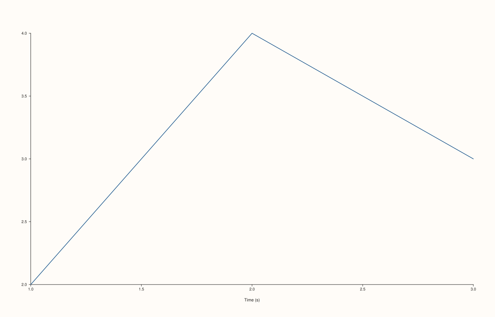
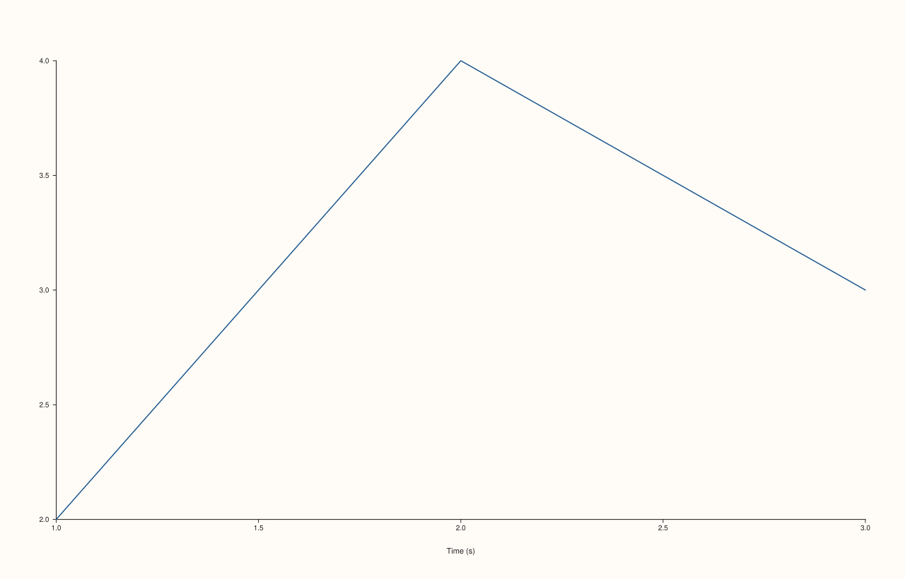

<!-- pluss-hand-authored -->

# Pane::x_label_gap

[Back to Pane API Reference](../../pane_api_reference)

## Signatures

```cpp
Pane& Pane::x_label_gap(double points)          // sets an explicit gap
Pane& Pane::clear_x_label_gap() noexcept          // clears back to the default
```

## What It Does

Sets the spacing, in points, between the x-axis line (and its tick labels) and the
x-axis's own overall label (set via [`x_label()`](x_label.md)) — a different, further-out
gap than [`x_tick_label_gap()`](x_tick_label_gap.md), which spaces the ticks from *their*
labels, closer to the axis. `clear_x_label_gap()` removes the override.

```{important} Same validation rule as x_tick_label_gap(): finite and non-negative
Identical validation to [`x_tick_label_gap()`](x_tick_label_gap.md): `points` must be
finite and `>= 0`, or this throws `std::invalid_argument("x_label_gap: spacing must be
finite and non-negative")`. `0.0` is a valid boundary.
```

## Parameters

**points** (`double`, setter only)
    The gap size in points. Must be finite and non-negative.

## Returns

`Pane&`
    A reference to the same pane, for chaining.

## Examples

Example 1. The default: no gap override.

```cpp
using namespace pluss::pl;

auto fig = studio("label_gap_default");
auto& pane = fig.pane2();
pane.trend(std::vector<double>{1.0, 2.0, 3.0}, std::vector<double>{2.0, 4.0, 3.0});
pane.x_label("Time (s)");
fig.show();

std::cout << pane.x_axis().label_gap.has_value() << "\n";
```

### Output

```text
0
```



Example 2. A wider gap, pushing the axis label further from the tick labels — verified via
direct SVG diff (not byte count) to be genuinely different from Example 1's output despite
sharing the same byte length.

```cpp
using namespace pluss::pl;

auto fig = studio("label_gap_wide");
auto& pane = fig.pane2();
pane.trend(std::vector<double>{1.0, 2.0, 3.0}, std::vector<double>{2.0, 4.0, 3.0});
pane.x_label("Time (s)");
pane.x_label_gap(30.0);
fig.show();

std::cout << *pane.x_axis().label_gap << "\n";
```

### Output

```text
30
```



Example 3. Both validation failures.

```cpp
using namespace pluss::pl;

auto fig = studio("label_gap_failures");
auto& pane = fig.pane2();
pane.trend(std::vector<double>{1.0, 2.0}, std::vector<double>{1.0, 2.0});

try {
  pane.x_label_gap(-1.0);
} catch (const std::invalid_argument& e) {
  std::cout << e.what() << "\n";
}

try {
  pane.x_label_gap(std::numeric_limits<double>::infinity());
} catch (const std::invalid_argument& e) {
  std::cout << e.what() << "\n";
}
```

### Output

```text
x_label_gap: spacing must be finite and non-negative
x_label_gap: spacing must be finite and non-negative
```

Example 4. `clear_x_label_gap()` removes the override.

```cpp
using namespace pluss::pl;

auto fig = studio("label_gap_cleared");
auto& pane = fig.pane2();
pane.trend(std::vector<double>{1.0, 2.0, 3.0}, std::vector<double>{2.0, 4.0, 3.0});
pane.x_label_gap(30.0);
pane.clear_x_label_gap();

std::cout << pane.x_axis().label_gap.has_value() << "\n";
```

### Output

```text
0
```

## Notes

- The setter is not `noexcept` (validates finiteness and non-negativity);
  `clear_x_label_gap()` is `noexcept`.
- `0.0` is valid; negative values are rejected.
- Distinct from [`x_tick_label_gap()`](x_tick_label_gap.md) — this spaces the axis label
  from its ticks, not the ticks from their own labels.

## See Also

- [`Pane::y_label_gap`](y_label_gap.md) / [`Pane::z_label_gap`](z_label_gap.md): the y-
  and z-axis equivalents.
- [`Pane::x_tick_label_gap`](x_tick_label_gap.md): the closer-in spacing between ticks and
  their own labels.
- [`Pane::x_label_rotation`](x_label_rotation.md): another axis-label layout control.

<div class="pluss-inline-prev-next">
  <a class="prev-link" href="z_tick_label_gap.html">
    <span class="label">Previous</span>
    <span class="title">z_tick_label_gap</span>
  </a>
  <a class="next-link" href="y_label_gap.html">
    <span class="label">Next</span>
    <span class="title">y_label_gap</span>
  </a>
</div>
