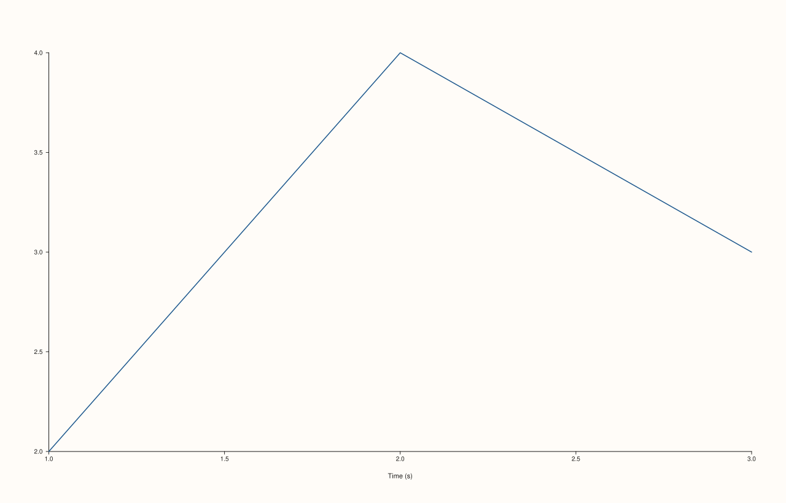
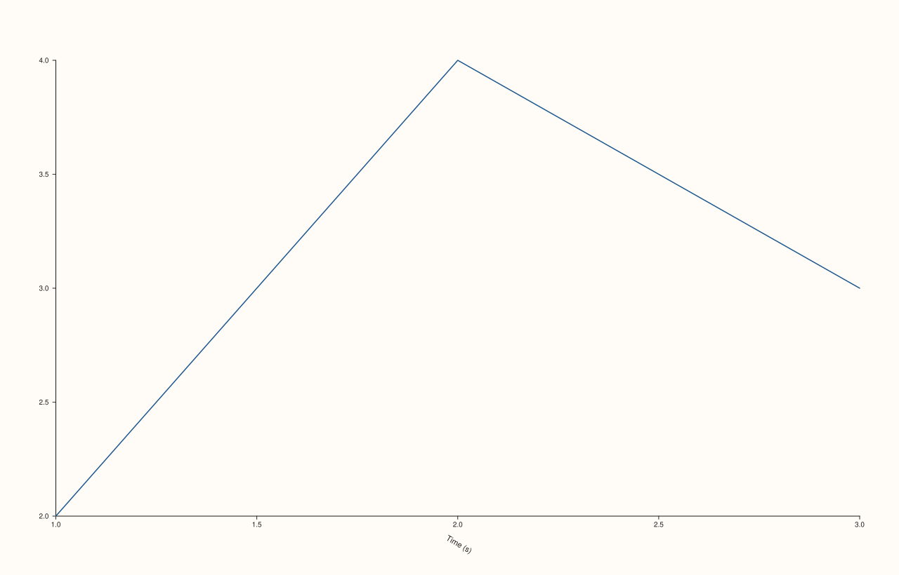

<!-- pluss-hand-authored -->

# Pane::x_label_rotation

[Back to Pane API Reference](../../pane_api_reference)

## Signatures

```cpp
Pane& Pane::x_label_rotation(double degrees)          // sets an explicit rotation
Pane& Pane::clear_x_label_rotation() noexcept          // clears back to the default
```

## What It Does

Rotates the x-axis's own overall label (set via [`x_label()`](x_label.md)) by an explicit
angle — distinct from [`x_tick_rotation()`](x_tick_rotation.md), which rotates the
individual tick labels instead. `clear_x_label_rotation()` removes the override.

```{important} Same validation rule as x_tick_rotation(): finite only, no bound
Identical validation to [`x_tick_rotation()`](x_tick_rotation.md): `degrees` must be
finite, or this throws `std::invalid_argument("x_label_rotation: angle must be finite")`.
Any other finite value is accepted, with no `[0, 360)` normalization.
```

## Parameters

**degrees** (`double`, setter only)
    The rotation angle in degrees. Must be finite.

## Returns

`Pane&`
    A reference to the same pane, for chaining.

## Examples

Example 1. The default: no rotation override.

```cpp
using namespace pluss::pl;

auto fig = studio("label_rotation_default");
auto& pane = fig.pane2();
pane.trend(std::vector<double>{1.0, 2.0, 3.0}, std::vector<double>{2.0, 4.0, 3.0});
pane.x_label("Time (s)");
fig.show();

std::cout << pane.x_axis().label_rotation_deg.has_value() << "\n";
```

### Output

```text
0
```



Example 2. A 30-degree rotation of the axis label.

```cpp
using namespace pluss::pl;

auto fig = studio("label_rotation_30");
auto& pane = fig.pane2();
pane.trend(std::vector<double>{1.0, 2.0, 3.0}, std::vector<double>{2.0, 4.0, 3.0});
pane.x_label("Time (s)");
pane.x_label_rotation(30.0);
fig.show();

std::cout << *pane.x_axis().label_rotation_deg << "\n";
```

### Output

```text
30
```



Example 3. A non-finite angle throws.

```cpp
using namespace pluss::pl;

auto fig = studio("label_rotation_failure");
auto& pane = fig.pane2();
pane.trend(std::vector<double>{1.0, 2.0}, std::vector<double>{1.0, 2.0});

try {
  pane.x_label_rotation(std::numeric_limits<double>::quiet_NaN());
} catch (const std::invalid_argument& e) {
  std::cout << e.what() << "\n";
}
```

### Output

```text
x_label_rotation: angle must be finite
```

Example 4. `clear_x_label_rotation()` removes the override.

```cpp
using namespace pluss::pl;

auto fig = studio("label_rotation_cleared");
auto& pane = fig.pane2();
pane.trend(std::vector<double>{1.0, 2.0, 3.0}, std::vector<double>{2.0, 4.0, 3.0});
pane.x_label_rotation(30.0);
pane.clear_x_label_rotation();

std::cout << pane.x_axis().label_rotation_deg.has_value() << "\n";
```

### Output

```text
0
```

## Notes

- The setter is not `noexcept` (validates finiteness); `clear_x_label_rotation()` is
  `noexcept`.
- No range restriction beyond finiteness, same as `x_tick_rotation()`.
- Rotates the axis *label* specifically, not the tick labels — see
  [`x_tick_rotation()`](x_tick_rotation.md) for that.

## See Also

- [`Pane::y_label_rotation`](y_label_rotation.md) / [`Pane::z_label_rotation`](z_label_rotation.md):
  the y- and z-axis equivalents.
- [`Pane::x_tick_rotation`](x_tick_rotation.md): rotates the tick labels, not the axis
  label.
- [`Pane::x_label_gap`](x_label_gap.md): another axis-label layout control.

<div class="pluss-inline-prev-next">
  <a class="prev-link" href="z_label_gap.html">
    <span class="label">Previous</span>
    <span class="title">z_label_gap</span>
  </a>
  <a class="next-link" href="y_label_rotation.html">
    <span class="label">Next</span>
    <span class="title">y_label_rotation</span>
  </a>
</div>
