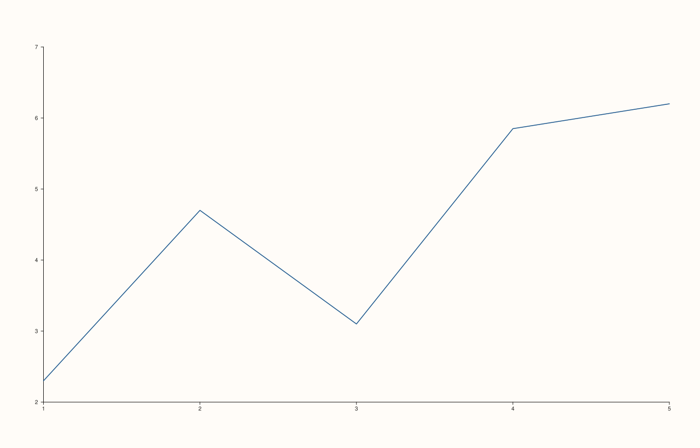
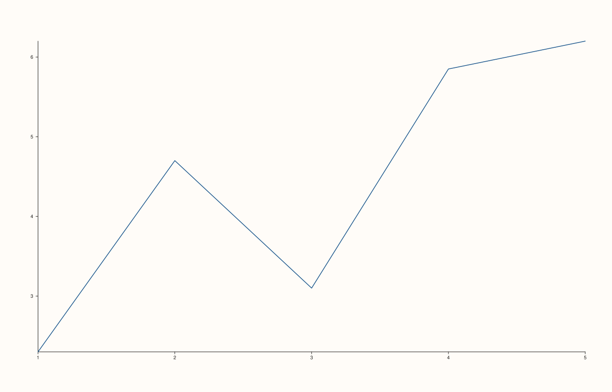
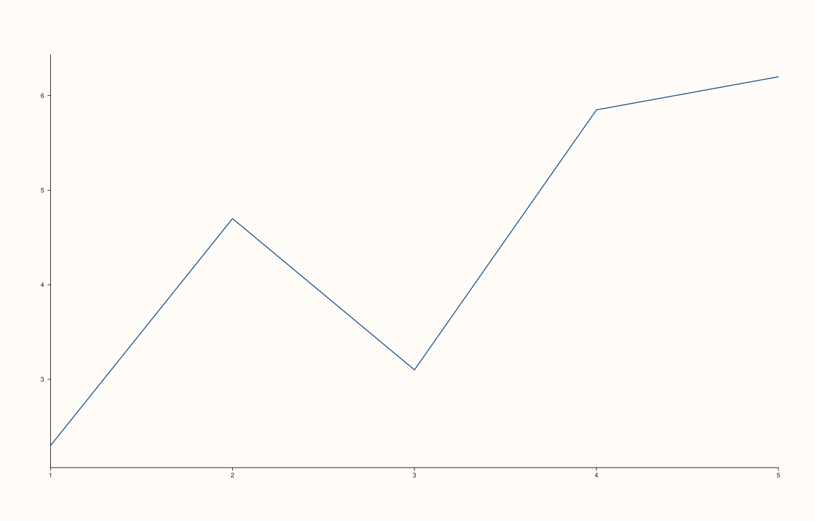

<!-- pluss-hand-authored -->

# Pane::x_limit_method

[Back to Pane API Reference](../../pane_api_reference)

## Signature

```cpp
Pane& Pane::x_limit_method(LimitMethod method) noexcept
```

## What It Does

Chooses **how** the x-axis range is computed when it's being fit *automatically* — that is,
only while [`x_limits()`](x_limits.md) has **not** set an explicit, manual range.
`LimitMethod` has three values:

- **`LimitMethod::TickAligned`** — the constructor default. Expands the data's natural
  range outward to the nearest round tick boundaries, so the axis starts and ends on
  "clean" numbers.
- **`LimitMethod::Tight`** — hugs the data as closely as possible, with little to no extra
  margin beyond the plotted values' own range.
- **`LimitMethod::Padded`** — adds a proportional margin around the data's range, keeping
  points away from the very edge of the plot area without necessarily landing on round
  tick values.

```{important} Has zero effect once x_limits() sets an explicit range
`x_limit_method()` only participates in **automatic** fitting. Once
[`x_limits()`](x_limits.md) sets a manual range, the axis uses exactly that range — the
method that *would* compute automatic padding is never consulted at all, regardless of
what `x_limit_method()` was set to (before or after `x_limits()`). Verified directly: two
otherwise-identical figures with manual `y_limits()` but different `y_limit_method()`
values produce byte-for-byte identical SVG output. See Example 4.
```

## Parameters

**method** (`LimitMethod`)
    `TickAligned`, `Tight`, or `Padded`.

## Returns

`Pane&`
    A reference to the same pane, for chaining.

## Examples

Example 1, 2, and 3. All three values compared on the same (deliberately non-round)
y-values, via [`y_limit_method()`](y_limit_method.md) — the same mechanics, shown on the
y-axis since it's the easier one to see the effect on. Verified via direct SVG content
comparison (not byte-count) that all three produce genuinely different output for this
data.

```cpp
using namespace pluss::pl;

const std::vector<double> x{1.0, 2.0, 3.0, 4.0, 5.0};
const std::vector<double> y{2.3, 4.7, 3.1, 5.85, 6.2};

auto fig1 = studio("limit_method_default");
auto& pane1 = fig1.pane2();
pane1.trend(x, y);
fig1.show();
std::cout << (pane1.y_axis().limit_method == LimitMethod::TickAligned) << "\n";

auto fig2 = studio("limit_method_tight");
auto& pane2 = fig2.pane2();
pane2.trend(x, y);
pane2.y_limit_method(LimitMethod::Tight);
fig2.show();

auto fig3 = studio("limit_method_padded");
auto& pane3 = fig3.pane2();
pane3.trend(x, y);
pane3.y_limit_method(LimitMethod::Padded);
fig3.show();

std::cout << (fig1.to_svg() == fig2.to_svg()) << "\n";
std::cout << (fig2.to_svg() == fig3.to_svg()) << "\n";
std::cout << (fig1.to_svg() == fig3.to_svg()) << "\n";
```

### Output

```text
1
0
0
0
```







Example 4. `y_limit_method()` has no effect once manual `y_limits()` are set — verified
that `Tight` and `Padded` produce byte-for-byte identical output when limits are explicit.

```cpp
using namespace pluss::pl;

const std::vector<double> x{1.0, 2.0, 3.0, 4.0, 5.0};
const std::vector<double> y{2.0, 4.0, 3.0, 5.0, 6.0};

auto fig_tight = studio("limit_method_manual_tight");
auto& pane_tight = fig_tight.pane2();
pane_tight.trend(x, y);
pane_tight.y_limits(Range1d{0.0, 10.0}).y_limit_method(LimitMethod::Tight);

auto fig_padded = studio("limit_method_manual_padded");
auto& pane_padded = fig_padded.pane2();
pane_padded.trend(x, y);
pane_padded.y_limits(Range1d{0.0, 10.0}).y_limit_method(LimitMethod::Padded);

std::cout << (fig_tight.to_svg() == fig_padded.to_svg()) << "\n";
```

### Output

```text
1
```

## Notes

- `noexcept` — no validation, since every `LimitMethod` value is valid.
- `TickAligned` is `0`, `Tight` is `1`, `Padded` is `2`.
- Only affects rendering while `limit_mode` is `AutoFit` — see the important callout
  above.
- Setting `x_limit_method()` before or after `x_limits()` makes no difference to whether
  it takes effect — what matters is whether `limit_mode` is `AutoFit` **at render time**,
  which is controlled entirely by whether `x_limits()`/`auto_x()` was called most recently.

## See Also

- [`Pane::x_limits`](x_limits.md) / [`Pane::auto_x`](x_limits.md): switch between manual
  and automatic fitting.
- [`Pane::y_limit_method`](y_limit_method.md) / [`Pane::z_limit_method`](z_limit_method.md) /
  [`Pane::color_limit_method`](color_limit_method.md): the other three axes' equivalents.

<div class="pluss-inline-prev-next">
  <a class="prev-link" href="color_limits.html">
    <span class="label">Previous</span>
    <span class="title">color_limits</span>
  </a>
  <a class="next-link" href="y_limit_method.html">
    <span class="label">Next</span>
    <span class="title">y_limit_method</span>
  </a>
</div>
