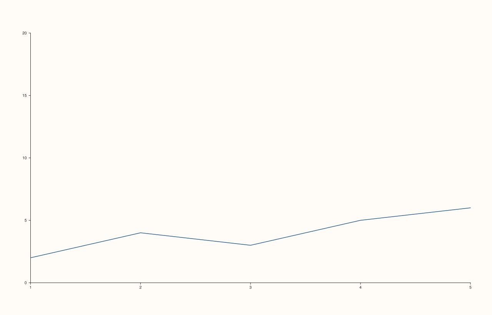

<!-- pluss-hand-authored -->

# Pane::x_limits

[Back to Pane API Reference](../../pane_api_reference)

## Signatures

```cpp
Pane& Pane::x_limits(Range1d limits)   // sets an explicit, manual range
Pane& Pane::auto_x() noexcept          // clears back to automatic fitting
```

## What It Does

Sets an explicit x-axis display range, overriding the default behavior of automatically
fitting the range to whatever data is plotted. Calling `x_limits()` also flips the axis's
internal `limit_mode` to `Manual`; calling `auto_x()` (documented on this same page below —
it's the direct undo for `x_limits()`) clears the range back to `nullopt` and flips
`limit_mode` back to `AutoFit`.

```{important} Two independent validation checks, both throwing std::invalid_argument
1. **The range itself** must be finite on both ends and *strictly increasing*
   (`low < high`, not merely `low <= high`) — a reversed range like `{10.0, 5.0}` or a
   degenerate one like `{5.0, 5.0}` both throw
   `"x_limits: range must be finite and strictly increasing"`. See Example 3.
2. **Scale compatibility** — if [`scale_x()`](scale_x.md) currently has
   `ScaleKind::Log10` active, the range must be strictly positive on both ends, or this
   throws `"x_limits: log10 limits must be strictly positive"`. This check only fires
   for `Log10`; `Linear` and `SymLog` never reject a range on these grounds. See
   [`scale_x()`](scale_x.md)'s Example 5 and Example 6 for both orderings of this
   interaction (setting incompatible limits after `log10` is active, and switching to
   `log10` after incompatible limits are already set).
```

## Parameters

**limits** (`Range1d`)
    The explicit `{low, high}` range to display. Must be finite and strictly increasing;
    must additionally be strictly positive if `ScaleKind::Log10` is the current x-scale.

## Returns

`Pane&`
    A reference to the same pane, for chaining.

## Examples

Example 1. The default: no `x_limits()` call, `limit_mode` is `AutoFit`, and `limits` is
unset (`std::nullopt`) — the axis range is computed automatically from the plotted data
every render.

```cpp
using namespace pluss::pl;

auto fig = studio("limits_auto_default");
auto& pane = fig.pane2();
pane.trend(std::vector<double>{1.0, 2.0, 3.0, 4.0, 5.0}, std::vector<double>{2.0, 4.0, 3.0, 5.0, 6.0});
fig.show();

std::cout << (pane.y_axis().limit_mode == LimitMode::AutoFit) << "\n";
std::cout << pane.y_axis().limits.has_value() << "\n";
```

### Output

```text
1
0
```


Example 2. An explicit range via `y_limits()` — the same mechanics as `x_limits()`, shown
on the y-axis here since it more visibly clips the plotted data's own range.

```cpp
using namespace pluss::pl;

auto fig = studio("limits_manual");
auto& pane = fig.pane2();
pane.trend(std::vector<double>{1.0, 2.0, 3.0, 4.0, 5.0}, std::vector<double>{2.0, 4.0, 3.0, 5.0, 6.0});
pane.y_limits(Range1d{0.0, 20.0});
fig.show();

std::cout << (pane.y_axis().limit_mode == LimitMode::Manual) << "\n";
std::cout << pane.y_axis().limits->low << " " << pane.y_axis().limits->high << "\n";
```

### Output

```text
1
0 20
```



Example 3. All three range-validation failures on the same axis.

```cpp
using namespace pluss::pl;

auto fig = studio("limits_reversed");
auto& pane = fig.pane2();
pane.trend(std::vector<double>{1.0, 2.0}, std::vector<double>{1.0, 2.0});

try {
  pane.y_limits(Range1d{10.0, 5.0});  // reversed
} catch (const std::invalid_argument& e) {
  std::cout << e.what() << "\n";
}

try {
  pane.y_limits(Range1d{5.0, 5.0});  // equal, not strictly increasing
} catch (const std::invalid_argument& e) {
  std::cout << e.what() << "\n";
}

try {
  pane.y_limits(Range1d{0.0, std::numeric_limits<double>::infinity()});  // non-finite
} catch (const std::invalid_argument& e) {
  std::cout << e.what() << "\n";
}
```

### Output

```text
y_limits: range must be finite and strictly increasing
y_limits: range must be finite and strictly increasing
y_limits: range must be finite and strictly increasing
```

Example 4. `auto_y()` clears manual limits back to automatic fitting — the direct undo for
`y_limits()`, producing output identical to never having called `y_limits()` at all.

```cpp
using namespace pluss::pl;

auto fig = studio("limits_cleared_back_to_auto");
auto& pane = fig.pane2();
pane.trend(std::vector<double>{1.0, 2.0, 3.0, 4.0, 5.0}, std::vector<double>{2.0, 4.0, 3.0, 5.0, 6.0});
pane.y_limits(Range1d{0.0, 20.0});
pane.auto_y();
fig.show();

std::cout << (pane.y_axis().limit_mode == LimitMode::AutoFit) << "\n";
std::cout << pane.y_axis().limits.has_value() << "\n";
```

### Output

```text
1
0
```


## Notes

- `x_limits()` is not `noexcept` (validates); `auto_x()` **is** `noexcept` (unconditional
  reset, nothing to validate).
- Setting `x_limits()` is the only way `limit_mode` becomes `Manual`; `auto_x()` is the
  only way it goes back to `AutoFit` after that.
- The scale-compatibility check is one-directional in what it inspects but bidirectional
  in when it fires: it always compares the range being set against whatever scale is
  *currently* active, and [`scale_x()`](scale_x.md) performs the mirror-image check
  against whatever limits are *currently* set — see that page's important callout.
- [`x_limit_method()`](x_limit_method.md) is unrelated to `x_limits()`/`auto_x()`'s own
  validation, but only has any visible effect while `limit_mode` is `AutoFit` — once
  manual limits are set, the method that *would* compute automatic padding is simply
  never consulted. See [`x_limit_method()`](x_limit_method.md)'s Example 4.

## See Also

- [`Pane::y_limits`](y_limits.md) / [`Pane::z_limits`](z_limits.md): the y- and z-axis
  equivalents.
- [`Pane::color_limits`](color_limits.md): the analogous control for the color axis (no
  scale-compatibility check, since there is no `scale_color()`).
- [`Pane::scale_x`](scale_x.md): the other half of the log10 cross-validation.
- [`Pane::x_limit_method`](x_limit_method.md): governs *automatic* fitting only; inert once
  `x_limits()` is set.
- [`Pane::x_axis`](axis_accessors.md): reads back `limit_mode` and `limits` together with
  every other axis field.

<div class="pluss-inline-prev-next">
  <a class="prev-link" href="scale_z.html">
    <span class="label">Previous</span>
    <span class="title">scale_z</span>
  </a>
  <a class="next-link" href="y_limits.html">
    <span class="label">Next</span>
    <span class="title">y_limits</span>
  </a>
</div>
