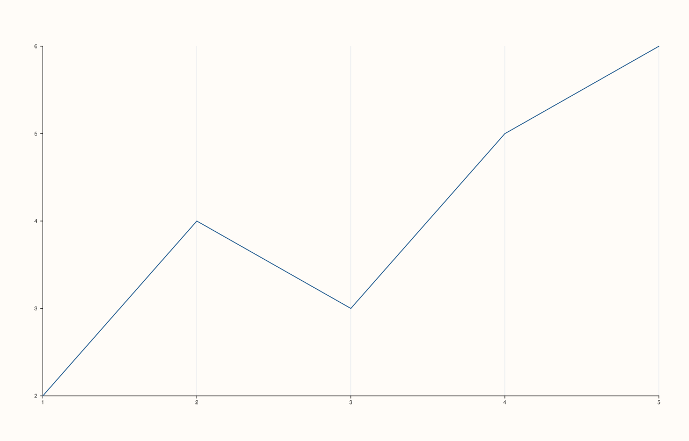

<!-- pluss-hand-authored -->

# Pane::x_major_grid

[Back to Pane API Reference](../../pane_api_reference)

## Signature

```cpp
Pane& Pane::x_major_grid(bool enable = true) noexcept
```

## What It Does

Toggles major gridlines for the x-axis specifically, independent of the y- and z-axes —
the granular counterpart of the uniform [`grid()`](grid.md) setter. Every call also
**recomputes** the aggregate [`grid_style()`](grid.md) by OR-ing the major/minor flags
across all three axes (see [`grid()`](grid.md)'s important callout for the full rule):
turning this axis's major grid on is enough to make `grid_style()` report `Major` (or
`MajorMinor`, if any axis's minor flag is also on) — even while the other two axes' major
flags are still `false`. See Example 2.

## Parameters

**enable** (`bool`, default `true`)
    `true` to show major gridlines on the x-axis, `false` to hide them.

## Returns

`Pane&`
    A reference to the same pane, for chaining.

## Examples

Example 1. Enabling major gridlines on the x-axis only, leaving y untouched.

```cpp
using namespace pluss::pl;

auto fig = studio("major_grid_per_axis");
auto& pane = fig.pane2();
pane.trend(std::vector<double>{1.0, 2.0, 3.0, 4.0, 5.0}, std::vector<double>{2.0, 4.0, 3.0, 5.0, 6.0});
pane.x_major_grid(true);
fig.show();

std::cout << pane.x_axis().major_grid << "\n";
std::cout << pane.y_axis().major_grid << "\n";
```

### Output

```text
1
0
```



Example 2. Even with only the x-axis's flag set, the aggregate
[`grid_style()`](grid.md) reports `Major` — it reflects "any axis has this on," not "every
axis has this on."

```cpp
using namespace pluss::pl;

auto fig = studio("major_grid_per_axis");
auto& pane = fig.pane2();
pane.trend(std::vector<double>{1.0, 2.0, 3.0, 4.0, 5.0}, std::vector<double>{2.0, 4.0, 3.0, 5.0, 6.0});
pane.x_major_grid(true);

std::cout << (pane.grid_style() == GridStyle::Major) << "\n";
```

### Output

```text
1
```

## Notes

- `noexcept`.
- Recomputes [`grid_style()`](grid.md) on every call — see the important callout on
  [`grid()`](grid.md)'s page for the exact aggregation rule.
- `enable` defaults to `true`, so bare `x_major_grid()` turns it on; pass `false`
  explicitly to turn it off.

## See Also

- [`Pane::grid`](grid.md): the uniform, all-axes setter, and the full explanation of how
  it relates to this per-axis toggle.
- [`Pane::y_major_grid`](y_major_grid.md) / [`Pane::z_major_grid`](z_major_grid.md): the
  y- and z-axis equivalents.
- [`Pane::x_minor_grid`](x_minor_grid.md): the minor-gridline counterpart for the x-axis.

<div class="pluss-inline-prev-next">
  <a class="prev-link" href="grid.html">
    <span class="label">Previous</span>
    <span class="title">grid</span>
  </a>
  <a class="next-link" href="y_major_grid.html">
    <span class="label">Next</span>
    <span class="title">y_major_grid</span>
  </a>
</div>
