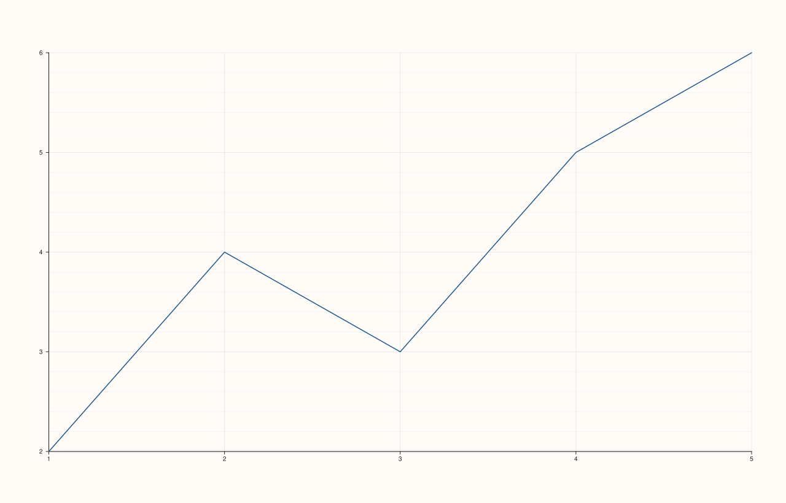

<!-- pluss-hand-authored -->

# Pane::x_minor_grid

[Back to Pane API Reference](../../pane_api_reference)

## Signature

```cpp
Pane& Pane::x_minor_grid(bool enable = true) noexcept
```

## What It Does

Toggles minor gridlines for the x-axis specifically, independent of the y- and z-axes —
the granular, per-axis counterpart of the uniform [`grid()`](grid.md) setter's
`MajorMinor` option. Every call recomputes the aggregate [`grid_style()`](grid.md) the
same way [`x_major_grid()`](x_major_grid.md) does.

```{important} Turning one axis's minor flag off doesn't necessarily drop the aggregate style
Because [`grid_style()`](grid.md) is recomputed by OR-ing *every* axis's minor (and major)
flag, turning `x_minor_grid(false)` off after a uniform `grid(GridStyle::MajorMinor)` call
does **not** drop the aggregate back to `Major` if the y- or z-axis still has its own
minor flag on — the aggregate only drops once *every* axis's minor flag is off. See
Example 1.
```

## Parameters

**enable** (`bool`, default `true`)
    `true` to show minor gridlines on the x-axis, `false` to hide them.

## Returns

`Pane&`
    A reference to the same pane, for chaining.

## Examples

Example 1. `grid(MajorMinor)` turns minor grid on for all three axes; turning it off for
x alone leaves the aggregate at `MajorMinor` still, since y (and z) still have it on.

```cpp
using namespace pluss::pl;

auto fig = studio("x_minor_grid_check");
auto& pane = fig.pane2();
pane.trend(std::vector<double>{1.0, 2.0, 3.0, 4.0, 5.0}, std::vector<double>{2.0, 4.0, 3.0, 5.0, 6.0});
pane.grid(GridStyle::MajorMinor);
pane.x_minor_grid(false);
fig.show();

std::cout << pane.x_axis().minor_grid << "\n";
std::cout << pane.y_axis().minor_grid << "\n";
std::cout << (pane.grid_style() == GridStyle::MajorMinor) << "\n";
```

### Output

```text
0
1
1
```



## Notes

- `noexcept`.
- Recomputes [`grid_style()`](grid.md) on every call — see the important callout above and
  [`grid()`](grid.md)'s own page for the exact aggregation rule.
- `enable` defaults to `true`.

## See Also

- [`Pane::grid`](grid.md): the uniform, all-axes setter, and the full explanation of the
  aggregation rule.
- [`Pane::y_minor_grid`](y_minor_grid.md) / [`Pane::z_minor_grid`](z_minor_grid.md): the
  y- and z-axis equivalents.
- [`Pane::x_major_grid`](x_major_grid.md): the major-gridline counterpart for the x-axis.

<div class="pluss-inline-prev-next">
  <a class="prev-link" href="z_major_grid.html">
    <span class="label">Previous</span>
    <span class="title">z_major_grid</span>
  </a>
  <a class="next-link" href="y_minor_grid.html">
    <span class="label">Next</span>
    <span class="title">y_minor_grid</span>
  </a>
</div>
