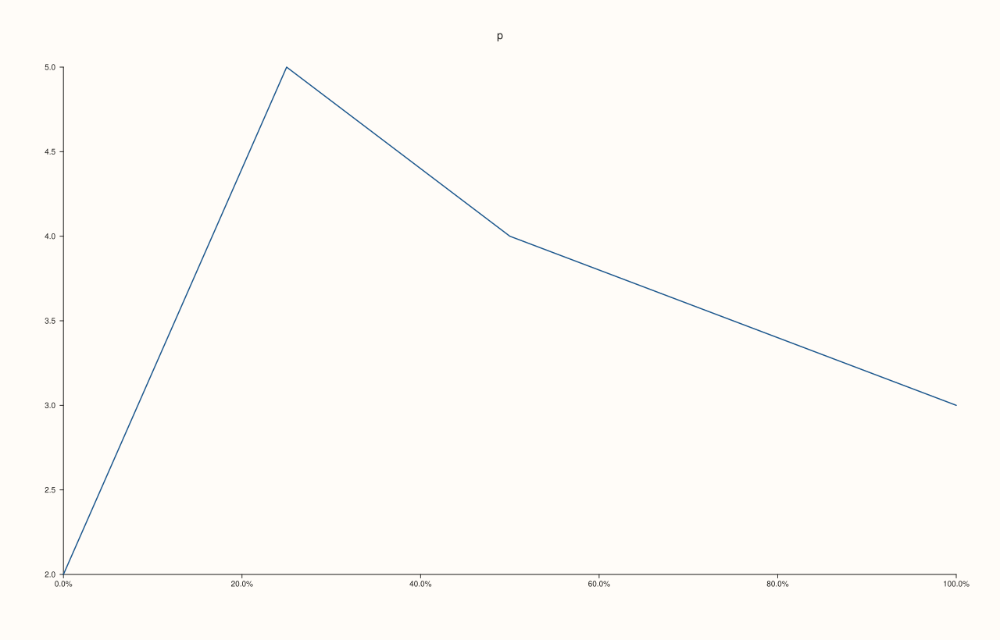
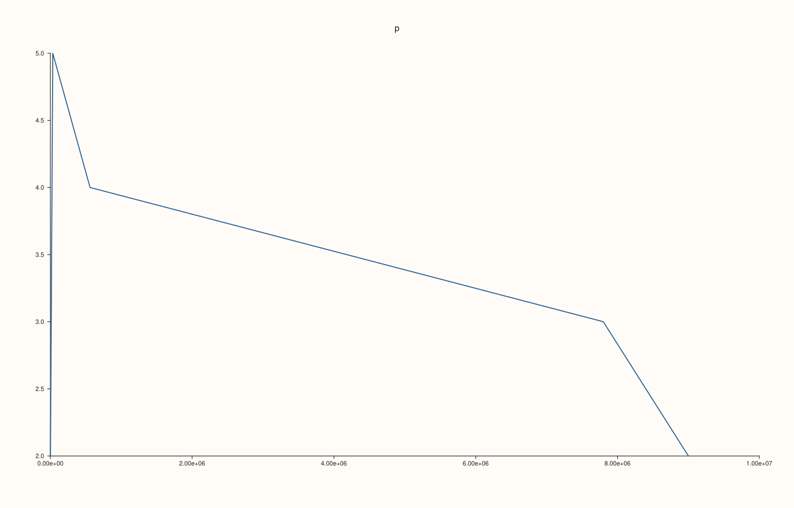
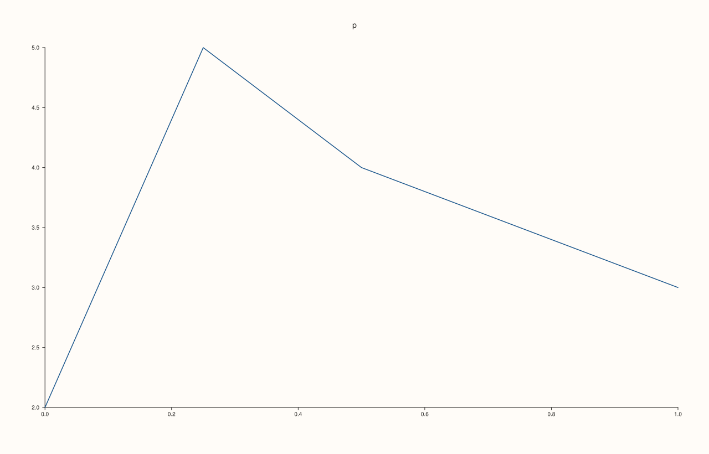

<!-- pluss-hand-authored -->

# Pane::x_tick_format

[Back to Pane API Reference](../../pane_api_reference)

## Signature

```cpp
Pane& Pane::x_tick_format(TickFormat format) noexcept
```

## What It Does

Chooses how the numbers on the x axis ticks are written. The format is stored in `x_axis().tick_format`; `TickFormat::Auto` (the default) picks plain or scientific notation from the size of the numbers, and the other formats force one style:

| Format | Ticks are written as |
|---|---|
| `Auto` | chooses plain or scientific notation from the size of the numbers. |
| `Plain` | plain decimal numbers with no trailing zeros. |
| `Fixed3` | three decimals. |
| `Fixed6` | six decimals. |
| `Scientific` | scientific notation, `2.00e+06`. |
| `Engineering` | engineering notation, exponents that are multiples of three. |
| `Integer` | rounded to whole numbers. |
| `Percent` | the value times 100 with a percent sign. |

The format shapes the automatic tick labels. Labels given explicitly with [`x_ticks`](x_ticks.md) or [`x_categories`](x_categories.md) are text, and are drawn as they were written. The number of decimals of the automatic labels in `Auto` is set with [`x_auto_tick_decimals`](x_auto_tick_decimals.md). The call never throws, and is read when the figure is rendered.

## Parameters

**format** (`TickFormat`)
    One of the eight formats; see [`TickFormat`](../types/TickFormat.md).

## Returns

`Pane&`
    The same pane, for chaining.

## Examples

Example 1. The default is `Auto` (0); each call is read back, and the last call wins.

```cpp
auto fig = studio("x_format_readback");
auto& pane = fig.pane2("p");
pane.trend(std::vector<double>{1, 2, 3, 4}, std::vector<double>{2, 5, 4, 3});
std::cout << "new axis: " << static_cast<int>(pane.x_axis().tick_format) << " (Auto = 0)\n";
pane.x_tick_format(TickFormat::Percent);
std::cout << "after Percent: " << static_cast<int>(pane.x_axis().tick_format) << "\n";
pane.x_tick_format(TickFormat::Auto);
std::cout << "back to Auto: " << static_cast<int>(pane.x_axis().tick_format) << "\n";
fig.save_svg("figure.svg");
```

### Output

```text
new axis: 0 (Auto = 0)
after Percent: 7
back to Auto: 0
```


Example 2. Every format on the same small values. The axis runs 0 to 1, and each format writes the ticks in its own way; `Percent` multiplies by 100.

```cpp
auto texts = [](const std::string& svg) {
  std::string out;
  for (std::size_t at = svg.find("<text"); at != std::string::npos; at = svg.find("<text", at + 1)) {
    const auto gt = svg.find('>', at);
    out += svg.substr(gt + 1, svg.find("</text>", gt) - gt - 1) + " ";
  }
  return out;
};
const std::pair<const char*, TickFormat> formats[] = {{"Auto", TickFormat::Auto}, {"Plain", TickFormat::Plain}, {"Fixed3", TickFormat::Fixed3}, {"Fixed6", TickFormat::Fixed6},
                                                    {"Scientific", TickFormat::Scientific}, {"Engineering", TickFormat::Engineering}, {"Integer", TickFormat::Integer}, {"Percent", TickFormat::Percent}};
for (const auto& [name, format] : formats) {
auto fig = studio("x_format_small");
  auto& pane = fig.pane2("p");
  pane.trend(std::vector<double>{0.0, 0.25, 0.5, 1.0}, std::vector<double>{2, 5, 4, 3});
  pane.y_tick_labels(false);
pane.z_tick_labels(false);
  pane.x_tick_format(format);
  std::cout << name << ": " << texts(fig.to_svg()) << "\n";
}
auto fig = studio("x_format_small_out");
auto& pane = fig.pane2("p");
pane.trend(std::vector<double>{0.0, 0.25, 0.5, 1.0}, std::vector<double>{2, 5, 4, 3});
pane.x_tick_format(TickFormat::Percent);
fig.save_svg("figure.svg");
```

### Output

```text
Auto: p 0.0 0.2 0.4 0.6 0.8 1.0 
Plain: p 0 0.2 0.4 0.6 0.8 1 
Fixed3: p 0.000 0.200 0.400 0.600 0.800 1.000 
Fixed6: p 0.000000 0.200000 0.400000 0.600000 0.800000 1.000000 
Scientific: p 0.00e+00 2.00e-01 4.00e-01 6.00e-01 8.00e-01 1.00e+00 
Engineering: p 0 200.000e-3 400.000e-3 600.000e-3 800.000e-3 1.000e0 
Integer: p 0 0 0 1 1 1 
Percent: p 0.0% 20.0% 40.0% 60.0% 80.0% 100.0% 
```



Example 3. Every format on large values. The axis runs to about ten million; `Plain` and `Fixed3` write every digit, `Scientific` and `Engineering` keep the labels short, and `Auto` switches to scientific notation by itself.

```cpp
auto texts = [](const std::string& svg) {
  std::string out;
  for (std::size_t at = svg.find("<text"); at != std::string::npos; at = svg.find("<text", at + 1)) {
    const auto gt = svg.find('>', at);
    out += svg.substr(gt + 1, svg.find("</text>", gt) - gt - 1) + " ";
  }
  return out;
};
const std::pair<const char*, TickFormat> formats[] = {{"Auto", TickFormat::Auto}, {"Plain", TickFormat::Plain}, {"Fixed3", TickFormat::Fixed3}, {"Scientific", TickFormat::Scientific}, {"Engineering", TickFormat::Engineering}, {"Integer", TickFormat::Integer}};
for (const auto& [name, format] : formats) {
auto fig = studio("x_format_large");
  auto& pane = fig.pane2("p");
  pane.trend(std::vector<double>{1200, 34000, 560000, 7800000, 9000000}, std::vector<double>{2, 5, 4, 3, 2});
  pane.y_tick_labels(false);
pane.z_tick_labels(false);
  pane.x_tick_format(format);
  std::cout << name << ": " << texts(fig.to_svg()) << "\n";
}
auto fig = studio("x_format_large_out");
auto& pane = fig.pane2("p");
pane.trend(std::vector<double>{1200, 34000, 560000, 7800000, 9000000}, std::vector<double>{2, 5, 4, 3, 2});
pane.x_tick_format(TickFormat::Scientific);
fig.save_svg("figure.svg");
```

### Output

```text
Auto: p 0 2.00e+06 4.00e+06 6.00e+06 8.00e+06 1.00e+07 
Plain: p 0 2000000 4000000 6000000 8000000 10000000 
Fixed3: p 0.000 2000000.000 4000000.000 6000000.000 8000000.000 10000000.000 
Scientific: p 0.00e+00 2.00e+06 4.00e+06 6.00e+06 8.00e+06 1.00e+07 
Engineering: p 0 2.000e6 4.000e6 6.000e6 8.000e6 10.000e6 
Integer: p 0 2000000 4000000 6000000 8000000 10000000 
```



Example 4. Eight formats, eight figures. The formats that look alike on some data differ on others; here all pairs of neighbouring formats on the small values give different figures, and setting the same format twice changes nothing.

```cpp
auto build = [&](TickFormat format) {
  auto fig = studio("x_format_distinct");
  auto& pane = fig.pane2("p");
  pane.trend(std::vector<double>{0.0, 0.25, 0.5, 1.0}, std::vector<double>{2, 5, 4, 3});
  pane.x_tick_format(format);
  return fig.to_svg();
};
std::cout << "Plain vs Fixed3: " << (build(TickFormat::Plain) != build(TickFormat::Fixed3)) << ", Fixed3 vs Fixed6: " << (build(TickFormat::Fixed3) != build(TickFormat::Fixed6)) << ", Scientific vs Engineering: " << (build(TickFormat::Scientific) != build(TickFormat::Engineering)) << "\n";
std::cout << "same format twice: " << (build(TickFormat::Percent) == build(TickFormat::Percent)) << "\n";
auto fig = studio("x_format_distinct_out");
auto& pane = fig.pane2("p");
pane.trend(std::vector<double>{0.0, 0.25, 0.5, 1.0}, std::vector<double>{2, 5, 4, 3});
fig.save_svg("figure.svg");
```

### Output

```text
Plain vs Fixed3: 1, Fixed3 vs Fixed6: 1, Scientific vs Engineering: 1
same format twice: 1
```



Example 5. Explicit tick labels keep their text. Labels given with `x_ticks` are drawn as written, whatever the format; the format applies to the automatic ticks.

```cpp
auto texts = [](const std::string& svg) {
  std::string out;
  for (std::size_t at = svg.find("<text"); at != std::string::npos; at = svg.find("<text", at + 1)) {
    const auto gt = svg.find('>', at);
    out += svg.substr(gt + 1, svg.find("</text>", gt) - gt - 1) + " ";
  }
  return out;
};
auto fig = studio("x_format_explicit");
auto& pane = fig.pane2("p");
pane.trend(std::vector<double>{1, 2, 3, 4}, std::vector<double>{2, 5, 4, 3});
pane.y_tick_labels(false);
pane.z_tick_labels(false);
pane.x_ticks(std::vector<double>{1, 2, 3}, {"low", "mid", "high"});
pane.x_tick_format(TickFormat::Percent);
std::cout << texts(fig.to_svg()) << "\n";
fig.save_svg("figure.svg");
```

### Output

```text
p low mid high 
```


## Notes

- `noexcept`. A format changes only how ticks are written, never where they are.
- The format is per axis: set it on each axis that should use it.

## See Also

- [`Pane::x_auto_tick_decimals`](x_auto_tick_decimals.md): decimals of the automatic labels.
- [`Pane::x_ticks`](x_ticks.md): explicit tick labels.
- [`TickFormat`](../types/TickFormat.md): the values.
- [`Pane::y_tick_format`](y_tick_format.md): the same setting for the y axis.
- [`Pane::z_tick_format`](z_tick_format.md): the same setting for the z axis.

<div class="pluss-inline-prev-next">
  <a class="prev-link" href="x_minor_grid.html">
    <span class="label">Previous</span>
    <span class="title">x_minor_grid</span>
  </a>
  <a class="next-link" href="x_tick_label_gap.html">
    <span class="label">Next</span>
    <span class="title">x_tick_label_gap</span>
  </a>
</div>
