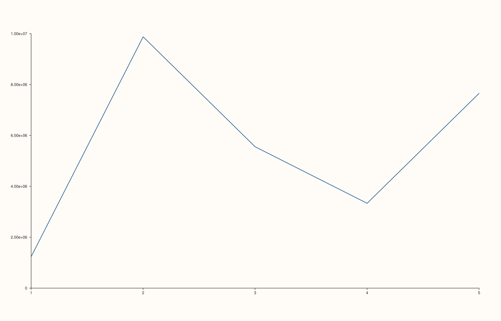
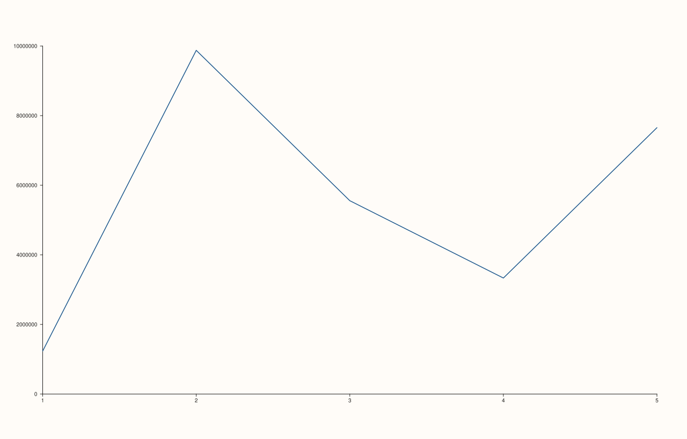
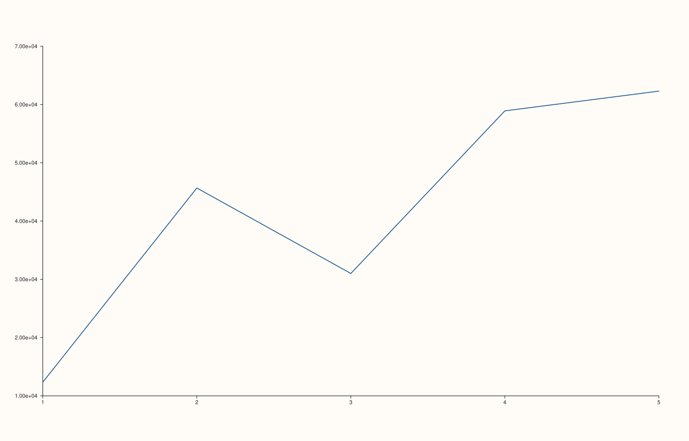
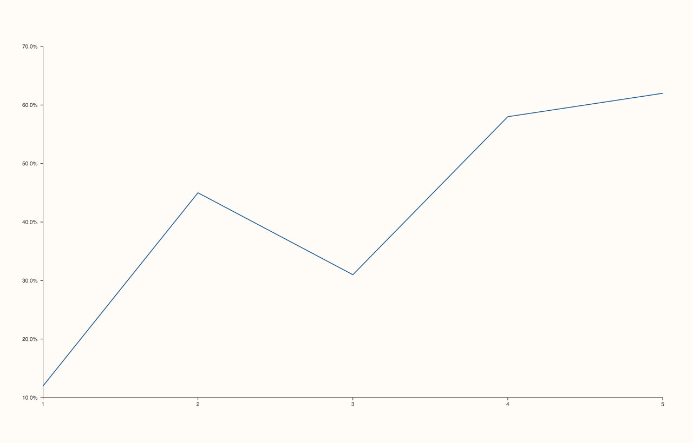

<!-- pluss-hand-authored -->

# Pane::x_tick_format

[Back to Pane API Reference](../../pane_api_reference)

## Signature

```cpp
Pane& Pane::x_tick_format(TickFormat format) noexcept
```

## What It Does

Chooses how numeric tick labels along the x-axis are rendered as text — the eight
`TickFormat` values control everything from letting the renderer choose automatically to
forcing scientific notation, a fixed decimal-place count, or a percent sign:

- **`TickFormat::Auto`** — the constructor default. Picks a reasonable representation
  based on the data's own magnitude — plain decimal for ordinary-sized numbers,
  automatically switching style for very large or very small ones. See the important
  callout below.
- **`TickFormat::Plain`** — always plain decimal notation, regardless of magnitude.
- **`TickFormat::Fixed3`** — always exactly 3 digits after the decimal point.
- **`TickFormat::Fixed6`** — always exactly 6 digits after the decimal point.
- **`TickFormat::Scientific`** — scientific notation (`1.23e+06` style).
- **`TickFormat::Engineering`** — engineering notation (exponents restricted to multiples
  of 3, e.g. `1.23e+06` rather than `12.3e+05`).
- **`TickFormat::Integer`** — rounds to the nearest whole number, no decimal point.
- **`TickFormat::Percent`** — multiplies by 100 and appends a `%` sign (`0.45` → `45%`).

```{important} Auto and Plain can coincide for ordinary-magnitude data
Because `Auto` adaptively picks a representation based on magnitude, it can render
identically to `Plain` when the data doesn't cross whatever threshold triggers `Auto`'s
adaptive switch — verified directly: for a y-range around `0.1`–`0.6`, `Auto` and `Plain`
produced byte-for-byte identical SVG output, while for a y-range in the millions, they
diverged (`Auto` switching styles, `Plain` staying in full decimal form). Don't assume
`Plain` visibly changes anything without checking against the actual magnitude of the data
in question — see Example 1's callout for the exact data used to demonstrate a real
difference.
```

## Parameters

**format** (`TickFormat`)
    One of the eight formatting styles listed above.

## Returns

`Pane&`
    A reference to the same pane, for chaining.

## Examples

Example 1. `TickFormat::Auto` (default) vs. `TickFormat::Plain`, on large-magnitude data
deliberately chosen so the two visibly diverge (see the important callout above for why
ordinary-magnitude data wouldn't show a difference here).

```cpp
using namespace pluss::pl;

const std::vector<double> x{1.0, 2.0, 3.0, 4.0, 5.0};
const std::vector<double> y{1234567.0, 9876543.0, 5555555.0, 3333333.0, 7654321.0};

auto fig1 = studio("tick_format_auto");
auto& pane1 = fig1.pane2();
pane1.trend(x, y);
fig1.show();
std::cout << (pane1.y_axis().tick_format == TickFormat::Auto) << "\n";

auto fig2 = studio("tick_format_plain");
auto& pane2 = fig2.pane2();
pane2.trend(x, y);
pane2.y_tick_format(TickFormat::Plain);
fig2.show();

std::cout << (fig1.to_svg() != fig2.to_svg()) << "\n";
```

### Output

```text
1
1
```





Example 2. `TickFormat::Fixed3` and `TickFormat::Fixed6` on the same decimal data — a
genuine, immediately visible difference in decimal-place count.

```cpp
using namespace pluss::pl;

const std::vector<double> x{1.0, 2.0, 3.0, 4.0, 5.0};
const std::vector<double> y{0.12345, 0.4567, 0.31, 0.5891, 0.623};

auto fig3 = studio("tick_format_fixed3");
auto& pane3 = fig3.pane2();
pane3.trend(x, y);
pane3.y_tick_format(TickFormat::Fixed3);
fig3.show();

auto fig4 = studio("tick_format_fixed6");
auto& pane4 = fig4.pane2();
pane4.trend(x, y);
pane4.y_tick_format(TickFormat::Fixed6);
fig4.show();

std::cout << (fig3.to_svg() != fig4.to_svg()) << "\n";
```

### Output

```text
1
```


Example 3. `TickFormat::Scientific` and `TickFormat::Engineering`, on large-magnitude
data.

```cpp
using namespace pluss::pl;

const std::vector<double> x{1.0, 2.0, 3.0, 4.0, 5.0};
const std::vector<double> y{12345.0, 45670.0, 31000.0, 58910.0, 62300.0};

auto fig5 = studio("tick_format_scientific");
auto& pane5 = fig5.pane2();
pane5.trend(x, y);
pane5.y_tick_format(TickFormat::Scientific);
fig5.show();

auto fig6 = studio("tick_format_engineering");
auto& pane6 = fig6.pane2();
pane6.trend(x, y);
pane6.y_tick_format(TickFormat::Engineering);
fig6.show();
```




Example 4. `TickFormat::Integer` and `TickFormat::Percent`.

```cpp
using namespace pluss::pl;

const std::vector<double> x{1.0, 2.0, 3.0, 4.0, 5.0};

auto fig7 = studio("tick_format_integer");
auto& pane7 = fig7.pane2();
pane7.trend(x, std::vector<double>{2.0, 4.0, 3.0, 5.0, 6.0});
pane7.y_tick_format(TickFormat::Integer);
fig7.show();

auto fig8 = studio("tick_format_percent");
auto& pane8 = fig8.pane2();
pane8.trend(x, std::vector<double>{0.12, 0.45, 0.31, 0.58, 0.62});
pane8.y_tick_format(TickFormat::Percent);
fig8.show();
```




## Notes

- `noexcept` — every `TickFormat` value is valid, nothing to reject.
- `Auto` is `0`, `Plain` is `1`, `Fixed3` is `2`, `Fixed6` is `3`, `Scientific` is `4`,
  `Engineering` is `5`, `Integer` is `6`, `Percent` is `7`.
- Independent of [`x_auto_tick_decimals()`](x_auto_tick_decimals.md) — that setting
  fine-tunes `Auto`'s own decimal-place choice, while `x_tick_format()` picks the overall
  style. The two combine when `TickFormat::Auto` is in effect.
- Applies to how tick *labels* are rendered as text; it has no bearing on where the ticks
  themselves are positioned — see [`x_ticks()`](x_ticks.md) for explicit tick placement.

## See Also

- [`Pane::y_tick_format`](y_tick_format.md) / [`Pane::z_tick_format`](z_tick_format.md):
  the y- and z-axis equivalents.
- [`Pane::x_auto_tick_decimals`](x_auto_tick_decimals.md): fine-tunes `Auto`'s decimal
  precision specifically.
- [`Pane::x_axis`](axis_accessors.md): where the current format is read back from.

<div class="pluss-inline-prev-next">
  <a class="prev-link" href="z_minor_grid.html">
    <span class="label">Previous</span>
    <span class="title">z_minor_grid</span>
  </a>
  <a class="next-link" href="y_tick_format.html">
    <span class="label">Next</span>
    <span class="title">y_tick_format</span>
  </a>
</div>
