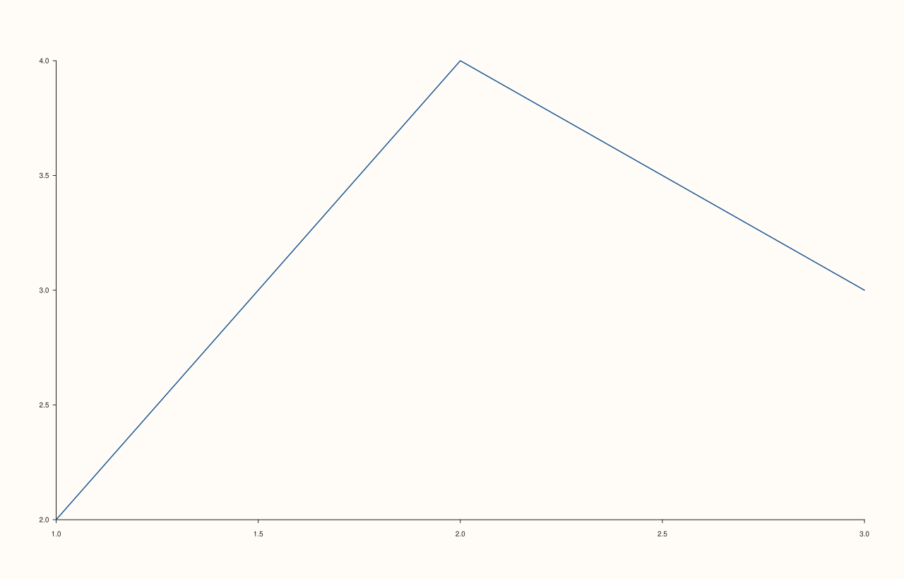

<!-- pluss-hand-authored -->

# Pane::x_tick_label_gap

[Back to Pane API Reference](../../pane_api_reference)

## Signatures

```cpp
Pane& Pane::x_tick_label_gap(double points)              // sets an explicit gap
Pane& Pane::clear_x_tick_label_gap() noexcept              // clears back to the default
```

## What It Does

Sets the spacing, in points, between the x-axis's tick marks and their text labels.
Larger values push the labels further away from the axis line; `clear_x_tick_label_gap()`
removes the override, returning to the renderer's own default spacing.

```{important} Must be finite and non-negative
`points` must be finite and `>= 0`, or this throws `std::invalid_argument("x_tick_label_gap:
spacing must be finite and non-negative")`. Unlike [`x_tick_rotation()`](x_tick_rotation.md)
(which only rejects non-finite values), a negative gap is explicitly rejected too — there's
no way to pull labels *closer* than flush against the axis via a negative value. `0.0`
itself is a valid, accepted boundary.
```

## Parameters

**points** (`double`, setter only)
    The gap size in points. Must be finite and non-negative.

## Returns

`Pane&`
    A reference to the same pane, for chaining.

## Examples

Example 1. The default: no gap override.

```cpp
using namespace pluss::pl;

auto fig = studio("tick_label_gap_default");
auto& pane = fig.pane2();
pane.trend(std::vector<double>{1.0, 2.0, 3.0}, std::vector<double>{2.0, 4.0, 3.0});
fig.show();

std::cout << pane.x_axis().tick_label_gap.has_value() << "\n";
```

### Output

```text
0
```


Example 2. A wider gap — verified to genuinely shift the tick labels further from the
axis (via direct SVG diff, not just byte count, since this pair happened to share the same
byte length).

```cpp
using namespace pluss::pl;

auto fig = studio("tick_label_gap_wide");
auto& pane = fig.pane2();
pane.trend(std::vector<double>{1.0, 2.0, 3.0}, std::vector<double>{2.0, 4.0, 3.0});
pane.x_tick_label_gap(20.0);
fig.show();

std::cout << *pane.x_axis().tick_label_gap << "\n";
```

### Output

```text
20
```



Example 3. Both validation failures — negative and non-finite — plus the accepted `0.0`
boundary.

```cpp
using namespace pluss::pl;

auto fig = studio("tick_label_gap_failures");
auto& pane = fig.pane2();
pane.trend(std::vector<double>{1.0, 2.0}, std::vector<double>{1.0, 2.0});

try {
  pane.x_tick_label_gap(-5.0);
} catch (const std::invalid_argument& e) {
  std::cout << e.what() << "\n";
}

try {
  pane.x_tick_label_gap(std::numeric_limits<double>::infinity());
} catch (const std::invalid_argument& e) {
  std::cout << e.what() << "\n";
}

pane.x_tick_label_gap(0.0);
std::cout << *pane.x_axis().tick_label_gap << "\n";
```

### Output

```text
x_tick_label_gap: spacing must be finite and non-negative
x_tick_label_gap: spacing must be finite and non-negative
0
```

Example 4. `clear_x_tick_label_gap()` removes the override.

```cpp
using namespace pluss::pl;

auto fig = studio("tick_label_gap_cleared");
auto& pane = fig.pane2();
pane.trend(std::vector<double>{1.0, 2.0, 3.0}, std::vector<double>{2.0, 4.0, 3.0});
pane.x_tick_label_gap(20.0);
pane.clear_x_tick_label_gap();

std::cout << pane.x_axis().tick_label_gap.has_value() << "\n";
```

### Output

```text
0
```

## Notes

- The setter is not `noexcept` (validates finiteness and non-negativity);
  `clear_x_tick_label_gap()` is `noexcept`.
- `0.0` is a valid, accepted value (flush against the axis); negative values are rejected
  outright — contrast with [`x_tick_rotation()`](x_tick_rotation.md), which accepts any
  finite value including "unusual" ones.
- Spaces ticks from their own labels specifically — see
  [`x_label_gap()`](x_label_gap.md) for the equivalent spacing between the axis and its
  overall label.

## See Also

- [`Pane::y_tick_label_gap`](y_tick_label_gap.md) / [`Pane::z_tick_label_gap`](z_tick_label_gap.md):
  the y- and z-axis equivalents.
- [`Pane::x_label_gap`](x_label_gap.md): spacing for the axis label, a related but
  independent control.
- [`Pane::x_tick_rotation`](x_tick_rotation.md): another tick-label layout control, with a
  looser (finite-only) validation rule.

<div class="pluss-inline-prev-next">
  <a class="prev-link" href="z_tick_rotation.html">
    <span class="label">Previous</span>
    <span class="title">z_tick_rotation</span>
  </a>
  <a class="next-link" href="y_tick_label_gap.html">
    <span class="label">Next</span>
    <span class="title">y_tick_label_gap</span>
  </a>
</div>
