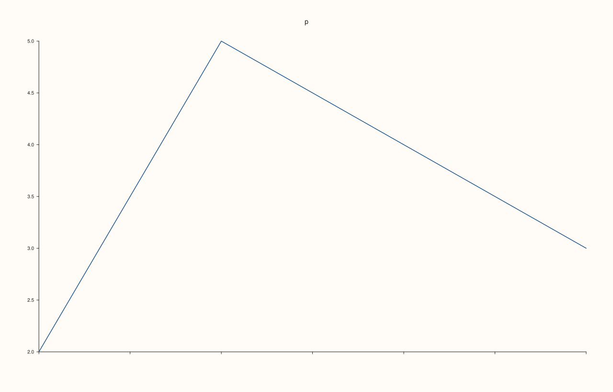
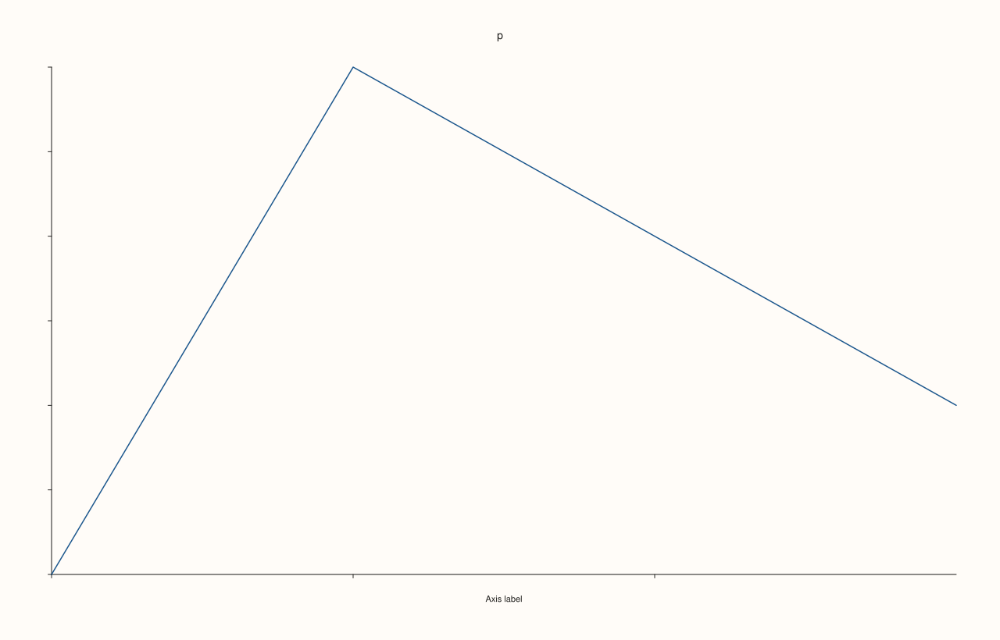

<!-- pluss-hand-authored -->

# Pane::x_tick_labels

[Back to Pane API Reference](../../pane_api_reference)

## Signature

```cpp
Pane& Pane::x_tick_labels(bool enable = true) noexcept
```

## What It Does

Shows or hides the tick labels of the x axis, the numbers or words written beside its ticks. They are visible by default. With `false` the labels are not drawn, whether they are the automatic numbers or explicit text set with [`x_ticks`](x_ticks.md) or [`x_categories`](x_categories.md); the axis label ([`x_label`](x_label.md)), the axis line and the grid are not affected, and the axis keeps its range and its ticks. `true` shows them again, exactly as before. The state is stored in `x_axis().tick_labels_visible`.

It is per axis, it never throws, and it is read when the figure is rendered.

## Parameters

**enable** (`bool`, default `true`)
    `false` hides the tick labels, `true` shows them.

## Returns

`Pane&`
    The same pane, for chaining.

## Examples

Example 1. Visible by default. `tick_labels_visible` is true for a new axis, `false` hides the labels, and `true` (the default argument) shows them again.

```cpp
auto fig = studio("x_labels_readback");
auto& pane = fig.pane2("p");
pane.trend(std::vector<double>{1, 2, 3, 4}, std::vector<double>{2, 5, 4, 3});
std::cout << "new axis: " << pane.x_axis().tick_labels_visible << "\n";
pane.x_tick_labels(false);
std::cout << "after false: " << pane.x_axis().tick_labels_visible << "\n";
pane.x_tick_labels();
std::cout << "after the default argument: " << pane.x_axis().tick_labels_visible << "\n";
fig.save_svg("figure.svg");
```

### Output

```text
new axis: 1
after false: 0
after the default argument: 1
```


Example 2. The effect. With the labels hidden the axis has no tick text; the texts of the figure show the ticks of this axis present and then absent.

```cpp
auto texts = [](const std::string& svg) {
  std::string out;
  for (std::size_t at = svg.find("<text"); at != std::string::npos; at = svg.find("<text", at + 1)) {
    const auto gt = svg.find('>', at);
    out += svg.substr(gt + 1, svg.find("</text>", gt) - gt - 1) + " ";
  }
  return out;
};
auto build = [&](bool visible) {
  auto fig = studio("x_labels_effect");
  auto& pane = fig.pane2("p");
  pane.trend(std::vector<double>{1, 2, 3, 4}, std::vector<double>{2, 5, 4, 3});
  pane.y_tick_labels(false);
pane.z_tick_labels(false);
  pane.x_tick_labels(visible);
  return fig.to_svg();
};
std::cout << "visible: " << texts(build(true)) << "\n";
std::cout << "hidden:  " << texts(build(false)) << "\n";
auto fig = studio("x_labels_effect_out");
auto& pane = fig.pane2("p");
pane.trend(std::vector<double>{1, 2, 3, 4}, std::vector<double>{2, 5, 4, 3});
pane.x_tick_labels(false);
fig.save_svg("figure.svg");
```

### Output

```text
visible: p 1.0 1.5 2.0 2.5 3.0 3.5 4.0 
hidden:  p 
```



Example 3. Showing them again restores the figure exactly: hiding and then showing gives the figure that never changed the setting.

```cpp
auto build = [&](bool hide_then_show) {
  auto fig = studio("x_labels_restore");
  auto& pane = fig.pane2("p");
  pane.trend(std::vector<double>{1, 2, 3, 4}, std::vector<double>{2, 5, 4, 3});
  if (hide_then_show) pane.x_tick_labels(false).x_tick_labels(true);
  return fig.to_svg();
};
std::cout << "equal: " << (build(true) == build(false)) << "\n";
auto fig = studio("x_labels_restore_out");
auto& pane = fig.pane2("p");
pane.trend(std::vector<double>{1, 2, 3, 4}, std::vector<double>{2, 5, 4, 3});
fig.save_svg("figure.svg");
```

### Output

```text
equal: 1
```


Example 4. Explicit tick labels are hidden too. Labels set with `x_ticks` are tick labels like any other, so `x_tick_labels(false)` hides them while the label of the axis (`x_label`) stays.

```cpp
auto texts = [](const std::string& svg) {
  std::string out;
  for (std::size_t at = svg.find("<text"); at != std::string::npos; at = svg.find("<text", at + 1)) {
    const auto gt = svg.find('>', at);
    out += svg.substr(gt + 1, svg.find("</text>", gt) - gt - 1) + " ";
  }
  return out;
};
auto fig = studio("x_labels_explicit");
auto& pane = fig.pane2("p");
pane.trend(std::vector<double>{1, 2, 3, 4}, std::vector<double>{2, 5, 4, 3});
pane.y_tick_labels(false);
pane.z_tick_labels(false);
pane.x_ticks(std::vector<double>{1, 2, 3}, {"low", "mid", "high"});
pane.x_label("Axis label");
std::cout << "shown: " << texts(fig.to_svg()) << "\n";
pane.x_tick_labels(false);
std::cout << "hidden: " << texts(fig.to_svg()) << "\n";
fig.save_svg("figure.svg");
```

### Output

```text
shown: p low mid high Axis label 
hidden: p Axis label 
```



## Notes

- `noexcept`. To hide the whole axis including its line, use [`Pane::axes_visible`](axes_visible.md).

## See Also

- [`Pane::x_label`](x_label.md): the axis label, which stays.
- [`Pane::x_ticks`](x_ticks.md): explicit tick labels.
- [`Pane::axes_visible`](axes_visible.md): hides all axes.
- [`Pane::y_tick_labels`](y_tick_labels.md): the same setting for the y axis.
- [`Pane::z_tick_labels`](z_tick_labels.md): the same setting for the z axis.

<div class="pluss-inline-prev-next">
  <a class="prev-link" href="x_tick_label_gap.html">
    <span class="label">Previous</span>
    <span class="title">x_tick_label_gap</span>
  </a>
  <a class="next-link" href="x_tick_rotation.html">
    <span class="label">Next</span>
    <span class="title">x_tick_rotation</span>
  </a>
</div>
