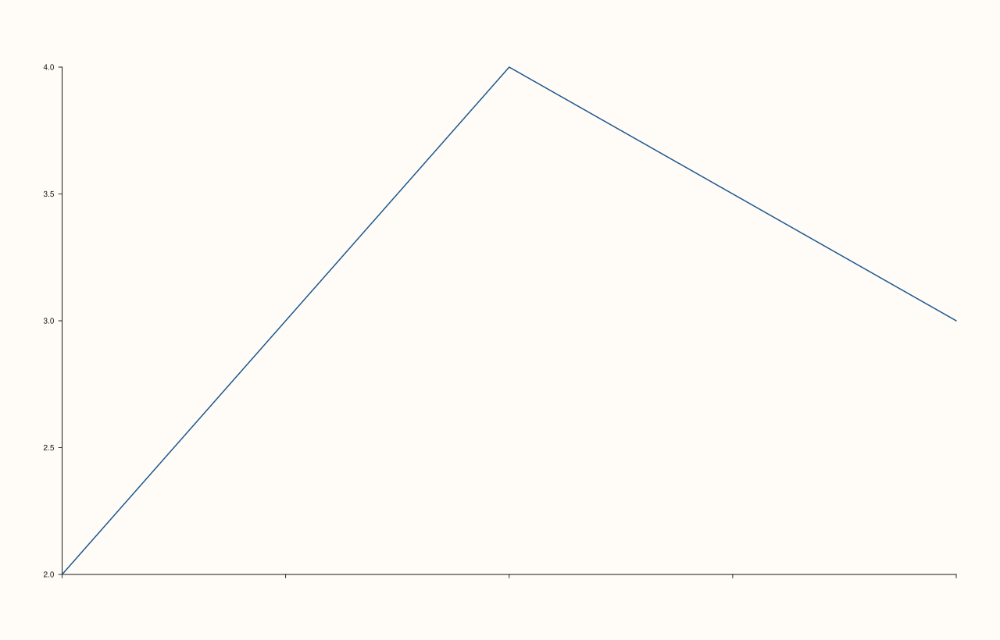

<!-- pluss-hand-authored -->

# Pane::x_tick_labels

[Back to Pane API Reference](../../pane_api_reference)

## Signature

```cpp
Pane& Pane::x_tick_labels(bool enable = true) noexcept
```

## What It Does

Toggles whether the x-axis's tick labels are drawn at all — `true` (the constructor
default) shows them, `false` hides them entirely while the tick *marks* themselves (and
gridlines, if enabled) still render normally. A simple visibility switch, with no
validation and no interaction with formatting settings like
[`x_tick_format()`](x_tick_format.md) (which is simply not consulted while hidden).

## Parameters

**enable** (`bool`, default `true`)
    `true` to show tick labels, `false` to hide them.

## Returns

`Pane&`
    A reference to the same pane, for chaining.

## Examples

Example 1. The default: tick labels visible.

```cpp
using namespace pluss::pl;

auto fig = studio("tick_labels_default");
auto& pane = fig.pane2();
pane.trend(std::vector<double>{1.0, 2.0, 3.0}, std::vector<double>{2.0, 4.0, 3.0});
fig.show();

std::cout << pane.x_axis().tick_labels_visible << "\n";
```

### Output

```text
1
```


Example 2. Hidden — the axis line and tick marks remain, but no text is drawn beneath
them.

```cpp
using namespace pluss::pl;

auto fig = studio("tick_labels_hidden");
auto& pane = fig.pane2();
pane.trend(std::vector<double>{1.0, 2.0, 3.0}, std::vector<double>{2.0, 4.0, 3.0});
pane.x_tick_labels(false);
fig.show();

std::cout << pane.x_axis().tick_labels_visible << "\n";
```

### Output

```text
0
```



## Notes

- `noexcept`.
- `enable` defaults to `true`, so bare `x_tick_labels()` turns labels back on; pass
  `false` explicitly to hide them.
- Purely a visibility toggle — doesn't clear or otherwise affect
  [`x_tick_format()`](x_tick_format.md), [`x_ticks()`](x_ticks.md), or any other tick
  setting; it just stops the labels from being drawn.

## See Also

- [`Pane::y_tick_labels`](y_tick_labels.md) / [`Pane::z_tick_labels`](z_tick_labels.md):
  the y- and z-axis equivalents.
- [`Pane::x_tick_format`](x_tick_format.md): how the (still-hidden, if disabled) labels
  would be formatted.

<div class="pluss-inline-prev-next">
  <a class="prev-link" href="z_label_rotation.html">
    <span class="label">Previous</span>
    <span class="title">z_label_rotation</span>
  </a>
  <a class="next-link" href="y_tick_labels.html">
    <span class="label">Next</span>
    <span class="title">y_tick_labels</span>
  </a>
</div>
