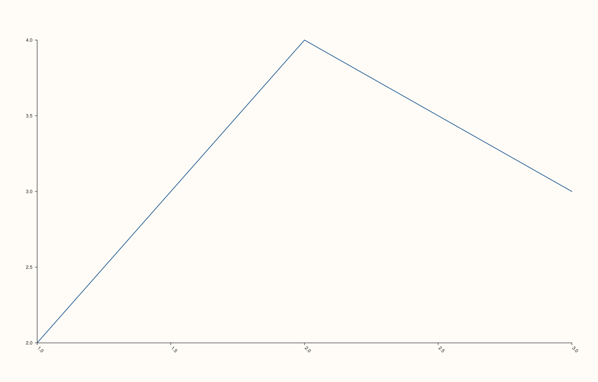

<!-- pluss-hand-authored -->

# Pane::x_tick_rotation

[Back to Pane API Reference](../../pane_api_reference)

## Signatures

```cpp
Pane& Pane::x_tick_rotation(double degrees)            // sets an explicit rotation
Pane& Pane::clear_x_tick_rotation() noexcept            // clears back to the default
```

## What It Does

Rotates the x-axis's tick labels by an explicit angle — useful for long category labels
that would otherwise overlap horizontally. `clear_x_tick_rotation()` removes the override,
returning to whatever the renderer's own default rotation is (typically horizontal, `0`
degrees, though this method doesn't itself define what "default" means — it just clears
the override).

```{important} Only validated for finiteness -- no [0, 360) normalization or bound
`degrees` must be finite, or this throws `std::invalid_argument("x_tick_rotation: angle
must be finite")` — `NaN` and `±infinity` are the only rejected values. Any other finite
value is accepted as-is, including ones "beyond" a full turn like `999.0` — there is no
wraparound normalization into `[0, 360)` or any other range restriction. See Example 3.
```

## Parameters

**degrees** (`double`, setter only)
    The rotation angle in degrees. Must be finite.

## Returns

`Pane&`
    A reference to the same pane, for chaining.

## Examples

Example 1. The default: no rotation override.

```cpp
using namespace pluss::pl;

auto fig = studio("tick_rotation_default");
auto& pane = fig.pane2();
pane.trend(std::vector<double>{1.0, 2.0, 3.0}, std::vector<double>{2.0, 4.0, 3.0});
fig.show();

std::cout << pane.x_axis().tick_rotation_deg.has_value() << "\n";
```

### Output

```text
0
```


Example 2. A 45-degree rotation.

```cpp
using namespace pluss::pl;

auto fig = studio("tick_rotation_45");
auto& pane = fig.pane2();
pane.trend(std::vector<double>{1.0, 2.0, 3.0}, std::vector<double>{2.0, 4.0, 3.0});
pane.x_tick_rotation(45.0);
fig.show();

std::cout << *pane.x_axis().tick_rotation_deg << "\n";
```

### Output

```text
45
```



Example 3. A non-finite angle throws; an "out of range" finite angle like `999` degrees
does not — it's accepted verbatim, with no wraparound.

```cpp
using namespace pluss::pl;

auto fig = studio("tick_rotation_failure");
auto& pane = fig.pane2();
pane.trend(std::vector<double>{1.0, 2.0}, std::vector<double>{1.0, 2.0});

try {
  pane.x_tick_rotation(std::numeric_limits<double>::quiet_NaN());
} catch (const std::invalid_argument& e) {
  std::cout << e.what() << "\n";
}

pane.x_tick_rotation(999.0);
std::cout << *pane.x_axis().tick_rotation_deg << "\n";
```

### Output

```text
x_tick_rotation: angle must be finite
999
```

Example 4. `clear_x_tick_rotation()` removes the override.

```cpp
using namespace pluss::pl;

auto fig = studio("tick_rotation_cleared");
auto& pane = fig.pane2();
pane.trend(std::vector<double>{1.0, 2.0, 3.0}, std::vector<double>{2.0, 4.0, 3.0});
pane.x_tick_rotation(45.0);
pane.clear_x_tick_rotation();

std::cout << pane.x_axis().tick_rotation_deg.has_value() << "\n";
```

### Output

```text
0
```

## Notes

- The setter is not `noexcept` (validates finiteness); `clear_x_tick_rotation()` is
  `noexcept`.
- No range restriction beyond finiteness — see the important callout above.
- Rotates *tick* labels specifically, not the axis label itself — see
  [`x_label_rotation()`](x_label_rotation.md) for that.

## See Also

- [`Pane::y_tick_rotation`](y_tick_rotation.md) / [`Pane::z_tick_rotation`](z_tick_rotation.md):
  the y- and z-axis equivalents.
- [`Pane::x_label_rotation`](x_label_rotation.md): rotates the axis *label*, not its ticks.
- [`Pane::x_tick_label_gap`](x_tick_label_gap.md): spacing between ticks and their labels,
  a related but independent layout control.

<div class="pluss-inline-prev-next">
  <a class="prev-link" href="z_auto_tick_decimals.html">
    <span class="label">Previous</span>
    <span class="title">z_auto_tick_decimals</span>
  </a>
  <a class="next-link" href="y_tick_rotation.html">
    <span class="label">Next</span>
    <span class="title">y_tick_rotation</span>
  </a>
</div>
