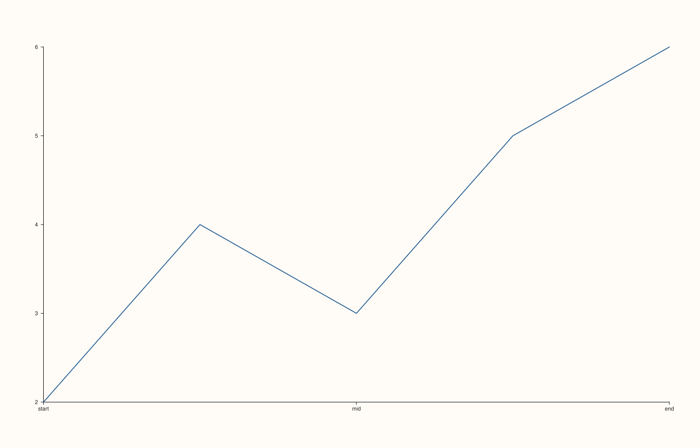

<!-- pluss-hand-authored -->

# Pane::x_ticks

[Back to Pane API Reference](../../pane_api_reference)

## Signatures

```cpp
// Core overload
Pane& x_ticks(Series positions, pluss::msharp::RangeView::Of<std::string_view> labels)

// Convenience overloads (all ultimately call the core overload above)
Pane& x_ticks(Series positions, std::initializer_list<std::string_view> labels)

template <class Positions>
Pane& x_ticks(Positions&& positions, pluss::msharp::RangeView::Of<std::string_view> labels)
  requires(!std::same_as<std::remove_cvref_t<Positions>, Series>)

template <class Positions>
Pane& x_ticks(Positions&& positions, std::initializer_list<std::string_view> labels)
  requires(!std::same_as<std::remove_cvref_t<Positions>, Series>)

// Clears back to automatic tick placement
Pane& clear_x_ticks() noexcept
```

## What It Does

Places explicit, hand-chosen tick marks on the x-axis at specific positions, each with its
own label — overriding the renderer's default automatic tick placement entirely.
`clear_x_ticks()` removes the override.

Four overloads exist purely to make `positions` and `labels` accept convenient argument
types without the caller needing to construct a `Series` or `RangeView` by hand:

- **`positions`** accepts either a `Series` directly, or anything series-convertible (a
  `std::vector<double>`, for instance) via the templated overloads.
- **`labels`** accepts either a `pluss::msharp::RangeView::Of<std::string_view>` or a
  plain `std::initializer_list<std::string_view>` — in practice, `{"a", "b", "c"}` braces
  are almost always what's written at the call site.

All four resolve to the same underlying behavior; which one gets selected is purely a
matter of what argument types were passed, invisible to the caller in practice.

```{important} positions and labels must have matching, non-empty length
Two independent checks: `positions` must be a non-empty, vector-shaped series — an empty
`positions` throws `std::invalid_argument("x_ticks: tick positions must be a non-empty
vector")`. And `labels.size()` must exactly equal `positions`'s element count, or this
throws `std::invalid_argument("x_ticks: tick labels must match the tick positions")`. See
Example 3.
```

## Parameters

**positions** (`Series` or series-convertible)
    The tick positions, in data coordinates. Must be non-empty.

**labels** (`RangeView::Of<std::string_view>` or `std::initializer_list<std::string_view>`)
    The label text for each position, in the same order. Must have the same count as
    `positions`.

## Returns

`Pane&`
    A reference to the same pane, for chaining (both the setter overloads and
    `clear_x_ticks()`).

## Examples

Example 1. The default: no explicit ticks, the renderer picks tick positions
automatically.

```cpp
using namespace pluss::pl;

auto fig = studio("ticks_default_auto");
auto& pane = fig.pane2();
pane.trend(std::vector<double>{1.0, 2.0, 3.0, 4.0, 5.0}, std::vector<double>{2.0, 4.0, 3.0, 5.0, 6.0});
fig.show();

std::cout << pane.x_axis().ticks.has_value() << "\n";
```

### Output

```text
0
```


Example 2. Explicit ticks at three hand-picked positions, using a `std::vector<double>`
for positions (resolving to the templated overload) and a braced `initializer_list` for
labels.

```cpp
using namespace pluss::pl;

auto fig = studio("ticks_explicit");
auto& pane = fig.pane2();
pane.trend(std::vector<double>{1.0, 2.0, 3.0, 4.0, 5.0}, std::vector<double>{2.0, 4.0, 3.0, 5.0, 6.0});
pane.x_ticks(std::vector<double>{1.0, 3.0, 5.0}, std::initializer_list<std::string_view>{"start", "mid", "end"});
fig.show();

std::cout << pane.x_axis().ticks->labels.size() << "\n";
std::cout << pane.x_axis().ticks->labels[0] << "\n";
```

### Output

```text
3
start
```



Example 3. Both validation failures: a labels/positions count mismatch, and an empty
`positions`.

```cpp
using namespace pluss::pl;

auto fig = studio("ticks_mismatch");
auto& pane = fig.pane2();
pane.trend(std::vector<double>{1.0, 2.0}, std::vector<double>{1.0, 2.0});

try {
  pane.x_ticks(std::vector<double>{1.0, 2.0, 3.0}, std::initializer_list<std::string_view>{"only one"});
} catch (const std::invalid_argument& e) {
  std::cout << e.what() << "\n";
}

try {
  pane.x_ticks(std::vector<double>{}, std::initializer_list<std::string_view>{});
} catch (const std::invalid_argument& e) {
  std::cout << e.what() << "\n";
}
```

### Output

```text
x_ticks: tick labels must match the tick positions
x_ticks: tick positions must be a non-empty vector
```

Example 4. `clear_x_ticks()` removes the override, returning to automatic placement.

```cpp
using namespace pluss::pl;

auto fig = studio("ticks_cleared");
auto& pane = fig.pane2();
pane.trend(std::vector<double>{1.0, 2.0, 3.0, 4.0, 5.0}, std::vector<double>{2.0, 4.0, 3.0, 5.0, 6.0});
pane.x_ticks(std::vector<double>{1.0, 3.0, 5.0}, std::initializer_list<std::string_view>{"start", "mid", "end"});
pane.clear_x_ticks();

std::cout << pane.x_axis().ticks.has_value() << "\n";
```

### Output

```text
0
```

## Notes

- The setter overloads are not `noexcept` (validate the position/label relationship);
  `clear_x_ticks()` is `noexcept`.
- Four overloads collapse to one behavior — see "What It Does" above.
- [`x_categories()`](x_categories.md) is a convenience layer built directly on top of
  `x_ticks()` — it auto-generates evenly (or arithmetically) spaced positions from a
  `first`/`step` pair and calls `x_ticks()` internally, for the common case of plotting
  categorical data at regular intervals.
- Explicit ticks replace automatic placement outright — there's no way to add hand-picked
  ticks *alongside* automatically-computed ones.

## See Also

- [`Pane::y_ticks`](y_ticks.md) / [`Pane::z_ticks`](z_ticks.md): the y- and z-axis
  equivalents.
- [`Pane::x_categories`](x_categories.md): a convenience wrapper for evenly-spaced
  categorical ticks, built on top of this method.
- [`Pane::x_axis`](axis_accessors.md): where the current `ticks` (a `std::optional<AxisTicks>`)
  is read back from.

<div class="pluss-inline-prev-next">
  <a class="prev-link" href="y_label_centered.html">
    <span class="label">Previous</span>
    <span class="title">y_label_centered</span>
  </a>
  <a class="next-link" href="y_ticks.html">
    <span class="label">Next</span>
    <span class="title">y_ticks</span>
  </a>
</div>
