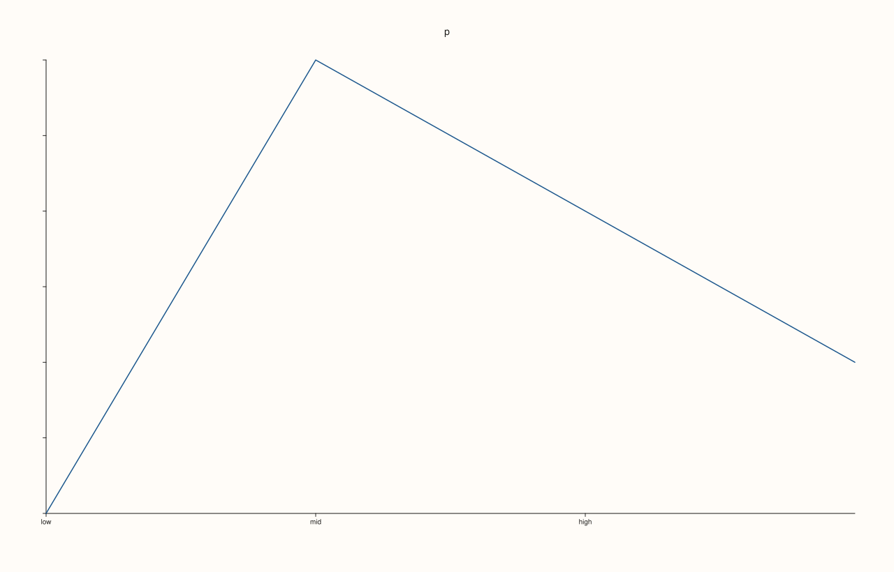
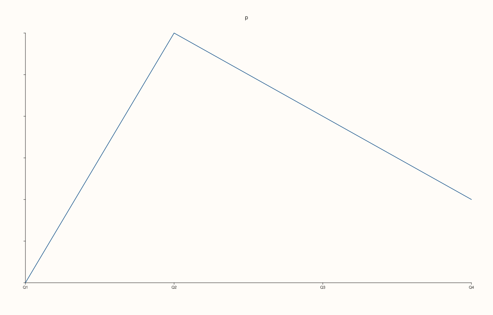
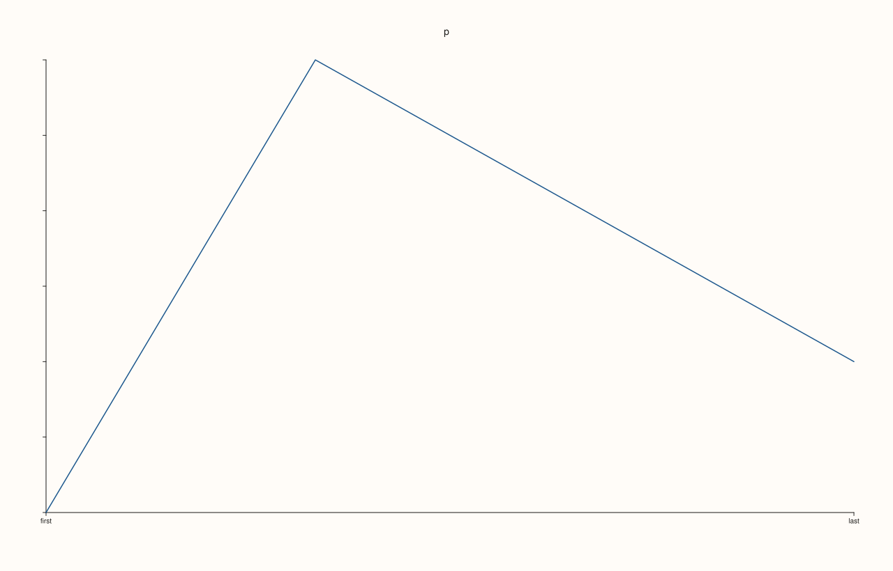
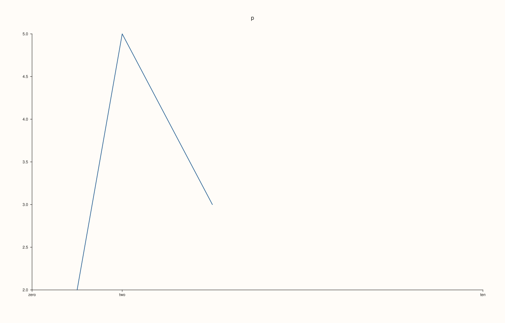
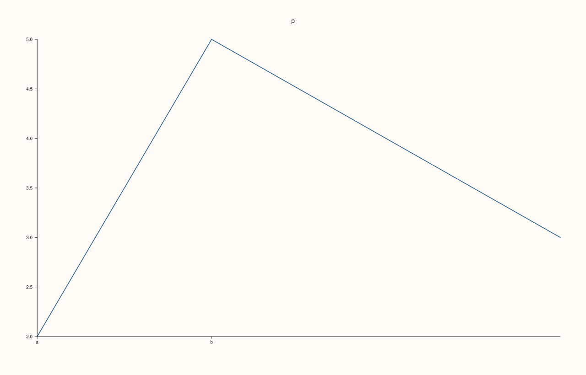

<!-- pluss-hand-authored -->

# Pane::x_ticks

[Back to Pane API Reference](../../pane_api_reference)

## Signature

```cpp
Pane& Pane::x_ticks(Series positions, RangeView::Of<std::string_view> labels)
Pane& Pane::x_ticks(Series positions, std::initializer_list<std::string_view> labels)
Pane& Pane::clear_x_ticks() noexcept
```

## What It Does

Replaces the automatic ticks of the x axis with ticks you choose: a position for each tick and the text drawn beside it. Positions are in the data units of the axis and need not be sorted; labels are drawn as written, so they can be words, dates or formatted numbers. The ticks are stored in `x_axis().ticks`, and the format of the numbers ([`x_tick_format`](x_tick_format.md), [`x_auto_tick_decimals`](x_auto_tick_decimals.md)) does not apply to them. A tick whose position lies outside the displayed range is not drawn, so a manual range ([`x_limits`](x_limits.md)) decides which of the ticks appear.

There are three call forms: a braced list of labels, a range of string views, and a `Series` of positions; positions given as a plain numeric vector are converted. `clear_x_ticks()` removes the explicit ticks and restores the automatic ones, exactly. A call is refused with `pluss::Error`, leaving the previous ticks as they were, when the positions are empty or are not a vector, or when the number of labels differs from the number of positions.

## Parameters

**positions** (`Series` or numeric vector)
    Where the ticks go, in data units. A non-empty vector.

**labels** (`RangeView::Of<std::string_view>` or braced list)
    The text of each tick; as many as there are positions.

## Returns

`Pane&`
    The same pane, for chaining.

## Examples

Example 1. Explicit labels at chosen positions. Three ticks are placed at 1, 2 and 3 with words for labels; the automatic ticks of this axis are replaced by them.

```cpp
auto texts = [](const std::string& svg) {
  std::string out;
  for (std::size_t at = svg.find("<text"); at != std::string::npos; at = svg.find("<text", at + 1)) {
    const auto gt = svg.find('>', at);
    out += svg.substr(gt + 1, svg.find("</text>", gt) - gt - 1) + " ";
  }
  return out;
};
auto fig = studio("x_ticks_labels");
auto& pane = fig.pane2("p");
pane.trend(std::vector<double>{1, 2, 3, 4}, std::vector<double>{2, 5, 4, 3});
pane.y_tick_labels(false);
pane.z_tick_labels(false);
std::cout << "automatic: " << texts(fig.to_svg()) << "\n";
pane.x_ticks(std::vector<double>{1, 2, 3}, {"low", "mid", "high"});
std::cout << "explicit:  " << texts(fig.to_svg()) << "\n";
fig.save_svg("figure.svg");
```

### Output

```text
automatic: p 1.0 1.5 2.0 2.5 3.0 3.5 4.0 
explicit:  p low mid high 
```



Example 2. Labels from a list of strings. A `std::vector<std::string_view>` of labels works as well as the braced list, and the positions can be any numeric vector.

```cpp
auto texts = [](const std::string& svg) {
  std::string out;
  for (std::size_t at = svg.find("<text"); at != std::string::npos; at = svg.find("<text", at + 1)) {
    const auto gt = svg.find('>', at);
    out += svg.substr(gt + 1, svg.find("</text>", gt) - gt - 1) + " ";
  }
  return out;
};
auto fig = studio("x_ticks_strings");
auto& pane = fig.pane2("p");
pane.trend(std::vector<double>{1, 2, 3, 4}, std::vector<double>{2, 5, 4, 3});
pane.y_tick_labels(false);
pane.z_tick_labels(false);
const std::vector<std::string_view> names = {"Q1", "Q2", "Q3", "Q4"};
std::vector<double> positions;
for (std::size_t i = 0; i < names.size(); ++i) positions.push_back(1.0 + static_cast<double>(i));
pane.x_ticks(positions, pluss::msharp::RangeView::Of<std::string_view>(names));
std::cout << texts(fig.to_svg()) << "\n";
fig.save_svg("figure.svg");
```

### Output

```text
p Q1 Q2 Q3 Q4 
```



Example 3. Positions as a `Series`. The positions can be passed as a Series, which is what the library's numeric results are; the labels are drawn in order of the positions given.

```cpp
auto texts = [](const std::string& svg) {
  std::string out;
  for (std::size_t at = svg.find("<text"); at != std::string::npos; at = svg.find("<text", at + 1)) {
    const auto gt = svg.find('>', at);
    out += svg.substr(gt + 1, svg.find("</text>", gt) - gt - 1) + " ";
  }
  return out;
};
auto fig = studio("x_ticks_series");
auto& pane = fig.pane2("p");
pane.trend(std::vector<double>{1, 2, 3, 4}, std::vector<double>{2, 5, 4, 3});
pane.y_tick_labels(false);
pane.z_tick_labels(false);
auto positions = pluss::make_series(std::vector<double>{1.0, 4.0}, {2});
pane.x_ticks(positions, std::vector<std::string_view>{"first", "last"});
std::cout << texts(fig.to_svg()) << "\n";
fig.save_svg("figure.svg");
```

### Output

```text
p first last 
```



Example 4. Only ticks inside the range are drawn. The tick at 10 lies outside the axis range and the tick at 0 is below it, so only the middle one is shown; widening the range with `limits` brings them in.

```cpp
auto texts = [](const std::string& svg) {
  std::string out;
  for (std::size_t at = svg.find("<text"); at != std::string::npos; at = svg.find("<text", at + 1)) {
    const auto gt = svg.find('>', at);
    out += svg.substr(gt + 1, svg.find("</text>", gt) - gt - 1) + " ";
  }
  return out;
};
auto build = [&](bool wide) {
  auto fig = studio("x_ticks_outside");
  auto& pane = fig.pane2("p");
  pane.trend(std::vector<double>{1, 2, 3, 4}, std::vector<double>{2, 5, 4, 3});
  pane.y_tick_labels(false);
  pane.z_tick_labels(false);
  pane.x_ticks(std::vector<double>{0, 2, 10}, {"zero", "two", "ten"});
  if (wide) pane.x_limits(Range1d{0.0, 10.0});
  return fig.to_svg();
};
std::cout << "automatic range: " << texts(build(false)) << "\n";
std::cout << "range 0 to 10:   " << texts(build(true)) << "\n";
auto fig = studio("x_ticks_outside_out");
auto& pane = fig.pane2("p");
pane.trend(std::vector<double>{1, 2, 3, 4}, std::vector<double>{2, 5, 4, 3});
pane.x_ticks(std::vector<double>{0, 2, 10}, {"zero", "two", "ten"});
pane.x_limits(Range1d{0.0, 10.0});
fig.save_svg("figure.svg");
```

### Output

```text
automatic range: p two 
range 0 to 10:   p zero two ten 
```



Example 5. Clearing. `clear_x_ticks()` removes the explicit ticks and the automatic ones come back; the figure equals the one that never set any.

```cpp
auto build = [&](bool set_then_clear) {
  auto fig = studio("x_ticks_clear");
  auto& pane = fig.pane2("p");
  pane.trend(std::vector<double>{1, 2, 3, 4}, std::vector<double>{2, 5, 4, 3});
  if (set_then_clear) pane.x_ticks(std::vector<double>{1, 2}, {"a", "b"}).clear_x_ticks();
  return fig.to_svg();
};
std::cout << "equal: " << (build(true) == build(false)) << "\n";
auto fig = studio("x_ticks_clear_out");
auto& pane = fig.pane2("p");
pane.trend(std::vector<double>{1, 2, 3, 4}, std::vector<double>{2, 5, 4, 3});
fig.save_svg("figure.svg");
```

### Output

```text
equal: 1
```


Example 6. Invalid specifications are refused and the previous ticks are kept. Empty positions, positions and labels of different lengths, and positions that are not a vector each throw `pluss::Error`.

```cpp
auto fig = studio("x_ticks_invalid");
auto& pane = fig.pane2("p");
pane.trend(std::vector<double>{1, 2, 3, 4}, std::vector<double>{2, 5, 4, 3});
pane.x_ticks(std::vector<double>{1, 2}, {"a", "b"});
auto attempt = [&](const char* label, auto call) {
  try {
    call();
  } catch (const pluss::Error& e) {
    std::cout << label << ": " << e.message() << "\n";
  }
};
attempt("no positions", [&] { pane.x_ticks(std::vector<double>{}, {}); });
attempt("length mismatch", [&] { pane.x_ticks(std::vector<double>{1, 2}, {"only one"}); });
attempt("not a vector", [&] { pane.x_ticks(pluss::make_series(std::vector<double>{1, 2, 3, 4}, {2, 2}), {"a", "b"}); });
std::cout << "kept: " << pane.x_axis().ticks->labels.size() << " labels\n";
fig.save_svg("figure.svg");
```

### Output

```text
no positions: x_ticks: tick positions must be a non-empty vector
length mismatch: x_ticks: tick labels must match the tick positions
not a vector: x_ticks: tick positions must be a non-empty vector
kept: 2 labels
```



## Notes

- `x_ticks` throws, so it is not `noexcept`; `clear_x_ticks` never throws.
- For labels at the integers 1, 2, 3, ... use [`x_categories`](x_categories.md), which builds the positions for you.

## See Also

- [`Pane::x_categories`](x_categories.md): labels at evenly spaced positions.
- [`Pane::x_tick_labels`](x_tick_labels.md): hide the tick labels.
- [`Pane::x_limits`](x_limits.md): the range that decides which ticks show.
- [`Pane::y_ticks`](y_ticks.md): the same setting for the y axis.
- [`Pane::z_ticks`](z_ticks.md): the same setting for the z axis.

<div class="pluss-inline-prev-next">
  <a class="prev-link" href="x_tick_rotation.html">
    <span class="label">Previous</span>
    <span class="title">x_tick_rotation</span>
  </a>
  <a class="next-link" href="y_auto_tick_decimals.html">
    <span class="label">Next</span>
    <span class="title">y_auto_tick_decimals</span>
  </a>
</div>
