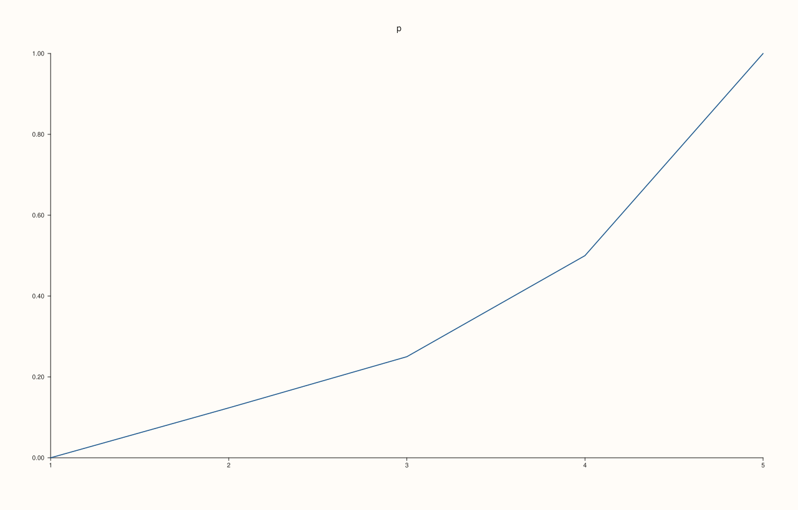
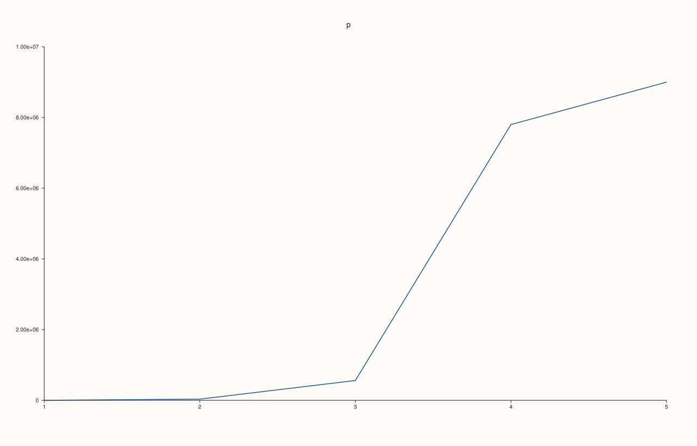
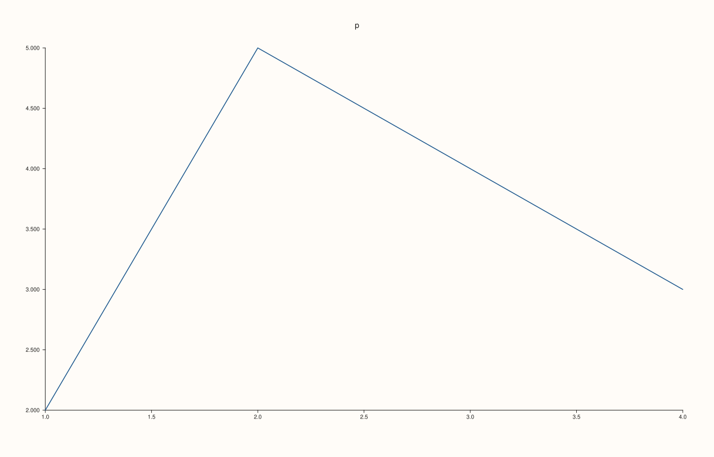
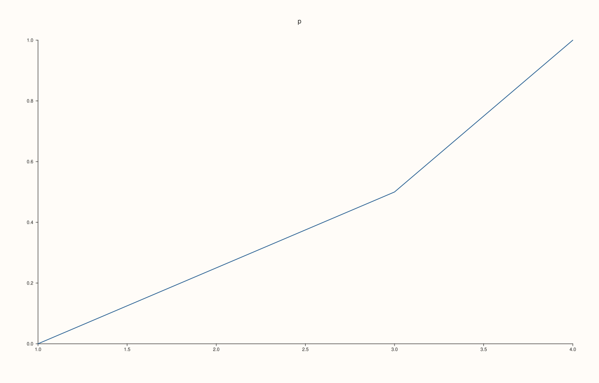

<!-- pluss-hand-authored -->

# Pane::y_auto_tick_decimals

[Back to Pane API Reference](../../pane_api_reference)

## Signature

```cpp
Pane& Pane::y_auto_tick_decimals(int decimals)
Pane& Pane::clear_y_auto_tick_decimals() noexcept
```

## What It Does

Sets how many decimals the automatic tick labels of the y axis are written with, for the axis that uses plain numbers. Without a setting the renderer picks the fewest decimals that tell the ticks apart; with one, every automatic label has exactly that many, so a column of ticks lines up. The count is stored in `y_axis().auto_tick_decimals` (empty when unset), and `clear_y_auto_tick_decimals()` removes it, giving exactly the figure that never set it.

The count must be from 0 to 8; anything else throws `pluss::Error` and the stored count is kept. The setting shapes automatic labels in plain notation only. An axis whose numbers are written in scientific notation ([`y_tick_format`](y_tick_format.md) `Auto` on millions, or `Scientific`) is not changed by it, and explicit labels ([`y_ticks`](y_ticks.md)) are text.

## Parameters

**decimals** (`int`)
    The number of decimals, 0 to 8.

## Returns

`Pane&`
    The same pane, for chaining.

## Examples

Example 1. Default, set, clear. A new axis has no setting (`auto_tick_decimals` is empty); the call stores the count and `clear_y_auto_tick_decimals()` removes it.

```cpp
auto fig = studio("y_decimals_readback");
auto& pane = fig.pane2("p");
pane.trend(std::vector<double>{1, 2, 3, 4}, std::vector<double>{2, 5, 4, 3});
auto show = [&] { const auto& v = pane.y_axis().auto_tick_decimals; std::cout << (v ? std::to_string(*v) : std::string("none")) << "\n"; };
std::cout << "new axis: "; show();
pane.y_auto_tick_decimals(2);
std::cout << "after y_auto_tick_decimals(2): "; show();
pane.clear_y_auto_tick_decimals();
std::cout << "after clear: "; show();
fig.save_svg("figure.svg");
```

### Output

```text
new axis: none
after y_auto_tick_decimals(2): 2
after clear: none
```


Example 2. The effect. On an axis from 0 to 1 the automatic labels have one decimal by default; with 0, 1, 2 and 5 decimals they are written with that many.

```cpp
auto texts = [](const std::string& svg) {
  std::string out;
  for (std::size_t at = svg.find("<text"); at != std::string::npos; at = svg.find("<text", at + 1)) {
    const auto gt = svg.find('>', at);
    out += svg.substr(gt + 1, svg.find("</text>", gt) - gt - 1) + " ";
  }
  return out;
};
for (int decimals : {0, 1, 2, 5}) {
auto fig = studio("y_decimals_effect");
  auto& pane = fig.pane2("p");
  pane.trend(std::vector<double>{1, 2, 3, 4, 5}, std::vector<double>{0.0, 0.1234, 0.25, 0.5, 1.0});
  pane.x_tick_labels(false);
pane.z_tick_labels(false);
  pane.y_auto_tick_decimals(decimals);
  std::cout << decimals << " decimals: " << texts(fig.to_svg()) << "\n";
}
auto fig = studio("y_decimals_effect_out");
auto& pane = fig.pane2("p");
pane.trend(std::vector<double>{1, 2, 3, 4, 5}, std::vector<double>{0.0, 0.1234, 0.25, 0.5, 1.0});
pane.y_auto_tick_decimals(2);
fig.save_svg("figure.svg");
```

### Output

```text
0 decimals: p 0 0 0 1 1 1 
1 decimals: p 0.0 0.2 0.4 0.6 0.8 1.0 
2 decimals: p 0.00 0.20 0.40 0.60 0.80 1.00 
5 decimals: p 0.00000 0.20000 0.40000 0.60000 0.80000 1.00000 
```



Example 3. Not when the axis is scientific. Values of millions are written in scientific notation by `Auto`, and a number of decimals does not change that; a plain-number format is the way to write them out.

```cpp
auto texts = [](const std::string& svg) {
  std::string out;
  for (std::size_t at = svg.find("<text"); at != std::string::npos; at = svg.find("<text", at + 1)) {
    const auto gt = svg.find('>', at);
    out += svg.substr(gt + 1, svg.find("</text>", gt) - gt - 1) + " ";
  }
  return out;
};
auto build = [&](bool decimals) {
  auto fig = studio("y_decimals_sci");
  auto& pane = fig.pane2("p");
  pane.trend(std::vector<double>{1, 2, 3, 4, 5}, std::vector<double>{1200, 34000, 560000, 7800000, 9000000});
  pane.x_tick_labels(false);
pane.z_tick_labels(false);
  if (decimals) pane.y_auto_tick_decimals(4);
  return fig.to_svg();
};
std::cout << "no setting: " << texts(build(false)) << "\n";
std::cout << "4 decimals: " << texts(build(true)) << "\n";
auto fig = studio("y_decimals_sci_out");
auto& pane = fig.pane2("p");
pane.trend(std::vector<double>{1, 2, 3, 4, 5}, std::vector<double>{1200, 34000, 560000, 7800000, 9000000});
fig.save_svg("figure.svg");
```

### Output

```text
no setting: p 0 2.00e+06 4.00e+06 6.00e+06 8.00e+06 1.00e+07 
4 decimals: p 0.0000 2000000.0000 4000000.0000 6000000.0000 8000000.0000 10000000.0000 
```



Example 4. Only 0 to 8 decimals. A negative count and a count above 8 are refused with `pluss::Error`, and the stored count is kept; 0 and 8 are valid.

```cpp
auto fig = studio("y_decimals_invalid");
auto& pane = fig.pane2("p");
pane.trend(std::vector<double>{1, 2, 3, 4}, std::vector<double>{2, 5, 4, 3});
pane.y_auto_tick_decimals(3);
for (int bad : {-1, 9, 100}) {
  try {
    pane.y_auto_tick_decimals(bad);
  } catch (const pluss::Error& e) {
    std::cout << bad << ": " << e.message() << "\n";
  }
}
pane.y_auto_tick_decimals(0);
pane.y_auto_tick_decimals(8);
std::cout << "0 and 8 accepted, stored: " << *pane.y_axis().auto_tick_decimals << "\n";
pane.y_auto_tick_decimals(3);
std::cout << "kept after errors: " << *pane.y_axis().auto_tick_decimals << "\n";
fig.save_svg("figure.svg");
```

### Output

```text
-1: y_auto_tick_decimals: decimals must be in [0, 8]
9: y_auto_tick_decimals: decimals must be in [0, 8]
100: y_auto_tick_decimals: decimals must be in [0, 8]
0 and 8 accepted, stored: 8
kept after errors: 3
```



Example 5. Clearing restores the default exactly. After `clear_y_auto_tick_decimals()` the figure equals the one that never set a count.

```cpp
auto build = [&](bool set_then_clear) {
  auto fig = studio("y_decimals_clear");
  auto& pane = fig.pane2("p");
  pane.trend(std::vector<double>{1, 2, 3, 4}, std::vector<double>{0.0, 0.25, 0.5, 1.0});
  if (set_then_clear) pane.y_auto_tick_decimals(5).clear_y_auto_tick_decimals();
  return fig.to_svg();
};
std::cout << "equal: " << (build(true) == build(false)) << "\n";
auto fig = studio("y_decimals_clear_out");
auto& pane = fig.pane2("p");
pane.trend(std::vector<double>{1, 2, 3, 4}, std::vector<double>{0.0, 0.25, 0.5, 1.0});
fig.save_svg("figure.svg");
```

### Output

```text
equal: 1
```



## Notes

- `y_auto_tick_decimals` throws, so it is not `noexcept`; `clear_y_auto_tick_decimals` never throws.

## See Also

- [`Pane::y_tick_format`](y_tick_format.md): the notation of the labels.
- [`Pane::y_ticks`](y_ticks.md): explicit labels.
- [`Pane::x_auto_tick_decimals`](x_auto_tick_decimals.md): the same setting for the x axis.
- [`Pane::z_auto_tick_decimals`](z_auto_tick_decimals.md): the same setting for the z axis.

<div class="pluss-inline-prev-next">
  <a class="prev-link" href="x_ticks.html">
    <span class="label">Previous</span>
    <span class="title">x_ticks</span>
  </a>
  <a class="next-link" href="y_categories.html">
    <span class="label">Next</span>
    <span class="title">y_categories</span>
  </a>
</div>
