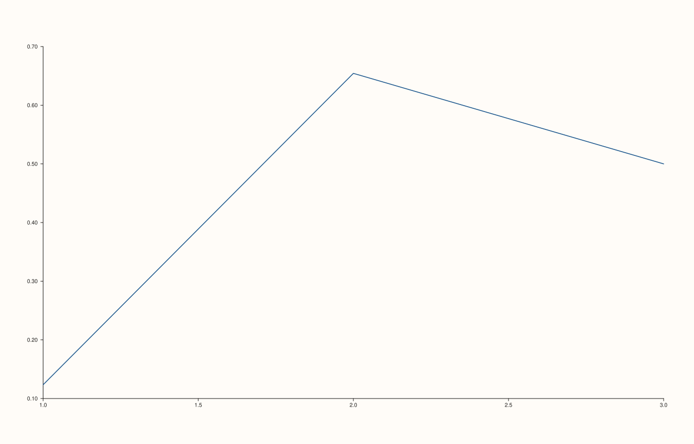

<!-- pluss-hand-authored -->

# Pane::y_auto_tick_decimals

[Back to Pane API Reference](../../pane_api_reference)

## Signatures

```cpp
Pane& Pane::y_auto_tick_decimals(int decimals)       // sets an explicit decimal count
Pane& Pane::clear_y_auto_tick_decimals() noexcept    // clears back to automatic
```

## What It Does

The y-axis counterpart of [`x_auto_tick_decimals()`](x_auto_tick_decimals.md)/
[`clear_x_auto_tick_decimals()`](x_auto_tick_decimals.md): fine-tunes how many decimal
digits [`TickFormat::Auto`](y_tick_format.md) uses for y-axis tick labels. Every
validation detail carries over unchanged (`decimals` must be in `[0, 8]`, with
`"y_auto_tick_decimals"` in place of `"x_auto_tick_decimals"` in throw messages) — see
[`x_auto_tick_decimals()`](x_auto_tick_decimals.md) for the full worked-example set,
including both boundary and out-of-range failures.

## Parameters

**decimals** (`int`, setter only)
    The number of digits after the decimal point. Must be in `[0, 8]`.

## Returns

`Pane&`
    A reference to the same pane, for chaining.

## Examples

Example 1. An explicit override on the y-axis.

```cpp
using namespace pluss::pl;

auto fig = studio("auto_tick_decimals_set");
auto& pane = fig.pane2();
pane.trend(std::vector<double>{1.0, 2.0, 3.0}, std::vector<double>{0.123456, 0.654321, 0.5});
pane.y_auto_tick_decimals(2);
fig.show();

std::cout << *pane.y_axis().auto_tick_decimals << "\n";
```

### Output

```text
2
```



## Notes

See [`x_auto_tick_decimals()`](x_auto_tick_decimals.md)'s Notes — every detail applies
identically here.

## See Also

- [`Pane::x_auto_tick_decimals`](x_auto_tick_decimals.md): the x-axis equivalent, with the
  full worked-example set for validation failures.
- [`Pane::z_auto_tick_decimals`](z_auto_tick_decimals.md): the z-axis equivalent.
- [`Pane::y_tick_format`](y_tick_format.md): the overall style this setting fine-tunes.

<div class="pluss-inline-prev-next">
  <a class="prev-link" href="x_auto_tick_decimals.html">
    <span class="label">Previous</span>
    <span class="title">x_auto_tick_decimals</span>
  </a>
  <a class="next-link" href="z_auto_tick_decimals.html">
    <span class="label">Next</span>
    <span class="title">z_auto_tick_decimals</span>
  </a>
</div>
