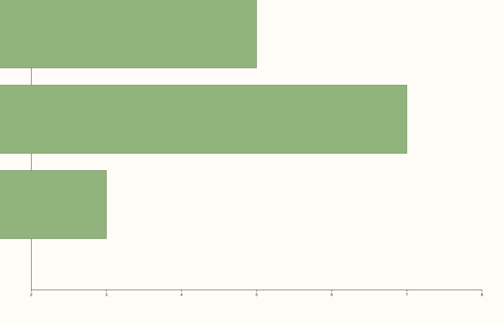

<!-- pluss-hand-authored -->

# Pane::y_categories

[Back to Pane API Reference](../../pane_api_reference)

## Signature

```cpp
Pane& Pane::y_categories(
    pluss::msharp::RangeView::Of<std::string_view> labels,
    double first = 1.0,
    double step = 1.0)
```

## What It Does

The y-axis counterpart of [`x_categories()`](x_categories.md): a convenience layer on top
of [`y_ticks()`](y_ticks.md) that auto-generates evenly (or arithmetically) spaced
positions from `first`/`step`. Every validation detail carries over unchanged — see
[`x_categories()`](x_categories.md) for the full worked-example set, including the
negative-`step` behavior and both failure modes.

## Parameters

**labels** (`RangeView::Of<std::string_view>`, accepts a braced `initializer_list` too)
    The category labels, in position order. Must be non-empty.

**first** (`double`, default `1.0`)
    The position of the first category. Must be finite.

**step** (`double`, default `1.0`)
    The spacing between consecutive positions. Must be finite and non-zero.

## Returns

`Pane&`
    A reference to the same pane, for chaining.

## Examples

Example 1. Categorical y-axis labels, paired with
[`columns_h()`](columns_h.md) (horizontal bars, where the category axis is naturally the
y-axis).

```cpp
using namespace pluss::pl;

auto fig = studio("y_categories_default");
auto& pane = fig.pane2();
pane.columns_h(std::vector<double>{3.0, 7.0, 5.0});
pane.y_categories(std::initializer_list<std::string_view>{"Row A", "Row B", "Row C"});
fig.show();

std::cout << pane.y_axis().ticks->labels.size() << "\n";
```

### Output

```text
3
```



## Notes

See [`x_categories()`](x_categories.md)'s Notes — every detail applies identically here.

## See Also

- [`Pane::x_categories`](x_categories.md): the x-axis equivalent, with the full
  worked-example set for validation failures and negative-`step` behavior.
- [`Pane::z_categories`](z_categories.md): the z-axis equivalent.
- [`Pane::y_ticks`](y_ticks.md): the underlying mechanism this method builds on.

<div class="pluss-inline-prev-next">
  <a class="prev-link" href="x_categories.html">
    <span class="label">Previous</span>
    <span class="title">x_categories</span>
  </a>
  <a class="next-link" href="z_categories.html">
    <span class="label">Next</span>
    <span class="title">z_categories</span>
  </a>
</div>
