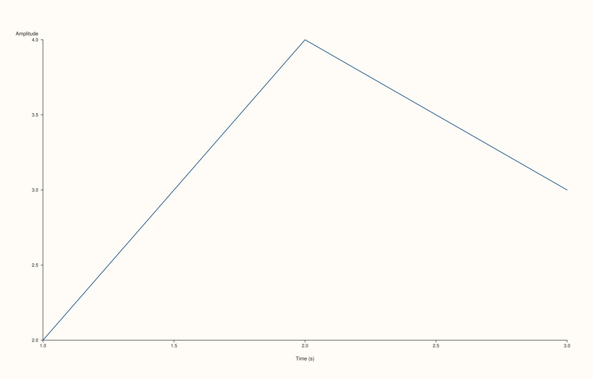

<!-- pluss-hand-authored -->

# Pane::y_label

[Back to Pane API Reference](../../pane_api_reference)

## Signature

```cpp
Pane& Pane::y_label(std::string label)
```

## What It Does

The y-axis counterpart of [`x_label()`](x_label.md): sets the y-axis's caption text.
Every detail carries over unchanged — no validation, empty string clears it, read back
through [`y_axis().label`](axis_accessors.md).

## Parameters

**label** (`std::string`)
    The y-axis label text. An empty string clears any existing label.

## Returns

`Pane&`
    A reference to the same pane, for chaining.

## Examples

Example 1. `y_label()` chained with [`x_label()`](x_label.md).

```cpp
using namespace pluss::pl;

auto fig = studio("labels_2d");
auto& pane = fig.pane2();
pane.trend(std::vector<double>{1.0, 2.0, 3.0}, std::vector<double>{2.0, 4.0, 3.0});
pane.x_label("Time (s)").y_label("Amplitude");
fig.show();

std::cout << pane.y_axis().label << "\n";
```

### Output

```text
Amplitude
```



## Notes

See [`x_label()`](x_label.md)'s Notes — every detail applies identically here. Note that
[`y_label_centered()`](y_label_centered.md) is a **separate**, y-axis-only toggle
controlling whether this label is centered on the axis; it doesn't change the label text
itself.

## See Also

- [`Pane::x_label`](x_label.md) / [`Pane::z_label`](z_label.md): the x- and z-axis
  equivalents.
- [`Pane::y_label_centered`](y_label_centered.md): a y-axis-only layout toggle for this
  label, unrelated to its text.
- [`Pane::y_axis`](axis_accessors.md): where this label is read back from.

<div class="pluss-inline-prev-next">
  <a class="prev-link" href="x_label.html">
    <span class="label">Previous</span>
    <span class="title">x_label</span>
  </a>
  <a class="next-link" href="z_label.html">
    <span class="label">Next</span>
    <span class="title">z_label</span>
  </a>
</div>
