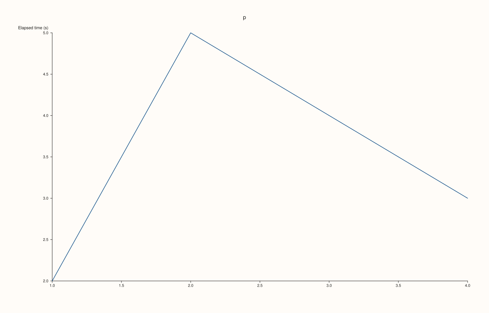
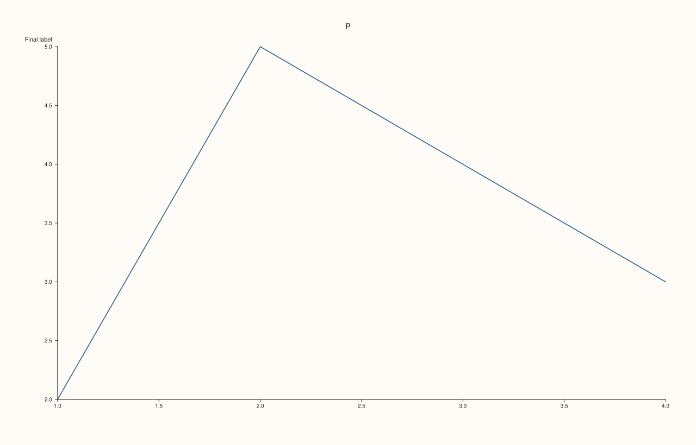
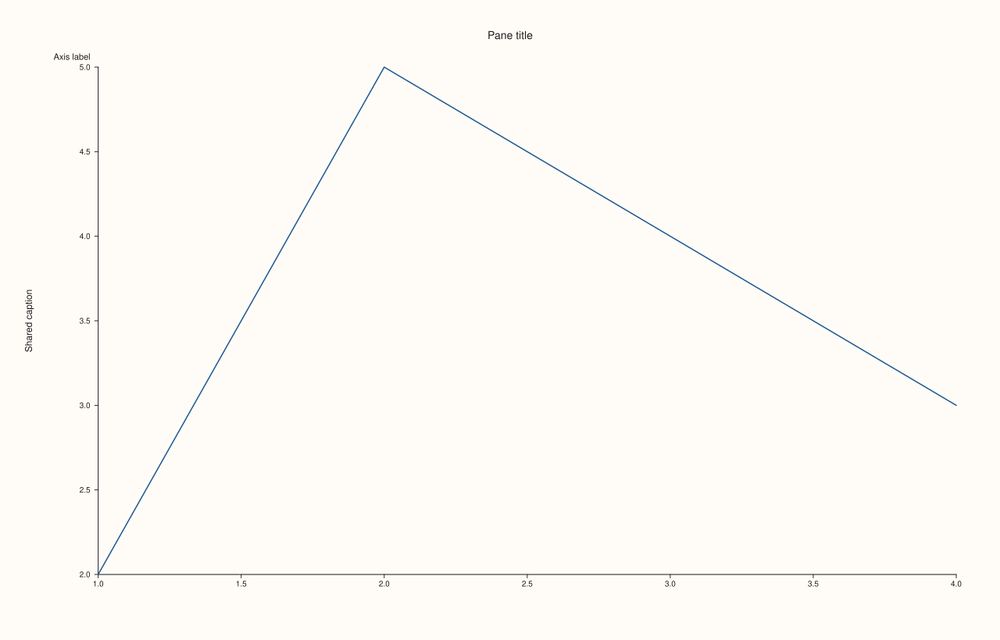
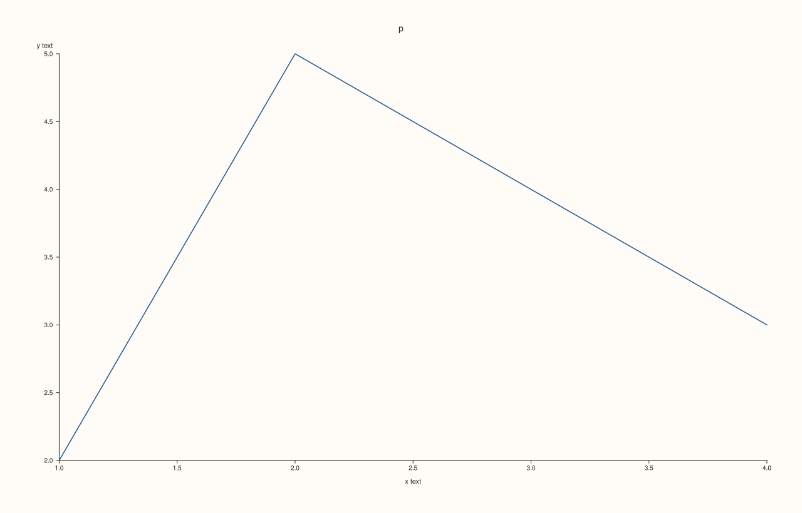
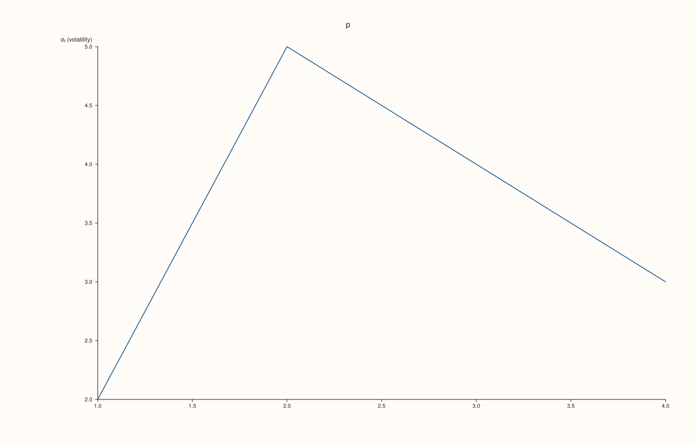

<!-- pluss-hand-authored -->

# Pane::y_label

[Back to Pane API Reference](../../pane_api_reference)

## Signature

```cpp
Pane& Pane::y_label(std::string label)
```

## What It Does

Sets the label of the y axis: the text drawn beside the axis that says what it measures. It is separate from the pane's own title ([`Pane::title`](title.md), drawn above the whole plot) and from the shared caption of an alignment group ([`Studio::y_caption`](../studio/y_caption.md), drawn once for several panes); the three can be used together. The text is stored in `y_axis().label`, where it can be read back; there is no separate getter.

The setter takes any text. An empty string clears the label and gives exactly the figure that never had one, a second call replaces the first, and text between dollar signs is typeset as math. The label is read when the figure is rendered, so it can be set before or after the traces. Its distance from the axis is [`y_label_gap`](y_label_gap.md) and its angle is [`y_label_rotation`](y_label_rotation.md); the axis tick labels are separate ([`y_tick_labels`](y_tick_labels.md)).

## Parameters

**label** (`std::string`)
    The label text. Empty clears the label.

## Returns

`Pane&`
    The same pane, for chaining.

## Examples

Example 1. Setting the y label. The label is stored in `y_axis().label` and drawn beside the y axis.

```cpp
auto fig = studio("y_label_basic");
auto& pane = fig.pane2("p");
pane.trend(std::vector<double>{1, 2, 3, 4}, std::vector<double>{2, 5, 4, 3});
std::cout << "before: '" << pane.y_axis().label << "'\n";
pane.y_label("Elapsed time (s)");
std::cout << "after: '" << pane.y_axis().label << "'\n";
std::cout << "drawn: " << (fig.to_svg().find(">Elapsed time (s)<") != std::string::npos) << "\n";
fig.save_svg("figure.svg");
```

### Output

```text
before: ''
after: 'Elapsed time (s)'
drawn: 1
```



Example 2. Replacing and clearing. A second call replaces the text, and an empty string clears it: the figure is then exactly the figure that never had a label.

```cpp
auto build = [&](const char* first, const char* second) {
  auto fig = studio("y_label_clear");
  auto& pane = fig.pane2("p");
  pane.trend(std::vector<double>{1, 2, 3, 4}, std::vector<double>{2, 5, 4, 3});
  if (first) pane.y_label(first);
  if (second) pane.y_label(second);
  return fig.to_svg();
};
std::cout << "replaced: " << (build("old", "new").find(">new<") != std::string::npos) << ", old still drawn: " << (build("old", "new").find(">old<") != std::string::npos) << "\n";
std::cout << "cleared == never set: " << (build("temporary", "") == build(nullptr, nullptr)) << "\n";
auto fig = studio("y_label_clear_out");
auto& pane = fig.pane2("p");
pane.trend(std::vector<double>{1, 2, 3, 4}, std::vector<double>{2, 5, 4, 3});
pane.y_label("Final label");
fig.save_svg("figure.svg");
```

### Output

```text
replaced: 1, old still drawn: 0
cleared == never set: 1
```



Example 3. Not the title and not a shared caption. The pane's title, its y label and a figure-level caption are three separate texts; each is set by its own call and each is drawn in its own place.

```cpp
auto fig = studio("y_label_distinct");
auto& pane = fig.pane2("p");
pane.trend(std::vector<double>{1, 2, 3, 4}, std::vector<double>{2, 5, 4, 3});
pane.title("Pane title");
pane.y_label("Axis label");
pane.align_y("group");
fig.y_caption("group", "Shared caption");
const std::string svg = fig.to_svg();
std::cout << "title: " << (svg.find(">Pane title<") != std::string::npos) << ", label: " << (svg.find(">Axis label<") != std::string::npos) << ", caption: " << (svg.find(">Shared caption<") != std::string::npos) << "\n";
fig.save_svg("figure.svg");
```

### Output

```text
title: 1, label: 1, caption: 1
```



Example 4. Per axis. Setting the y label leaves the labels of the other axes empty, and each axis keeps its own text.

```cpp
auto fig = studio("y_label_independent");
auto& pane = fig.pane2("p");
pane.trend(std::vector<double>{1, 2, 3, 4}, std::vector<double>{2, 5, 4, 3});
pane.y_label("this axis only");
std::cout << "x: '" << pane.x_axis().label << "', y: '" << pane.y_axis().label << "', z: '" << pane.z_axis().label << "'\n";
pane.x_label("x text").y_label("y text").z_label("z text");
std::cout << "all set: '" << pane.x_axis().label << "', '" << pane.y_axis().label << "', '" << pane.z_axis().label << "'\n";
fig.save_svg("figure.svg");
```

### Output

```text
x: '', y: 'this axis only', z: ''
all set: 'x text', 'y text', 'z text'
```



Example 5. Math text. A label with `$...$` is typeset, so Greek letters and subscripts appear as symbols instead of the raw markup.

```cpp
auto fig = studio("y_label_math");
auto& pane = fig.pane2("p");
pane.trend(std::vector<double>{1, 2, 3, 4}, std::vector<double>{2, 5, 4, 3});
pane.y_label("$\\sigma_t$ (volatility)");
const std::string svg = fig.to_svg();
std::cout << "raw markup drawn: " << (svg.find("$\\sigma_t$") != std::string::npos) << "\n";
fig.save_svg("figure.svg");
```

### Output

```text
raw markup drawn: 0
```



## Notes

- Not `noexcept`: it moves the text into the pane.
- The label of an axis does not change the axis range or its ticks.

## See Also

- [`Pane::y_label_gap`](y_label_gap.md), [`y_label_rotation`](y_label_rotation.md): where and at what angle it is drawn.
- [`Studio::y_caption`](../studio/y_caption.md): one caption shared by aligned panes.
- [`Pane::title`](title.md): the title of the pane.
- [`Pane::x_label`](x_label.md): the same setting for the x axis.
- [`Pane::z_label`](z_label.md): the same setting for the z axis.

<div class="pluss-inline-prev-next">
  <a class="prev-link" href="y_categories.html">
    <span class="label">Previous</span>
    <span class="title">y_categories</span>
  </a>
  <a class="next-link" href="y_label_centered.html">
    <span class="label">Next</span>
    <span class="title">y_label_centered</span>
  </a>
</div>
